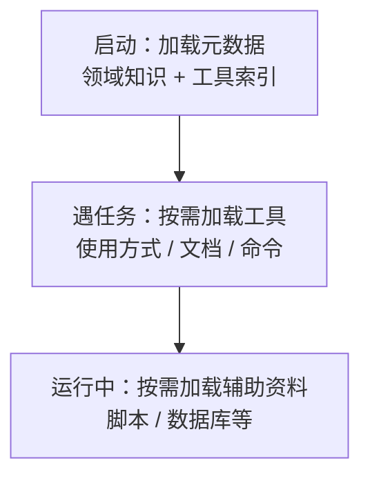

# 3-8 工具调用最强组合：Agent Skills+MCP

【学习目标】

- 理清工具调用的演进路径：Function Calling → MCP → Agent Skills。
- 掌握 Agent Skills 三步渐进式加载的具体内容与触发时机。
- 说清 MCP 与 Agent Skills 的分工，理解为什么未来是「MCP + Agent Skills」而非二选一。

【正文】

## 1. 从 Function Calling 到 MCP

第一种工具调用方式是函数调用（Function Calling）：自己写一个方法去调用外部工具。问题在于，不同大模型编写的工具调用方法各不相同，调用同一个外部 API，OpenAI 有自己的调用方法，DeepSeek 也有自己的调用方法，重复且不便。

拆开看，一次 Function Calling 的完整链路分四步：开发者把函数定义（名称、描述、参数 Schema）随请求注入上下文；模型阅读定义后，返回「调用哪个函数、传什么参数」的结构化结果；宿主程序解析该结果，真正执行函数；函数返回值再次回填进上下文，由模型组织成最终回答。四步里，第一、三、四步都是与具体模型强绑定的胶水代码，换个模型，注入格式、返回结构、解析逻辑全要重写。这也是「每个模型各写一套」的根源。

在 Spring AI 中，这一路的标准做法是 `@Tool` 注解加 `ToolCallbackProvider`，或 `FunctionToolCallback.builder(name, method).build()` 注册进 `ChatClient` 的 `defaultTools`：开发者写方法、加注解，框架负责注入定义、解析调用、回填结果。工具数量固定、调用方单一时，这条路径最直接。

MCP 协议的出现改变了局面：工具由 MCP 服务端统一提供，无论 OpenAI 还是 DeepSeek，要调用同一个外部 API 工具，只需到 MCP 服务端里调用即可，不需要重复造轮子。供给侧的标准化就此完成。

## 2. MCP 的两个缺陷

MCP 协议并非万能，它有两个明显缺点。

**缺点一：一次性返回所有工具，造成上下文爆炸。** 一个 MCP 服务端往往挂着很多工具，客户端连接后，全部工具定义一股脑塞进上下文窗口。工具越多，窗口越挤。这份工具清单每一轮对话都要随请求发送，20 个工具约两千 token，多个服务端叠加轻松破万，成本随对话轮次复利式放大。

**缺点二：智能体不知道用哪个工具，只能反复请教大模型。** 智能体看到一堆工具，并不清楚哪个才能正确执行当前任务，只能询问语言大模型，让大模型告诉它该选哪个，然后才能执行。这一来一回造成 Token 浪费。更麻烦的是，有些任务需要几个工具组合使用，难道每次都要反复问一遍大模型？既浪费时间，又浪费成本。

举个例子：旅游规划中「查明天杭州西湖的天气」这样一个需求，理想路径是地理编码（地址转坐标）→ 天气查询（按坐标查天气）两步串联。若工具平铺在上下文里，模型要走一步问一步，中间任何一次选错（例如误选路线规划工具）都会让整条链路跑偏，而每次纠错又意味着新的上下文堆积。

## 3. Agent Skills：赋予专业知识，三步渐进式加载

解决思路是让智能体拥有专业知识的能力。好比给智能体赋予一个农民的角色，它对耕地领域的知识很在行：遇到农业耕地任务，它知道该用哪个工具；更进一步，它还知道哪几样工具组合起来效率更高。于是它不再需要 MCP 把所有工具都返回，执行时它清楚自己要用的那一两个，告诉 MCP 服务端「把这两个返回给我，其他的不需要」即可。

这种调用工具的方法就是 **Agent Skills**：通过文件配置的方式，赋予智能体专业知识的能力。

关键在于它如何加载这些知识。Agent Skills 并不是把工具文档、调用方式、辅助脚本一次性全部塞给智能体，而是分三步渐进式加载：

| 步骤 | 时机 | 加载内容 |
|---|---|---|
| 第一步 | 智能体启动时 | 元数据：专业知识 + 工具索引（只是索引，不是工具本体） |
| 第二步 | 遇到具体任务时 | 按需加载对应工具的具体使用方式、文档与命令 |
| 第三步 | 工具使用过程中 | 如需脚本、数据库等辅助资料，运行时再次按需加载 |

三步各自解决一个问题：

- **第一步只放索引，是为了守住启动开销。** 元数据体积极小，却足以让智能体在任务到来时判断「这项技能是否相关」。索引进上下文，工具本体不进。
- **第二步按任务加载，是把决策成本花在刀刃上。** 只有任务真正匹配某项技能，该技能的说明文档、工具用法、调用命令才进入上下文。任务不相关的技能，其细节始终留在磁盘上。
- **第三步运行时加载，兜住长尾需求。** 有些工具的使用还依赖脚本、参考数据库、示例文件，这些资料体积大、利用率低，放进上下文不划算，于是在执行过程中按需读取。

这样一来，启动时智能体先拥有专业能力，知道遇到什么问题该调用哪个工具、哪几个工具组合效率最高；真正用到某个工具时，才把该工具的使用细节加载进来；使用过程中如果还涉及其他辅助资料，才在运行时继续加载。整个过程的 token 开销与任务复杂度挂钩，而不是和工具清单长度挂钩。

两种加载形态的对比：

| 指标 | 全量加载（MCP 默认） | 渐进式加载（Agent Skills） |
|---|---|---|
| 启动时上下文 | 全部工具定义 | 仅元数据与索引 |
| 单轮请求 token | 随工具数量线性增长 | 随当前任务增长 |
| 多工具组合任务 | 每步重新询问大模型 | 技能内预置组合策略 |
| 长尾资料（脚本/数据） | 无法处理 | 运行时按需读取 |

总结 Agent Skills 的两个特点：

1. 让智能体拥有领域的专业知识，自己知道解决某个问题需要调用哪些工具、或哪几样工具组合，不再远程询问语言大模型；
2. 对工具的加载采用渐进式加载，按需取用。

## 4. MCP + Agent Skills：分工而非替代

有人会问：Agent Skills 会不会取代 MCP？不会。两者不是互相替代的关系，而是合作共赢。

| 维度 | MCP | Agent Skills |
|---|---|---|
| 角色定位 | 工具的提供者 | 工具的使用者与选择者 |
| 关注点 | 工具实现与协议标准化 | 专业知识与调用策略 |
| 加载方式 | 客户端连接后即可用 | 元数据 → 工具 → 辅助资料，渐进加载 |
| 复用价值 | 一套工具，多个大模型复用 | 一份知识，多个任务复用 |

MCP 协议负责工具提供：不同语言大模型都可以基于 MCP 协议，通过 MCP 服务端调用同样的工具，工具的编写不需要重复造轮子。Agent Skills 代表如何使用工具：它是智能体自己的能力与智慧，而不是每用一次工具都要去问语言大模型、让它教导怎么用。

把两者放进同一次任务里，流程是这样的：用户提问后，智能体先依据启动时加载的技能索引判断任务类型；匹配的技能说明进入上下文，智能体据此确定要用的工具组合；随后向 MCP 服务端请求这批工具的定义与执行；工具返回结果后，若还需脚本加工或参考数据，运行时再次按需加载。整个过程里，MCP 始终在供给侧保证「工具拿得到」，Skills 始终在消费侧保证「工具用得对」。

智能体拥有专业知识后，解决某个问题时先把专业知识加载进来，知道自己要调用哪个工具，然后告诉 MCP 服务端「把这两样工具返回给我，其他的不需要」。它知道自己该用什么工具，也知道如何使用这些工具；使用过程中如需附加资料，才在运行时再加载。

这就形成了一次业务上的分割：**MCP 协议负责工具提供，智能体负责工具的选择与使用方式**，各司其职。因此未来智能体的工具调用，大概率就是「MCP + Agent Skills」这种组合形态。

【易错点 / 面试题】

1. **Agent Skills 会取代 MCP 吗？** 不会。MCP 是供给侧标准（工具从哪来），Agent Skills 是消费侧智慧（工具怎么用）。两者解决的问题不同，组合使用才能既避免重复造轮子，又避免上下文爆炸。面试中可补一句判据：只要还存在「多模型复用同一批工具」的需求，MCP 的供给价值就不会消失。
2. **三步渐进式加载分别加载什么？** 启动时加载元数据（专业知识 + 工具索引）；遇到任务时按需加载工具的使用方式、文档与命令；使用过程中如需脚本、数据库等辅助资料，运行时再加载。高频追问是「为什么启动时不放工具本体」，索引只需几十 token，工具本体动辄上千，全部前置会让每个任务的启动都变贵。
3. **为什么说「MCP + Agent Skills」是工具调用的最强组合？** MCP 让工具跨模型复用，Agent Skills 让智能体懂行、按需取用。前者解决供给标准化，后者解决选择与加载效率，合起来才是完整的工具调用闭环。可以按「供给侧 / 消费侧」的框架组织回答，再各举一个工程实例收尾。

【小结】

本节把工具调用的演进串成一条线：Function Calling 各自造轮子 → MCP 统一供给但全量返回 → Agent Skills 注入专业知识、渐进式加载，最终形态是 MCP 负责提供、Skills 负责使用的组合。判断一个技术问题该往哪层优化，可以先问自己：这是供给问题还是消费问题，供给问题找 MCP 服务端，消费问题找 Skills 配置。想对照工程实现的读者，可参阅 `981-demo/src/main/java/com/travel/agent/tool/RouteMakingTools.java`（地图工具以 `@Tool` 形式提供，对应 MCP 服务端工具清单的一路）与 `981-demo/src/main/java/com/travel/agent/agent/TeamMembers.java`（通过 `Toolkit.registerTool` 把工具挂载到 ReActAgent，对应「智能体知道该用哪个工具」的一路）；课程 10-4、12-4 篇演示 Skills 的渐进式加载机制，可与工程对照阅读。
