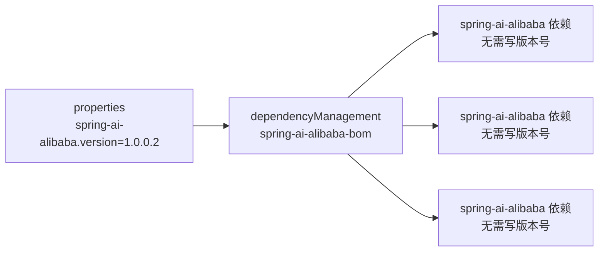

# 4-1 以bom方式导入SpringAi Alibaba依赖

【学习目标】

1. 说清 Spring AI 与 Spring AI Alibaba 的定位差异，理解课程为什么选后者。
2. 掌握 Spring AI Alibaba 的版本线：1.0 里程碑、1.0.0.M6 分水岭、1.0.0.2 最新版。
3. 理解 BOM 依赖机制的作用与放置位置，能够独立完成依赖导入并在 IDE 中验证。

【正文】

## 一、Spring AI 与 Spring AI Alibaba：先分清定位

动手导依赖之前，必须先回答一个问题：课程为什么用 Spring AI Alibaba，而不是直接用 Spring AI？

先说共性：Spring AI Alibaba 的核心基于 Spring AI，是在 Spring AI 基础上做增强的发行版。没有 Spring AI，就没有 Spring AI Alibaba。两者的开发者 API（`ChatClient`、`@Tool` 等）一脉相承，从 Spring AI 迁移到 Spring AI Alibaba 不存在重新学习成本。

再说差异，两者的定位并不相同：

| 维度 | Spring AI | Spring AI Alibaba |
|---|---|---|
| 定位 | 底层 AI 应用开发框架 | 倾向 AI Agent 的开发框架 |
| 模型生态 | 以海外模型为主 | 深度集成国内模型：DeepSeek、Qwen（通义千问） |
| 平台绑定 | 无 | 与阿里云百炼平台深度集成 |
| 目标场景 | 通用的 AI 能力接入 | 智能体编排、多智能体协作、RAG、分布式 MCP |

本课程的主线是开发 AI 智能体，因此选择更贴近 Agent 场景的 Spring AI Alibaba。选型逻辑是一致的：框架定位贴合业务主线，可以少写很多胶水代码。

顺带说明阿里云百炼：这是阿里巴巴的大模型平台，控制台里集成了包括最新 Qwen、DeepSeek 在内的众多模型。与之定位类似的还有百度千帆（主要集成文心一言与 DeepSeek）。区别在于，Spring AI Alibaba 与阿里云百炼是深度集成关系，模型调用、参数配置、密钥管理这条链路是打通的，API Key 在第一章配置阿里大模型广场时已经准备好，框架侧开箱即用。

## 二、Spring AI Alibaba 为智能体开发提供了什么

在 Spring AI 的底层能力之上，Spring AI Alibaba 针对智能体开发提供了五项关键增强：

| # | 增强项 | 说明 |
|---|---|---|
| 1 | 智能体编排与工作流 | 内置 Agent 编排引擎，支持以工作流方式组织智能体行为 |
| 2 | 多智能体协作原生支持 | 框架层面支持多个智能体互相调用、协同完成任务 |
| 3 | 阿里云智能体应用平台深度集成 | 与阿里云侧的应用平台打通，便于部署与运营 |
| 4 | RAG 知识库方案 | 提供检索增强生成的完整解决方案 |
| 5 | 分布式 MCP 方案 | 支持以分布式方式部署与调用 MCP 服务 |

逐项说明它们与课程内容的对应关系：

- **智能体编排与工作流**：课程第 3 章的多 Agent 协作、第 11 章的主管调度成员，用的都是框架内置的编排能力，无需自行实现任务分发器。
- **多智能体协作原生支持**：多个智能体的定义、注册、互相调用在框架层完成，开发者只写业务提示词与工具。
- **阿里云智能体应用平台深度集成**：本地开发完成后，可向阿里云侧应用平台平滑部署，省去自建部署管道的成本。
- **RAG 知识库方案**：对应课程中检索增强生成相关章节，框架提供从文档接入到向量检索的成套组件。
- **分布式 MCP 方案**：对应第 4 章的 MCP 实战与第 11 章的远程工具调用，MCP 服务可以独立部署、跨进程暴露。

其中第 2 项与第 5 项和本课程后续章节直接相关：第 3 章讲多 Agent 协作，第 11 章会把智能体注册到 Nacos 实现分布式发现，用的都是框架原生能力。

## 三、版本线：1.0 里程碑与 M6 分水岭

Spring AI Alibaba 是年轻框架，学习它最好的资料就是官方文档。截至课程录制时（Spring AI 底层框架已发布 1.0 里程碑版本之后），Spring AI Alibaba 跟随 Spring AI 的节奏同样发布了 1.0，当前最新版本为 1.0.0.2，看文档以 1.0.0.2 为准。

有一个版本细节必须牢记：如果要使用历史版本，最低必须是 1.0.0.M6。原因是从 M6 这一版本开始，MCP 功能才被集成进框架。低于 M6 的版本无法使用 MCP，而 MCP 是本课程的核心工具链。因此实际项目中直接使用 1.0.0.2 即可。

版本号写入 Maven 的 properties 标签：

```xml
    <!-- 最低版本必须是 > 1.0.0-m6 , 因为 -->
    <spring-ai-alibaba.version>1.0.0.2</spring-ai-alibaba.version>
```

原稿注释在「因为」处中断（视频转写如此），完整语义为「因为 MCP 功能从 1.0.0.M6 开始集成，所以最低版本必须大于 1.0.0.M6」。

把版本号提取为属性而不是写死在依赖里，是版本管理的第一道防线：升级框架时只改这一处，所有引用 `${spring-ai-alibaba.version}` 的依赖同步生效，不会出现「改了一个漏了一个」的版本漂移。

## 四、BOM 机制：一次声明，全局统一

导依赖时，Spring AI Alibaba 文档给出的方式很简洁，只导入一个名为 `spring-ai-alibaba-bom` 的依赖：

```xml
    <dependencyManagement>
        <dependencies>
            <dependency>
                <groupId>com.alibaba.cloud.ai</groupId>
                <artifactId>spring-ai-alibaba-bom</artifactId>
                <version>${spring-ai-alibaba.version}</version>
            </dependency>
        </dependencies>
    </dependencyManagement>
```

两个要点：

1. BOM 起什么作用：BOM（Bill of Materials）是「版本统一管理」机制。导入 BOM 之后，后续引入的任何 Spring AI Alibaba 依赖都不需要写版本号，版本号由 BOM 统一指定。
2. BOM 必须放哪：必须放在 `dependencyManagement` 标签内，不能放在 `dependencies` 里。这是最容易踩的坑。

为什么需要 BOM？背景是 Maven 的依赖传递机制：一个框架往往拆成几十个模块（spring-ai-alibaba-core、spring-ai-alibaba-graph 等），若每个模块各自声明版本，模块间稍有偏差就会引入传递依赖冲突，这就是常说的「依赖地狱」。BOM 把整条产品线的版本收敛到一份清单里，任何模块的版本都从这份清单取，从机制上消除冲突。

用一张图描述 BOM 的工作方式：



## 五、在 IDE 中验证 BOM 生效

口说无凭，BOM 是否生效可以在 IDE 里直接验证。以 IntelliJ IDEA 为例：

1. 只在 `dependencyManagement` 中导入 BOM，此时右侧 Maven 窗口的 Dependencies 里看不到 Spring AI Alibaba 相关 jar，BOM 本身不引入依赖，只管理版本。
2. 在 `dependencies` 中引入一个不带版本号的 Spring AI Alibaba 依赖（例如阿里云百炼平台依赖）。
3. 点击「Load Maven Changes」，再次打开 Maven 窗口查看 Dependencies：导入的依赖包版本号显示为 1.0.0.2，而配置文件里并没有写版本号，该版本正是 BOM 指定的。

若 Maven 面板不可见，可通过菜单 View → Tool Windows → Maven 打开，展开项目的 Dependencies 节点查看。

该实验同时说明两个结论：BOM 不会凭空引入 jar（它只声明版本），但任何受它管辖的依赖都会被统一版本。课程演示中导入的百炼平台依赖当前用不到，可以先删除，最终 pom.xml 里只需要保留 BOM 这一处声明。

## 六、常见误区

- 把 BOM 写进 dependencies：BOM 是 import 类型的版本声明，写进 dependencies 不会生效，还会引入一个无用的 pom 依赖。
- 给受管依赖重复写版本号：一旦写了具体版本，就以依赖上写的为准，BOM 的统一管理被绕过，多模块项目极易出现版本漂移。
- 用手动升级替代属性管理：升级框架版本时只改 properties 中一处，比全局搜索替换更可靠。
- 忽略最低版本约束：涉及 MCP 的项目若用了低于 M6 的版本，编译期不会报错，运行期才发现 MCP 类不存在，排查成本高。

【易错点 / 面试题】

1. **BOM 依赖应该放在哪个标签里？放错会怎样？** 放在 `dependencyManagement`。放错到 `dependencies` 里，版本统一管理不生效，还会引入一个无实际内容的 pom 包。面试中可继续展开：`dependencyManagement` 只治理版本不引入依赖，`dependencies` 才真正引入依赖，两者职责不同。
2. **为什么 Spring AI Alibaba 的最低版本要求是 1.0.0.M6？** 因为 MCP 功能从 1.0.0.M6 这一版本开始集成。低于该版本无法使用 MCP，涉及 MCP 的项目必须大于等于 M6。这类「功能自哪个版本引入」的问题是框架选型面试的高频题，回答时给出版本号与功能点两个要素即可。
3. **Spring AI 与 Spring AI Alibaba 是什么关系？课程为什么选后者？** Spring AI Alibaba 基于 Spring AI，是面向国内生态与智能体场景的增强发行版：深度集成 DeepSeek、Qwen 与阿里云百炼，原生支持多智能体协作、RAG 与分布式 MCP。课程主线是 AI 智能体开发，因此选 Spring AI Alibaba。

【小结】

本节完成了课程工程的依赖底座搭建，关键结论三条：

- Spring AI Alibaba 基于 Spring AI，定位偏向 AI Agent 开发框架，深度集成国内模型与阿里云百炼平台；
- 版本线注意两个数：最低 1.0.0.M6（MCP 集成的起点），当前 1.0.0.2；
- 只导入 `spring-ai-alibaba-bom` 到 `dependencyManagement`，即可完成版本统一管理，后续依赖一律不写版本号。

「属性统一管理版本」的思路在任何工程里都适用。本课程配套的 981-demo 工程（`981-demo/pom.xml`）走的是 AgentScope Java 技术栈（properties 中声明 `agentscope.version=2.0.3`），虽然不用 Spring AI Alibaba BOM，但同样在 properties 中集中声明版本属性、再在各依赖中通过 `${agentscope.version}` 引用，这与 BOM 的统一管理思想同源：版本只在一处声明，全局引用。`981-demo/src/main/java/com/travel/agent/config/AgentProperties.java` 中的 `app.agent.modelMode`、`app.agent.discovery` 等配置项，也是把易变参数集中到配置层的工程实践。下一篇将继续在此基础上搭建工程。
