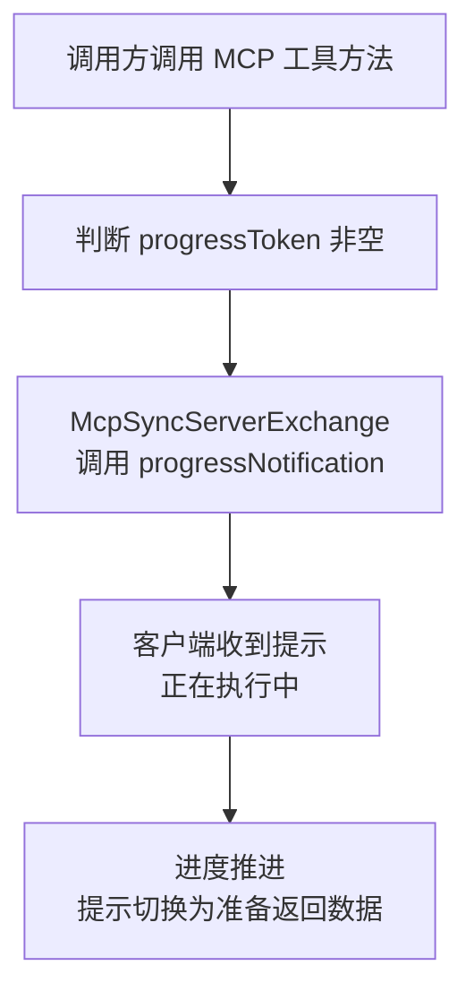

# 4-12 SpringAi 1.1 MCP注解：全新的MCP实现

## 【学习目标】

- 弄清 Spring AI 1.1 开发 MCP 的全新方式：基于注解（Annotation）开发，而非 1.0 时代的手动注册。
- 分清 `@Tool` 与 `@McpTool` 的归属与适用场景，知道为什么 1.1 弃用前者定义 MCP 工具。
- 掌握 `@McpProgressToken` + `McpSyncServerExchange` 的进度通知写法及其参数含义。
- 记住 MCP Server WebFlux Starter 的归属包与 BOM 导入陷阱。

## 【正文】

### 1. 依赖层面：一个 Starter 带上注解全家

在前述 MCP 章节中，已经在 MCP Server 模块导入了 `spring-ai-starter-mcp` 体系下的 MCP Server WebFlux Starter。官方文档明确说明：只要引入该 Starter，它就自动把 MCP Annotation 包含进来。换言之，Spring AI 1.1 最新的 MCP 开发方式就是基于注解去开发 MCP，开发者无需再次手动引入 MCP Annotations 依赖包。

这里有一个必须警惕的归属问题：**MCP Server WebFlux Starter 属于 Spring AI 包，并不属于 Spring AI Alibaba 包**。因此 Maven 的 pom 里除了 Spring AI Alibaba 的 BOM 之外，还要以 BOM 的版本管理方式把 Spring AI 1.1 这一版本同样引入进来，否则 MCP Server WebFlux Starter 根本引入不进来。课程同时使用两套 BOM，原因就在这里：Agent Framework、A2A、Nacos 相关构件走 Spring AI Alibaba BOM；MCP 相关构件走 Spring AI BOM。

### 2. 注解层面：从 @Tool 到 @McpTool

Spring AI 1.1 开发 MCP 基于注解，需要引入 MCP Annotations 依赖包，而 Spring AI 的 MCP Server Starter 依赖包会自动引入 MCP Annotations，无需手动处理。

在 1.0 版本及之前，定义 MCP 工具采用 `@Tool` 注解。`@Tool` 位于 `org.springframework.ai.tool.annotation` 包下，属于 Spring AI tool 包，并非 MCP 专属包。到了 1.1，对 MCP 工具的定义不再使用 `@Tool`，而是改用 `@McpTool`，点进源码可以发现，该注解位于 MCP 包下，是专门针对 MCP 工具开发的。

两代写法的对比如下：

| 对比项 | 1.0：@Tool | 1.1：@McpTool |
|---|---|---|
| 所属包 | org.springframework.ai.tool.annotation | MCP 专属注解包 |
| 参数 | name / description 等 | 仅 name 与 description |
| 参数注解 | @ToolParam | @McpToolParam |
| 工具注册 | 定义后需手动注册到工具列表 | 定义即注册，无需手动操作 |
| 定位 | Spring AI 通用工具 | MCP 协议工具 |

`@McpTool` 只有两个参数：name 与 description。大模型看到该注解，就知道这是一个 MCP 的方法。其中 description 是最重要的，大模型依靠 description 来判断何时以及如何去使用该工具；只有读懂了这段描述，它才能从众多工具中选出正确的那一个去完成任务。写 description 时偷懒，等于让大模型闭着眼睛选工具。

### 3. 第一个 MCP 工具：Temperature

```java
    @Component
    public class WeatherTool {
        // 问题：
        // 1. 大模型如何知道能够使用哪些工具
        // 2. 大模型如何知道选择对应工具
        // @Tool注解：
        // 1. 修饰的方法，告诉大模型，你能够使用这个方法
        // 2. @Tool的description属性非常重要，必须要写，
        // 大模型根据description的描述判断何时以及如何使用这个工具
        // @ToolParam 注解：
        // 定义方法的参数
        // **********************
        @McpTool(name = "Temperature",
                description = "获取指定城市当前时间的温度",
                @McpProgressToken
        )
        public String getTemperature(@McpToolParam String cityName) {
            return cityName + "温度值是30度";
        }
    }
```

需要如实说明：以上是讲稿中的板书式写法，`@McpTool` 注解内部直接出现 `@McpProgressToken` 并不符合 Java 语法（注解的属性值不能是另一个注解）。`@McpProgressToken` 的正确位置是修饰方法参数，即下一段代码所示的写法。这类讲稿截取的代码在学习时容易照抄出错，应以可编译版本为准。

抛开板书问题，这段代码传递了两个关键信息：其一，`@McpTool` 的 name 是工具对外暴露的名字，description 决定大模型的选择行为；其二，方法参数用 `@McpToolParam` 修饰，取代了 1.0 时代的 `@ToolParam`，类上的 `@Component` 保证被 Spring 扫描到。

### 4. 进度通知：@McpProgressToken 与 McpSyncServerExchange

有些工具方法执行逻辑较长，调用方需要知道方法执行到了哪一步。MCP 为此设计了进度通知机制，由 `@McpProgressToken` 承担，它只能是 String 类型，作为方法的一个参数出现。

进度如何反馈给客户端？远程智能体要把进度写入模型的上下文，通过 `McpSyncServerExchange` 对象完成：它能把进度 Token 自主地写入反馈给客户端的上下文对象里，因此方法参数中也要引入该对象。

```java
    @McpTool(name = "Temperature",
            description = "获取指定城市当前时间的温度")
    public String getTemperature(@McpToolParam String cityName,
            @McpProgressToken String progressToken,
            McpSyncServerExchange exchange) {
        if (progressToken != null) {
            exchange.progressNotification(
                    new McpSchema.ProgressNotification()
            );
        }
        return cityName + "温度值是30度";
    }
```

进度写入上下文的逻辑分两步：先判断进度 Token 是否为空，非空则对 Token 进行格式化。格式化可以用 `McpSchema` 提供的方法，在该方法里对进度 Token 做格式处理。`progressNotification` 有多个重载，最简重载的参数依次为：Token 的值（String 类型，与前面设置的 String 型参数对应）、当前进度、总进度值、提示信息。

于是可以这样写：第一个参数传进度 Token（String）；第二个参数传当前进度，执行到一半时是 0.5；第三个参数传总进度 1.0；第四个参数在进度为 0.5 时返回提示信息「正在执行中」。同一个方法里还能设置进度到达某个值时切换提示信息：当进度到 0.9、总进度仍为 1 时，把提示信息改为「准备返回数据」。这样客户端就能随着执行推进收到不同的状态提示。



从工程视角看，进度通知的价值在于把「长任务黑箱」变成「可观测任务」：调用方（人或上层 Agent）能据此做超时判断、重试决策与用户体验设计。写生产级 MCP 工具时，凡执行时间可能超过数秒的方法，都值得补上进度回调。

### 5. 第二个工具与「免注册」特性

同样的迁移规律适用于其他工具：把 `@Tool` 换成 `@McpTool`，方法入参注解换成 `@McpToolParam` 即可。

```java
    @McpTool(description = "获取指定城市的紫外线值")
    public String getUltraviolet(@McpToolParam String cityName) {
        return cityName + "紫外线值：";
    }
```

在 1.0 版本，定义完 MCP 方法之后还需要手动注册，通过一个注册方法把定义好的 MCP 方法加进 MCP 的工具列表。1.1 则不再需要这一步：定义 MCP 方法的同时，该方法已经注册到 MCP 的工具列表里，手动注册的代码直接删掉即可。这是注解式 MCP 相对 1.0 最直接的效率提升，工具定义与工具注册合二为一。

最后还有一件事：配置文件里要写上 MCP 注解的扫描配置，把对应开关设为启用状态，MCP 注解才会被 Spring Boot 扫描到。完成这一步，整个 MCP 服务端就开发好了。

## 【易错点 / 面试题】

**面试题 1：Spring AI 1.1 定义 MCP 工具用哪个注解？和 1.0 有什么区别？**
1.1 用 `@McpTool`（MCP 专属包），1.0 用 `@Tool`（org.springframework.ai.tool.annotation）。参数注解相应地从 `@ToolParam` 变为 `@McpToolParam`。更深的区别在注册机制：1.0 定义后要手动注册到工具列表，1.1 定义即注册。

**面试题 2：description 为什么被称为 MCP 工具里最重要的属性？**
因为大模型没有代码视野，只能看到 name 与 description。它依据 description 判断何时、如何使用该工具。description 写得含糊，工具选错的概率直线上升；name 重复或缺失也会造成解析歧义。

**面试题 3：进度通知是怎么实现的？**
`@McpProgressToken`（仅 String 型）作为方法参数接收 Token，方法内通过 `McpSyncServerExchange.progressNotification(new McpSchema.ProgressNotification(...))` 把进度写入上下文反馈给客户端；重载参数依次是 Token、当前进度、总进度、提示信息，可随进度切换提示文案。

**易错点 1：BOM 引漏。** MCP Server WebFlux Starter 属于 Spring AI 包，只引 Spring AI Alibaba BOM 会漏掉它，必须同时以 BOM 方式引入 Spring AI 1.1。

**易错点 2：注解位置照抄错误。** 讲稿板书把 `@McpProgressToken` 写进了 `@McpTool` 注解内部，那是非法 Java。它应修饰方法参数；`McpSyncServerExchange` 同样作为参数注入。

**易错点 3：忘记开启注解扫描。** 配置文件里 MCP 注解扫描开关不启用，注解定义的 bean 不会被 MCP 层识别，工具列表为空，调用时表现为「大模型说没有可用工具」。

## 【小结】

本节把 MCP 的开发方式从 1.0 的手动注册推进到 1.1 的注解式：`@McpTool` + `@McpToolParam` 定义即注册，`@McpProgressToken` + `McpSyncServerExchange` 补齐长任务进度反馈，配置文件里的注解扫描是最后一道开关。至此，MCP 工具可以同时服务于本地智能体与后续 A2A 远程智能体，4-13 创建的 Provider 智能体就会挂载这类工具。

对应工程 `981-demo` 中，工具层集中在 `981-demo/src/main/java/com/travel/agent/tool/` 包下：`RouteMakingTools.java` 以 `@Tool` + `@ToolParam` 声明 `map_geocode` / `map_directions` / `map_weather` 三个工具，离线桩返回与百度地图 MCP 服务端同构的数据，保证「工具挂载 → 工具调用 → 结果回传」链路形态与生产一致；`AttractionTools.java` 提供景点推荐能力。工程默认以离线规则模型跑通全链路，读者跑通后可把桩实现替换为真实 MCP Client，观察注解定义的工具如何被智能体自主选用。
