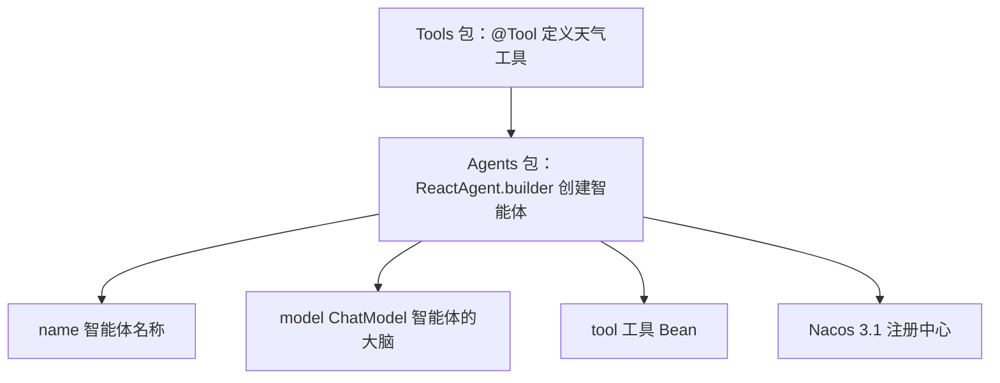

# 4-13 SpringAi 1.1 A2A的服务注册

## 【学习目标】

- 完整搭建 A2A Provider 模块：工具（Tools 包）与智能体（Agents 包）两部分。
- 分清 `@Tool` 与 `@McpTool` 的边界：非 MCP 工具方法用 `@Tool`，MCP 工具方法用 `@McpTool`。
- 记住 ReactAgent 的定位与 builder 创建方式，理解 name / model / tool 三个必设项。
- 掌握 Provider 侧依赖导入（Agent Framework + A2A Nacos + DashScope）与 application.yml 注册配置，特别是 1.0 与 1.1 在 DashScope 版本管理上的差异。

## 【正文】

### 1. 模块结构：Tools 包与 Agents 包

服务提供者（A2A Provider）模块里有两个包：Agents 包负责创建智能体，Tools 包负责创建工具，工具是给智能体使用的。先建工具，再建智能体，顺序不能反，因为智能体的 builder 需要把工具作为参数传进去。



### 2. Tools 包：天气工具

在 Tools 包下创建天气工具。核心问题只有一个：一个普通方法，如何被标注为智能体与大模型都能识别的工具？

在前述章节中，Spring AI Alibaba 1.0 实现 MCP 工具用的注解是 `@Tool`，它位于 `org.springframework.ai.tool.annotation` 包下，注明该方法能够被语言大模型识别，大模型看到该注解，就知道存在一个可调用的工具方法，且该方法是用来查询天气的。到了 Spring AI Alibaba 1.1，注明 MCP 工具改用 MCP 专属的 `@McpTool`；但本课的天气方法并非 MCP 工具方法，因此直接使用 `@Tool`，指明这是一个能够被智能体调用的工具方法。此外还要给类加上 `@Component`，注解扫描时才能把它扫到，并注入 Spring 容器。

```java
    package com.imoooc.springAi_1_1.demo.a2a.provider.tools;

    import org.springframework.ai.tool.annotation.Tool;
    import org.springframework.ai.tool.annotation.Tool;

    /**
     * author: Imooc
     * description: 天气工具
     * date: 2026
     */
    public class WeatherTool {
        @Tool
        public void getWeather(String city) {
            System.out.println("正在获取" + city + "天气信息...");
        }
    }
```

需要如实说明两点。其一，以上是讲稿板书代码：两个 import 行完全重复，其中一个应删除；类上缺少 `@Component` 注解（正文已说明其必要性），`getWeather` 方法也没有补 `description`。其二，`@Tool` 修饰的方法必须提供描述，写明该工具的用途，否则智能体不知道该工具能做什么，也就无法在推理时选用它，这一点在原稿结尾处被专门强调，是高频失分点。

### 3. Agents 包：用 ReactAgent 创建智能体

在 Agents 包下创建 `AgentProviderConfig` 类，专门负责创建 `AgentProvider` 智能体，类上标注 `@Configuration`，内部用一个 `@Bean` 方法产出智能体实例。

在 Spring AI Alibaba 1.1 中，创建 Agent 的方式非常简洁：通过 `ReactAgent` 对象的 `builder()` 工厂方法创建实例，产出的对象就是 `ReactAgent`。builder 模式在前述课程中已反复出现，这里有三个属性是必设的：

1. **name**：智能体的名称，此处设为 `AgentProvider`。它是后续服务发现时匹配智能体卡片的依据，不能随意起名；
2. **model**：智能体的大脑，即推理逻辑与思维过程的来源，语言大模型。具体选哪一个模型（DeepSeek 还是阿里的 Qwen），由 `model` 方法指定，传入 `ChatModel` 对象；
3. **tool**：智能体执行工具的能力。语言大模型本身只能对话、不能执行工具，而智能体可以代替大模型真正完成用户需求。工具定义为 Bean 之后，在这里以方法参数的形式注入，再传给 `tool` 方法。

```java
    public class AgentProviderConfig {
        public ReactAgent agentProvider() {
            /*
             * SpringAi Alibaba 1.1 版本
             * 通过 ReactAgent的工厂方法(builder) 创建Agent,
             * ReactAgent: 能够自主规划, 自主决策, 能够执行工具, 有记忆能力, 感知周边环境的智能体
             * 
             */
            return ReactAgent.builder()
                    .name("AgentProvider")
                    .model("")
                    .tool()
                    .build();
        }
    }
```

需要如实说明：以上是讲稿板书代码，`model("")` 与 `tool()` 的参数被省略，类与方法上也未写 `@Configuration` / `@Bean`。可运行形态应在 builder 中以参数注入 `ChatModel` 与工具 Bean，4-16 篇给出了接近完整的写法（`.model(...)` 注入 ChatModel、`.tool(weatherTool)` 传入工具）。

此处的 `ReactAgent` 究竟是何来头？为什么不直接叫 Agent？因为它并非一个只会执行工具的普通智能体，而是一个能够自主规划、自主决策、执行工具、拥有记忆能力、还能感知周边环境的智能体，这正是整个课程的重点：让智能体自己知道该执行哪一个步骤、自己选择正确的工具去完成用户交代的复杂需求，全程无需人工干预。后续章节会重点展开 ReactAgent，当前阶段只需建立该认知：Provider 侧跑起来的，是一个有自己思考能力的智能体。

### 4. 依赖导入：三个构件，两种版本管理

智能体创建好之后，下一步是把它注入注册中心，Consumer 才能发现该远程智能体。注册中心使用阿里的 Nacos，版本必须是 3.1。注入方式只需在 pom.xml 中导入依赖。

Provider 模块共需三个关键构件：

```xml
    <dependency>
        <groupId>com.alibaba.cloud.ai</groupId>
        <artifactId>spring-ai-alibaba-starter-a2a</artifactId>
    </dependency>

    <dependency>
        <groupId>com.alibaba.cloud.ai</groupId>
        <artifactId>spring-ai-alibaba-starter-dashscope</artifactId>
        <version>${spring-ai-alibaba.version}</version>
    </dependency>
```

其中 Agent Framework 依赖在前述课程中已导入（走 Spring AI Alibaba BOM，无需版本号）。这里新增两个：一是 `spring-ai-alibaba-starter-a2a`，即 A2A 专用的 Nacos 注册中心，属于 Spring AI Alibaba，专为 A2A 协议服务，已被 BOM 覆盖，无需指定版本；二是 `spring-ai-alibaba-starter-dashscope`，即阿里大模型平台 DashScope，通过它可以方便地调用 Qwen，也集成了 DeepSeek 等其他厂商模型。

**1.0 与 1.1 的关键差异就在这里**：DashScope 不包含在 Spring AI Alibaba 1.1 的 BOM 版本管理内，必须显式指明版本号；而在 1.0 中，DashScope 被 BOM 覆盖，无需写版本。照搬 1.0 的 pom 到 1.1 工程，会直接因版本解析失败而报错，这是版本迁移时最常踩的坑。

### 5. 配置文件：注册开关

依赖就绪后，在 application.yml 中完成三件事：注明 DashScope 的 API Key，才能调用 Qwen 或 DeepSeek；指明 Nacos 注册中心地址，本地联调时给本地地址；开启 Provider 侧的注册开关，把智能体写入注册中心。

```yaml
    a1:
      dashscope:
        api-key: chat
        options:
          model: qwen-max
      a2a:
        nacos:
          server-addr: 127.0.0.1:8848
        server:
          enabled: true
```

与注册相关的核心是 `server.enabled: true`：该开关置 true，服务提供者的智能体才会写入注册中心；保持默认 false，Consumer 将永远发现不了它。

### 6. 收尾：给工具补上描述

最后一个动作回到工具本身：`getWeather` 方法上的 `@Tool` 注解内一定要给一个描述，说明该工具的用途。没有描述，智能体就不知道该工具能做什么，选工具时自然选不到它。工具描述是大模型做工具选择的唯一依据，写不写描述，直接决定工具是否「可见」。

## 【易错点 / 面试题】

**面试题 1：Provider 侧创建智能体用哪个对象？必设哪些属性？**
用 `ReactAgent.builder()`。必设三项：name（智能体名称，服务发现按它匹配卡片）、model（ChatModel，智能体的大脑）、tool（工具 Bean，智能体的手脚）。可选/按需的还有 description、instruction 等，4-16 篇会看到必填校验。

**面试题 2：`@Tool` 和 `@McpTool` 怎么选？**
看工具是否为 MCP 工具。非 MCP 的本地工具方法用 `@Tool`（org.springframework.ai.tool.annotation）；MCP 工具方法在 1.1 用 `@McpTool`，参数注解用 `@McpToolParam`，且定义即注册。两者不要混用。

**面试题 3：Spring AI Alibaba 1.0 与 1.1 在依赖管理上的差异？**
1.1 中 DashScope 不在 BOM 管辖内，必须显式声明版本；Agent Framework 与 A2A Nacos 仍在 BOM 内，无需版本。1.0 中 DashScope 由 BOM 覆盖。迁移 pom 时这是第一个要核对的点。

**易错点 1：注册开关没开。** `a2a.server.enabled` 为 false 或漏配时，Provider 启动无报错，但 Nacos 里看不到智能体卡片，排查时容易误以为是 Consumer 的问题。

**易错点 2：name 不一致。** Provider 智能体的 name（AgentProvider）与卡片配置中的 name 必须一致，Consumer 是按 name 找卡片的，写错就找不到，4-15 篇会详细展开。

**易错点 3：工具无描述。** `@Tool` 不写 description，大模型无法判断工具用途，表现为「工具注册了但从不被调用」。

## 【小结】

本节完成了 A2A 的「上半场」：Tools 包用 `@Tool` 定义天气工具，Agents 包用 `ReactAgent.builder()` 创建具备规划与决策能力的智能体，三个依赖（Agent Framework + starter-a2a + starter-dashscope）加一条注册配置，把智能体写进 Nacos 3.1。下一篇 4-14 切换到 Consumer 侧，用 `A2aRemoteAgent` 从注册中心发现并调用该远程智能体，形成完整闭环。

对应工程 `981-demo` 中，Provider 侧职责有清晰的离线映射：注册动作由 `981-demo/src/main/java/com/travel/agent/config/NacosBootstrap.java` 承担，它在 prod 模式下把团队成员（路线制定、景点推荐）的端点注册进 Nacos；注册内容即 `981-demo/src/main/java/com/travel/agent/a2a/AgentCard.java` 记录的名片（name / description / baseUrl）；注册中心地址等配置收敛在 `981-demo/src/main/java/com/travel/agent/config/AgentProperties.java`（`app.agent.nacos-server-addr`，默认 `127.0.0.1:8848`）；Nacos 客户端操作封装在 `981-demo/src/main/java/com/travel/agent/a2a/NacosAgentRegistry.java`。工程默认走 `in-process` 注册表，无需 Nacos 即可跑通注册-发现-调用全链路，切到 `nacos` 模式即与课程形态一致。
