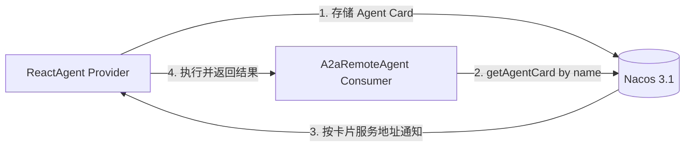

# 4-15 SpringAi 1.1 A2A的元数据AgentCard

## 【学习目标】

- 回答遗留问题：注册中心里卡片众多，服务发现者凭什么精确锁定目标智能体。
- 掌握 AgentCardProvider 接口与 getAgentCard 方法的作用，理解「接口 + 默认实现」为何能直接 @Autowired 注入。
- 记住 AgentCardWrapper 暴露的元数据字段（name / description / url / version / provider / documentationUrl / Skills）及其含义。
- 走通 A2A 三步流程：Provider 注册卡片 → Consumer 按 name 取卡片 → 按卡片服务地址调用远程智能体。

## 【正文】

### 1. 两个模块的分工回顾

前述课程中，Spring AI Alibaba 实现 A2A 协议基于注册中心形态：智能体的提供方把自己的智能体模型写入注册中心；服务发现方从注册中心取出相应智能体，让它执行任务，结果返回给服务发现方。

两个模块的分工非常清晰：

- **服务提供者模块**：创建真正执行业务的智能体。它是一个 ReactAgent 框架的智能体，拥有工具、记忆能力、推理能力，还能感知环境，是真正干活的那一个；
- **服务发现模块**：主要任务不是创建能干活的智能体，而是把注册中心里存储的相应智能体取出来，让它去干某个业务（因为它擅长做该业务），做完把结果返回。

服务发现模块的核心对象是 `A2aRemoteAgent`，即 Spring AI Alibaba 1.1 封装的 A2A 远程智能体对象。它的主要功能是到注册中心里把相应的智能体取出来、去干对应的业务、最后把结果返回。远程智能体执行完任务后，会把结果写入 `OverAllState` 对象，这是工作流里的状态对象，KeyValue 结构，取值必须传 Key。这些是上一篇的内容。

### 2. 遗留问题：如何知道哪一个智能体是我要的

注册中心里会存储很多个远程智能体模型，服务发现者依据什么选择对应的智能体？选择远程智能体的前提是：知道远程智能体所拥有的工具能解决该任务，而自己完成不了，所以才要去获取它。据此，要如何在注册中心里找到目标的那一张卡片？

答案回到 `A2aRemoteAgent` 的 builder：除了 name，实例上还有一个很重要的属性，AgentCardProvider，即智能体卡片。所谓智能体卡片，就是远程智能体的元数据，通俗地说，是远程 Agent 的一张名片。这张名片存放在注册中心里：远程智能体并不是把整个自己存进 Nacos，而是把主要信息，名称、拥有哪些工具、擅长做什么、擅长完成什么任务，作为元数据写在一张卡片上；卡片是一个对象模型，可以存储在注册中心 Nacos 里。

```java
    // 获取远程 Agent
    A2RemoteAgent agentProvider = A2RemoteAgent.builder()
        .name("AgentProvider")
        .build();

    // 运行远程的 Agent
    Optional<OverAllState> res = agentProvider.invoke("提示词");
```

需要如实说明：以上是讲稿板书代码，`A2RemoteAgent` 应为 `A2aRemoteAgent`（少了一个字母 a），类名拼写不一致，以 4-14 篇与 Spring AI Alibaba 1.1 文档中的 `A2aRemoteAgent` 为准。

### 3. AgentCardProvider：默认实现让注入成为可能

服务的消费者（A2aRemoteAgent 对象）通过 AgentCardProvider 从注册中心获取智能体卡片。该方法需要传入的对象是 `AgentCardProvider`，点进去看，它是一个接口，里面有一个需要重写的方法 `getAgentCard`。

问题来了：接口能通过 `@Autowired` 注入吗？通常不能，但该接口自己有一个默认方法，对「获取智能体卡片」这一方法，它已经提供了默认的实现方式。所以可以直接 `@Autowired` 注入，无需自己写实现类。这是 Spring 依赖注入的一个典型技巧：接口带 default 方法时，容器可以实例化该接口的 lambda 代理/匿名实现，业务代码零实现即可使用框架默认行为。

```java
    @Autowired
    private AgentCardProvider agentCardProvider;

    public void getAgentProvider() throws GraphRunnerException {
        // 这里创建的 Agent，并不是用于执行业务的。
        // 执行业务的是远程的 Agent，并获取这个远程 Agent
    }
```

注册中心里不只有一张智能体卡片，如何获取指定的那张？答案是 Agent 名称。接口的默认实现方法 `getAgentCard` 传入的参数就是 Agent Name，`A2aRemoteAgent` 通过远程 Agent 的名称获取指定的智能体卡片。所以 builder 上的 name 方法不要随便填，必须填写远程智能体的名称。

远程智能体定义在 A2A Provider 模块中，前述课程把它命名为 `AgentProvider`，因此这里应填写 `AgentProvider`。**消费者 name 方法的参数必须和服务提供者（远程智能体）的名称一致**，否则拿不到存储在注册中心里的智能体卡片。

### 4. A2A 三步流程

三个核心组件就位后，Spring AI Alibaba 1.1 对 A2A 协议的执行流程可以完整写出：

1. **注册**：ReactAgent（服务提供者）将自己的智能体卡片存储在注册中心，Nacos 3.1 能够存储智能体卡片模型；
2. **发现**：服务发现者（A2aRemoteAgent）通过 AgentCardProvider 的 getAgentCard 方法，基于远程智能体的名称获取对应的智能体卡片；
3. **调用**：注册中心根据服务发现者获取的智能体卡片，通知远程 Agent 执行服务发现者提交的任务。注意调用关系并不是注册中心去调用远程智能体，而是远程 Agent 被告知后执行任务。



### 5. AgentCardWrapper：卡片里有什么

通过 AgentCardProvider 获取到的智能体卡片，其返回类型是 `AgentCardWrapper`。它包装了 `AgentCard`，并暴露出一组访问方法：

```java
    public AgentCardWrapper(AgentCard agentCard) {
        this.agentCard = agentCard;
    }

    public String name() { return this.agentCard.name(); }
    public String description() { return this.agentCard.description(); }
    public String url() { return this.agentCard.url(); }
    public AgentProvider provider() { return this.agentCard.provider(); }
    public String version() { return this.agentCard.version(); }
    public String documentationUrl() { return this.agentCard.documentationUrl(); }
```

智能体卡片包含的元数据主要有：name（远程智能体的名称）、description（远程智能体的描述）、url（注册中心的地址）、version（版本号），以及能力 provider（一个对象，表示远程智能体的能力）与 documentationUrl。此外还有一项重点内容：Skills。Skills 在后续课程会详细展开，当前阶段可先理解为工具，但它与 MCP 有很大区别，不只是工具，而是包含了整个流程，是远程智能体的专业领域技能。

各字段的用途可归纳为：

| 字段 | 含义 | 在发现链路中的作用 |
|---|---|---|
| name | 远程智能体名称 | 定位卡片的唯一键，Consumer 按它匹配 |
| description | 智能体描述 | 人与上层 Agent 判断「是否擅长该任务」 |
| url | 注册中心/服务地址 | Consumer 拿到卡片后据此发起调用 |
| version | 版本号 | 多版本共存时区分目标实例 |
| provider | 能力提供方对象 | 描述智能体能力来源 |
| documentationUrl | 文档地址 | 补充说明入口 |
| Skills | 专业领域技能列表 | 比 MCP 工具粒度更粗，含完整流程 |

### 6. A2aService：默认实现背后的注册中心操作

AgentCardProvider 的默认实现背后是 `A2aService`。它通过传入远程智能体的 name 属性获取相应的智能体卡片：

```java
    public interface A2aService {
        AgentCardDetailInfo getAgentCard(String agentName) throws NacosException;
        AgentCardDetailInfo getAgentCard(String agentName, String version) throws NacosException;
        void releaseAgentCard(AgentCard agentCard) throws NacosException;
    }
```

`getAgentCard` 有三个实现方法：可以只按 name 获取，也可以按 name + version 获取；`releaseAgentCard` 则负责把卡片发布（注册）进注册中心。三个方法中，智能体卡片的 name 属性是必填的，它是注册中心的定位键。

### 7. 卡片在哪里设置：application.yml

智能体卡片的属性设置，走配置文件 application.yml。Spring AI Alibaba 1.1 文档给出了示例：通过 card 属性设置智能体卡片，可以设置 name、description 等属性。这里有一个必须遵守的约束：**卡片配置里的 name 必须和 ReactAgent 智能体的 name 一致**。服务发现者通过 name 找到对应的智能体卡片，name 是必填的查找属性，两边对不上，发现链路就会断在第一步。

## 【易错点 / 面试题】

**面试题 1：什么是 AgentCard？它解决什么问题？**
AgentCard 是远程智能体的元数据（名片），存放在注册中心，包含 name、description、url、version、provider、Skills 等字段。它解决「注册中心里智能体众多，消费者凭什么锁定目标」的问题，按 name 定位，按卡片内容判断能力。

**面试题 2：AgentCardProvider 是接口，为什么能直接注入？**
因为接口自带 getAgentCard 的默认实现方法，Spring 容器可为其生成代理实例，业务代码无需写实现类。默认实现内部委托 A2aService 操作 Nacos。

**面试题 3：A2A 的完整流程是三步还是四步？**
按课程口径三步：Provider 注册卡片 → Consumer 按 name 获取卡片 → 按卡片服务地址调用远程 Agent。其中「调用」是注册中心通知远程 Agent 执行任务，而非注册中心亲自执行。

**易错点 1：name 三处不一致。** ReactAgent 的 name、yml 中 card 的 name、Consumer builder 的 name，三者必须同为 `AgentProvider`，任一环节写错都会导致发现失败。

**易错点 2：把 Skills 当成普通工具。** Skills 不只是工具，它包含整个工作流程，与 MCP 的工具粒度不同，后续章节会专门展开。

**易错点 3：板书类名拼写。** `A2RemoteAgent` 是讲稿笔误，正确类名是 `A2aRemoteAgent`，照抄会编译不过。

## 【小结】

本节补上了 A2A 的最后一块拼图：AgentCard 元数据。Provider 把名片写进 Nacos 3.1，Consumer 通过 AgentCardProvider（接口默认实现 → A2aService）按 name 取卡片，再按卡片里的服务地址调用远程智能体。A2A 三组件至此全部落地。下一篇 4-16 进入联调验证：启动 Nacos、双模块同窗运行、用 ApiFox 触发调用，把整条链路跑通。

对应工程 `981-demo` 中，智能体卡片对应 `981-demo/src/main/java/com/travel/agent/a2a/AgentCard.java`，一个 record（name / description / baseUrl 最小集），`toJson()` 输出 A2A 风格的 JSON；卡片的能力发现端点由 `981-demo/src/main/java/com/travel/agent/a2a/A2aEndpointController.java` 提供：`GET /a2a/{agent}/.well-known/agent.json` 返回卡片 JSON，与课程「Consumer 按 name 获取卡片」的语义一一对应；卡片与调用通道的绑定由 `981-demo/src/main/java/com/travel/agent/a2a/A2aHttpAgentTransport.java` 完成，首次调用时惰性拉取 `/.well-known/agent.json` 并缓存为 AgentCard。`NacosAgentRegistry.java` 则把课程中的 Nacos 注册中心操作收敛为一处，默认 profile 下由 `InProcessAgentRegistry.java` 平替，两条路径解析语义一致。
