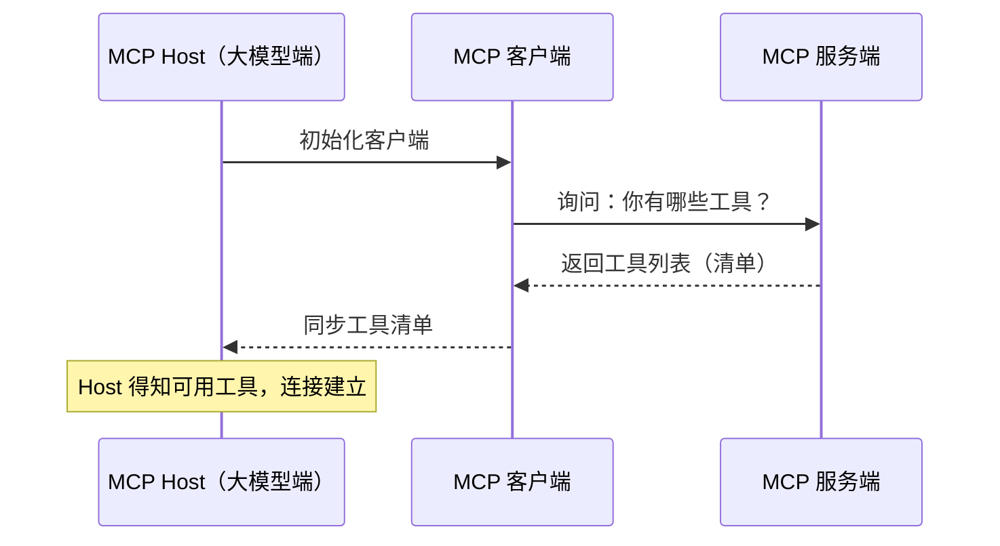
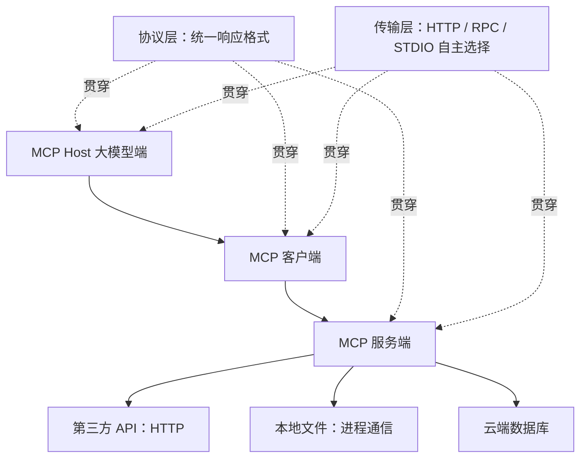

# 4-3 MCP能连接万物的原因：通信的分层设计

【学习目标】

- 回顾 MCP 三节点（Host / Client / Server）的连接建立过程与一次完整的工具调用流程
- 说清 MCP 用「协议层 + 传输层」分别解决了哪两类不统一问题
- 能用「USB 通用插头」的类比，向别人解释 MCP 的设计动机

【正文】

## 1. 回顾：MCP 协议与三个节点

大模型能力虽强，却有两类数据够不着：一类是实时变化的数据，需要调用第三方 API 获取；另一类是用户私人数据，需要访问用户本地电脑，或云端的数据库与文件。不同大模型接入这些外部能力的方式各不相同，MCP（Model Context Protocol，模型上下文协议）正是为了统一这些接入方式而引入的中间层。无论哪家公司的大模型，都可以经由 MCP 这一层，去统一访问第三方 API 以及本地、云端的个人数据。

没有这一层会怎样：每个大模型团队都要为每个外部工具单独写一套适配，工具提供方也要为每个模型单独做一套对接，M×N 的重复建设无人承担得起。MCP 把 M×N 收敛为 M+N，模型侧只对接 MCP，工具侧也只对接 MCP。这就是「中间层」三个字的全部价值。

MCP 协议包含三个节点：

- **MCP Host**：大模型端，负责理解用户意图、决定调用哪个工具、把结果组织成语言
- **MCP 客户端**：Host 与 Server 之间的中转，负责传递工具调用请求与执行结果
- **MCP 服务端**：工具的宿主，是工具业务的真正执行者

连接的建立遵循固定时序：Host 先初始化 MCP 客户端；客户端启动后向服务端发起询问，服务端把自己拥有的工具列表反馈给客户端；客户端再把这份清单同步给 Host。至此，三个节点之间的通信连接建立完毕，Host 也知道了自己可动用哪些工具。

以上时序图还原了原文描述的连接建立过程。Host 并不直接访问 Server，一切经由客户端中转，这是 MCP 与「大模型直连 API」在结构上的根本差别。

以「查深圳实时天气」为例看一次完整调用：用户向 Host 提问；Host 检视工具清单，发现 Server 上有一个调用天气预报 API 的工具，可以拿到深圳实时气温；Host 指示客户端转告 Server 调用该工具，并给出参数（地点：深圳）；客户端把工具名称与参数交给 Server；Server 执行调用，把结果沿原路返回；Host 凭借推理能力把数据组织成自然语言，交给用户。

关键点在于：Host 不需要知道天气预报 API 的业务逻辑如何实现，无论底层是 Qwen、DeepSeek 还是豆包，都只面向「工具名称 + 参数」协作。真正执行业务的是 MCP 服务端。

## 2. 问题一：不同工具返回的数据格式不统一

Server 既能访问天气预报 API，也能访问地图 API，两者的返回格式显然不同；此外，访问本地 Excel 文件与访问数据库，返回的数据形态也不一致。问题随之而来：Host 如何解析这些格式各异的数据？如何知道每个字段的含义？如何从格式不同的返回数据里精确取出所需内容？

MCP 的对策是**协议层**：在协议层里约定响应数据的统一格式。只要所有工具的结果都按这套统一格式封装，Host 就能以同一套解析逻辑处理任何工具的返回，不必为每个工具写一套适配代码。

协议层的收益是双向的。对 Host 而言，解析逻辑只有一套：不论工具背后是天气 API 还是地图 API，都按约定的统一格式读取，字段含义在协议层有据可查。对工具提供方而言，职责同样清晰：把结果封装成协议层约定的格式即可，不必关心对面是哪家模型、用什么方式发问。

## 3. 问题二：不同工具的数据传输方式不统一

格式之外还有传输。调用第三方 API，数据的传输方式是 HTTP 协议；访问本地 Excel、Word 文件，则不可能用 HTTP，只能由本机进程间通信完成。传输机制的不统一，同样会卡住 Host。

MCP 的第二个对策是**传输层**：由传输层自主选择合适的传输机制，工具若是 API，选 HTTP；工具若是本地文件，选本机进程通信。传输层的「自主选择」还覆盖节点之间：Client 与 Server 分处不同机器时选 HTTP（或 RPC 这类微服务协议）；Host 与 Client 同处一台机器时，两者之间可以用本地线程传输。

传输层的选择发生在两个位置，不要混淆。第一个位置在 Server 与工具之间：工具是第三方 API，走 HTTP；工具是本地 Excel、Word 文件，走本机进程通信。第二个位置在节点与节点之间：拓扑是跨机器的，选 HTTP 或 RPC；拓扑是同机的，选本地进程通信。两个位置都由传输层裁决，使用方无感知，这正是「自主选择」的含义。

## 4. 两层贯穿三节点：MCP 成为「通用插头」

协议层与传输层贯穿 Host、Client、Server 三个节点。Host 依据协议层约定的格式，从响应数据中精确提取所需内容；节点之间的数据传输交给传输层按场景裁决。两类不统一被分别收编，MCP 因此常被比作 USB 通用插头，大模型通过 MCP，可以连接自身之外的一切。

以上架构图把原文的分层设计归拢到一起：横向是三节点的连接与中转，纵向是协议层与传输层对所有节点的覆盖。Server 之下挂着形态各异的工具，两层之上的 Host 只面对统一接口。

用一张表对照记忆更牢：

| 不统一的现象 | 具体表现 | MCP 的对策 |
|---|---|---|
| 返回数据格式不统一 | 天气 API 与地图 API 字段不同；Excel 与数据库形态不同 | 协议层：约定统一响应格式 |
| 数据传输方式不统一 | API 走 HTTP；本地文件只能走本机进程 | 传输层：按场景自主选择 HTTP / RPC / STDIO |
| 节点距离不统一 | Client 与 Server 可跨机器；Host 与 Client 可同机 | 传输层：跨机器选 HTTP，同机选本地进程通信 |

记忆口诀：**协议层管「数据长什么样」，传输层管「数据怎么来」**。两个问题、两层对策、三个节点，就是 MCP 能连接万物的全部秘密。

【易错点 / 面试题】

1. **面试官问：MCP 为什么能连接万物？** 答题分两层：协议层统一了响应数据的格式，传输层统一了数据传输机制，因此不论工具背后是 HTTP API 还是本地文件，Host 都用同一套方式对接。只答「MCP 是一个协议」而不做两层拆解，等于没答。若能再点明「两层贯穿三个节点」，面试官会认定你不只背过概念，而是真看过架构图。
2. **易错点：以为工具由 Host 或客户端执行。** 工具的真正执行者是 MCP 服务端；客户端只做中转，Host 只做决策与组织语言。把「谁执行」讲错，会直接暴露对架构图的理解停留在表面。
3. **易错点：把协议层与传输层混为一谈。** 前者解决「格式」，后者解决「通路」。可以用 USB 类比校验自己的回答：USB 统一了接口形态（协议层），但数据走哪条线（传输层）可以不同。

【小结】

本节课补齐了 MCP 的完整拼图：三节点（Host / Client / Server）负责连接与中转，协议层负责统一响应格式，传输层负责自主选择传输机制，两层贯穿三个节点，MCP 由此成为大模型连接外部世界的通用插头。下一篇 4-4 聚焦传输层在节点间的落地，SSE 实时传输，并解释它为何优于 WebSocket。工程侧，`981-demo/src/main/java/com/travel/agent/tool/RouteMakingTools.java` 把百度地图 MCP 风格的工具（地理编码、路线规划、天气查询）收敛为统一的 JSON 字符串返回，正是「协议层统一响应格式」这一思想的最小落地；调用方只面对统一结构，不必关心背后是真实地图 API 还是离线桩数据。
