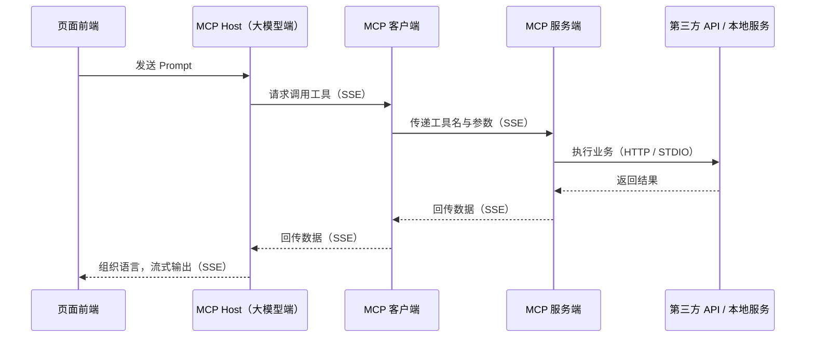

# 4-4 MCP的通信：SSE实时传输

【学习目标】

- 复述传统 HTTP「请求-响应即断开」的模型，以及它为何撑不住流式输出
- 说清 SSE 与 WebSocket 的相同点与本质差异（单向与双向）
- 解释大模型前端与 MCP 三节点为何都选用 SSE，以及 STDIO 的适用位置

【正文】

## 1. 先回顾：传输层要自主选择什么

上节课留下两个问题：不同工具返回的数据格式不同，由协议层统一；不同工具的数据传输机制不同，由传输层自主选择。传输层的「自主选择」覆盖两个范围：其一是 Server 调用工具时按工具类型选机制，API 选 HTTP，本地文件选本机进程通信；其二是三节点之间按拓扑选机制，Client 与 Server 跨机器时选 HTTP 或 RPC，Host 与 Client 同机时选本地进程通信。

本节把镜头再推近一层：三节点之间「具体用什么通信」。HTTP 不是已经讲过了吗，跨机器用 HTTP，同机用进程通信，还有什么可讲的？要回答该问题，得先看清传统 HTTP 的一个硬特征。

## 2. 传统 HTTP 的硬特征：服务端不能主动开口

传统 HTTP 通信中，客户端向服务端发请求，服务端响应请求，一次通信即告完成；客户端若还想访问服务端的内容，必须再次发起请求，服务端才会把响应发回来。服务端无法主动向客户端发送信息，除非客户端先请求。这是理解后续一切的基准线。

若硬要用传统 HTTP 模拟「服务端持续推送」，客户端只能反复发起请求去问「好了没有」，代价是大量无效请求与难以接受的延迟。大模型逐字返回的体验，显然等不起这种轮询式的笨办法，于是才有了对长连接通信协议的需求。

## 3. 一次实测：DeepSeek 网页端的逐字返回

打开 DeepSeek 网页端，发送一个 Prompt，同时按 F12 打开调试面板，切到「网络」页签并筛选 Fetch。点击发送后可以观察到：远程 DeepSeek 大模型并非一次性返回全部内容，而是像打印机一样逐字吐出；网络面板里这条请求记录的大小持续变化，说明服务端在源源不断地分批推送。

这组观察里有三个细节值得逐一记下：其一，内容是分批到达的，不是一次响应体；其二，请求记录的大小在持续增长，说明同一条连接上数据在流动；其三，页面是边收边渲染的，用户看到的是逐字出现的效果。三个细节共同指向一个结论：服务端在一条连接上持续写入数据。

这与传统 HTTP 的特征相矛盾：一次请求之后连接应当断开，服务端不该主动开口。据此可以判断，网页端与大模型之间的通信并不是传统 HTTP。

那它是 WebSocket 吗？WebSocket 的模型是：客户端与服务端建立长连接，此后客户端可以向服务端发请求，服务端也能主动向客户端反馈信息，这正是它与传统 HTTP 的最大差别。但实测暴露了两个细节：其一，在流式返回中途再发一次 Prompt，发送按钮处于禁用状态，必须停止当前对话才能发起新请求；其二，点开这条请求，响应头中 `Content-Type` 的值为 `text/event-stream`，即事件流。该请求的 URL 为 `https://chat.deepseek.com/api/v1/chat/completion`，方法为 `POST`；响应头同时带有 `Access-Control-Allow-Origin: *`，表明接口允许跨域访问。`Content-Type: text/event-stream` 正是 SSE 通信的标志。

## 4. SSE：与 WebSocket 相像，但只有一个方向

SSE（Server-Sent Events，服务器发送事件）是一种单向的实时通信协议。客户端向服务端发送请求后，双方建立长连接；长连接存续期间，服务端能够主动向客户端分批推送信息，这一点与 WebSocket 相同。本质差异在于方向：SSE 是单向的，长连接期间客户端不能再向服务端发送请求，直到连接断开；WebSocket 是双向的，长连接期间双方都可以主动发送。

| 对比项 | 传统 HTTP | SSE | WebSocket |
|---|---|---|---|
| 连接模型 | 短连接，一次请求一次响应 | 长连接 | 长连接 |
| 服务端能否主动推送 | 不能 | 能 | 能 |
| 客户端能否中途再发请求 | 每次需重新请求 | 不能，须等连接断开 | 能 |
| 方向性 | 请求-响应式 | 单向（服务端到客户端） | 双向 |
| 资源开销 | 低 | 轻量 | 相对更重 |

以上对照表归纳了三者的差别。SSE 常被称作「轻量级的 WebSocket」，形态相像，开销更小。

## 5. 大模型场景为何选 SSE 而不是 WebSocket

第一层原因是业务场景：用户提出问题后，大模型分批返回数据的期间，用户没有必要与服务端互动，只需等结果全部返回，再提下一个 Prompt。流式返回期内没有互动必要性，双向通道就是闲置能力。

第二层原因是资源：大模型服务同一时间面对海量访问，提高性能、降低资源耗费是硬指标。SSE 的单向通道比 WebSocket 的双工连接更轻，同样的机器能承载更多并发对话。

## 6. 把 SSE 放回 MCP：整条通信链路长什么样

把视野从「前端与大模型」扩展到整条链路：除了 MCP 三节点，还有页面前端，以及 Server 所调用的 API 接口与本地服务。各段的传输机制如下：

- 页面前端与大模型之间：基于 SSE 实时传输（前述实测）
- MCP 三节点之间（Host / Client / Server）：同样基于 SSE，既是从性能与资源耗费考虑，也要配合大模型把信息持续反馈给前端
- Host 与 Client 同处一台机器时：两者之间改用进程间通信，专业名词为 STDIO
- Server 调用第三方 API：走 HTTP
- Server 访问本地服务：基于本地线程通信，同样采用 STDIO

STDIO 是标准输入输出的缩写，本质是进程间通信：数据不走网络，由同一台机器上的两个进程直接交换。它适合 Host 与 Client 同机部署的场景，省去网络栈的开销，也不必处理跨域。而 Server 一旦要访问本机之外的能力（第三方 API），或者自身要访问本机的其他服务，传输层就按场景切回 HTTP 或 STDIO。整条链路上没有一种协议包打天下，只有按场景选择的组合，这就是分层设计的日常形态。

以上时序图把原文描述的全链路通信归拢到一张图里：Host、Client、Server 三段是 SSE；Server 到工具的一段按工具类型在 HTTP 与 STDIO 之间切换；Host 与 Client 同机时，二者之间退化为 STDIO。整个大模型系统的传输机制，至此形成完整闭环。

【易错点 / 面试题】

1. **面试官问：SSE 和 WebSocket 的区别？** 一句话版本：两者都建立长连接且允许服务端主动推送，但 SSE 单向、WebSocket 双向；SSE 长连接期间客户端不能发新请求，WebSocket 可以。再补一句「SSE 更轻量，适合大模型流式场景」即是加分项。
2. **易错点：把 `text/event-stream` 当成 WebSocket 的标识。** 它是 SSE 的标志响应头。判断通信类型的实操方法，就是看响应头的 `Content-Type`。
3. **易错点：认为 MCP 三节点之间「只能」用 SSE。** 准确表述是：三节点之间采用 SSE，但 Host 与 Client 同机时二者之间走 STDIO；Server 侧再按工具类型切到 HTTP 或 STDIO。传输层的要义正是「按场景自主选择」，背下「一律 SSE」反而答错。

【小结】

本节课沿传输层一路下沉：传统 HTTP 的服务端不能主动推送，撑不住流式输出；SSE 以长连接实现服务端单向分批推送，比 WebSocket 更轻，且契合大模型「返回期间无需互动」的业务形态；MCP 三节点之间采用 SSE，Host 与 Client 同机时退化为 STDIO，Server 调用第三方 API 走 HTTP、访问本地服务走 STDIO。下一篇 4-5 进入动手环节：在 MCP Server 模块中创建第一个 MCP 工具。工程侧，`981-demo/src/main/java/com/travel/agent/web/TravelController.java` 以 `POST /api/travel/plan` 暴露用户交互入口，正是「页面前端与大模型端」这一段链路的落点；其上游由主管 Agent 经客户端中转调用各成员工具，与本节所讲的全链路通信形态一一对应，可对照阅读。
