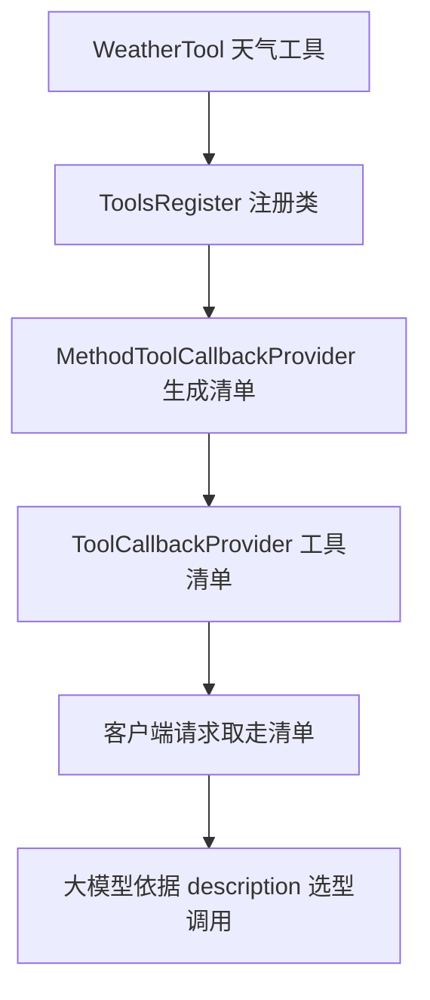

# 4-6 将MCP工具注册到MCP服务

【学习目标】

- 讲清「工具清单」机制：MCP 服务端如何把工具列表提供给客户端与大模型
- 用 `ToolCallbackProvider` 与 `MethodToolCallbackProvider` 完成工具注册，并说清两者的接口关系
- 理解 Builder 模式与可变参数在本场景下的作用，以及 `@Configuration` + `@Bean` 的必要性

【正文】

## 1. 回顾：注解三件套与工具清单

上节课定义了一个天气工具类，其中有两个方法：获取指定城市的温度值、获取指定城市的紫外线值。让大模型识别并使用这两个方法，靠的是 Spring AI 提供的注解三件套：

```java
        @Tool(description = "获取指定城市的温度")
        public String getTemperature(@ToolParam String cityName) {
            return cityName + "温度值：";
        }

        @Tool(description = "获取指定城市的紫外线值")
        public String getUltraviolet(@ToolParam String cityName) {
            return cityName + "紫外线值：";
        }
```

以上代码块回顾上节课内容：`@Tool` 标记方法可被大模型调用；`description` 描述方法的作用与使用方式，大模型据此选择对应工具；`@ToolParam` 声明调用时需要传入的参数。三个要素齐备，单个工具的定义才算完整。

只定义还不够。回顾 MCP 的结构图：工具设置在 MCP 服务端，但大模型并不直接访问服务端，大模型先初始化 MCP 客户端，由客户端去调用服务端的工具。服务端有哪些工具，客户端一开始并不知道，因此服务端需要先把工具写进一张清单，在客户端请求时把清单发给客户端；客户端再把清单交给大模型，大模型根据用户意图，凭借每个工具的 `description` 准确调用对应工具。

这张清单机制可以用餐厅类比：服务端是后厨，工具是一道道菜，清单就是菜单。客人（大模型）不看后厨，只看菜单点菜；后厨备什么菜，全写在菜单上。菜单不及时更新，客人就会点到不存在的菜，工具清单与工具定义不同步，是线上事故的常见源头。

所以本节的任务很明确：在 MCP 服务端把天气工具写进这张清单。用程序化的语言说，就是完成工具的注册。

## 2. 建立注册类：ToolsRegister

在 MCP Server 模块中新建一个包 `conf`，包内建类 `ToolsRegister`，即工具注册类。它的职责是把 MCP 工具写入工具清单，也可以理解为在 MCP 服务端进行工具注册。理解成「把工具写进一张清单」更直观：客户端来要清单时，服务端就把这张单子递过去。

写一个获取 MCP 工具清单的方法。工具清单是一个对象，类型为 `ToolCallbackProvider`；需要把上节课定义的天气工具类作为参数传进去，即包含两个方法的 `WeatherTool`。

```java
        public class ToolsRegister {
            public ToolCallbackProvider toolList(WeatherTool weatherTool) {
                return MethodToolCallbackProvider.builder().build();
            }
        }
```

以上代码块是注册类的核心形态：方法入参是工具对象，返回类型是清单接口 `ToolCallbackProvider`。真实工程中还需补上 `@Configuration` 修饰类、`@Bean` 修饰方法（正文随后说明），此处按讲稿原样保留最简骨架。

## 3. ToolCallbackProvider 与 MethodToolCallbackProvider：接口与实现

清单对象如何生成？通过 `MethodToolCallbackProvider` 生成。这两个类型的关系是：`MethodToolCallbackProvider` 实现了 `ToolCallbackProvider` 接口，因此方法返回前者实例，在类型上完全符合 `ToolCallbackProvider`，这是「面向接口编程」的典型用法，调用方只面对接口，不关心实现类是谁。

实例的生成方式采用 Builder 模式：通过 `builder()` 拿到 Builder 对象，再通过 `build()` 产出实例。Java 对象实例生成的方式有两种：一种是 `new`，另一种就是 Builder 模式。两种方式的取舍是 Java 基础功：参数少、结构简单时 `new` 更直接；参数多、需要分步配置时 Builder 更安全，不必背一个超长构造器的参数顺序，也不会因为漏传参数而错位。Spring 系的配置类普遍采用 Builder，正是出于可读性与可维护性的考量：每一步配置语义自明，改配置时 diff 也清晰。

工具如何写入实例？通过 `toolObjects` 方法，把天气工具传入，即完成 MCP 工具到清单的写入。到此，MCP 工具的定义与写入清单两步全部完成。

```java
        public class MethodToolCallbackProvider {
            private List<Object> toolObjects;

            public Builder toolObjects(Object... toolObjects) {
                Assert.notNull(toolObjects, message: "toolObjects cannot be null");
                this.toolObjects = Arrays.asList(toolObjects);
                return this;
            }

            public MethodToolCallbackProvider build() {
                return new MethodToolCallbackProvider();
            }
        }
```

以上代码块按讲稿原样保留，需要如实说明：这是从反编译视角看到的示意片段，并非可直接编译的源码，`Assert.notNull(toolObjects, message: ...)` 中 `message:` 字样是反编译产物，合法 Java 写法应为 `Assert.notNull(toolObjects, "toolObjects cannot be null")`；类声明处也未展示 `implements ToolCallbackProvider` 与 `Builder` 内部类。保留它的价值在于说明 `toolObjects` 的参数形态，语法细节以真实源码为准。

## 4. 多个工具怎么办：可变参数的答案

一个自然的疑问随之而来：如果除了天气工具，还定义了数据库工具，如何把多个工具写进同一张清单？难道要再写一个方法吗？不需要。点开 `toolObjects` 方法，可以看到它的参数类型是 `Object`，且后面带有三个点，这是 Java 的可变参数（varargs），表示参数数量不固定：传一个可以，传两个可以，传十个也可以。因此无论定义了多少个 MCP 工具，都可以一次性全部传入，清单始终只有一张。

可变参数在语法层是三个点，在字节码层会被包装成数组，`Arrays.asList(toolObjects)` 一行正是把数组转为列表存进字段。理解这层「语法糖」有助于看懂上面代码块里 `List<Object> toolObjects` 字段的由来，清单在内存里就是一个对象列表，每个元素就是一个工具 Bean。

## 5. 交给 Spring 管理：@Configuration + @Bean

最后一步是让 Spring 接管该注册类。既然使用的框架是 Spring，就要把 `toolList` 方法声明为 Bean，用 `@Bean` 修饰；注册类本身用 `@Configuration` 修饰。这样容器启动时就会执行注册逻辑，工具清单随应用就绪，客户端随请求随取。没有这一步，类写得再对也只是普通对象，Spring 不会实例化它，更不会把它纳入 MCP 服务端的工具分发链路。

从生命周期角度看这一步：`@Configuration` 类在容器启动阶段被解析，`@Bean` 方法的返回值注册为单例；客户端第一次请求工具清单时，拿到的是启动时就已构建好的同一份实例。把初始化成本前移到启动期，请求期就只有读取，这是注册类要进容器的又一个理由。

| 环节 | 手段 | 作用 |
|---|---|---|
| 标记工具 | `@Tool` + `description` + `@ToolParam` | 声明工具存在、用途与参数 |
| 生成清单 | `MethodToolCallbackProvider.builder().build()` | 产出清单对象 |
| 写入工具 | `toolObjects(Object...)` 可变参数 | 任意多个工具一次写入 |
| 纳入容器 | `@Configuration` + `@Bean` | 启动时注册，随请求分发 |

以上表格把「工具定义到清单分发」的链路压缩成四步，可作为复习提纲。



【易错点 / 面试题】

1. **面试官问：`ToolCallbackProvider` 和 `MethodToolCallbackProvider` 是什么关系？** 前者是接口，后者是实现类；方法返回接口类型，面向接口编程。能主动补一句「实现类用 Builder 模式生成，`toolObjects` 支持可变参数传入多个工具」，就是完整的加分答案。
2. **易错点：给每个工具写一个注册方法。** 不需要。`toolObjects(Object...)` 是可变参数，多个工具一次传入即可，清单始终只有一张。
3. **易错点：漏写 `@Configuration` 与 `@Bean`。** 注册类不被 Spring 管理，工具清单就不会在启动时生成，客户端请求工具列表时拿到空清单，表现为「工具莫名其妙调不到」。

【小结】

本节课把工具从「类里的方法」推进到「服务端的清单」：服务端通过 `ToolsRegister` 把 `@Tool` 标记的工具写入 `ToolCallbackProvider` 清单，客户端请求时取走清单并交给大模型，大模型依据 `description` 选型调用；`toolObjects` 的可变参数让多工具一次写入，`@Configuration` + `@Bean` 让清单随容器启动就绪。下一篇 4-7 转向通信实现：MCP 服务端如何基于 WebFlux 落地 SSE 实时传输。工程侧，`981-demo/src/main/java/com/travel/agent/agent/TeamMembers.java` 展示了同一思想的另一种写法：用 `Toolkit.registerTool(...)` 把 `RouteMakingTools`、`AttractionTools` 注册进 `ReActAgent`，工具随 Agent 就绪、随调用分发，与本节的清单机制一一对应，可对照阅读。
