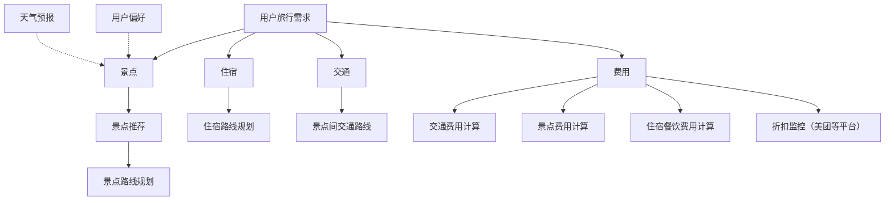

# 5-1 旅行规划的复合任务拆解

【学习目标】

1. 建立「复合任务」视角：把旅行规划拆成住宿、景点、交通、费用四大域。
2. 理清四域之间的耦合关系：景点间交通、景点-住宿交通，以及费用的固定项与弹性项。
3. 把每个域细化到可执行的原子动作，形成后续 Agent 设计的输入。
4. 面试中能系统回答「如何把一个模糊需求拆成可执行子任务」。

【正文】

## 一、旅行规划是一个复合任务

课程项目是旅行规划助手 Agent。从用户视角看，「帮我规划一次旅行」只是一句话；从工程视角看，这句话覆盖四个核心关注点：

| 关注域 | 用户真正关心的问题 |
|---|---|
| 住宿 | 住哪里、离景点远近、有无优惠 |
| 景点 | 玩什么、按什么顺序玩 |
| 交通 | 怎么去、景点之间怎么走 |
| 费用 | 总共花多少、哪里能省 |

其中费用是用户最敏感的项，前三域做得再好，预算超支就会全盘否决行程。

再从反面想：若把旅行规划交给单个智能体一轮完成，它要在一次决策中同时权衡住宿选址、景点顺序、天气适配与预算控制，任何一域考虑不周都会传导到其他域。拆分的本质是把一个高维决策问题分解为若干低维决策问题，再在汇总层做全局平衡，这也是工程上应对复杂需求的通用手段。

四域并非彼此割裂，而是互相约束：住宿选址要靠近景点，否则交通成本上升；景点顺序决定交通路线；费用又由前三域的选择汇总而来。举例说，把住宿定在远离景点的低价酒店，住宿费用省了，往返交通的时间成本与费用却上去了，总账未必划算。这种「牵一发而动全身」的结构，正是需要多个智能体协同的原因，任何单一视角都看不到全局最优。

从「一句话需求」到「可执行计划」之间的距离，就是本章要丈量的对象。拆解得越细，后续每名智能体的职责才越清晰。

## 二、域内拆解：从关注点到子方向

**交通域**包含两个子方向：

- 景点之间的交通：游览顺序决定移动路线，坐火车还是坐汽车、耗时多少，都是规划对象；
- 景点与住宿之间的交通：住宿选址若离景点太远，每天往返的时间成本会侵蚀游览体验，因此住宿应尽量靠近景点。

火车与汽车的取舍还牵出费用域的刚性项：项目以火车为主，票价固定无折扣，智能体无需在交通费用上寻找优化空间，只需算准。

**费用域**的构成需要区分固定项与弹性项：

| 费用子项 | 是否固定 | 说明 |
|---|---|---|
| 交通费用 | 固定 | 项目以火车为主，动车、高铁票价基本无折扣 |
| 景点费用 | 固定 | 景点票价基本固定，没有优惠折扣 |
| 住宿费用 | 有折扣空间 | 住宿与餐饮合在一起监控，优惠券主要出在这里 |

景点票价与交通票价属于刚性支出，可优化的只有住宿与餐饮，折扣监控因此成为费用域的核心动作。区分固定项与弹性项的价值在于：智能体不该把精力花在不存在优化空间的地方，折扣监控只瞄准住宿与餐饮。

**景点域**的推荐受两个输入驱动：一是旅行期间的天气预报（天气状况直接决定景点取舍），二是用户偏好（景点数量庞大，需按用户喜好筛选）。推荐完成之后，才进入景点路线规划，先有「玩什么」，才有「按什么顺序玩」。

**住宿域**的动作是住宿路线规划，即住宿点与景点、餐饮点之间的通勤路线。住宿域与费用域在此交汇：住宿选址同时决定住宿费用与通勤路线，是四域中耦合最强的节点。单独优化住宿费用会推高交通成本，单独优化通勤会推高住宿费用，必须联合权衡。

## 三、原子动作清单

把四域细化到原子动作，得到下表：

| 需求域 | 原子动作 | 输入 | 输出 |
|---|---|---|---|
| 景点 | 景点推荐 | 天气预报 + 用户偏好 | 候选景点列表 |
| 景点 | 景点路线规划 | 候选景点列表 | 景点游览顺序与路线 |
| 住宿 | 住宿路线规划 | 住宿选址 + 景点分布 | 住宿-景点通勤路线 |
| 费用 | 交通费用计算 | 交通方式与路线 | 交通费用 |
| 费用 | 景点费用计算 | 候选景点列表 | 景点门票费用 |
| 费用 | 住宿餐饮费用计算 | 住宿与餐饮安排 | 住宿餐饮费用 |
| 费用 | 折扣监控 | 美团等平台优惠信息 | 优惠券/折扣情报 |

表格中的「输入 / 输出」列就是动作之间的契约：上游动作的输出是下游动作的输入，接口一旦确定，每名智能体只需对自己的契约负责，不必关心其他成员如何实现。这是多 Agent 系统可分工、可并行、可测试的基础。契约思维还有助于实现替换：路线制定专员只需知道景点推荐的输出是候选景点列表，不必关心推荐用搜索还是检索；费用统筹管家只需知道路线规划输出距离与耗时，不必关心路线来自地图工具还是本地桩。接口稳定，实现可替换，离线演示换成真实 MCP 服务时，其他成员无需改动。

生产经验：契约思维还带来一个工程红利，可独立测试。每个原子动作的输入输出既定，测试时只需构造上游桩数据喂给该动作，断言其输出符合契约，不必拉起整个 Agent 团队。没有契约的多 Agent 系统，联调时任何一个成员的偏差都会被放大成全局抖动，排障成本高到难以定位；先定契约、再各自实现，是把「联调地狱」提前消解在设计阶段的手段。课程 981-demo 的离线测试正是这一思路：用本地桩替代真实 MCP 与远程成员，按契约分别验证路线、推荐、费用三条链路，再谈协同。

两个细节值得注意：其一，景点推荐是一条「双输入」动作，天气与偏好各自作为一条虚线汇入推荐环节，课程图示中以不同色彩区分这两条输入；其二，折扣监控是持续动作而非一次性计算，需要周期性运行。动作命名也有讲究：「景点推荐」与「景点路线规划」主语相同但动词不同，前者是筛选（收敛候选集），后者是排序（确定顺序）。命名清晰，接口才好定义。

## 四、拆解全景图

## 五、为什么这样拆

复合任务拆解遵循三条原则：

1. **按关注域切分**：住宿、景点、交通、费用对应清晰的业务边界，边界内高内聚、边界间低耦合。用户谈旅行时天然按这四域思考，拆解结果因此可解释、可对齐。
2. **拆到原子动作**：每个动作有明确输入与输出，才能交给单一智能体执行，也才能被测试与验收。停留在「规划交通」的粒度无法执行，必须落到「景点间路线规划」才可被工具化。
3. **识别动作间依赖**：推荐先于路线规划，路线规划先于费用计算，依赖关系决定调度顺序，这正是主管 Agent 制定计划的依据。折扣监控与推荐、路线无强依赖，可并行执行。

依赖关系构成一条主干链：景点推荐 → 景点路线规划 / 住宿路线规划 → 费用计算；折扣监控作为旁路持续运行，其产出在费用计算时汇入。主管 Agent 制定计划时，按此链排序子任务并分派给对应成员。执行层面还有并行空间：景点推荐、住宿路线规划、折扣监控三者之间无强依赖，可同时进行；费用计算必须等待前两者产出后才能开始。据此区分「可并行批」与「须等待点」，才能把三天期限的压力摊到并发执行上。

这套拆解直接对应后续章节的团队成员设计：路线制定专员（5-2）、行程规划经理（5-3）、费用统筹管家（5-4），再加上负责结果汇总的框架默认智能体。

【易错点 / 面试题】

1. **把复合任务当成单轮对话**：一句「规划旅行」背后是七个以上原子动作，单 Agent 单轮 prompt 无法覆盖，必须拆域、拆动作。面试常见问法：「用户说帮我规划一次旅行，你的系统怎么处理？」参考回答：按关注域拆解为住宿、景点、交通、费用四域，识别域间依赖后排成任务链，由主管 Agent 分派给对应的成员智能体并行执行，最后汇总输出。关键是把「一句话」变成「有输入输出契约的动作清单」。
2. **混淆固定费用与弹性费用**：交通与景点费用是刚性的，折扣监控只对住宿餐饮有意义；若对刚性支出设计「优惠监控」属于无效动作。拆解时先判断每个子项有无优化空间，再决定是否值得一个智能体持续投入。
3. **忽略动作间依赖**：景点推荐未完成就规划路线，会导致路线规划返工。拆解时必须显式记录依赖关系，供调度器排序；对无依赖的动作（如折扣监控）则应允许并行，不必串行等待。

【小结】

本节给出旅行规划的复合任务拆解方法：四域关注 → 域内子方向 → 原子动作 → 依赖关系，最终形成七个动作的清单。这套拆解是多 Agent 团队的设计输入，`981-demo/src/main/java/com/travel/agent/agent/SupervisorAgent.java` 中的主管 Agent 即按任务关键词把需求分发给路线制定专员与景点推荐成员（`ask_route_making_agent` / `ask_attraction_agent`），用户入口为 `981-demo/src/main/java/com/travel/agent/web/TravelController.java` 的 `POST /api/travel/plan`。技术前瞻：本章的静态任务链将在第 10-4、12-4 章用 Agent Skills 演进为「按需渐进加载」，工具不再一次性全挂，而是按任务阶段披露，降低上下文与 token 消耗；A2A 协议（第 11 章）则让主管能调度进程外的远程成员。多 Agent 编排的下一步，正是「工具渐进披露 + 跨进程协同」。下一篇设计第一名团队成员：路线制定专员 Agent。
