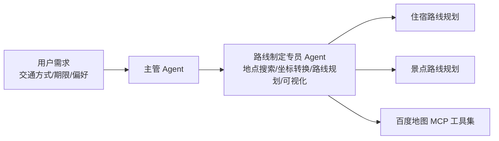

# 5-2 团队成员：路线制定专员Agent

【学习目标】

1. 从一段真实用户需求中识别「用户明确给出的」与「需要智能体补全的」信息。
2. 把旅行规划拆成四类子需求，并理解每类子需求的约束条件。
3. 掌握路线制定专员 Agent 的角色定义方法：定位加能力清单。
4. 面试中能讲清 SubAgent 的拆分粒度与职责边界设计。

【正文】

## 一、用户说了什么，没说什么

一个旅行规划的需求可以被拆分成多个子需求。以「十一国庆期间从深圳自驾游到清远，三天时间，并且不想把行程安排得太满」为例，用户实际只给出三项信息：

| 用户给出的 | 内容 | 性质 |
|---|---|---|
| 交通方式 | 自驾游 | 明确约束 |
| 旅游期限 | 三天 | 明确约束 |
| 偏好 | 行程不要太满 | 明确约束 |

而「想游览什么景点」用户自己并不清楚，景点数量庞大，筛选依赖智能体依据偏好与外部信息（天气）完成。用户给的是约束，智能体补的是内容，这是 Agent 系统与普通表单系统的本质区别：表单系统只能处理用户填了的字段，Agent 系统要主动补全用户没填的缺口。

三项约束各自划定了智能体的行动边界：自驾游意味着路线规划以公路通勤为场景；三天期限限制了景点数量与节奏；「不要太满」则要求行程留白。约束越明确，智能体的搜索空间越小，推荐质量越高。反观缺口：用户没说想玩什么，智能体必须借助天气与偏好数据主动推荐；用户没说住哪里，智能体要在「离景点近」与「费用低」之间找平衡。约束决定边界，缺口决定智能体的价值空间。

## 二、智能体补全的四类子需求

智能体把需求进一步划分为四个子需求：

**子需求一：景点推荐。** 依据旅游期间的天气状况与用户偏好推荐景点。天气是硬约束（恶劣天气下部分景点不适宜），偏好是软约束（历史人文还是自然风光），两者共同构成推荐输入。

**子需求二：住宿安排。** 约束是双向的：住得离景点太远，每天往返耗时侵蚀游览时间；住得离景点太近，费用偏高。住宿如何安排、住宿与景点之间的路线如何规划，都需要智能体权衡，此处的「合适」不是最便宜，也不是最近，而是时间成本与费用的平衡点。

**子需求三：景点间交通路线规划。** 目标是用很短的时间与路程把多个景点串联起来，这本质是一个路径优化问题，景点顺序的调整会显著改变总行程。三天去五个景点，先后顺序不同，总路程可能相差数成。

**子需求四：住宿餐饮优惠监控。** 景点费用与交通费用基本固定，国庆、五一期间更不可能有折扣，有折扣空间的只有住宿和餐饮。智能体需要持续监控优惠券发放，把住宿餐饮上的花费压到更低。

四类子需求对应四类能力域：推荐与筛选、住宿权衡、路径优化、价格监控。没有单一能力集能覆盖全部四域，这正是团队需要不止一名成员的原因。四类子需求中，前两类产出的是行程内容，第三类产出的是执行路径，第四类产出的是成本情报。内容、路径、情报三类产出分别对应后续三名成员，团队结构由此自然浮现。

## 三、角色定义：路线制定专员

路线制定专员 Agent 是团队中第一个被设计的成员，其角色定义包含三项能力：

1. **地点搜索，以及经纬度坐标的转换**：把「深圳」「清远」「某景点」等地名解析为坐标，是一切路线计算的前置步骤，地图工具只认坐标，不认地名；
2. **路线规划**：输入起点、终点（或途经点），输出通行方案、距离与耗时；
3. **将规划好的路线进行可视化展示**：把路线结果渲染到地图上，让用户直观确认方案。

三项能力构成一条完整链路：地名 → 坐标 → 路线 → 可视化。缺少坐标转换，路线规划无输入；缺少可视化，用户难以校验路线是否合理。

该成员可复用于两个场景：住宿路线规划（住宿点-景点通勤）与景点路线规划（景点-景点串联），对应 5-1 节拆解出的住宿路线规划与景点路线规划两个原子动作。一名成员服务两个动作，说明设计粒度是能力域级，凡属于「路线」域的活，都归它。三项能力的共同点是都围绕「空间关系」展开：地名定位、路径连接、地图呈现。这种内在一致性是判断角色定义是否合理的又一标准，能力清单应当同源，而不是把无关能力硬凑在一起。

生产经验：把一名成员的能力收敛到「空间关系」这一同源域，还有一个隐性收益，系统提示词可以长期稳定。能力域越窄，提示词越聚焦，模型每轮决策时的注意力越集中，工具选择的准确率也越高；反之能力庞杂的成员，提示词里塞满互不相关的工具描述，模型容易在「该调哪个工具」上犹豫，甚至出现工具误用。这也是路线制定专员不兼做费用计算的原因：两类决策对工具的要求南辕北辙，硬塞进同一提示词只会互相干扰。团队设计阶段花在「划边界」上的时间，会在运行期的稳定性上成倍返还。

## 四、能力与工具形态的对应

课程后续章节（11-5 / 11-6）中，路线制定专员挂载百度地图 MCP，服务端暴露的工具与角色能力一一对应：

| 角色能力 | 对应工具形态 | 工具职责 |
|---|---|---|
| 地点搜索 + 坐标转换 | `map_geocode` | 把地址转换为经纬度坐标 |
| 路线规划 | `map_directions` | 查询两点之间的通行方案，返回路线摘要 |
| 行程决策输入 | `map_weather` | 查询目的地天气，供行程决策 |

可视化展示能力则依赖前端把工具返回的坐标与路线数据渲染成地图，智能体负责产出数据，渲染交给展示层，职责同样要分离。

生产经验：把「产出数据」与「渲染呈现」分离，是多 Agent 系统里一条常被忽视的边界。智能体只负责生成结构化的坐标与路线数据（消息体或 JSON），地图渲染、行程卡片等视觉呈现交给前端或专门的渲染服务。这样做有两重好处：其一，智能体的输出可被其他成员直接复用，费用统筹管家消费路线里的距离与耗时做费用计算，而不必等地图先画出来；其二，展示层技术栈可独立演进，不会因换了前端框架就回过头改智能体。凡是「数据会被下游消费」的产物，都应优先以结构化数据而非视觉成品交付，这也是契约思维在成员内部的一次落地。课程图示里路线制定专员把结果「可视化展示」，真实工程里这步往往由前端组件完成，智能体侧只需保证数据结构自描述、可被任意下游解析。在 981-demo 里，路线制定专员正是以这种「数据优先」的方式对外提供服务，便于主管 Agent 把它的路线产出直接转交费用与汇总环节，而不必等待任何视觉呈现。

工程对应实现见 `981-demo/src/main/java/com/travel/agent/tool/RouteMakingTools.java`：真实环境下这些工具由百度地图 MCP Server 提供，通过 Toolkit 挂载到智能体；离线演示用本地桩返回同构数据，保证「工具挂载 → 工具调用 → 结果回传」的链路形态与生产一致。从工具命名还能直观看出映射关系：`map_geocode` 对应地点搜索与坐标转换，`map_directions` 对应路线规划，`map_weather` 则为行程决策提供天气输入。真实挂载百度地图 MCP 的方式在课程 11-6 展开。这也解释了一个常见困惑：离线环境没有地图服务，智能体如何验证？答案是保持链路形态不变，只把真实工具换成同构桩数据。

## 五、成员在团队中的位置

【易错点 / 面试题】

1. **角色定义过宽**：把路线制定专员写成「既能规划路线又能推荐景点还能算费用」，职责边界模糊会导致工具挂载混乱、提示词自相矛盾。角色定义应窄而清晰：一名成员只解决一类子需求。一个实用检验：把角色定义讲给非技术同事听，对方能复述出该成员负责什么，定义才算合格。判断标准是能力清单能否用一句话概括，说不清，就是拆错了。
2. **把用户没说的当用户说了**：用户没说想玩什么，智能体必须主动补全；反之用户明确说过的约束（自驾、三天、不赶行程）不能被智能体擅自修改。区分「约束」与「缺口」是需求分析的基本功：约束是硬边界，缺口是待填内容。
3. **面试题：SubAgent 拆分的粒度依据是什么？** 按子需求的关注域拆，每个子需求有独立的能力集与工具集，且可被独立测试；路线制定专员同时服务住宿路线与景点路线两个动作，说明粒度是「能力域级」而非「动作级」。粒度过粗（一个 Agent 包打天下）会导致提示词臃肿、工具集混乱；粒度过细（一个动作一个 Agent）会带来调度开销与上下文碎片化。

【小结】

本节完成第一名团队成员的设计：从真实需求中分离约束与缺口，划分四类子需求，给出路线制定专员的角色定义与三项能力，并建立能力到 MCP 工具形态的对应。工程中该成员对应 `981-demo/src/main/java/com/travel/agent/agent/TeamMembers.java` 的 `routeMakingAgent`（挂载 `RouteMakingTools`，成员名称 `RouteMakingAgent`）。技术前瞻：路线制定专员当前以 Toolkit 静态挂载百度地图工具；课程第 12 章将用 Agent Skills 实现工具的渐进式加载，使该成员在「仅需路线」的阶段不加载天气/推荐类工具，进一步压缩上下文。Toolkit 与 Skills 的分工，正是 AgentScope 工具治理从「全量挂载」走向「按需披露」的演进。下一篇设计第二名成员：行程规划经理 Agent，负责景点推荐与餐饮推荐。
