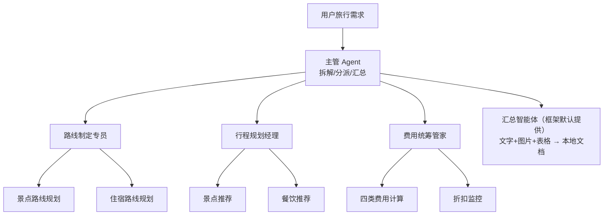

# 5-4 团队成员：费用统筹管家Agent

【学习目标】

1. 理解费用域与前两域的本质差异：规划域产出方案，费用域产出账目。
2. 掌握费用统筹管家的角色定义与四项能力。
3. 建立团队成员全景：路线制定专员、行程规划经理、费用统筹管家，外加主管与汇总智能体。
4. 面试中能系统回答多 Agent 团队的角色划分思路。

【正文】

## 一、回顾：前两名成员

行程规划经理（5-3）能根据天气预报与用户偏好安排整个行程：景点推荐、住宿与饮食推荐，并给出推荐理由、抓取景点或住宿图片供用户参考，还能列出详细的行程安排。

至此，行程维度有了负责人，费用维度仍是空白，这是本节的补充。

## 二、费用统筹管家的角色定义

费用计算需求交由费用统筹 Agent 完成。其角色定义包含两层：

**第一层是费用计算**：能够计算住宿、交通、饮食、景点四类费用，统计出详细的费用明细以及所花费的总费用。四类费用对应 5-1 节拆解出的三个计算动作加一类持续监控：

| 需求动作 | 对应成员能力 |
|---|---|
| 交通费用计算 | 四类费用计算之一 |
| 景点费用计算 | 四类费用计算之一 |
| 住宿费用计算 | 四类费用计算之一 |
| 折扣监控 | 优惠券监控 |

**第二层是优惠券监控**：除计算费用之外，还能给出优惠券，监控优惠券的发放。5-1 节已分析过：景点费用与交通费用刚性，折扣空间集中在住宿与餐饮，因此监控的价值在于把弹性支出压到最低。

角色定义的特殊之处在于「双重身份」：既是账房先生（算账），也是情报员（盯优惠）。算账是一次性的汇总动作，盯优惠是持续性动作，两类节奏不同的职责落在同一成员身上，是因为它们服务同一个目标，把总费用算清、把能省的钱省下。若拆成两名成员，优惠情报要在成员间多传一手，反而增加协调成本。这也决定了它的能力集横跨计算与网络两类。

## 三、四项能力

| # | 能力 | 用途 |
|---|---|---|
| 1 | 数学计算能力 | 汇总明细、计算总费用 |
| 2 | 表格制作能力 | 列出费用明细 |
| 3 | 网络抓取能力 | 监控优惠券发放 |
| 4 | 定时脚本制作能力 | 支撑「随时监控」的周期性执行 |

逐项说明：

**数学计算能力**是账目准确性的保障。多笔费用累加、折扣抵扣、总费用汇总，任何一处算术错误都会让整份行程预算失去可信度。费用明细是用户做决策的依据，账目错一位，信任就垮一半。

**表格制作能力**让费用明细结构化。明细表（项目、单价、数量、小计）既是给用户的交付物，也是后续汇总智能体的输入，汇总智能体要把费用表并入最终文档，结构化的表格才能被无缝整合。

**网络抓取能力**服务于优惠监控：需要访问美团等平台获取优惠券发放信息。与行程规划经理的抓取不同，后者抓的是内容素材（评价、图片），前者抓的是价格情报。同为抓取，目标与解析逻辑完全不同。

**定时脚本制作能力**支撑「随时监控」：优惠券发放是时间相关事件，一次性查询会错过窗口，必须周期性执行。定时能力把一次性抓取升级为持续监控，这是费用统筹管家区别于其他成员的技术特征。四项能力中，表格制作与网络抓取和其他成员存在重叠，区分成员靠的是能力组合而非单项能力，行程规划经理也做表格，但做的是行程表；费用统筹管家做表格，做的是明细账。组合不同，职责不同。

生产经验：以能力组合而非单项能力区分成员，还隐含一个工程含义，工具可以共享，成员身份由「能力组合加角色提示词」决定。例如在 981-demo 里，`RouteMakingTools` 与 `AttractionTools` 都是普通 Toolkit，真正让它们分属不同成员的是各自的系统提示词与挂载关系；换一套提示词，同一组工具就能重组出新的角色。这种「工具中性、角色由提示词定义」的设计，让团队编排具备乐高式拼装的可能：调整成员只需增删 Bean 与提示词，不必改动底层工具实现。

## 四、团队成员全景

至此，旅行规划的三名团队成员全部就位：

| 成员 | 解决的子需求 | 核心能力 |
|---|---|---|
| 路线制定专员 | 景点间路线、住宿-景点路线 | 地点搜索、坐标转换、路线规划、可视化 |
| 行程规划经理 | 景点推荐、餐饮推荐、详细行程 | 网络搜索与抓取、天气查询、本地文件、表格制作 |
| 费用统筹管家 | 四类费用计算、折扣监控 | 数学计算、表格制作、网络抓取、定时脚本 |

外加两个角色：主管 Agent 负责拆解需求、分派任务、汇总结果（第 11 章详述）；汇总智能体把路线规划、行程安排、总体费用汇总为一份文档保存在本地。课程在此特别强调：该交付物是文档而非表格，文档包含文字、图片、表格多种信息形态。该汇总智能体由后续框架默认提供，本节不单独列出。汇总智能体由框架默认提供还暗示了一层架构思想：通用能力（汇总、文档生成）沉淀为框架默认组件，业务能力（推荐、路线、费用）由开发者按团队设计实现，开发者聚焦差异化部分，通用部分不必重复造轮子。

## 五、拆解方法论回顾

从 5-1 到 5-4 走完了完整路径：复合需求 → 四域拆解 → 原子动作 → 按能力域划分成员 → 每名成员做角色定义与能力清单。可复用的设计 checklist：

1. 用户输入中区分「明确约束」与「待补全缺口」；
2. 按关注域切分复合需求，识别域间依赖；
3. 每个能力域设计一名成员，角色定义窄而清晰；
4. 能力清单逐项对应角色定义要素，不挂无用能力；
5. 持续型动作（折扣监控）与一次性动作（费用计算）区分对待；
6. 跨域调度与结果汇总交由更高层角色（主管与汇总智能体），成员只对本域负责。

工程侧，前两名成员已在 `981-demo/src/main/java/com/travel/agent/agent/TeamMembers.java` 中以 Bean 形式落地：`RouteMakingAgent` 挂载 `RouteMakingTools`（地图类工具），`AttractionAgent` 挂载 `AttractionTools`（景点检索）；主管 `TravelManagerAgent` 定义于 `981-demo/src/main/java/com/travel/agent/agent/SupervisorAgent.java`，按需求关键词在 `ask_route_making_agent` 与 `ask_attraction_agent` 之间路由；用户经 `981-demo/src/main/java/com/travel/agent/web/TravelController.java` 的 `POST /api/travel/plan` 提交需求。费用统筹管家作为第三名成员，可在同一 `TeamMembers` 配置类中按相同 Bean 模式扩展。

【易错点 / 面试题】

1. **让 LLM 直接裸算费用**：数学计算能力虽可借助大模型，但多笔累加与折扣抵扣的准确性要求高，关键账目应有确定性计算路径兜底，大模型只做组织与呈现。工程上更稳妥的做法是：智能体负责组织计算请求与呈现结果，具体算术由工具或脚本执行。面试延伸：「哪些任务适合交给 LLM，哪些不适合？」参考回答：开放式生成（推荐、理由、行程叙述）适合 LLM；精确计算（费用汇总、坐标换算）需工具或代码兜底。让模型做不擅长的事，出错率与不可复现性都会上升。
2. **监控做成一次性查询**：优惠券发放有时间窗口，缺少定时执行就会漏采；定时脚本制作能力正是为此设置。工程上还要考虑监控频率与平台反爬的平衡。
3. **面试题：三名成员之外为什么还要主管与汇总智能体？** 成员只懂本域，需求拆解、跨域调度、结果汇总需要更高层角色；汇总智能体把分散产出固化为统一交付物（含文字、图片、表格的文档）。这对应 Supervisor-Worker 模式中主管与工作流的职责分层：成员对「任务」负责，主管对「目标」负责。

【小结】

本节完成费用统筹管家的设计：角色定义双层（费用计算加优惠券监控），能力四项（数学计算、表格制作、网络抓取、定时脚本）。至此团队成员全景成型：路线制定专员、行程规划经理、费用统筹管家，外加主管与框架默认的汇总智能体。工程对应 `981-demo/src/main/java/com/travel/agent/agent/TeamMembers.java`、`SupervisorAgent.java` 与 `TravelController.java`，其中费用统筹管家可按相同 Bean 模式在 `TeamMembers` 中扩展。课程第 11 章将看到团队成员基于 A2A 协议注册到 Nacos、主管 Agent 调度远程成员的技术实现。技术前瞻：费用统筹管家的「定时监控」能力在课程第 11 章将借助 A2A 协议对接进程外的远程成员，主管通过 AgentCard 发现并调度；而 Skills 化（第 12 章）则可把「优惠监控工作流」封装为可复用 Skill。工具标准化（MCP）+ 服务发现（A2A）+ 知识装载（Skills）三者叠加，正是自主决策智能体的工程底座。
