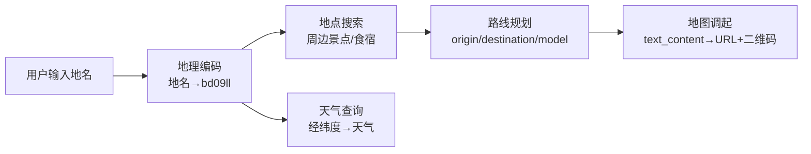

# 5-6 百度地图 MCP 提供的工具体系全景

## 【学习目标】

- 理清百度地图 MCP Server 解决了什么问题：把地图能力以标准化协议封装，智能体无需关心 API 细节即可调用。
- 逐一对照项目真实用得到的 MCP 工具（天气、地理编码、地点搜索、路线规划、地图调起），明确它们的输入输出契约。
- 理解「工具标准化」对多 Agent 系统的意义：成员 Agent 通过挂载 MCP 工具即可获得外部能力，而无需改写自身逻辑。

## 【正文】

在 1 章我们已经申请了百度地图开放平台的 API Key（缩写 AK），只有携带这串密钥才能调用百度地图的接口。重点在于：百度地图已经把这套接口封装成了一个 **MCP Server**。智能体不再直接对接零散的 REST API，而是通过 MCP 协议向该 MCP Server 请求能力，这正是「工具标准化」的价值：对上，Agent 看到的是统一的工具描述；对下，百度负责把协议调用翻译成真实 API 请求。

### 一、MCP 工具清单与本项目匹配度

按文档梳理，百度地图 MCP 提供的工具可以分成「本项目必用」与「通用可选」两类：

| 工具（MCP 能力） | 本项目是否用到 | 关键输入 | 关键输出 | 说明 |
|---|---|---|---|---|
| 天气查询 | 是 | 经纬度 `location`、行政区划 `district_id` | 该点天气 | 用于按天气筛选可游玩景点 |
| 地理编码 | 是 | 地址 `address`、城市 `city` | 百度经纬度 `bd09ll` | 把地名转坐标；逆地理编码则反过来，输入 `latitude`/`longitude`，输出 `formatted_address` |
| 地点搜索（含 POI） | 是 | 中心点 + 关键词（如「天安门,美食」） | 周边住宿 / 景点 / 美食 | 个人申请级别通常只能用基础地点搜索，高级 POI 检索未必开放 |
| 路线规划 | 是 | 出行方式 `model`、起点 `origin`、终点 `destination` | 驾车 / 步行 / 公交路线 | 覆盖景点间、住宿与景点间、美食间路线 |
| 地图调起（马克地图） | 是 | 规划文本 `text_content` | 个性化地图 URL + 二维码 | 把路线规划结果可视化并支持分享 |
| IP 定位 | 可选 | IP 地址 | 城市及城市中心 | 通用定位 |
| 实时路况 | 可选 | 道路 / 区域 | 路况 | 出行前避堵 |
| 多维检索 | 可选 | 多条件多类型 | 复合检索结果 | 高级检索 |
| 行政区划查询 | 可选 | 关键词 / 边界 | 区划信息 | 通用 |

对照项目需求可以看到：天气决定景点取舍，地理编码把用户输入的地名转成坐标，地点搜索给出「某点周边有什么」，路线规划串起景点与食宿，地图调起把结果落到可分享的页面，**这五项恰好覆盖了旅行规划团队的全部外部数据需求**，剩下的 IP 定位、路况等属于锦上添花。

### 二、参数契约：工具调用的硬约束

MCP 工具不是「传个地名就行」，每个能力都有严格的输入输出约定，Agent 调用前必须按契约构造参数，否则 Server 会直接拒绝：

- **地理编码**：入参 `address` + `city`，出参为百度坐标系 `bd09ll` 的经纬度。注意是 `bd09ll` 而非 WGS84，后续若与其他坐标系混用需做转换。
- **逆地理编码**：入参 `latitude` + `longitude`，出参含 `formatted_address`。
- **路线规划**：入参 `model`（出行方式）、`origin`、`destination` 三者缺一不可；不指定 `model` 时无法区分驾车 / 步行 / 公交。
- **天气查询**：入参 `location`（经纬度）或 `district_id`，只给地名查不到天气，这正是必须先做地理编码的原因。
- **地图调起**：入参 `text_content`，出参为 URL 与二维码，用于前端展示与分享。

**为什么必须先地理编码、不这么写会怎样**：路线规划与天气查询都吃「经纬度」而不吃「地名」。若让 Agent 直接把「天安门」塞给天气工具，参数契约不满足，调用必然失败。工程中正确的顺序是「地名 → 地理编码 → 拿到 `bd09ll` → 再喂给天气 / 路线」，这一步顺序错了，整条工具链就断在第一个节点。

### 三、工具如何挂到 Agent 上

在 AgentScope 体系中，这些 MCP 工具被封装进成员 Agent 的 `Toolkit`，以 `@Tool` 形式声明，成员在 ReAct 循环中由大模型决策调用。对应到离线复刻工程：

- 路线相关工具集中在 `com.travel.agent.tool.RouteMakingTools`（地理编码、路线规划、地图调起）。
- 景点 / 周边检索相关工具集中在 `com.travel.agent.tool.AttractionTools`（地点搜索、天气）。
- 远程成员的元信息（能力描述、端点）由 `com.travel.agent.a2a.AgentCard` 承载，供主管做「按能力分发」时读取。

**生产经验**：把「工具参数契约」与「工具归属」固定下来，成员 Agent 就能在不改自身逻辑的前提下获得百度地图的全部能力；一旦百度侧接口升级，只需改 `Toolkit` 内的封装，Agent 编排层完全不动，这就是 MCP 标准化带来的解耦收益。

## 【易错点 / 面试题】

1. **面试官常问：MCP 和直接调 REST API 有什么区别？**
   答：MCP 把外部能力抽象为「统一的工具描述 + 标准协议」，Agent 面向工具而非接口编程；后端 API 细节、鉴权、坐标转换等由 MCP Server 封装，调用方只关心入参出参契约。项目里就是百度地图 MCP Server 把地图 API 包成可挂载工具。
2. **为什么天气查询前必须先地理编码？**
   因为天气工具的入参是经纬度或行政区划 ID，不接受纯地名；跳过编码会触发参数校验失败。这是工具链顺序依赖的典型坑。
3. **路线规划缺了 `model` 会怎样？**
   无法区分驾车 / 步行 / 公交，Server 要么报错要么返回默认方式，导致规划的出行类型不符合用户预期。

## 【小结】

本节把百度地图 MCP 的工具体系摊开来看：天气、地理编码、地点搜索、路线规划、地图调起五项直接支撑旅行规划团队，其余为可选能力；每个工具都有明确的参数契约，调用顺序（尤其「先编码后查询」）是工程正确性的关键。下一篇起进入第 6 章，转向另一套实现栈 Spring AI，讲解它与 Spring Boot 的整合及 `ChatClient` / `ChatModel` 两大交互对象。需要说明：本课程的 981-demo 是以 AgentScope 栈离线复刻上述 MCP 工具挂载形态的（见 `981-demo/src/main/java/com/travel/agent/tool/RouteMakingTools.java`、`AttractionTools.java`、`a2a/AgentCard.java`），而第 6 章的 Spring AI 名词（如 `spring-ai-starter-mcp`、`McpToolCallback`）是另一套等价实现思路，二者不可混为一谈。
