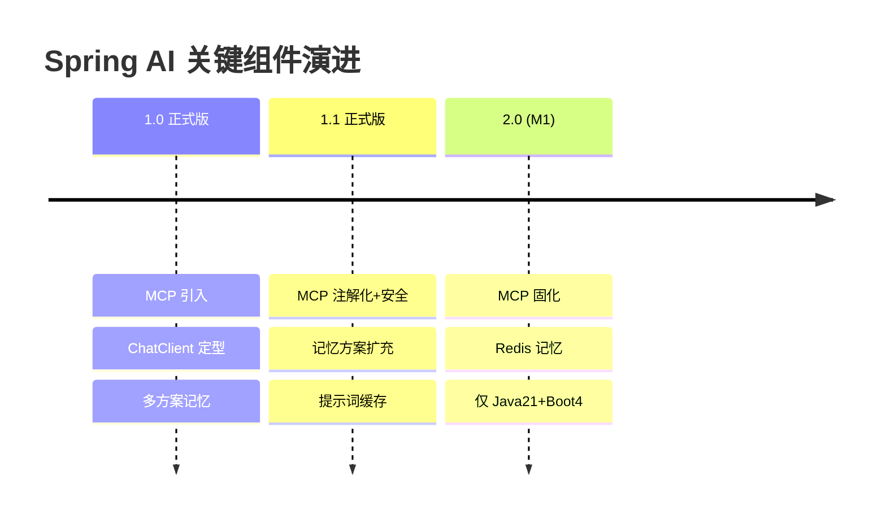

# 6-1 Spring AI 1.0、1.1 和 2.0

## 【学习目标】

- 厘清 Spring AI 与 Spring AI Alibaba 的关系：后者是前者在国内的发行版，版本号与上游同步。
- 从 1.0 / 1.1 / 2.0 三个版本的演进中，提炼出课程真正要主攻的三个稳定组件：MCP、对话记忆、`ChatClient`。
- 建立「以不变应万变」的学习观：开发者 API（`ChatClient` 等）跨版本稳定，变化主要发生在底层机制与增强组件上。

## 【正文】

本项目要做的是多智能体系统，底层框架选的是 **Spring AI Alibaba**。它本质上是 Spring AI 在国内的发行版本，因为 Spring AI 上游依赖的部分基础设施在国内访问偏慢，阿里在其上做了适配与托管。二者的**版本号是同步发布**的：课程里有时候统称「Spring AI」，指的就是该国内版的 Spring AI Alibaba，能力上没有本质区别。

做项目时，Spring AI 1.0 正式版已经发布，课程以 1.0 为基线；而 AI 迭代极快，几个月内 1.1 正式版就出了，录制本节时 2.0 也放出了 M1。把三个版本放在一起对比，是为了区分「哪些组件是长期主线、哪些只是过渡」，主线组件值得深学，过渡组件了解即可。

### 一、三版本能力对照

| 能力维度 | 1.0（正式版） | 1.1（正式版） | 2.0（录制时为 M1） |
|---|---|---|---|
| MCP 支持 | 首次引入，能连外部数据 / API | 升级为 Spring Boot 注解内嵌，并加 OAuth2 安全层 | 成为固有组件，不再单独递增 |
| 大模型交互对象 | `ChatClient`（基础操作定型） | 完全继承，无变化 | 完全继承，无变化 |
| 对话记忆 | 内存 / 文本 / 数据库等方案 | 提供更多存储方案 | 基于 Redis 的对话记忆组件 |
| RAG（向量检索生成） | 支持 | 更高效 | 基于向量数据库提升，仍为重点发展但非本课重点 |
| 模型支持 | 多后端（阿里 / DeepSeek / OpenAI） | 原生支持 Gemini 2.0 Flash，新增提示词缓存 | 深度集成 OpenAI 与 Gemini，原生 SDK 集成 |
| 运行基线 | - | - | 仅支持 Java 21 + Spring Boot 4.0 以上，并做性能调优 |

### 二、为什么这三个版本必须合起来看

三个版本是承接关系：1.0 里很多重要组件在 1.1、2.0 里仍被沿用，所以基于 1.0 学的内容不会白费；但 1.0 里部分组件可能在后续被淘汰，没必要当成重点。把三版对照一遍，就能把「长期主线」和「过渡项」分开。

从对照表可以清楚看出，**三条主线贯穿始终**：

1. **MCP**：从 1.0 首次引入，到 1.1 变成注解内嵌并补安全，再到 2.0 固化为基础设施，它是多 Agent 调用外部工具的基石，必须主攻。
2. **对话记忆（上下文）**：1.0 提供多方案，1.1 扩充存储，2.0 又补 Redis，记忆机制持续增强，是多轮 Agent 的前提。
3. **`ChatClient` 交互对象**：1.0 把基础操作定型后，1.1、2.0 一字未改。这意味着**课程以 1.0 为基线完全合理**，你学的是「未来的稳定 API」，而不是会被推倒重来的临时接口。

**为什么把 RAG 降权**：课程录制时已是 2025 年底，业界对「向量检索生成（RAG）」争议很大，普遍认为它只是阶段性过渡，未来会被更优的上下文方案替代。Spring AI 仍在发展 RAG，但它**不是本课程的讲解重点**，学员应当把精力放在上面三条主线上，避免被一个尚在快速变化的能力牵扯过多。

**为什么 `ChatClient` 是「以不变应万变」的锚点**：大模型后端（阿里、DeepSeek、OpenAI、Gemini）年年换、月月新，但应用层与模型对话的方式被 `ChatClient` 收敛成了统一接口。你只需要在配置文件里指定后端，调用代码几乎不动。这是对「 AI 变化快、工程要稳」这一矛盾的最佳解法：变的是模型，不变的是交互契约。

## 【易错点 / 面试题】

1. **面试官常问：Spring AI 和 Spring AI Alibaba 是什么关系？版本号一致吗？**
   答：Spring AI Alibaba 是 Spring AI 在国内的发行版，构建于上游之上并做国内适配，二者版本号同步发布。课程里说的「Spring AI」通常即指国内版，能力等价。
2. **为什么课程以 1.0 为基线，而不直接追 2.0？**
   因为 1.0 已经把 `ChatClient` 等开发者 API 定型，这些 API 在 1.1、2.0 中完全继承；学 1.0 的主线组件等于学了未来稳定接口，不必被版本号牵着走。
3. **MCP、对话记忆、`ChatClient` 三者为什么是主线？**
   它们从 1.0 贯穿到 2.0 且持续增强，分别对应「外部工具接入」「多轮上下文」「模型交互契约」，是多 Agent 工程的三大支柱；RAG 则因争议大被降权。

## 【小结】

本节给出课程的版本坐标系：Spring AI Alibaba 即国内版 Spring AI，1.0 / 1.1 / 2.0 演进中真正要主攻的是 MCP、对话记忆与 `ChatClient` 三条不变主线，RAG 作为有争议的过渡项降权处理。需要说明：本课程的 981-demo 是以 **AgentScope 栈**离线复刻同类多 Agent 调度与 MCP 工具挂载形态的，而第 6 章讲解的 `ChatClient` / `MCP` 等是 **Spring AI** 栈的等价实现思路，框架不同，但「工具标准化 + 主管编排」的核心思想一致。技术前瞻：课程录制时 2.0 尚为 M1；截至 2026-10，Spring AI 已发布 **2.0.1 正式版**（2026-06-12 GA，构建于 Spring Boot 4.1.1 + Spring Framework 7.0），开发者 API 与本节一致；后续 2.1 / 3.0 计划引入 Message Parts 模型与「Spring AI Agents」（Skills / 子 Agent / 渐进披露），方向正与本课程前半段讲的多 Agent + Skills 呼应。下一篇（6-2）进入实战：把 Spring AI Alibaba 与 Spring Boot 真正整合起来。
