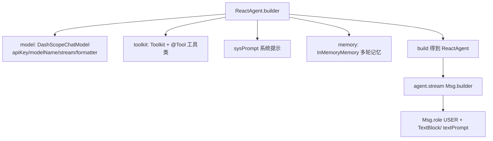

# 6-10 AgentScope 构建搭载工具的 ReAct Agent（2）

## 【学习目标】

- 用 `@Tool` 注解 + `Toolkit.withToolsTool` 把普通 Java 类注册成 Agent 可调用工具，理解「大模型靠 description 认识工具」的机制。
- 掌握 AgentScope 与 SpringAI Alibaba 1.1 在记忆配置上的差异：AgentScope 用 `memory(Memory)`（`InMemoryMemory`），而非 `saver`。
- 用 `Msg.builder()` + `TextBlock` 或 `textPrompt` 构造用户输入，并以 `agent.stream(Msg)` 运行 Agent。

## 【正文】

### 一、其他模型参数：enableThinking 与 formatter

`DashScopeChatModel.builder()` 还有若干可选参数，例如 `enableThinking(true)`（深度思考/思维链开关，列出推理过程，这股风气由 DeepSeek 带起），以及 `formatter`（返回格式，上章已讲）。基础三件套 `apiKey`/`modelName`/`stream` 之外，按需求补这两项即可。

### 二、用 @Tool 把工具类挂进 Toolkit

先建一个普通天气工具类，标注 `@Tool`：

```java
    @Tool
    public class WeatherTool {
        public String getWeather() {
            return "It's always sunny";
        }
    }
```

`@Tool` 带 `name` 与 `description`，大模型读 `description` 才知道「这工具是干什么的」。即使工具类本身没有任何注解也能 `new WeatherTool()` 塞进 `withToolsTool`（因其参数只是 `Object`），但**不标 `@Tool` 大模型就不认识它**，等于白挂。

创建工具包并写入工具：

```java
    // 配置工具包
    .toolkit(new Toolkit())
    .build();
```

```java
    .toolkit(toolkit)
    .sysPrompt("")
    .memory(new InMemoryMemory())
    .build();
```

**为什么用 `Toolkit` + `withToolsTool` 比 1.1 方便**：SpringAI Alibaba 1.1 里，要给 Agent 配工具，除了类标 `@Tool`，还得把工具 `FunctionToolCallback.builder(name)...build()` 成 `ToolCallback` 对象，再逐个塞进 `tools(...)`。AgentScope 则只要类标 `@Tool`、丢进 `Toolkit` 即可，框架自动扫描 `@Tool` 方法注册，省掉手写 `ToolCallback` 的样板：

```java
    ToolCallback weatherTool = FunctionToolCallback.builder(name)
        .description("Get weather for a given city")
        .inputType(String.class)
        .build();
```

**生产经验**：`description` 是工具能否被正确调用的命门。写得含糊（「获取信息」），大模型会乱调或弃用；写清输入、输出与适用场景（「输入城市名，返回实时天气」），调用准确率显著提升。工具描述质量直接决定 Agent 可靠性。

### 三、记忆：AgentScope 用 memory 而非 saver

SpringAI Alibaba 1.1 用 `saver(MemorySaver)` 赋予记忆；AgentScope 没有 `saver`，改用 `memory(Memory)`。`Memory` 是接口，`InMemoryMemory` 是其实现，传入即可让 Agent 具备多轮一致性（即上一节 `.memory(new InMemoryMemory())` 那一行）。

**为什么命名不同但作用相同**：两者都是「多轮对话记忆」，只是框架抽象名不同。AgentScope 用 `Memory` 接口统一「短期/持久化记忆」形态，后续可换外部存储实现；1.1 用 `Saver` 偏「保存器」语义。迁移框架时别按旧名找方法，这是两栈混用最常见的编译坑。

### 四、运行 Agent：Msg 与 TextBlock

AgentScope 执行同样有 `call`（一次性）与 `stream`（流式）。因前面已配 `stream(true)`，运行用 `stream` 并传入 `Msg`：

```java
    agent.stream(Msg.builder().build());
```

`Msg` 是用户提示词的载体，`Msg.builder()` 工厂创建。消息需配 `role`（如 `MsgRole.USER`）与 `content`（内容）。`content` 收 `ContentBlock` 不定参数，文本型用 `TextBlock`：

```java
    .role(MsgRole.USER)
    .content(List.of(
        TextBlock.builder()
            .text("")
            .build()
    ))
    .build();
```

**为什么 content 要包成 ContentBlock/TextBlock**：这是为「多模态」预留的封装，`ContentBlock` 既能是 `TextBlock`（文本）也能是图片块等，统一了消息体结构。若只发纯文本，有更简洁的 `textPrompt("...")` 直接传文字，无需手动 `TextBlock.builder()`。

**为什么 stream 仍可用、又不必显式 call stream**：AgentScope 在 `DashScopeChatModel` 已设 `stream(true)`，运行方式仍选 `stream(Msg)` 即可拿到流式结果；框架按模型配置决定编码，调用侧心智统一为「传 Msg、取响应」。

执行配置与运行流程归纳如下：



### 五、与 SpringAI Alibaba 1.1 的整体差异小结

AgentScope 基于 1.1，大量风格一致（都 ReAct、都 builder 创建），但在三处更顺手：配置工具用 `Toolkit` + `@Tool` 自动扫描（免手写 `ToolCallback`）；模型用 `Model` 抽象可换厂商；消息发送支持 `Msg`/`TextBlock` 多模态、并内建 `formatter` 与 `enableThinking`。

## 【易错点 / 面试题】

1. **工具类不标 @Tool 能塞进 Toolkit 吗？能生效吗？**
   能塞（参数只是 `Object`），但不生效，大模型靠 `@Tool` 的 `description` 识别工具，缺注解等于「挂了却没人会叫」。

2. **AgentScope 与 1.1 记忆配置方法分别叫什么？**
   AgentScope 用 `memory(Memory)`（如 `InMemoryMemory`）；1.1 用 `saver(MemorySaver)`。混用旧名会编译失败。

3. **纯文本 prompt 用 TextBlock.builder 还是 textPrompt？**
   两者皆可，纯文本优先 `textPrompt("...")` 更简洁；`TextBlock` 是面向多模态消息体的底层写法，需要图文混发时才必须用它。

## 【小结】

本章用 `@Tool` + `Toolkit` 完成 AgentScope 版「ReAct Agent 搭载工具」，补齐 `memory`/`sysPrompt`，并以 `Msg`/`TextBlock` 运行 Agent。结合 6-9 的差异对照，AgentScope 与 SpringAI Alibaba 1.1 在 ReAct 范式上同源、在工具与记忆 API 上异栈。完整离线可跑示例见 `981-demo/src/main/java/com/travel/agent/agent/SupervisorAgent.java`（主管 ReAct Agent）、`981-demo/src/main/java/com/travel/agent/agent/TeamMembers.java`（成员 Agent 组队）、`981-demo/src/main/java/com/travel/agent/tool/RouteMakingTools.java` 与 `981-demo/src/main/java/com/travel/agent/tool/AttractionTools.java`（`@Tool` 风格工具挂载），这些正是 981-demo 以 AgentScope 栈复刻本章「ReAct Agent + 工具」形态的真实模块。技术前瞻上，Spring AI Alibaba 已引入 Agent Skills 与渐进式工具披露（ToolSearchToolCallingAdvisor），其「按需加载工具、省 token」的思路与本章 `@Tool` 工具挂载一脉相承。
