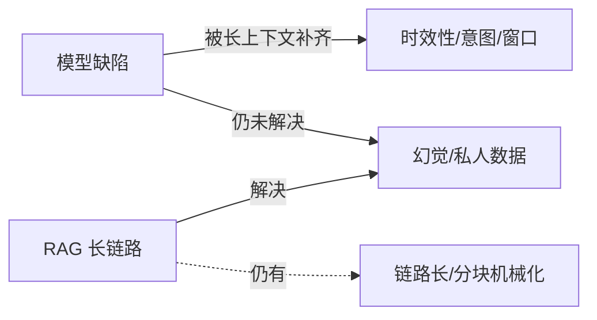

# 6-14 长上下文能取代 RAG 吗？

【学习目标】
- 拆解 RAG 长链路（清洗→分块→向量化→入库；查询→初筛→重排→排序）及其两类固有缺陷。
- 对照长上下文能力，判断哪些缺陷被模型内化、哪些仍残留。
- 明确 RAG 不会被取代的两大场景（私人数据、异构数据）。
- 理解本课程为何把 RAG 视为「发展中态」而非主线。

【正文】

RAG 作为弥补模型缺陷的检索外挂，针对的是：数据即时性不足、意图洞察不准、幻觉、私人数据缺失、上下文窗口有限。但 RAG 自身也有局限。

### 一、RAG 的长链路与缺陷

RAG 把私人/商业/运营数据（Excel / Word / 图片）接入向量库，链路很长：

入库侧：数据清洗与标注 → 数据分块（分片方式决定质量）→ 向量化 → 存入向量库。
查询侧：向量库先初筛相关知识的查询 → 重排（Rerank）精确筛选 → 顺序排列 → 反馈相关知识的查询。

**缺陷一：链路长、易放大错误**。从入库到查准要经多节点，任一节点出错会沿链路流动甚至放大，查准难保证，且带来性能开销。

**缺陷二：分块机械化**。不同文件前后文有关联，却用单一分片方式「一刀切」，承上启下内容被割裂、知识碎片化，导致查找不精准。

### 二、长上下文补齐了哪些缺陷

模型演进一日千里：
- **数据时效性**：现已能查到最新/即时数据，该缺陷已消解。
- **意图挖掘**：模糊表述也能被正确挖掘真实意图，不必精准表达。
- **上下文窗口**：长上下文功能解除窗口长度限制，整部《红楼梦》可直丢给模型分析；多轮对话记忆也能结合上下文。比喻：长上下文像模型「记忆力超群」。

下图为「长上下文 vs RAG」的能力此消彼长（归纳自本节）：

### 三、哪些缺陷短期无解

- **幻觉**：一本正经胡说八道，目前仍看不到彻底解法。
- **私人数据**：企业内部商业数据不可能发往云端模型，除非本地部署（成本高、需大量显卡），近期无解。

### 四、RAG 不会被取代

6-1 讲过 Spring AI 1.0/1.1/2.0，其中 2.0 仍把 RAG 作为重要组件，并优化了向量库与检索索引。RAG 有模型替代不了的两类场景：
- **私人数据（个性化）**：最重要，模型永远拿不到。
- **多元异构数据**：音频、结构化/非结构化数据、视频，不可能一股脑丢给模型（模型也处理不过来）；RAG 统一向量化入库、统一查询，是它近期不可替代的优势。

**名词对照（Spring AI）**：上述「统一向量化入库 + 统一查询」即 `VectorStore` 的职责；`Embedding` 模型负责把文本/多模态转向量，`QuestionAnswerAdvisor` 负责把检索片段注入 prompt。长上下文与 RAG 并非替代关系，而是互补，超大上下文解决「一次塞得下」，RAG 解决「该塞哪一块」。

### 五、本课程的取舍

RAG 处于发展中间态，等成熟确定再系统学，可避免学了即过时的知识。本课程聚焦有持久趋势的多 Agent 与 MCP 能力。

【易错点/面试题】
1. **面试问：长上下文能取代 RAG 吗？** 答：不能。长上下文解决「窗口够大、一次塞得下」，但私人数据与异构数据仍需 RAG 向量化入库；且 RAG 解决幻觉（限源），长上下文不解决幻觉。
2. **RAG 分块为何不能一刀切？** 答：文件前后文关联，单一分片会割裂承上启下内容、造成知识碎片化、查准下降。
3. **Rerank 作用？** 答：在初筛基础上做精确重排，提升最终注入 prompt 的片段相关性。

【小结】
长上下文与 RAG 互补而非替代：前者解窗口，后者解私人/异构数据与幻觉限源。需明确：本课程的 981-demo 聚焦多 Agent 协同与 MCP 工具挂载，**并未实现 RAG**，不应假称其具备向量检索。技术前瞻：Spring AI 2.0 持续优化 `VectorStore` 索引，2.1 的 Message Parts 有望让多模态片段更细粒度注入上下文。
