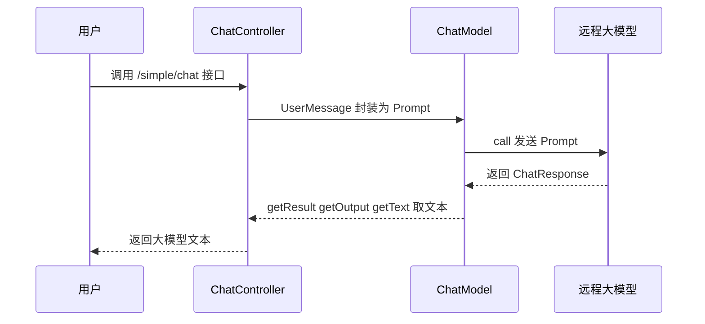

# 6-3 和大模型互动的中枢：ChatModel 对象

## 【学习目标】

- 理清 Spring AI 中与大模型对话的四个核心对象：`UserMessage`、`Prompt`、`ChatModel`、`ChatResponse`。
- 掌握 `ChatModel` 的正确获取方式：由 Spring Boot 自动装配注入，而非手动 `new`。
- 会写最小可运行的对话 Controller，并理解为什么要对 `ChatResponse` 做空值防御。

## 【正文】

上一节把 Spring AI Alibaba 与 Spring Boot 整合完成，`spring-ai-alibaba-starter-dashscope` 一进场，Spring Boot 的自动装配就会把框架组件初始化，启动时提示「缺 API Key」恰恰证明了这一点。本节就用这套框架写一个 API，真正和大模型对话。

先确认依赖齐全：Web 起步包负责接收 HTTP 请求，AI 起步包提供对话能力。

```xml
        <dependency>
            <groupId>org.springframework.boot</groupId>
            <artifactId>spring-boot-starter-web</artifactId>
            <version>${springboot.version}</version>
        </dependency>

        <dependency>
            <groupId>com.alibaba.cloud.ai</groupId>
            <artifactId>spring-ai-alibaba-starter-dashscope</artifactId>
            <version>1.0.0.2</version>
        </dependency>
```

### 一、四个对象串起一次对话

在网页端和大模型聊天，流程是：在输入框写一句话（这就是 prompt）→ 点提交发给远程模型 → 模型返回文字。对应到 Spring AI，这套流程被建模成四个对象：

- **`UserMessage`**：用户的原始输入，构造时传入一个字符串。
- **`Prompt`**：提示词对象，里面封装的就是 `UserMessage`。
- **`ChatModel`**：大模型对象，负责把 `Prompt` 发往远程模型并取回结果。
- **`ChatResponse`**：模型返回的对象，从中可提取文本。



在 `controller` 包下建一个 `ChatController`，先写出最简对话方法：

```java
        @RestController
        public class ChatController {

            @GetMapping("/simple/chat")
            public String simpleChat() {
                // 用户输入
                String message = "在咖啡馆里，想要杯星巴克";
                UserMessage userMessage = new UserMessage(message);
                Prompt prompt = new Prompt(userMessage);
                ChatModel chatModel = new ChatModel();
                ChatResponse chatResponse = chatModel.call(prompt);
                return chatResponse.getText();
            }
        }
```

### 二、`ChatModel` 不要 `new`，要注入

上面的代码里 `new ChatModel()` 是**故意写错的演示**，真实工程里 `ChatModel` 不能手动实例化。文档明确：引入并整合该依赖后，Spring Boot 自动装配会初始化两个实例，一个是 `ChatClient`，另一个就是 `ChatModel`。既然容器已经帮我们造好了，直接注入即可，不必、也不应该自己 `new`。

通过构造方法把它注入为 `final` 成员变量是最推荐的做法（比 `@Autowired` 字段注入更利于测试和不可变性）：

```java
@RestController
public class ChatController {
    private final ChatModel chatModel;

    public ChatController(ChatModel chatModel) {
        this.chatModel = chatModel;
    }

    @GetMapping("/simple/chat")
    public String simpleChat() {
        UserMessage userMessage = new UserMessage("在咖啡馆里，想要杯星巴克");
        Prompt prompt = new Prompt(userMessage);
        ChatResponse chatResponse = chatModel.call(prompt);
        return chatResponse.getResult().getOutput().getText();
    }
}
```

调用链是 `chatModel.call(prompt)` 拿到 `ChatResponse`，再 `getResult()` → `getOutput()` → `getText()` 取出文本。

**为什么必须做空值防御**：大模型调用受网络、超时、限流影响，`getResult()` 完全可能返回 `null`；更严谨时 `getOutput()` 也可能是 `null` 或空串。生产代码应当先判空再取文本，否则偶发的超时就会抛 NPE。这也是为什么课程强调「严谨一点先判断 `getResult` 是否为 null」。

```java
ChatResponse resp = chatModel.call(prompt);
if (resp != null && resp.getResult() != null
        && resp.getResult().getOutput() != null) {
    return resp.getResult().getOutput().getText();
}
return "";
```

**为什么不自己 `new` ChatModel**：自动装配的 `ChatModel` 内部已经绑定了 `api-key`、模型名、重试与超时等配置；手动 `new` 出来的是个「裸对象」，既拿不到密钥，也缺失这些横切配置，调用必败。把对象生命周期交给容器，是 Spring 应用的基本纪律。

### 三、用 `application.yml` 配置后端模型

对话要连真模型，需要在 `resources/application.yml` 里写密钥与模型名。`spring-ai-alibaba-starter-dashscope` 接入的是**阿里百炼**大模型服务平台，里面包含 Qwen3 系列、DeepSeek 等，但**不含文心一言**（不同厂商平台）。配置如下：

```yaml
        spring:
          ai:
            dashscope:
              # 阿里百炼大模型服务平台 API-Key申请文档
              # https://help.aliyun.com/zh/model-studio/get-api-key
              api-key: 你的Api-key
              chat:
                options:
                  model: deepseek-r1 # 指定DeepSeek的模型名称
```

把 `api-key` 换成前面课程申请的免费密钥，`model` 填 `deepseek-r1` 即可。启动后 8080 端口正常打开，用 Apifox 调 `/simple/chat`，就能拿到大模型返回的 Markdown 文本。

**为什么密钥必须走配置文件而非硬编码**：密钥属于环境敏感信息，硬编码会泄露到代码仓库；走 `application.yml`（生产再走环境变量 / 配置中心）既能本地跑通，又能保证密钥不落库、可随环境切换。

## 【易错点 / 面试题】

1. **面试官常问：Spring AI 里 `ChatModel` 和 `ChatClient` 各自怎么拿到？**
   答：二者都由 Spring Boot 自动装配生成。`ChatModel` 通过构造方法注入；`ChatClient` 额外走 `builder().build()` 构建（下节讲）。都不该手动 `new`。
2. **取大模型文本为什么要层层判空？**
   远程调用可能因超时 / 限流返回不完整响应，`getResult()`、`getOutput()` 都可能为 `null`，不防御就会 NPE。
3. **`spring-ai-alibaba-starter-dashscope` 接入的是哪个平台？能用文心一言吗？**
   接入阿里百炼（含 Qwen3、DeepSeek 等），不含文心一言；想换模型只改 `application.yml` 的 `model` 字段。

## 【小结】

本节打通了「对象建模 → 注入 `ChatModel` → 取文本做空值防御 → 配 `application.yml` 连真模型」的最小对话链路，四个核心对象是后续所有 Agent 能力的基础。需要说明：981-demo 是以 AgentScope 栈离线复刻同类多 Agent 能力的，本节讲的是 Spring AI 栈的 `ChatModel` 交互，框架不同不可混用。下一节（6-4）看另一个同样由自动装配生成、但用法不同的对象，`ChatClient`，以及它背后的 Builder 模式与链式调用。
