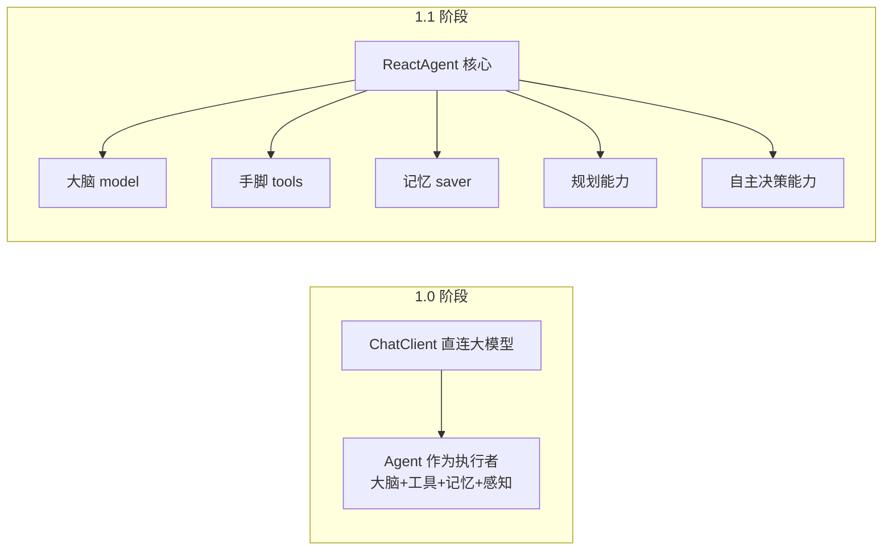

# 6-6 SpringAI Alibaba 1.1 正式进入 Agent 自主决策时代

## 【学习目标】

- 理解 SpringAI Alibaba 从 1.0（对话）到 1.1（智能体）的定位跃迁：核心变为 Agent Framework 与 Graph Core。
- 掌握 `ReactAgent.builder()` 的五个关键配置：`name / model / tools / systemPrompt / saver`，建立「大脑-手脚-记忆」的心智模型。
- 会用 `agent.call()` 一次性返回与 `agent.stream()` 流式返回（`Flux<NodeOutput>`），并看懂 `OutputType` 的流式阶段。

## 【正文】

### 一、1.0 到 1.1 的架构重心变化

1.0 阶段，与大模型交互只有一条路：用 `ChatClient` 链式调用，发 Prompt、收流式响应（基于 SSE）。智能体（Agent）概念虽存在，但只是「执行者」，作为 `ChatClient` 的补充，帮大模型调工具真正解决问题。

1.1 阶段（录制时版本已发布），文档目录出现两个核心：**Agent Framework** 与 **Graph Core（工作流）**。与语言大模型的交互不再是直接调 `ChatClient`，而是经由智能体。1.1 真正的核心只有两个，工作流与智能体；「跟大模型对话」降级为最底层能力，被智能体调用。

依赖引入方式与 1.0 一致：仍用 BOM 版本管理。区别在于 `agent-framework` 走 BOM、无需写版本号，而 `dashscope` starter 不在 BOM 内、必须显式指定 `${spring-ai-alibaba.version}`：

```xml
        <dependency>
            <groupId>com.alibaba.cloud.ai</groupId>
            <artifactId>spring-ai-alibaba-agent-framework</artifactId>
            <version>1.1.0-RC2</version>
        </dependency>

        <dependency>
            <groupId>com.alibaba.cloud.ai</groupId>
            <artifactId>spring-ai-alibaba-starter-dashscope</artifactId>
            <version>${spring-ai-alibaba.version}</version>
        </dependency>
```

**为什么 dashscope 要单独写版本**：BOM 只托管了框架自身一套坐标，`dashscope` starter 属于「模型接入层」独立发布节奏，不进 BOM，漏写版本会直接编译报错。生产里建议把 `${spring-ai-alibaba.version}` 收口到父 `pom` 的 `properties`，避免多模块版本漂移。

**注意**：1.1 完全兼容 1.0 的 `ChatClient` 写法，老代码不用改；但新开发应按 1.1 理念，通过 `ReactAgent` 而非直连大模型来交互。

### 二、用 ReactAgent 创建智能体

跟随文档，创建智能体只需 `ReactAgent.builder()` 设属性后 `build()`：

```java
        @GetMapping(value = "/simple/stream", produces = MediaType.TEXT_EVENT_STREAM_VALUE)
        public Flux<String> streamChat() {
            // 创建 agent
            ReactAgent agent = ReactAgent.builder()
                .name("weather_agent") // Agent的名称（必须）
                .model(chatModel) // Agent的大脑（语言大模型）
                .tools(weatherTool) // Agent的手脚（调用工具）
                .systemPrompt("You are a helpful assistant") // Agent的眼睛和耳朵（系统提示）
                .saver(new MemorySaver()) // Agent的记忆（多轮对话记录）
                .build();
        }
```

五个属性的含义，用「人」来类比最直观：

- `name`：智能体唯一 ID，必填，调度时靠它寻址。
- `model`：智能体的大脑（语言大模型），传入 `ChatModel`。配置文件已定模型时，此参数可注释掉。
- `tools`：智能体的手脚。大模型只擅长推理，真正解决问题靠调工具，这是 Agent 与普通「对话」的本质区别。
- `systemPrompt`：系统提示词，给 Agent 划能力边界（「你是谁、擅长什么」）。
- `saver`：记忆，承载多轮对话一致性（第三轮可省略首轮已给的信息，Agent 凭记忆补全）。

**为什么需要 tools**：纯大模型是「大脑」，能想但不能做；工具是「手脚」，让 Agent 查天气、算费用、调 API。没有 tools 的 Agent 只是高级问答机，谈不上自主解决问题。

**为什么需要 saver**：多轮对话里用户会省略前文信息，Agent 必须凭历史上下文推断真实意图，否则每轮都是「失忆」的新会话。`MemorySaver` 是最简实现，生产可换持久化记忆（`CassandraChatMemory` 等）。

### 三、执行：call 与 stream

`builder` 里的 `systemPrompt` 是「身份设定」，`call(message)` 里的提示词才是「本次真正要聊的话」。取返回用 `getText()`：

- `call(message)`：一次性返回，适合短答。
- `stream(message)`：流式返回，返回 `Flux<NodeOutput>`。

```java
        Flux<NodeOutput> flux = agent.stream(message);

        stream.subscribe(output -> {
            // 检查是否为 StreamingOutput 类型
            if (output instanceof StreamingOutput streamingOutput) {
                OutputType type = streamingOutput.getOutputType();
                // 处理模型推理的流式输出
                if (type == OutputType.AGENT_MODEL_STREAMING) {
                    System.out.print(streamingOutput.message);
                } else if (type == OutputType.AGENT_MODEL_FINISHED) {
                    System.out.println("\n模型输出完成");
                }
            }
        });
```

**为什么返回是 `Flux<NodeOutput>` 而非 `Flux<String>`**：Agent 流式输出不止「文本片段」，还夹带阶段信号（推理中、完成、工具调用等）。`OutputType.AGENT_MODEL_STREAMING` 代表正在吐字，`AGENT_MODEL_FINISHED` 代表本轮生成结束。按类型分流，才能在前端同时渲染「思考中/已输出」状态。

**生产经验**：`ReactAgent` 的工具方法是一个类，需先在 `tool` 包下建工具类并实现对应接口，传入 `ToolCallback` 对象；`tools(...)` 是可变参数（三个点），可挂多个工具。导入 `BiFunction` 时要注意选对包，同名接口容易引错，编译报错往往就出在这里。

### 四、1.0 与 1.1 智能体的能力对比



1.0 的 Agent 已具备大脑、工具、记忆、环境感知，但只是执行者。1.1 的 `ReactAgent` 在四能力之上多了**规划能力**（把复杂任务拆成多步）与**自主决策能力**（自行决定调哪个工具、走哪一步），不再由人下指令「你该用这个工具」。

这正是 Agentic AI 时代的标志：不止单 Agent 替人执行，而是多个具备规划与自主决策的 `ReactAgent` 协同完成复杂任务。

## 【易错点 / 面试题】

1. **SpringAI Alibaba 1.0 与 1.1 调大模型的根本区别是什么？**
   1.0 直接经 `ChatClient` 对话；1.1 经 `ReactAgent` 间接对话，大模型退到 Agent 底层。1.1 仍兼容 `ChatClient`，但新代码建议走 Agent。

2. **ReactAgent 的 tools 为什么是可变参数？**
   一个 Agent 常需多个工具（查天气、算费用、调 MCP），`tools(ToolCallback...)` 用可变参数支持挂任意数量工具，不必为「几个工具」写重载。

3. **stream() 返回的 NodeOutput 要怎么消费？**
   用 `subscribe` 订阅，按 `OutputType` 分流：`AGENT_MODEL_STREAMING` 实时打印、`AGENT_MODEL_FINISHED` 标记结束。不可像 `call()` 那样直接 `getText()` 拿整段。

## 【小结】

1.1 把 `ReactAgent` 推到核心，赋予智能体规划与自主决策能力，Agentic AI 时代由此开启。后续 6-7、6-8 将用 `ReactAgent` 组出旅游规划的 Agent 团队，并借 `ParallelAgent`/`LlmRoutingAgent`/`SequentialAgent` 编排协同。完整离线可跑示例见 `981-demo/src/main/java/com/travel/agent/agent/SupervisorAgent.java`，该 demo 以 AgentScope 栈复刻了同类「主管 + 多个 ReAct 成员自主协同」的形态，与本章 `ReactAgent` 范式同源（注意：981-demo 是 AgentScope 工程，并非 Spring AI 工程）。技术前瞻上，统一栈 Spring AI 2.0.1 将工具循环提升为 `ToolCallingAdvisor` 在 Advisor 链驱动，底层机制与 1.1 的 `ReactAgent` 工具循环一致，开发者 API 命名保持兼容。
