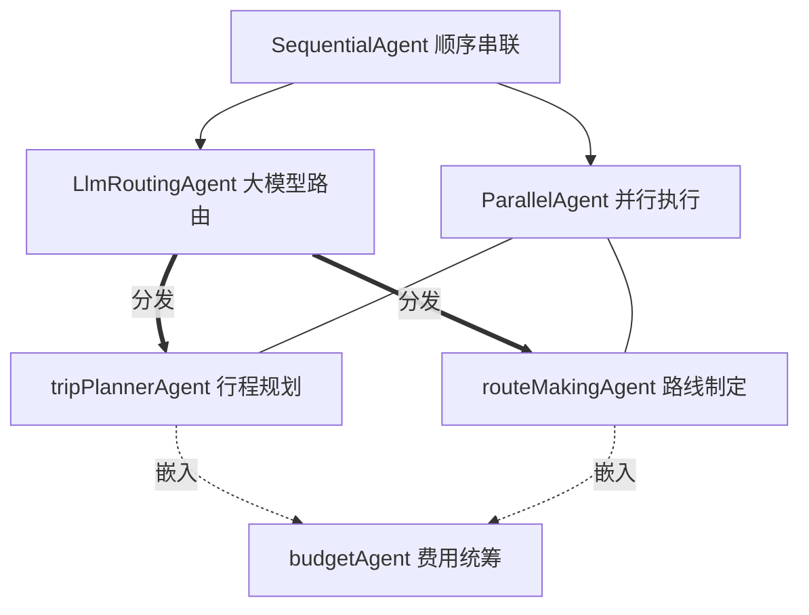

# 6-8 SpringAI Alibaba 1.1 Agent 团队协同合作

## 【学习目标】

- 厘清旅游规划团队的三种协同逻辑：费用 Agent 被嵌入、路线与行程并行无交集、主管负责路由分发。
- 掌握三种工作流 Agent：`ParallelAgent`（并行）、`LlmRoutingAgent`（大模型动态路由）、`SequentialAgent`（顺序串联），以及它们共用的 `subAgents` 配置。
- 理解工作流 Agent 与 ReAct Agent 的本质区别：前者「组织流程」、后者「执行任务」，并用 `invoke` 而非 `call/stream` 启动工作流。

## 【正文】

### 一、四个 Agent 与三种协同逻辑

上一章已建出费用统筹 Agent 与主管 Agent：

```java
    ReactAgent budgetAgent = ReactAgent.builder()
        .name("budgetAgent")
        .description("你是负责统筹旅游费用")
        .tools()
        .build();
```

```java
    ReactAgent managerAgent = ReactAgent.builder()
        .name("managerAgent")
        .description("你是负责全局统筹旅游规划")
        .tools()
        .build();
```

协同逻辑有三条：

1. **嵌入复用**：路线制定、行程规划都嵌了费用统筹 Agent，遇到算账就调它。
2. **并行无交集**：路线制定只管「两城之间交通工具选择」（自驾/高铁），行程规划只管「到达目的地后的景点/住宿/活动/餐饮」。两者业务不交叉、无依赖，是独立并行的两条线，不存在「路线结果传给行程」的顺序依赖。
3. **主管路由**：主管把「出行工具选择」分给路线 Agent、「景点住宿规划」分给行程 Agent，是任务分发中枢。

### 二、ParallelAgent：把无交集的业务并行化

路线与行程没有业务依赖，应并行执行以提升效率。它们属于「工作流 Agent」`ParallelAgent`，而非 ReAct 执行型 Agent：

```java
    ParallelAgent parallelAgent = ParallelAgent.builder()
        .name("parallelAgent")
        .description("路线制定和行程规划是并行执行")
        .subAgents(List.of(tripPlannerAgent, routeMakingAgent))
        .build();
```

`subAgents` 接收 `List<Agent>`，因为 `ReactAgent` 底层继承 `BaseAgent`→`Agent`，可作为元素传入。`ParallelAgent` 表示这些 Agent 按并行流程协同、彼此无交集。

**为什么用 `ParallelAgent` 而不是串行调两次**：并行能缩短整体耗时（路线和行程同时算），且语义上声明了「无依赖」，后续维护者一看 `subAgents` 就知道这俩不会互相阻塞。生产里把「本可并行却串行」的 Agent 拉平，是多 Agent 提速的首要优化点。

### 三、LlmRoutingAgent：让大模型动态分发

主管的路由职责，由 `LlmRoutingAgent` 承担。它同样是工作流 Agent，不是真正执行业务的 Agent：

```java
    LlmRoutingAgent llmRoutingAgent = LlmRoutingAgent.builder()
        .name("llmRoutingAgent")
        .description("将旅游出行工具选择的业务和旅游景点，住宿的规划业务分发给对应的智能体去执行")
        .subAgents(List.of(tripPlannerAgent, routeMakingAgent))
        .build();
```

名称里的 `Llm` 表明：任务怎么切、切完给谁，由大模型动态决定。`subAgents` 在这里是「分发候选集」，大模型把任务拆好后，知道该交给 `tripPlannerAgent` 还是 `routeMakingAgent`。

**为什么路由也要交给大模型**：业务边界（「工具选择」vs「景点住宿」）用规则硬编码会僵化；让大模型读 `description` 动态匹配，才能应对用户千变万化的自然语言需求。代价是路由结果不可完全预测，需用清晰的 `description` 与示例约束。

### 四、SequentialAgent：把整条流程串起来

路由 Agent 之后接并行 Agent，二者要用顺序 Agent 组装成完整流程：

```java
    SequentialAgent sequentialAgent = SequentialAgent.builder()
        .name("sequentialAgent")
        .description("")
        .subAgents(List.of(llmRoutingAgent, parallelAgent))
        .build();
```

`SequentialAgent` 表示「先路由、再并行」的顺序逻辑：先把 `llmRoutingAgent` 跑完（决定分发），再把 `parallelAgent` 跑完（并行执行）。

**为什么需要 SequentialAgent 兜底**：单独一个 `LlmRoutingAgent` 只管分发、不保证「分发完接着并行」。用 `SequentialAgent` 把「路由→并行」声明为有序两段，框架才按预期串联。三类工作流 Agent 的关系归纳如下：



### 五、启动工作流：invoke 而非 call/stream

工作流 Agent 不是单一 ReAct 执行体，不能用 `call()`/`stream()`，要用 `invoke` 传入用户需求：

```java
    // 例如：invoke("帮我规划深圳到惠州的三天旅游行程")
```

`invoke` 返回 `Optional<OverAllState>`，包含整条工作流的状态与产物。工作流由框架接管「路由→并行」的执行节奏，调用方只管喂需求、取终态。

**生产经验**：`ReActAgent` 负责「干一件事」，`FlowAgent`（Parallel/LlmRouting/Sequential）负责「编排多件事」。混淆二者是新手高频错误，给并行/路由 Agent 挂业务工具、却指望它产出业务结果，会得到空响应。职责分离是 Agent 团队可维护的前提。

## 【易错点 / 面试题】

1. **ParallelAgent、LlmRoutingAgent、SequentialAgent 和 ReactAgent 的根本区别？**
   前三者是「工作流 Agent（FlowAgent）」，只组织流程（并行/路由/顺序），不亲自执行业务；`ReactAgent` 是 ReAct 执行型 Agent，负责真正调工具干活。启动方式也不同：工作流用 `invoke`，ReAct 用 `call`/`stream`。

2. **为什么路线与行程要并行而非顺序？**
   两者业务无交集、无数据依赖，顺序执行只会徒增耗时且无意义；并行既快又准确表达「无依赖」语义。

3. **LlmRoutingAgent 的 subAgents 与 ParallelAgent 的 subAgents 含义一样吗？**
   不一样：前者是「大模型分发任务的候选集」，后者是「按并行逻辑同时执行的成员集」。同名方法、不同语义，读 `description` 与上下文才能区分。

## 【小结】

本章把四成员团队的三层协同逻辑落地为三种工作流 Agent：`LlmRoutingAgent` 动态路由、`ParallelAgent` 并行执行、`SequentialAgent` 顺序串联，最终用 `invoke` 启动整条流程。至此 SpringAI Alibaba 1.1 的「多 Agent 团队」骨架完成。从 6-9 起切换到 AgentScope 框架，看同一套 ReAct 范式在 AgentScope 里如何用 `ReactAgent` + `Toolkit` + `@Tool` 承载工具，完整离线可跑示例见 `981-demo/src/main/java/com/travel/agent/agent/SupervisorAgent.java` 与 `981-demo/src/main/java/com/travel/agent/agent/TeamMembers.java`（981-demo 即以 AgentScope 栈复刻本章「主管 + 成员 + 工作流编排」形态，是本章 SpringAI Alibaba 团队的同源异栈实现）。
