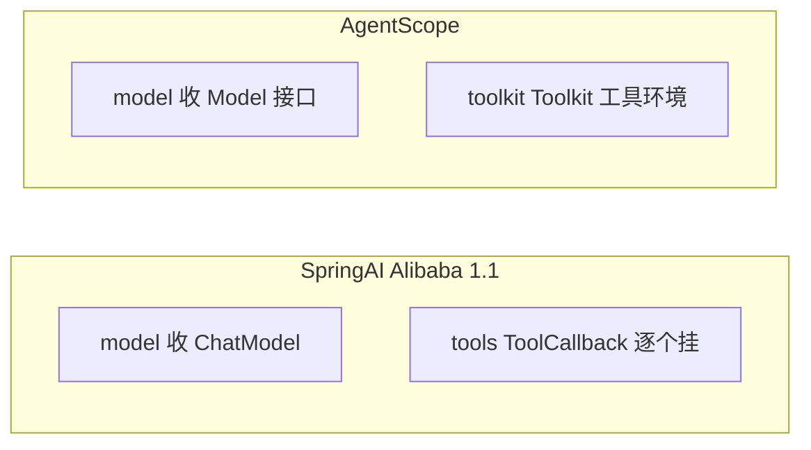

# 6-9 AgentScope 构建搭载工具的 ReAct Agent（1）

## 【学习目标】

- 理解 AgentScope（Java 版，基于 SpringAI Alibaba 1.1）与 SpringAI Alibaba 1.1 的同源关系，以及它在 `ReactAgent` 封装上的一致与差异。
- 掌握 AgentScope 创建 `ReactAgent` 的两个关键差异点：`model` 接收 `Model` 接口（而非 `ChatModel`）、配置工具用 `toolkit(Toolkit)`（而非 `tools(ToolCallback...)`）。
- 会用 `DashScopeChatModel.builder()` 装配大模型，并理解 `AgentScope` 内部 `tools`/`methodTools` 的注入机制。

## 【正文】

### 一、AgentScope 的定位与依赖

AgentScope 分 Python 与 Java 两个版本；Java 版构建在 SpringAI Alibaba（最新 1.1）之上，比 JManus 更贴近 1.1 的 API 风格。当前依赖版本 `1.0.7` 为当时最新。它用 SLF4J 日志接口，需配一个实现类 Logback：

```xml
    <dependency>
        <groupId>io.agentscope</groupId>
        <artifactId>agentscope</artifactId>
        <version>${AgentScope.version}</version>
    </dependency>
    <dependency>
        <groupId>ch.qos.logback</groupId>
        <artifactId>logback-classic</artifactId>
        <version>${logback.version}</version>
    </dependency>
```

**为什么必须引 Logback**：AgentScope 只定义 SLF4J 接口，不绑定具体实现；不提供实现类，框架内部日志会无出口（典型表现：`No SLF4J providers` 警告、调试信息全丢）。生产里日志实现应统一走项目既有的 Logback 配置。

### 二、AgentScope 的 ReactAgent 与 SpringAI Alibaba 的差异

AgentScope 同样用 `ReactAgent.builder()` 创建执行型智能体，执行体仍是 ReAct 范式。但有两个与 SpringAI Alibaba 1.1 不同的地方，需重点区分：

```java
    ReactAgent agent = ReactAgent.builder()
        .name("weather_agent")
        .model(DashScopeChatModel.builder()
            .apiKey("")
            .modelName("")
            .stream(true)
            .formatter(new DashScopeChatFormatter())
            .build())
        .tools(weatherTool)
        .systemPrompt("You are a helpful assistant")
        .saver(new MemorySaver())
        .build();
```

**差异一：`model` 的参数类型**。SpringAI Alibaba 1.1 的 `model` 收 `ChatModel`；AgentScope 的 `model` 收 `Model` 接口。上例用 `DashScopeChatModel`，它实现了 `Model` 接口，故可作参数。`Model` 是更上层的抽象，AgentScope 借此解耦具体模型厂商。

**差异二：`tools` 与 `toolkit`**。SpringAI Alibaba 1.1 用 `tools(ToolCallback...)` 一个一个挂工具；AgentScope 的 builder **没有 `tools` 方法**，改用 `toolkit(Toolkit)` 配置「工具环境」（`kit` 即环境）：

```java
    .toolkit(new Toolkit())
    .build();
```

`toolkit` 收 `Toolkit` 对象，代表一整套工具环境。差异点归纳如下：



### 三、AgentScope 内部工具注入机制

点进框架源码，`tools` 与 `methodTools` 是 builder 注入工具的两条路径，都做非空校验后加入内部集合：

```java
    public Builder tools(ToolCallback... tools) {
        Assert.notNull(tools, message: "tools cannot be null");
        Assert.noNullElements(tools, message: "tools cannot contain null");
        this.tools.addAll(Arrays.asList(tools));
        return this;
    }

    public Builder methodTools(Object... toolObjects) {
        Assert.notNull(toolObjects, message: "toolObjects cannot be null");
        Assert.noNullElements(toolObjects, message: "toolObjects cannot contain null");
        this.tools.addAll(Arrays.asList(toolObjects));
        return this;
    }
```

**为什么有两套**：`tools` 收已包装好的 `ToolCallback`（手动控制每个工具的回调）；`methodTools` 收「工具对象」，由框架扫描对象内的 `@Tool` 方法自动注册，后者更贴近「写个类、标个注解」的零样板风格（下一章 6-10 会用到）。两者最终都汇入同一个 `tools` 集合，语义一致。

**为什么必须非空校验**：工具集合若含 `null`，运行时反射调用会 `NullPointerException` 且难定位；框架在 builder 阶段就 `Assert` 拦截，把错误提前到装配期，是值得借鉴的防御式 API 设计。

### 四、配置大模型 DashScopeChatModel

`DashScopeChatModel` 实现 `Model` 接口，同样用 builder 工厂创建。核心属性：

- `apiKey`：请求大模型的密钥。
- `modelName`：所用模型（DeepSeek / 千问 Qwen / 豆包等）。
- `stream(true)`：是否流式输出，布尔值。
- `formatter`：返回结果格式（`DashScopeChatFormatter` 等），比 SpringAI Alibaba 1.1 更方便地切换 JSON / 文本格式。

**为什么 `Model` 接口有多种实现可换**：`Model` 是厂商无关的抽象，除 `DashScopeChatModel` 外还有 DeepSeek、Gemini 等格式化实现。换模型只需换 builder 实现类，Agent 编排代码不动，这是 AgentScope 比 1.1 在「多模型切换」上更顺手的地方。

## 【易错点 / 面试题】

1. **AgentScope 的 ReactAgent 与 SpringAI Alibaba 1.1 的 ReactAgent 是同一个类吗？**
   不是。两者 API 风格一致（都 `builder().build()`、都 ReAct 范式），但来自不同包：AgentScope 的 `model` 收 `Model`、配置工具用 `toolkit`；SpringAI Alibaba 的 `model` 收 `ChatModel`、配置工具用 `tools`。混淆会编译报错。

2. **AgentScope 里忘记引 Logback 会怎样？**
   框架日志无 SLF4J 实现，出现 `No SLF4J providers` 警告，运行期调试信息缺失，问题难排查。

3. **tools 与 methodTools 该选哪个？**
   已有 `ToolCallback` 用手动 `tools`；写「工具类 + @Tool 注解」让框架扫描，用 `methodTools`（下一章主用方式）。最终都进同一集合。

## 【小结】

本章切入 AgentScope 框架，看清它与 SpringAI Alibaba 1.1 在 `ReactAgent` 上的两大差异：`Model` 抽象与 `Toolkit` 工具环境。下一章（6-10）将用 `@Tool` 注解 + `Toolkit` 真正挂上天气工具，并补全 `memory`/`sysPrompt` 与 `Msg`/`TextBlock` 的消息发送方式。完整离线可跑示例见 `981-demo/src/main/java/com/travel/agent/agent/SupervisorAgent.java`（主管编排）与 `981-demo/src/main/java/com/travel/agent/tool/RouteMakingTools.java`、`981-demo/src/main/java/com/travel/agent/tool/AttractionTools.java`（工具挂载），这正是 981-demo 以 AgentScope 栈复刻本章「ReAct Agent + 工具」形态的核心模块。
