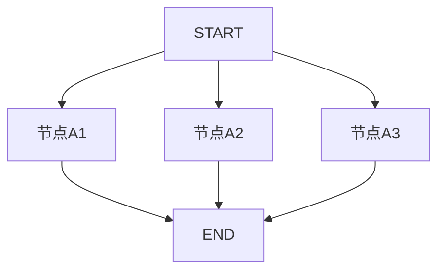

# 7-10 Spring AI Alibaba 1.1 的 Graph 引擎

## 【学习目标】

- 说清 Spring AI Alibaba 1.1 多智能体协同的两种实现路径：Agent Framework 与 Graph 引擎。
- 理解 Graph 引擎的三大核心概念（OverAllState / Node / Edge）并在 1.1 中与 1.0 对比。
- 看懂官方「并行节点」示例，理解 `StateGraph.addNode` / `addEdge` / `compile` 的编排与编译闭环。

## 【正文】

### 一、1.1 的两条主线

Spring AI Alibaba 1.1 发布后，多智能体与工作流编排成为两大核心。官方文档给出两种多智能体协同方式：

- **Agent Framework**：以智能体基类直接创建多智能体协同。
- **Graph 引擎**：以工作流编排（节点 + 边）的方式创建多智能体协同。官方 Graph 工作流编排指南以「处理客户邮件」为业务场景讲解。

本课程聚焦 Graph 引擎，因为它更贴近「显式定义流程」的工程诉求。

### 二、Graph 引擎核心概念与 1.0 完全通用

1.1 的 Graph 核心概念与 1.0 基本相同：

1. **状态载体 OverAllState**：贯穿整个工作流，任何节点都能读取与修改的全局状态对象，1.0 与 1.1 一致。
2. **节点 Node**：以函数式接口定义，1.0 与 1.1 一致。
3. **边 Edge**：节点之间的连接，同样以函数式接口定义，1.0 与 1.1 一致。

换言之，在 Graph 工作流引擎这一层，Spring AI Alibaba 1.0 与 1.1 完全通用。

工作流涉及的对象在 `GraphConfiguration.java` 中集中注释说明（保留课程原文注释）：

```java
    /*
     * 工作流涉及的对象：
     * 1. OverAllState ：全局状态对象，任何节点都能够读取和修改
     *    全局状态是贯穿整个工作流
     * 2. StateGraph: 工作流框架对象，
     *    工作流框架可以添加节点以及节点之间的箭头连线
     * 3. CompiledGraph: 工作流的编译对象
     */
```

### 三、并行节点示例：从 StateGraph 到 CompiledGraph

官方文档中定义带并行节点的图（`DemoAgentApplication.java`），其构建步骤与 1.0 完全一致：

1. 用 `StateGraph` 对象作为工作流框架对象；
2. 通过 `addNode` 添加节点；
3. 通过 `addEdge` 添加节点间连线；
4. 通过 `compile` 编译生成 `CompiledGraph` 对象，即工作流编译后的可执行对象。

下方代码为官方并行图示例，逐字保留：

```java
    // 定义状态策略工厂
    KeyStrategyFactory keyStrategyFactory = () -> {
        HashMap<String, KeyStrategy> keyStrategyHashMap = new HashMap<>();
        keyStrategyHashMap.put("messages", new AppendStrategy());
        return keyStrategyHashMap;
    };

    // 创建并行节点
    private static AsyncNodeAction makeNode(String message) {
        return node_async(state, Map.of("messages", List.of(message)));
    }

    // 构建并行图
    StateGraph workflow = new StateGraph(keyStrategyFactory);
    workflow.addNode("A1", makeNode("A1"));
    workflow.addNode("A2", makeNode("A2"));
    workflow.addNode("A3", makeNode("A3"));
    workflow.addEdge("A1", "A1");
    workflow.addEdge("A2", "A2");
    workflow.addEdge("A3", "A3");
    workflow.addEdge("START", "A1");
    workflow.addEdge("START", "A2");
    workflow.addEdge("START", "A3");
    workflow.addEdge("A1", "END");
    workflow.addEdge("A2", "END");
    workflow.addEdge("A3", "END");
    CompiledGraph compiledGraph = workflow.compile();
```

**为什么这么写**：并行节点的关键在「多个节点关联同一组边」，`START` 同时连向 `A1`、`A2`、`A3`，三者又分别连向 `END`。这样并行任务同时启动，最终在 `END` 汇聚，完成整条工作流。`keyStrategyFactory` 用 `AppendStrategy` 处理 `messages` 键，保证多节点写入的同名状态被追加而非互相覆盖。



**不这么写会怎样**：若把并行节点误连成链式（`START→A1→A2→A3→END`），原本并行的任务变成串行，耗时叠加、失去并发意义；若 `messages` 用覆盖策略，多节点结果只剩最后一个，上下文丢失。

### 四、编译后即可执行

并行图定义完成后，调用 `CompiledGraph.execute(...)` 即可执行：并行任务同时启动并汇聚到 `END`，从而完成整个工作流。

## 【易错点 / 面试题】

1. **1.0 与 1.1 的 Graph 引擎通用吗？** 通用。核心概念（OverAllState / Node / Edge）与 `StateGraph` / `addNode` / `addEdge` / `compile` 编排链路在 1.0、1.1 中完全一致。
2. **并行节点如何表达？** 让 `START` 同时指向多个节点、各节点再同时指向 `END`；切勿连成串行链。
3. **`CompiledGraph` 是什么？** 是 `StateGraph.compile()` 的产物，代表已编译、可执行的图；运行入口即 `execute`。

## 【小结】

Graph 引擎以 `StateGraph` 编排、`CompiledGraph` 执行，1.0 与 1.1 在此层完全通用，这是后续迁移到 1.1 的基础。下一篇（7-11）重点看 1.1 在「状态合并策略」上对 1.0 的简化。完整可跑的多 Agent 编排示例见 `981-demo/src/main/java/com/travel/agent/agent/SupervisorAgent.java`（该工程以 AgentScope ReAct 离线复刻「主管调度成员」形态，非 Spring AI Graph 工程）。
