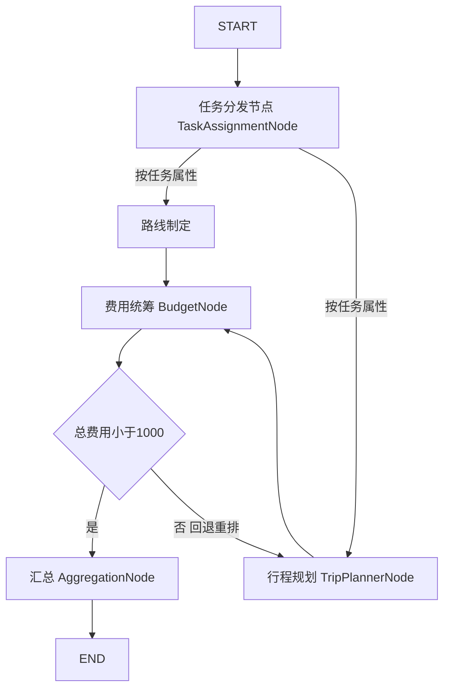

# 7-12 基于 Graph 搭建旅游规划工作流

## 【学习目标】

- 基于 Spring AI Alibaba 1.1 Graph 引擎，把「旅游规划」五节点多 Agent 协同工作流落地。
- 掌握 `addNode` / `addEdge` / `addConditionalEdges` 三类连线的用法，以及 `KeyStrategyFactory` 里状态键值与更新策略的定义。
- 理解条件边 `AsyncEdgeAction` 的返回语义：泛型 `String` 即「下一个节点 ID」。

## 【正文】

旅游规划工作流一共五个节点：路线制定、行程规划、费用统筹、汇总，以及一个负责任务分发与分解的节点。任务分发节点按「任务属性」把活分出去，路线相关走路线制定，行程相关走行程规划；二者产出的费用汇总到费用统筹节点。若总费用超过 1000，则回退给行程规划节点重排（路线固定，花费主要在住宿/景点/吃饭），否则交给汇总节点。这条带条件回环的流程，用 1.1 的 Graph 来搭。



### 第一步：在 `KeyStrategyFactory` 里定义全局状态

为什么这么写：每个节点都要往「总体费用」该 key 上写自己的花费，且后者应覆盖前者（不是累加），所以这里用 `ReplaceStrategy`。状态的定义与节点定义解耦，集中在合并策略 factory 中声明：

```java
    // 设置全局状态的合并策略
    KeyStrategyFactory keyStrategyFactory = () -> {
        Map<String, KeyStrategy> map = new HashMap<>();
        // fei的更新策略为覆盖
        // 总体费用
        map.put("Total Budget", new ReplaceStrategy());
        return map;
    };
```

不这么写会怎样：若用 `AppendStrategy`，费用统筹节点读到的会是「所有节点花费被拼接/累加」的脏数据，后续条件判断直接失真。覆盖还是追加，是状态策略里最容易被选错的一项。

### 第二步：加节点与基础边

节点创建方式与 1.0 一致，实现 `NodeAction`（或异步 `AsyncNodeAction`），重写 `apply` 拿到 `OverAllState` 再取数。`addNode` 第二个参数用 `AsyncNodeAction.node_async` 以异步方式挂上节点对象。下面这段把五个节点、START/END 以及条件边的外壳都铺好（其中 `id:` / `targetId:` 等是图示化的伪标注，重点看结构）：

```java
    // 添加节点
    stateGraph.addNode(id: "TripPlannerNode", AsyncNodeAction.node_async);
    stateGraph.addNode(id: "BudgetNode", AsyncNodeAction.node_async);
    stateGraph.addNode(id: "AggregationNode", AsyncNodeAction.node_async);
    stateGraph.addNode(id: "TaskAssignmentNode", AsyncNodeAction.node_async);
    // 添加边
    stateGraph.addEdge(stateGraph.START, targetId: "TaskAssignmentNode");
    stateGraph.addEdge(sourceId: "AggregationNode", stateGraph.END);
    // 添加条件判断边
    stateGraph.addConditionalEdges(
        sourceId: "TotalBudgetEdge",
        new TotalBudgetEdge()
    );
```

### 第三步：条件边 `TotalBudgetEdge`

中间有三组关系要处理：① 路线、行程两节点都汇总到费用统筹；② 费用统筹 → 汇总之间按「总费用 < 1000」做条件分支；③ 任务分发节点按属性路由到两个子节点。

条件边 `addConditionalEdges` 需要三个参数：条件边 ID、`AsyncEdgeAction` 实现类、以及「可能跳转到的节点集合」Map。下面是实现类的骨架，通过 `state.value("Total Budget", Integer.class)` 取出 `Optional<Integer>` 形式的总费用。注意原文判断方向有两处表述，成稿以「小于 1000 走汇总、否则回退行程规划」为准保留原意图：

```java
    public class TotalBudgetEdge implements AsyncEdgeAction {
        @Override
        public CompletableFuture<String> apply(OverallState state) {
            // 取出全局状态的总费用
            Optional<Integer> totalBudget = state.value(key: "Total Budget", Integer.class);
            // 判断总费用是否大于1000
            if (totalBudget < 1000) {
                // 跳到汇总节点
            } else {
                // 继续执行
            }
        }
    }
```

为什么这么写：重写的 `apply` 返回 `CompletableFuture<String>`，该泛型 `String` 就是「下一个节点的 ID」，框架据此把工作流切到对应分支。`value` 的第二个参数 `Integer.class` 用来锁定 `Optional` 的泛型，避免取出后再做类型猜测。

不这么写会怎样：若返回的节点 ID 不在 `addConditionalEdges` 第三个参数（Map）登记的集合内，条件边就不知道往哪跳，路由会失效。所以「实现类里 return 的 ID」必须落在该 Map 里，这是条件边最容易踩的约束。

【生产经验】带「回退重试」的环（费用超预算 → 重排）是 Graph 相对线性编排的优势：它把业务闭环表达成一条边，而不是在节点内部写死循环。但要注意回退必须收敛（如限定重排次数），否则预算永远压不下来会陷入死环。

## 【易错点 / 面试题】

1. **问：`addConditionalEdges` 三个参数分别是什么？**
   答：条件边 ID、`AsyncEdgeAction` 实现类（决定跳哪个分支）、可能跳转到的节点 ID 集合 Map（返回的分支 ID 必须登记在此）。

2. **陷阱**：`state.value(...)` 返回的是 `Optional`，直接当数值比较会编译/运行报错，需先 `get()`（或判空）取出真实值再比较。

3. **陷阱**：条件边返回的节点 ID 若不在第三个参数的 Map 中，分支路由会失败，实现类与声明集合必须对齐。

## 【小结】

用 `KeyStrategyFactory` 声明「总费用覆盖」策略、用 `addNode`/`addEdge` 搭骨架、用 `addConditionalEdges` + `AsyncEdgeAction` 实现「超预算回退重排」的闭环，就构成了 1.1 Graph 版的旅游规划工作流。条件边的核心心法是「返回 String 泛型即下一节点 ID，且必须落在声明集合内」。这种「主管按属性分发、成员按条件回退」的编排形态，与完整可跑的离线示例同源：见 `981-demo/src/main/java/com/travel/agent/agent/SupervisorAgent.java`（该工程以 AgentScope ReAct 离线复刻「主管调度成员」形态，非 Spring AI Graph 工程）。下一节将对比 Graph 与 FlowAgent 两条编排路线。
