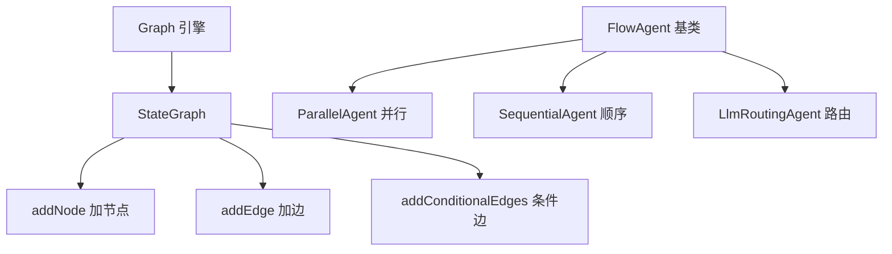

# 7-13 总结：Agent 与 Graph 分别构建的工作流

## 【学习目标】

- 厘清 Spring AI Alibaba 1.1 多 Agent 协同的两条路线：Graph 引擎 vs `FlowAgent` 基类。
- 掌握 Graph 的核心对象（`StateGraph` / `OverAllState` / 节点与边接口）与 `FlowAgent` 的四个流程实现（并行 / 顺序 / 路由 / ReAct）。
- 理解「Graph 编排的是方法逻辑、`FlowAgent` 编排的是会思考的 Agent」这一根本取舍。

## 【正文】

Spring AI Alibaba 1.1 提供两种多智能体协同的实现方式：一种是基于 Graph 引擎的工作流编排，另一种是基于 `FlowAgent` 基类的工作流编排。二者解决的是同一个问题，把复杂业务流程（并行、顺序、路由）串起来，但抽象层次不同。

### 路线一：Graph 引擎

Graph 的核心视图对象是 `StateGraph`，节点与边的定义都靠它封装的方法：`addNode` 加节点、`addEdge` 加边、`addConditionalEdges` 加条件边（按状态分流到不同分支）。通过这三个方法，旅游规划里的「并行执行、顺序执行、路由分发」三类逻辑都能表达出来。

自定义节点实现 `NodeAction` / `AsyncNodeAction`（区别仅在同步与异步），自定义边实现 `EdgeAction` / `AsyncEdgeAction`。贯穿全局的是 `OverAllState`：每个节点完成后把结果写回它，下游节点再从中取出上游产物作为输入。它是 KeyValue 结构。1.0 与 1.1 的 Graph 引擎差异不大，主要就是上一节讲的状态策略自动注册。

### 路线二：`FlowAgent` 基类

为什么要有 `FlowAgent`？因为 Graph 节点里跑的是「一个业务逻辑方法」，而不是「一个会思考、会调用工具的智能体」。1.1 的设计哲学是：真正执行任务的应该是 Agent。所以 `FlowAgent`（继承自 `Agent`）只负责「构建工作流」，底层把任务交给 ReAct 框架的 Agent 去执行，它们能自己决定怎么用工具，而不只是一段代码。

`FlowAgent` 通过 `subAgents(...)` 把成员 Agent 收编进来，并派生出几个表达流程语义的子类：

- **并行**：`ParallelAgent`，成员之间任务无交叉，并发执行。
- **顺序**：`SequentialAgent`，上游完成后把结果传给下游，下游以上游输出为输入。
- **路由**：`LlmRoutingAgent`，按任务属性把活派给最擅长的成员。



回顾一下几个流程 Agent 的创建代码。行程规划 Agent 通过 `AgentTool.getFunctionToolCallback` 把费用统筹 Agent 作为工具嵌入自身：

```java
    ReactAgent tripPlannerAgent = ReactAgent.builder()
        .name("tripPlannerAgent")
        .description("你是负责规划旅游行程")
        .tools(AgentTool.getFunctionToolCallback(budget))
        .build();
```

路由分发的 `LlmRoutingAgent` 把行程规划、路线制定两个 Agent 收为子成员，由它按属性派活：

```java
    LlmRoutingAgent llmRoutingAgent = LlmRoutingAgent.builder()
        .name("llmRoutingAgent")
        .description("将旅游出行工具选择的业务和旅游景点，住宿的规划业务")
        .subAgents(List.of(tripPlannerAgent, routeMakingAgent))
        .build();
```

顺序执行的 `SequentialAgent` 把「路由 Agent」和「并行 Agent」按先后串联，先路由分发，再并行执行：

```java
    SequentialAgent sequentialAgent = SequentialAgent.builder()
        .subAgents(List.of(llmRoutingAgent, parallelAgent))
        .build();
```

### 两条路线怎么选

- **Graph**：适合流程边界清晰、节点是「确定性方法」的场景，边与条件边把分支表达得非常直观，且对回退/闭环友好。
- **FlowAgent**：适合执行单元本就是「会推理、会用工具的 Agent」的场景，把编排重心从「连方法」上升到「连智能体」，更贴合 1.1 的 Agent 优先理念。

不这么写会怎样（指理解偏差）：若把 Graph 节点当成「Agent」去滥用工具调用，会失去 Graph 对确定性流程的可读性与可控性；反之若用 `FlowAgent` 去硬拼一个需要精确回退环的流程，又得在 Agent 内部塞循环，反而绕远。

【生产经验】实际项目里两者常混用：用 `FlowAgent` 表达「哪几个 Agent 协作」，用 Graph 的 `OverAllState` 在它们之间传递共享上下文。选哪条路线，看你的执行单元到底是「方法」还是「Agent」。

## 【易错点 / 面试题】

1. **问：Graph 与 `FlowAgent` 的根本区别？**
   答：Graph 节点执行的是业务逻辑方法，`FlowAgent` 节点执行的是能思考/用工具的 Agent；后者是 1.1 为「Agent 优先」设计的更高层抽象。

2. **问：`ParallelAgent` / `SequentialAgent` / `LlmRoutingAgent` 三者流程语义？**
   答：并行（成员并发、无交叉）、顺序（上游结果作下游输入）、路由（按属性派给最擅长成员），均通过 `subAgents(...)` 收编成员。

3. **陷阱**：把 Graph 节点误用为「重度工具调用的 Agent」，会牺牲流程确定性与可观测性；编排粒度应与执行单元的性质匹配。

## 【小结】

Spring AI Alibaba 1.1 给了两条等价目标、不同抽象的多 Agent 编排路线：Graph 引擎以 `StateGraph` + `OverAllState` + 节点/边接口勾勒「方法级」工作流；`FlowAgent` 则以 `ParallelAgent` / `SequentialAgent` / `LlmRoutingAgent` / `ReactAgent` 把「Agent 级」协同表达出来。落地时按「执行单元是方法还是 Agent」来取舍，二者也可组合使用。这套「主管调度成员」的编排思想，与完整可跑的离线示例同源：见 `981-demo/src/main/java/com/travel/agent/agent/SupervisorAgent.java`（该工程以 AgentScope ReAct 离线复刻「主管调度成员」形态，非 Spring AI Graph 工程）。技术前瞻上，Spring AI 2.1+ 的 Message Parts 与渐进披露（Progressive Disclosure）正把「Agent 协作时如何增量暴露中间产物」做得更顺滑，可关注 Spring AI Agents 方向的后续演进。
