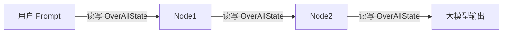

# 7-2 搭建工作流的记忆中枢：OverAllState

## 【学习目标】
学完本节，你将能够：
- 说清 Spring AI Alibaba Graph 中 `OverAllState` 的定位，它如何作为贯穿整条工作流的全局状态载体；
- 用 `registerKeyAndStrategy` 注册 key，并理解 `KeyStrategy` 的两种更新策略（`AppendStrategy` / `ReplaceStrategy`);
- 为后续 `StateGraph`、`NodeAction`、`Edge` 三件套搭好「记忆中枢」的地基。

## 【正文】
回顾上节课的链式工作流：原本用户的 prompt 直接喂给大模型、再由大模型产出结果；现在在「用户输入」与「模型输出」之间插入两个节点，每个节点都对上游传入的信息做加工，再把加工结果交给下一个节点。多节点之间要交换数据，靠的就是一个全局状态对象，这就是本节的主角 `OverAllState`。

### 工作流涉及的核心对象
一个最朴素的链式工作流，会涉及四类对象：
1. 全局状态对象（`OverAllState`）：任何节点都能读取、修改，贯穿整条工作流；
2. 节点对象（`NodeAction`）：真正干活的单元；
3. 节点间的连线对象（`Edge`）：定义流转顺序；
4. 工作流蓝图对象（`StateGraph`）：把上述三者组织起来。

本节先解决第 1 个，全局状态。

### OverAllState 是什么
`OverAllState` 即全局状态对象。它最大的特点是「全局可见、全程可达」：链路上的每一个节点都能从它这里取出上游写入的数据，也能把本节点的产出写回它，从而传递给下游。可以这样理解，`OverAllState` 是工作流版的「共享黑板」，节点们不互相直接调用，只在这块黑板上读写。其数据流转形态如下：



### 注册 key 与更新策略
`OverAllState` 内部用 `HashMap` 存放上下文数据，因此注册信息时必须同时指定 key 与对应的 value 类型。value 的类型是 `KeyStrategy`，它不仅是「key 对应的值」，更关键的，它封装了该值的更新策略：

```java
        Map<String, KeyStrategy> map = new HashMap<String, KeyStrategy>();
        overAllState.registerKeyAndStrategy(map);
```

**为什么这么写**：`registerKeyAndStrategy` 接收的是一个 `Map<String, KeyStrategy>`，说明每个 key 必须显式绑定一种更新策略，框架才知道「当多个节点写同一个 key 时该如何合并」。不注册 key 就直接读写，框架无从知晓合并语义，会按默认行为处理甚至报错。

#### 两种更新策略
`KeyStrategy` 是一个接口，有两个实现类，从命名即可推断语义：

```java
// 全局状态OverAllState以Key-Value的形式存放上下文数据
// KeyStrategy不只是指代key所对应的Value，还包括Value的更新策略
// 有2种更新策略: 1. AppendStrategy: 在旧值的基础上追加新值 2. ReplaceStrategy: 将新值覆盖旧值
```

- `AppendStrategy`：在旧值基础上**追加**新值；
- `ReplaceStrategy`：用新值**覆盖**旧值。

**生产经验类比**：这点和流式管道（如 Kafka Streams 的聚合窗口、或前端状态管理里的 reducer 合并）思路一致，「相同 key 的多次写入」必须有明确的合并规则，否则并发场景下结果不可预期。`AppendStrategy` 适合「日志累加 / 多轮思考链拼接」这类需要保留历史的场景；`ReplaceStrategy` 适合「最新结果即最终结论」的场景，比如「最终路线方案」只保留最后一次计算值。

**不这么写会怎样**：如果业务需要「把每一轮节点产出的思考过程都保留下来做复盘」，却误用了 `ReplaceStrategy`，则只能拿到最后一轮的值，历史链丢失；反之，若只用 `AppendStrategy` 存「最终答案」，下游每次读取都要自己裁剪列表取末位，既浪费又易错。策略选错，是 Graph 工作流里最隐蔽的 bug 之一。

### 一个易混淆点：OverAllState 与 State 参数的区别
后续节点方法 `apply(OverallState state)` 里拿到的 `state`，是框架在每次调用时注入的「当前全局状态实例」。它和本节创建的 `overAllState` 工厂产物是同一类对象，但**生命周期不同**：工厂只负责「造一个空状态」，真正在节点间流转、被读写的是运行期的那份实例。

## 【易错点 / 面试题】
1. **`OverAllState` 和 `ChatClient` 的 `MessageChatMemoryAdvisor` 记忆有什么区别？** 面试官常问。`OverAllState` 是 Graph 工作流内部、节点间传递结构化中间结果的「工作内存」，作用域仅限单次工作流运行；而 `MessageChatMemoryAdvisor` 管的是「多轮对话消息历史」，是跨请求的用户会话记忆。两者常被一起用：工作流内部用 `OverAllState` 串节点，多轮对话用记忆 Advisor 串会话。
2. **`AppendStrategy` 和 `ReplaceStrategy` 怎么选？** 看「同 key 多次写入是否需要保留历史」。需要保留（如思考链、日志）→ `Append`；只关心最新值（如最终答案）→ `Replace`。
3. **为什么 value 类型是 `KeyStrategy` 而不是普通 `Object`？** 因为全局状态要在多节点间共享写入，`KeyStrategy` 把「值 + 合并规则」绑定在一起，框架才能正确地自动合并，避免覆盖冲突。

## 【小结】
本节把工作流的「记忆中枢」`OverAllState` 立了起来：它用 `HashMap` 以 Key-Value 存上下文，每个 key 必须绑定 `AppendStrategy` 或 `ReplaceStrategy` 来定义合并语义，这是后续所有节点交换数据的基础。下一篇我们用 `StateGraph` 把这层「记忆」装进工作流蓝图，并理解它为何需要一个 `OverAllStateFactory` 工厂来生产状态实例。

> 技术前瞻：Spring AI 2.1 引入的 Message Parts 模型把「结构化中间结果」进一步标准化，未来 Graph 节点间传参有望与对话消息复用同一套 Parts 表达；但当前 Graph 工作流的 `OverAllState` 机制自成一脉，学习时仍以此为准。

完整离线可跑的多 Agent 编排示例见 `981-demo/src/main/java/com/travel/agent/agent/SupervisorAgent.java`（以 AgentScope ReAct 离线复刻『主管调度成员』形态，非 Spring AI Graph 工程）。
