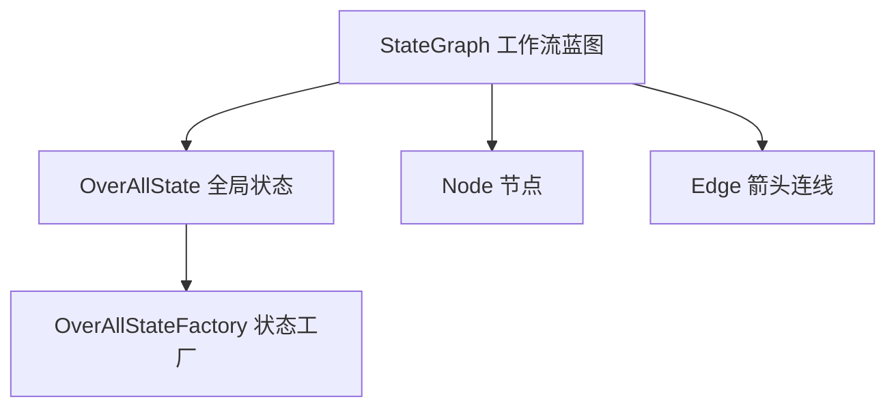

# 7-3 搭建工作流的框架蓝图：StateGraph

## 【学习目标】
学完本节，你将能够：
- 说清 `StateGraph` 在 Spring AI Alibaba Graph 中的角色，它是整张工作流的「蓝图」；
- 用 `new StateGraph(name, OverAllStateFactory)` 创建蓝图，理解为何传入的是**工厂**而非状态实例；
- 用 Lambda 表达式快速产出 `OverAllStateFactory`，而不必专门写实现类。

## 【正文】
上节课我们立起了工作流的「记忆中枢」`OverAllState`。回顾它的两个要点：全局状态对象贯穿整条工作流，负责把上下文信息传递到每个节点；且它以 Key-Value 形式存放上下文，每个 Value 都绑定了一种更新策略，要么在旧值上追加，要么用新值覆盖：

```java
  // 两种更新策略
  1. AppendStrategy: 在旧值的基础上追加新值
  2. ReplaceStrategy: 将新值覆盖旧值
```

```java
  Map<String, KeyStrategy> map = new HashMap<String, KeyStrategy>();
  map.put("key1", new ReplaceStrategy());
  map.put("key2", new AppendStrategy());
  overAllState.registerKeyAndStrategy(map);
```

一个完整工作流还涉及另外三个对象：节点对象、节点间连线对象、以及把三者组织起来的「工作流蓝图」对象。本节就来实现这第四样东西，`StateGraph`。

### StateGraph 是什么
`StateGraph` 是工作流框架对象，内部可以添加节点（`addNode`）与节点间的箭头连线（`addEdge`）。把它想成一张「写在纸上的建筑施工图」：图纸本身不执行任何逻辑，只是把节点与连线定义清楚，等到编译（`compile`）阶段才被真正搭建运行。四者的关系是：



### 创建 StateGraph
`StateGraph` 提供了多个构造方法。其中部分构造方法直接接收 `OverAllState` 实例，但**已经被标记为废弃**，不应再使用。当下推荐用的构造方法主要接收三个参数：工作流名称、全局状态对象的工厂类、以及一个序列化框架。即便参数最少的重载，也只需传前两个，第三个序列化框架由框架内部自动 `new`（默认采用 Google 的 Gson）：

```java
  StateGraph stateGraph = new StateGraph(
      "parallel", 
      OverAllStateFactory
  );
```

**为什么传入的是工厂，而不是 `overAllState` 实例**：工作流会被反复执行多次，每次执行都应该有一份**独立、干净**的全局状态，避免上一次运行的残留数据污染下一次。若直接传入同一个 `OverAllState` 实例，所有次执行会共享同一份状态，引发串数据。工厂 `OverAllStateFactory` 的职责正是「每次需要状态时都 new 一份新的」，从而天然隔离各次运行。

**不这么写会怎样**：若图省事直接 `new StateGraph("parallel", overAllState)`（旧式、已废弃的写法），不仅踩中废弃 API，更会在多轮/并发执行时让全局状态被反复读写同一份对象，造成节点间数据错乱，这类 bug 往往只在压测或多用户场景才暴露，定位极难。

### 用 Lambda 生成 OverAllStateFactory
`OverAllStateFactory` 是一个接口，并用 `@FunctionalInterface` 修饰，意味着它只有一个抽象方法 `create()`，且返回 `OverAllState`：

```java
  return overAllState;
```

传统做法要写一个类去实现该接口并重写 `create()`。但由于它是函数式接口，用 Lambda 更简洁，把上节课创建 `OverAllState`、注册 key 的那段逻辑直接塞进 Lambda 体，末尾 `return overAllState` 即可，无需专门建实现类。

**生产经验类比**：这和使用 `Supplier<OverAllState>` 或 Spring 的 `@Bean` 工厂方法如出一辙，延迟创建、每次取新实例，是「有状态对象」的标准工厂化写法。Java 8+ 的函数式接口让这种「轻量工厂」几乎零样板代码。

拿到 `StateGraph` 蓝图后，后续便可通过 `addNode` 添加节点、`addEdge` 添加连线，把图纸逐步补全。

## 【易错点 / 面试题】
1. **为什么 `StateGraph` 构造要传工厂而非状态实例？** 因为工作流会多次执行，每次都需要独立的全局状态以隔离数据；工厂保证「每次取一份新状态」。直接传实例会共享状态、导致串数据，且旧式构造已废弃。
2. **`@FunctionalInterface` 有什么用？** 它约束接口只有一个抽象方法，从而可以用 Lambda 表达式直接实现，省去写实现类的样板代码。面试中常借此考察对函数式编程的理解。
3. **Gson 在这里扮演什么角色？** 它是 `StateGraph` 内部的默认序列化框架，用于节点间状态/数据的序列化。默认已自动装配，一般无需手动传入；若需切换序列化方案才要显式指定。

## 【小结】
本节用 `new StateGraph(name, OverAllStateFactory)` 搭起了工作流的「蓝图」，并理解了「传工厂不传实例」背后的状态隔离考量，以及用 Lambda 投产线级的 `OverAllStateFactory`。有了蓝图，下一篇就用 `NodeAction` 往里填「真正干活的节点」。

> 技术前瞻：Spring AI 2.1/3.0 的 「Spring AI Agents」 方向在 Graph 之上抽象出更高层的子 Agent / Skills 编排，但底层的 StateGraph 蓝图 + 工厂化状态这一思路会被延续，学习本节并不过时。

完整离线可跑的多 Agent 编排示例见 `981-demo/src/main/java/com/travel/agent/agent/SupervisorAgent.java`（以 AgentScope ReAct 离线复刻『主管调度成员』形态，非 Spring AI Graph 工程）。
