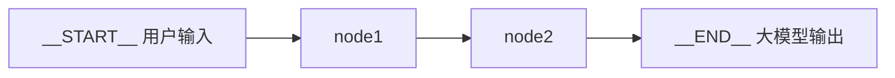

# 7-5 搭建工作流的流程顺序：Edge

## 【学习目标】
学完本节，你将能够：
- 用 `addEdge(sourceId, targetId)` 把两个节点按指定顺序连起来；
- 用 `StateGraph.START` 与 `StateGraph.END` 常量连接「用户输入」和「模型输出」这两个特殊端点；
- 拼出完整的一条链式工作流：`START → node1 → node2 → END`。

## 【正文】
上节课我们往蓝图里加了节点：`addNode` 用的是 `addNode(String id, AsyncNodeAction action)`，其中 `AsyncNodeAction` 由 `AsyncNodeAction.node_async(new Node1())` 产出，`NodeAction` 则是节点对全局状态做读写的函数式接口：

```java
        AsyncNodeAction.node_async(new Node1());
```

```java
        stateGraph.addNode(id: "node1", AsyncNodeAction.node_async(new Node1()));
```

`NodeAction.apply(OverallState)` 体内，按 key 取出全局状态的值、加工、再放回一个 `Map` 返回，这就是节点对上下文的操作方式：

```java
    @Override
    public Map<String, Object> apply(OverallState state) throws Exception {
        // 根据key获取全局状态中的值
        Object object = state.value(key: "key1");

        // 创建一个Map并返回
        Map<String, Object> map = new HashMap<>();
        map.put("key1", object);

        return map;
    }
```

### 节点之间的连线：addEdge
节点光有还不够，必须定义「谁先谁后」。这靠 `StateGraph.addEdge` 完成。它接收两个参数：第一个是起点节点的 id，第二个是终点节点的 id。上节课我们建了 `node1` 与 `node2`，于是把 `node1` 指向 `node2`：

```java
        stateGraph.addEdge(sourceId: "node1", targetId: "node2");
```

### 连接「用户输入」和「模型输出」两个特殊端点
上面只定义了 `node1 → node2`，但还缺两段：**用户输入 → node1** 与 **node2 → 模型输出**。工作流的首尾不是普通节点，而是框架预留的特殊端点。

- 起点（用户 prompt 进入工作流的位置）用常量 `StateGraph.START` 表示；
- 终点（大模型输出离开工作流的位置）用常量 `StateGraph.END` 表示。

因此「用户输入 → node1」和「node2 → 模型输出」这样连：

```java
        stateGraph.addEdge(stateGraph.START, targetId: "node1");
```

把上节课的节点、本节课的连线整合进 `GraphConfiguration`，完整蓝图如下：

```java
    // 添加节点，需要传入2个参数（1.节点id，2.AsyncNodeAction）
    stateGraph.addNode(id: "node1", AsyncNodeAction.node_async(new Node1()));
    stateGraph.addNode(id: "node2", AsyncNodeAction.node_async(new Node2()));

    // 添加节点间的箭头连线
    stateGraph.addEdge(sourceId: "node1", targetId: "node2");

    // 定义流程起点
    stateGraph.addEdge(stateGraph.START, targetId: "node1");
```

**为什么 `START`/`END` 必须是特殊常量**：它们是框架识别「入口/出口」的哨兵。若不用 `START` 而用普通节点当入口，框架无法判断从哪份初始数据（用户 prompt）开始注入；若不用 `END`，则无法把最后节点的产物对接到大模型输出。换言之，这两端是工作流与「外部世界」的唯一接口，必须显式声明。整条链路的拓扑如下：



**不这么写会怎样**：漏掉 `START → node1` 的连线，工作流就「没有入口」，编译/运行阶段会因找不到起点而失败；漏掉 `node2 → END`，则 node2 的产物无法回流到模型输出，整条链在最后一个节点「断头」。连线缺失是 Graph 初学者的高频报错源，编译期往往不报错、运行期才暴露。

**生产经验类比**：`Edge` 之于工作流，正如「服务编排里的 DAG 依赖边」，节点是任务，边是依赖。和 Airflow / 数据流管道一样，边的方向一旦定错（比如把 `node2 → node1` 连反），执行顺序就会错乱甚至成环死循环。编排类系统第一原则：先画拓扑，再填逻辑。

## 【易错点 / 面试题】
1. **`START` 和 `END` 是什么？为什么不能直接用普通节点当入口/出口？** 它们是 `StateGraph` 的预留常量，分别标记工作流的「用户输入入口」和「模型输出出口」，是工作流与外部数据交换的唯一接口，必须显式连接。
2. **`addEdge` 参数顺序搞反会怎样？** 参数一是 source、参数二是 target；写反等于把执行顺序颠倒，甚至可能产生环。Graph 执行依赖正确的有向边方向。
3. **节点 id 必须唯一吗？** 必须。`addNode` 的第一个 id 与 `addEdge` 引用的 id 要一致，否则连线找不到目标节点，运行期报「未知节点」。

## 【小结】
本节用 `addEdge` 把节点串成顺序链，并借助 `StateGraph.START` / `StateGraph.END` 接通「用户输入」与「模型输出」，得到 `START → node1 → node2 → END` 的完整蓝图。蓝图画好了，下一篇就进入编译（`compile`）与运行（`invoke` / `stream`），让它真正跑起来。

> 技术前瞻：Spring AI 2.1/3.0 的 「Spring AI Agents」 在 Graph 之上提供条件分支与子 Agent 路由，但 `Edge` 定义节点顺序的基本语义不变，本节是理解更复杂编排的基石。

完整离线可跑的多 Agent 编排示例见 `981-demo/src/main/java/com/travel/agent/agent/SupervisorAgent.java`（以 AgentScope ReAct 离线复刻『主管调度成员』形态，非 Spring AI Graph 工程）。
