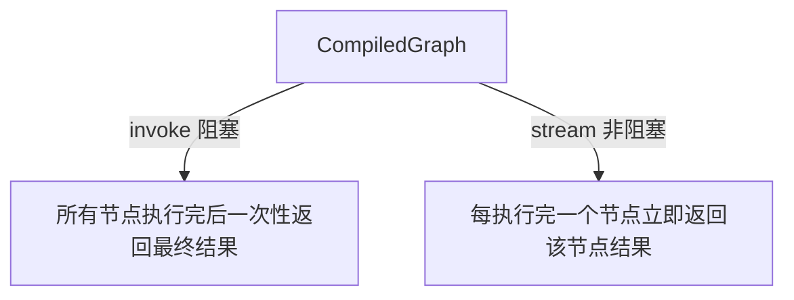

# 7-6 编译及运行工作流

## 【学习目标】
学完本节，你将能够：
- 把 `StateGraph` 蓝图编译成 `CompiledGraph`，并通过 Spring 的 `@Bean` / `@Qualifier` 注入到 Controller；
- 区分 `CompiledGraph.invoke()` 与 `CompiledGraph.stream()` 两种运行方式的差异；
- 用一份初始 `Map`（含用户 prompt）启动一次工作流执行。

## 【正文】
前面几篇已经备齐了工作流的四类对象：全局状态 `OverAllState` 在节点间流通、被每个节点读写；工作流蓝图 `StateGraph` 通过 `addNode` 加节点、`addEdge` 加连线。本节引入第三样关键对象，**编译对象 `CompiledGraph`**：蓝图只是「图纸」，编译后才是「可运行的实体」。

### 把 StateGraph 注册为 Spring Bean
蓝图默认写在 `GraphConfiguration` 配置类里。要能在 Controller 中引用它，需把「构建蓝图的方法」声明为 `@Bean`，且配置类用 `@Configuration` 修饰，使 Spring Boot 启动时自动装载：

```java
  public class GraphConfiguration {
      @Bean
      public void parallelGraph() throws GraphStateException {
          // 配置工作流的代码（未完全显示）
      }
  }
```

**为什么这里要返回 `StateGraph` 而非 `void`**：原示例方法签名是 `void`，但在实际工程中，要让 Controller 拿到这份蓝图，方法必须返回 `StateGraph` 实例（即 `public StateGraph parallelGraph() {... return stateGraph;}`）。`@Bean` 的返回类型就是注册进容器的 Bean 类型。写成 `void` 时，容器里没有可用的 `StateGraph` Bean，后续注入会失败。此处的 `void` 仅为示意片段，落地时务必改为返回 `StateGraph`。

### 用 @Qualifier 注入指定 Bean
在 `controller` 包建 `WorkFlowController`，通过构造方法注入蓝图 Bean。由于 Spring 容器里可能有多个 `StateGraph` Bean，用 `@Qualifier("parallelGraph")` 按名称精确指定：

```java
  @RestController
  public class WorkFlowController {
      public WorkFlowController(@Qualifier("parallelGraph") StateGraph stateGraph) {
          // 构造函数注入
      }

      @GetMapping(value = "/workflow/parallel")
      public void execute() {
          // 调用工作流执行方法
          // 例如：compiledGraph.invoke() 或 compiledGraph.stream()
      }
  }
```

**为什么用构造注入 + `@Qualifier`**：构造注入保证 Bean 不可变、且依赖在启动期就就绪（而非用到时才可能为 null）；`@Qualifier` 在多蓝图场景下避免「按类型找到多个候选 Bean」的歧义。这是 Spring 推荐的显式装配写法。

### 编译蓝图：StateGraph → CompiledGraph
把 `CompiledGraph` 作为 Controller 的 `private final` 成员变量（一个控制器可能有多个接口都跑工作流，故缓存编译结果更合理）。在构造方法里调用蓝图的 `compile()` 生成编译对象，注意它声明抛出 `GraphStateException`，需向上抛出：

```java
  /*
   * CompiledGraph提供了2种运行工作流的方式：
   * 1. invoke()：以阻塞的方式运行工作流，工作流的结果是一次性返回
   * 2. stream()：以非阻塞的方式运行工作流，工作流结果通过回调函数返回
   */
```

### invoke 与 stream 的差异
`CompiledGraph` 提供两种运行方式，本质区别在「结果何时返回」：



- `invoke()`：**阻塞式**。等全部节点跑完，才把最终结果一次性返回。适合「要完整答案」的同步场景。
- `stream()`：**非阻塞流式**。每完成一个节点，立刻把该节点的结果推出来（常配合 `Flux` 做 SSE 实时输出）。适合「边算边展示思考过程」的交互场景。

本节先用 `invoke()`。它有几个重载，选参数最少的，接收一个 `Map`。一次链式工作流含四个逻辑节点：用户 prompt（起点）、`node1`、`node2`、模型输出（终点）。因此 `invoke` 的入参 `Map` 至少要带上用户的 prompt。构造一个 `HashMap`，以 `"prompt"` 为 key、用户原话（如「在咖啡馆里想要杯星巴克」）为 value，传入 `invoke` 即可启动整条链。

**不这么写会怎样**：若用 `stream()` 却按「一次性拿结果」的同步逻辑处理，会拿到一串分段流而非最终对象，下游解析直接报错；反之，若交互场景硬用 `invoke()`，用户要干等所有节点跑完，体验差且无法中途展示进度。运行方式选错，是「功能能跑但体验/解析全错」的典型坑。

**生产经验类比**：`invoke`/`stream` 的取舍，和「同步 HTTP 调用 vs SSE/WebSocket 流式推送」完全一致。需要完整结构再处理（如落库、抽取 JSON）用阻塞；需要打字机式输出、长任务进度条用流式。Spring AI 的 `ChatClient.stream()` 也返回 `Flux<String>`，与 Graph 的 `stream()` 一脉相承。

## 【易错点 / 面试题】
1. **为什么蓝图要先 `compile()` 才能跑？** `StateGraph` 只是声明式蓝图，`compile()` 会做拓扑校验（如是否连通、有无环、入口出口是否齐全），产出可执行的 `CompiledGraph`。直接「运行蓝图」是不存在的步骤。
2. **`invoke()` 和 `stream()` 怎么选？** 要完整结果、同步处理 → `invoke()`；要实时流式展示、长任务进度 → `stream()`。两者结果形态不同，消费端写法也不同。
3. **多个 `StateGraph` Bean 时如何注入？** 用 `@Qualifier` 按 Bean 名称精确指定，避免「找到多个同类型 Bean」的注入歧义。

## 【小结】
本节把 `StateGraph` 蓝图注册为 `@Bean`、用 `@Qualifier` 注入 Controller，并通过 `compile()` 得到 `CompiledGraph`，最后用 `invoke()`（或 `stream()`）以一份含 prompt 的 `Map` 启动工作流。下一篇我们再加一层「可视化」，把这张工作流以图形方式打印出来，验证它确实长成我们设想的链路。

> 技术前瞻：Spring AI 2.1 的 Message Parts 与流式输出进一步统一了 `Flux` 语义，未来 Graph 的 `stream()` 有望与对话流式接口共用同一套背压机制；但 `CompiledGraph` 的 `invoke`/`stream` 双模式选择逻辑不变。

完整离线可跑的多 Agent 编排示例见 `981-demo/src/main/java/com/travel/agent/agent/SupervisorAgent.java`（以 AgentScope ReAct 离线复刻『主管调度成员』形态，非 Spring AI Graph 工程）。
