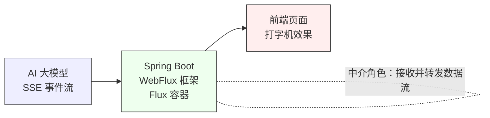

# 7-8 Flux 就是装载 SSE 流式数据的容器

## 【学习目标】

- 说清 SSE 协议为何成为 AI 大模型与客户端之间主流的流式通信方式，以及它与 WebSocket 的本质差异。
- 理解 `Flux` 在 Spring WebFlux 中扮演的「流式数据容器」角色，以及为何其泛型通常指定为 `String`。
- 理解响应式编程模型为何与 SSE 事件流天然契合，进而解释 Spring Boot 选用 WebFlux 接收大模型返流的底层动机。

## 【正文】

### 一、SSE 协议：大模型返流的默认通道

AI 大模型与客户端之间最常见的通信方式是基于 SSE（Server-Sent Events）的流式响应。大模型对一次提问的回答往往篇幅很长，若等服务端把完整回答整合后再一次性回传，客户端要等待很久，体验很差。因此服务端（AI 大模型）以「逐字 / 逐段」的形式持续向客户端推送文本，前端看到的就是打字机效果，这正是 SSE 协议的典型表现。

SSE 与 WebSocket 同属长连接，但方向相反：

- **SSE**：单向通道，只允许服务端向客户端推送消息；客户端在连接存续期间不能反向发送消息。
- **WebSocket**：全双工通道，服务端可主动推送，客户端也能随时发送。

客户端与服务端约定使用 SSE，靠的是请求头 `Accept: text/event-stream`。从该 MIME 类型即可看出，SSE 本质是 `text` 类型下的一个子类型，基于 Event 事件的文本数据流。

### 二、Flux：WebFlux 中的流式数据容器

客户端如何接收大模型基于 SSE 推送的事件流？答案是 `Flux` 对象。`Flux` 来自 Spring 的响应式编程核心库（Reactor），被 WebFlux 框架引入。WebFlux 专门处理流式数据序列，简单理解就是一个「数据流的容器」：它既能接收大模型逐字推送的内容，也能逐段把数据再发送给前端，从而让前端呈现打字机效果。

由于大模型返流是文本，因此 WebFlux 接收时泛型指定为 `String`，即 `Flux<String>`。Spring Boot 在整条链路中扮演中介角色：一方面基于 WebFlux 接收 SSE 数据流，另一方面又以 SSE 格式把数据流发往前端。该链路的数据流向归纳如下（图仅归纳原文描述，未引入新事实）：

### 三、为什么 Spring Boot 用 WebFlux 而不是阻塞式框架？

`Flux` 类属于响应式编程核心类，WebFlux 引入后同样基于响应式编程模型。所谓响应式编程，简单说就是不让线程傻等请求处理完成，而是告诉系统：「我先去干别的，你把请求处理的准备工作做好了再通知我。」其目标是用最少的线程处理大量请求。

SSE 持续推送的数据流天然可以看作「响应式事件流」，响应式框架恰好具备高效处理这类事件流的能力，因此 Spring Boot 的 WebFlux 与 SSE 协议天然契合。响应式流的另一个优势是**背压（backpressure）**：下游消费慢时，上游自动减速而非无脑堆积，这对大模型突发吐字速率的波动很友好，这是选用响应式模型而非普通阻塞 Servlet 的额外收益。

### 四、一个工程入口的呼应

在课程示例 `StreamController.java` 的注释中，`//构建prompt -> 发送到大模型 -> 获取大模型返回`、`//用户输入`，以及演示输入 `String message = "在咖啡馆里，想要杯星巴克";`，正是后续把用户请求喂给大模型、再经 `Flux` 流式返回的入口雏形。该处的 `Flux` 容器与上面的链路一一对应。

**为什么不这么写会怎样**：若用传统 `Servlet` 阻塞式 `Controller` 接收大模型返流，线程会被长连接占住，并发一上来线程池立刻打满，这正是 WebFlux 响应式模型要解决的问题。

## 【易错点 / 面试题】

1. **SSE 与 WebSocket 怎么选？** 面试官常问：需要服务端单向推流（如大模型逐字输出）用 SSE，需要双向实时交互（如聊天室、协同编辑）用 WebSocket。SSE 基于 HTTP、自带断线重连、实现更简单。
2. **`Flux<String>` 为什么泛型是 String？** 因为大模型 SSE 返流本质是文本片段，逐段拼起来才是完整回答。
3. **WebFlux 是阻塞还是非阻塞？** 非阻塞、基于 Reactor（`Mono` / `Flux`）的响应式模型，线程不被 IO 等待占用。

## 【小结】

`Flux` 作为 WebFlux 的流式数据容器，是 AI 大模型返流从服务端一路贯通到前端打字机效果的载体。下一篇（7-9）将用 `Flux` + `ServerSentEvent` 实际编码，把 SSE 事件流持续推送到前端。完整可跑的多 Agent 编排示例见 `981-demo/src/main/java/com/travel/agent/agent/SupervisorAgent.java`（该工程以 AgentScope ReAct 离线复刻「主管调度成员」形态，非 Spring AI Graph 工程）。技术前瞻：Spring AI 2.1 引入的 Message Parts 模型，将进一步把「逐字流」提升为带类型、可渐进披露的结构化流片段，打字机效果之上还能携带工具调用等元信息。
