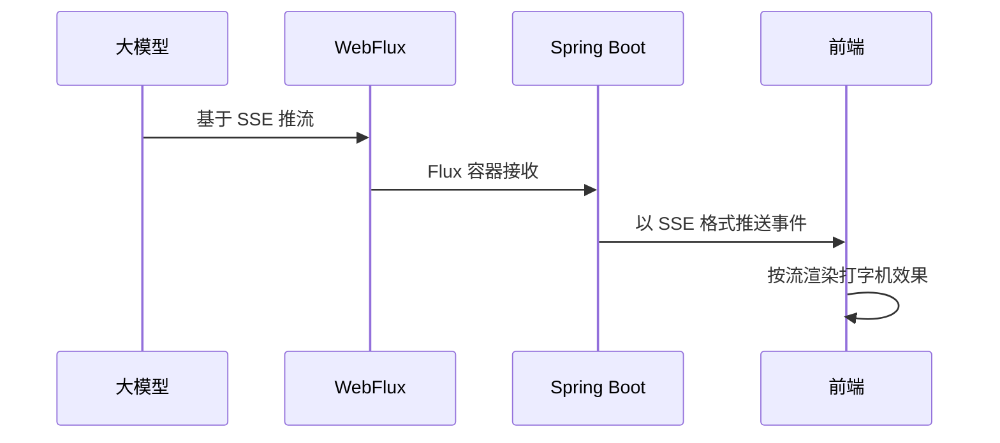

# 7-9 Flux 包装 SSE 返回给前端展示打字机输出效果

## 【学习目标】

- 掌握用 Spring Boot 基于 SSE 协议持续向前端推送事件流的三个必要条件。
- 掌握 `Flux.interval` + `map` 生成每秒一条流，以及用 `ServerSentEvent` 工厂安全组装 SSE 格式。
- 理解手写 JSON 与 `ServerSentEvent` 两种组装方式的差异与坑点。

## 【正文】

### 一、为什么需要「服务端持续推流」

大模型返流到前端之所以呈现打字机效果，是因为数据不是等全部生成完才下发，而是以 SSE 事件流逐段到达前端，前端即时渲染、逐字打印。对用户而言，他几乎立刻看到首字，获得「即时响应」的体感。整条链路是：大模型基于 SSE 推给 Spring Boot → WebFlux 用 `Flux` 容器接收 → Spring Boot 同样以 SSE 格式再推给前端 → 前端按流渲染。



上篇已说明，WebFlux 之所以契合，是因为 SSE 持续数据流可视为响应式事件流，而 WebFlux 正是高效处理响应式事件流的框架。

### 二、基于 SSE 持续发消息的三个条件

要基于 SSE 协议持续向前端发消息，需满足三个条件：

1. **指定 MIME 类型为 SSE 事件流**：`text/event-stream`，属于文本类型下的子类型（事件数据流）。
2. **消息符合 SSE 协议格式**：含 `event`（事件名称）、`data`（消息体）、`id`（消息 ID）三个字段；一条完整事件以两个换行符 `\n\n` 结束。
3. **能持续不断地发送**：通过 `produces = MediaType.TEXT_EVENT_STREAM_VALUE` 声明 MIME 类型，再持续产出事件。

### 三、用 Flux 实现「持续 + 组装」

`Flux` 提供 `interval` 静态方法（有多种重载），其中接受 `Duration` 的重载可设定每秒发送一次，返回 `Flux<Long>`。再用 `map` 把流接过来、组装成 `Flux<String>`（泛型对齐返回类型）：

- **手写 JSON 方式**：在 `map` 内用字符串拼 `event/data/id` 并手动补 `\n\n`。容易写错 JSON 结构，且需自己处理转义，不推荐。
- **`ServerSentEvent` 工厂方式**：用 `ServerSentEvent.<String>builder().event(...).data(...).id(...).build()` 组装。框架自动补结尾换行符，无需手写 JSON，安全得多。

注意泛型一致性：`map` 的入参类型决定返回的 `Flux` 泛型。手写字符串时入参是 `String`，返回 `Flux<String>`；用 `ServerSentEvent` 时，由于 `builder()` 指定了 `<String>`，`map` 入参是 `ServerSentEvent<String>` 实例，返回 `Flux<ServerSentEvent<String>>`。原文示例把 `ServerSentEvent` 直接作为返回泛型展示，下方代码保留课程原始写法：

```java
    @GetMapping(value = "/flux/interval", produces = MediaType.TEXT_EVENT_STREAM_VALUE)
    public Flux<String> sseToFrontPage() {
        // 基于SSE协议持续的发消息：
        // 1. 指定消息的MIME类型是 SSE事件类型 (text/event-stream)
        // 2. 消息要符合 SSE 协议消息格式
        // event: 指定事件名称
        // data: 消息体
        // id: 消息ID
        // 通过2个换行符 (\n\n) 表示一个完整事件消息结束
        // 3. 能持续不断地发送SSE协议格式的事件消息

        return Flux.interval(Duration.ofSeconds(1)) // 每1秒发送SSE协议消息
            .map(seq -> {
                // 将Map结构组装SSE协议格式消息
                // .map(seq->"{data:{},event:{},id:{}}\n\n" );
                return ServerSentEvent.<String>builder()
                    .event("message")
                    .data("Hello World " + seq)
                    .id(String.valueOf(seq))
                    .build();
            });
    }
```

**为什么这么写**：`interval` 负责「持续触发」，`map` 负责「逐条组装成 SSE 格式」，二者组合刚好满足上述三个条件。`ServerSentEvent` 工厂把 `event/data/id` 与结尾 `\n\n` 的拼接交给框架，避免手写 JSON 漏字段、漏转义导致前端解析失败。

**不这么写会怎样**：若手工拼 JSON 又漏掉 `data` 字段或 `\n\n`，浏览器 `EventSource` 可能整条丢弃或合并错乱，打字机效果直接断流。生产上务必优先用 `ServerSentEvent`。

### 四、收尾：接收与发送的统一

WebFlux 既能接收大模型 SSE 数据流（泛型多为 `String`），也能向前端发送 SSE 数据流（用 `ServerSentEvent` 对象封装，其内数据为 `String`）。无论收发，数据都经 `Flux` 该容器承载片段。

## 【易错点 / 面试题】

1. **SSE 格式结尾为什么是两个换行符？** 协议规定 `\n\n` 表示一条事件结束；少一个换行，客户端会认为事件未完、持续等待。
2. **`Flux.interval` 返回 `Flux<Long>`，为何接口能返回 `Flux<String>`？** 中间用 `map` 做了类型转换；`map` 的入参 / 出参泛型决定流的新类型。
3. **手写 JSON 与 `ServerSentEvent` 怎么选？** 面试常考：手写易错且需自管 `\n\n`；`ServerSentEvent` 工厂更安全，生产优先。

## 【小结】

通过 `Flux.interval` + `map` + `ServerSentEvent`，我们完成了「服务端持续向前端推 SSE 流」的最小闭环，打字机效果得以落地。下一篇（7-10）切到 Spring AI Alibaba 1.1 的 Graph 引擎，看工作流如何以 `StateGraph` 编排。完整可跑的多 Agent 编排示例见 `981-demo/src/main/java/com/travel/agent/agent/SupervisorAgent.java`（该工程以 AgentScope ReAct 离线复刻「主管调度成员」形态，非 Spring AI Graph 工程）。技术前瞻：Spring AI 2.1 的渐进披露（Progressive Disclosure）方向，正是把「逐字流」升级为按需携带结构化元信息，与这里的 `ServerSentEvent` 思路一脉相承。
