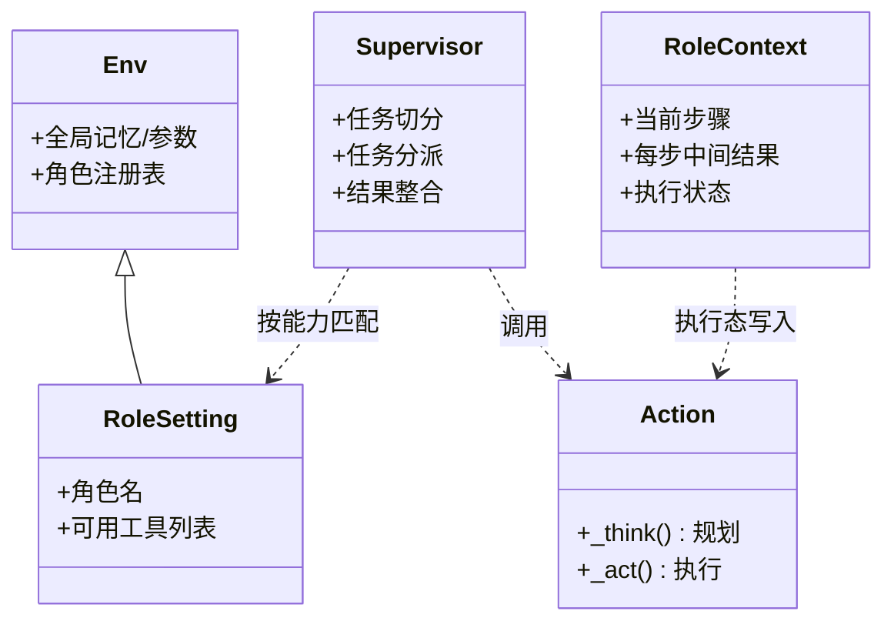

# 8-1 多Agent设计思路 角色分工

## 【学习目标】

- 能说清多智能体系统里同时存在「全局协同流程」与「单 Agent 执行流程」两层循环，并解释二者关系。
- 能画出一套最小多 Agent 框架应有的三个核心模块：主管调度、同环境协同、结果汇总。
- 能区分两个全局类（`Env` / `Action`）与两个角色类（`RoleSetting` / `RoleContext`）各自存什么、管什么。

## 【正文】

### 一、两条并行的执行流程

多智能体的核心执行流程可以拆成两层，二者嵌套但职责不同。

**第一层是全局协同流程**：用户提出需求后，先由大模型做意图识别，得到用户的真实意图；随后由主管（Supervisor）级别的智能体把复杂任务切割成若干简单子任务，再按能力把每个子任务派给对应的专业智能体；各智能体并行执行完毕后，由主管把中间结果整合，形成完整答案回给用户。

**第二层是每个单 Agent 的执行流程**：被分派到子任务的智能体，自身也要先做步骤规划，再按步骤顺序执行；每完成一步都要监测该步的中间结果，并评估是否符合预期，符合则进入下一步，不符合则动态调整后续步骤。整个过程同样是 「执行 → 监测 → 反馈评估」 三步循环，直到所有步骤走完。

关键在于：**全局流程里套着每个 Agent 的局部流程**。主管负责 「拆与合」，单 Agent 负责 「想与做」。如果只设计主管调度、却忽略单 Agent 内部的规划-执行-评估循环，系统就会退化成简单的任务分发器，遇到步骤级失败无法自愈。

### 二、设计一个协同框架要补哪三块

从上面这套流程反推，一个多 Agent 框架至少要包含三个核心部分：

1. **主管智能体**：负责复杂任务的切分与分派。
2. **协同环境**：多个智能体应当处于同一运行环境（共享上下文与通信通道），否则彼此看不见、无法协作。
3. **结果存储与整合机制**：每个 Agent 的中间结果如何落盘、如何汇成统一答案。

这里要注意一个常见误区：前面课程讲过的 A2A（Agent2Agent）协议，适用于**基于不同大模型**的智能体之间的跨进程通信；而本章讨论的框架里，各 Agent 通常基于同一个大模型，因此不适用 A2A，而是采用更轻量的进程内结构化通信。把 A2A 硬套进同模型框架，属于典型的协议错配。

### 三、两个全局类：Env 与 Action

无论哪个 Agent 执行任务，都要复用两类全局能力，因此抽成全局类：

- **`Env` 类（环境类）**：存储全局记忆信息与全局参数，例如框架里注册了哪些角色、有哪些共享配置。它相当于整个团队的 「白板」。
- **`Action` 类（动作类）**：所有对工具的调用、对大模型的调用都经由它。因为思考与执行分离，该类中包含两个方法：
  - `_think()`：思考 / 规划方法，对应人类的逻辑分析。
  - `_act()`：执行方法，把规划落到工具调用或模型推理上。

把 「调工具」 和 「调模型」 统一收口到 `Action`，能避免每个 Agent 各写一套调用逻辑，也方便后续统一加日志、限流、重试（这正是生产里 Advisor 链要做的横切）。

### 四、角色类：RoleSetting 与 RoleContext

每个 Agent 的差异通过角色类表达，它再分两个子类：

- **`RoleSetting` 类**：静态配置，记录框架有哪些角色、每个角色能使用哪些工具。例如 「研究分析师」 配 Excel 工具，「技术研究员」 配编程/API 工具，「产品经理」 配原型图工具。
- **`RoleContext` 类**：运行时状态，记录某 Agent 执行到了第几步、每一步的中间结果、当前所处状态。它随任务推进被持续写入，是主管做结果整合时的数据来源。

> 设计视角：把 「我是谁、我会什么」（`RoleSetting`）与 「我做到哪了、产出了什么」（`RoleContext`）分开，等价于把**静态能力描述**与**动态执行态**解耦。这种拆法在后续 SOP、冲突协商、人工介入等模块里都会被复用，角色配置是调度依据，角色上下文是协调依据。

### 五、模块关系一图总览

## 【易错点 / 面试题】

1. **问：多 Agent 的 「全局流程」 和 「单 Agent 流程」 各解决什么问题？**
   答：全局流程解决 「任务怎么拆、派给谁、结果怎么合」；单 Agent 流程解决 「分到的子任务内部怎么一步步做、做错了怎么调」。面试常考二者嵌套关系，漏掉任一层都不完整。

2. **问：同模型的多 Agent 框架为什么不用 A2A？**
   答：A2A 面向跨大模型、跨服务的 Agent 互调；同模型框架进程内共享上下文，用结构化通信（RPC / WebSocket 风格）更轻，硬上 A2A 是协议错配。

3. **问：`RoleSetting` 和 `RoleContext` 能否合并？**
   答：不宜合并。前者是静态能力、用于调度决策；后者是动态执行态、用于协调与整合。混在一起会让调度依据被运行时状态污染，也难以序列化恢复。

## 【小结】

本章先把多 Agent 框架的两层执行流程讲透，再落到 `Env`/`Action` 两个全局类与 `RoleSetting`/`RoleContext` 两个角色类的职责划分，这是后续 「冲突协商」 与 「SOP 标准流程」 两块的地基：冲突协商要读 `RoleContext` 判断谁该让步，SOP 要基于 `RoleSetting` 决定节点由哪个角色承接。完整可跑的多 Agent 编排示例见 `981-demo/src/main/java/com/travel/agent/agent/SupervisorAgent.java`（以 AgentScope 离线桩复刻 「主管调度成员」 范式，与本章 Manus/JManus 多 Agent 思路同源，但栈不同）。技术前瞻：Spring AI 2.1 起的 Message Parts 与 「Spring AI Agents」 方向，正在把这类 「角色 + 状态」 的抽象往框架一等公民推进，可关注其后续演进。
