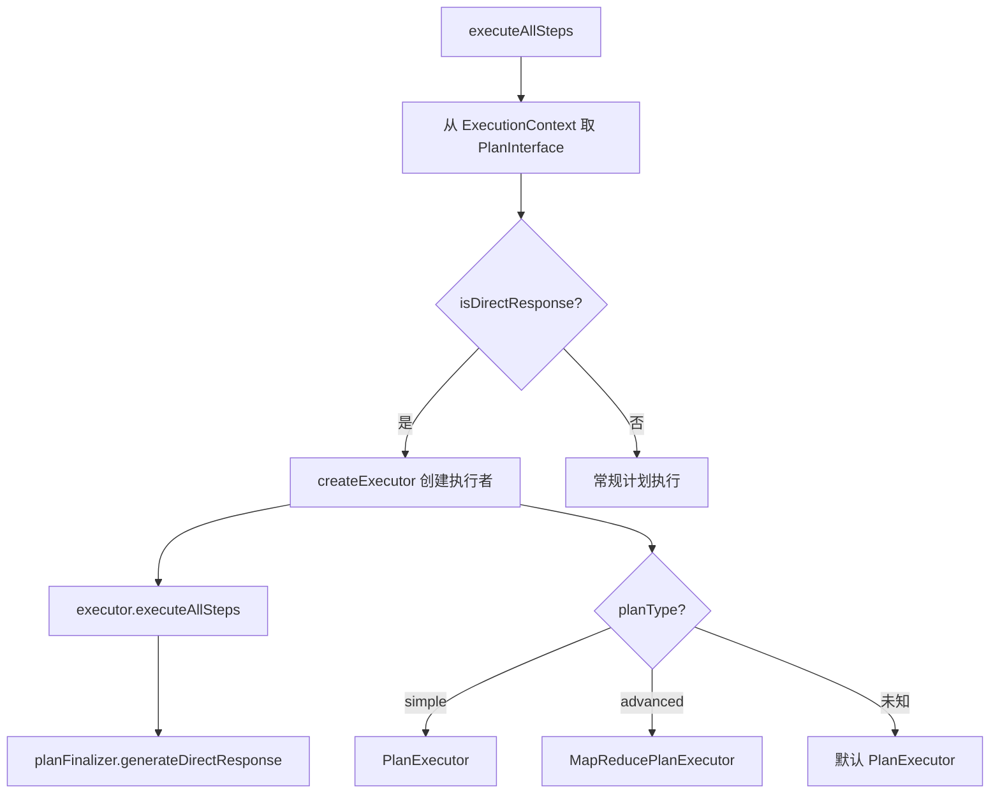

# 8-12 根据计划类型创建不同的执行者

## 【学习目标】
- 说明计划执行阶段由 `PlanExecutorFactory` 按计划类型选择执行者。
- 区分 `PlanExecutor`（simple）与 `MapReducePlanExecutor`（advanced）两种执行者。
- 理解直接从执行上下文读取已建计划、再交给执行者落地的数据流。

## 【正文】
计划协调器生命周期的第二段是计划执行。计划已在上一段由 `PlanCreator` 写入执行上下文，本段从上下文中取出计划并交给对应执行者运行。

**读取计划**：`createPlan` 方法把计划写入上下文后，即可从中取回 `PlanInterface`：

```java
        @Override
        public ExecutionContext createPlan(ExecutionContext context) {
            log.info("Creating plan for planId: {}", context.getCurrentPlanId());
            context.setUseMemory(false);
            planCreator.createPlan(context);

            PlanInterface plan = context.getPlan();
            if (plan != null) {
                log.info("Plan created successfully with type: {} for planId: {}", plan.getPlanType(), context.getCurrentPlanId());
            }

            return context;
        }
```

**执行入口 `executeAllSteps`**：该方法先从执行上下文提取已建计划。若计划标记 `isDirectResponse`（直接响应），则通过 `planExecutorFactory.createExecutor(plan)` 创建执行者，调用其 `executeAllSteps(context)`，随后由 `planFinalizer.generateDirectResponse(context)` 收尾并直接返回；非直接响应则进入常规计划执行分支：

```java
        if (plan != null) {
            boolean isDirectResponse = plan.isDirectResponse();
            if (isDirectResponse) {
                PlanExecutorInterface executor = planExecutorFactory.createExecutor(plan);
                log.info("Selected executor: {} for direct response plan (planId: {})", executor.getClass().getSimpleName(), context.getCurrentPlanId());
                executor.executeAllSteps(context);

                planFinalizer.generateDirectResponse(context);
                log.info("Direct response completed successfully for planId: {}", context.getCurrentPlanId());
                return context;
            } else {
                // Normal plan execution
            }
        }
```

计划创建、执行、结束三段，分别对应 `planCreator`、`planExecutorFactory` 创建出的执行者、`planFinalizer` 三个对象。

**按类型选执行者**：`createExecutor` 先从计划属性取出 `planType`，再以 `switch` 分支创建不同执行者：

```java
        return switch (planType.toLowerCase()) {
            case "simple" -> createSimpleExecutor();
            case "advanced" -> createAdvancedExecutor();
            default -> {
                log.warn("Unknown plan type: {}, defaulting to simple executor", planType);
                yield createSimpleExecutor();
            }
        };
```

- 计划类型为 `simple`：创建 `PlanExecutor`，执行简单任务。
- 计划类型为 `advanced`：创建 `MapReducePlanExecutor`，以「分而治之再汇总」的方式执行复杂计划。
- 未知类型：告警并默认回退到 `simple` 执行者，保证链路不中断。



## 【易错点 / 面试题】
1. 为什么执行者要用工厂（`PlanExecutorFactory`）创建？答：计划类型在运行时才确定，工厂按 `planType` 动态选派 `simple`/`advanced` 执行者，把「选谁执行」与「如何执行」解耦。
2. `advanced` 为何对应 `MapReducePlanExecutor`？答：复杂计划可拆为多个子任务并行处理后再汇总，MapReduce 思路天然适配该场景。
3. 未知 planType 为何默认回退 simple？答：以最稳健的简单执行者兜底，避免未知类型导致整条链路失败，属于防御式降级。

## 【小结】
计划执行阶段由 `executeAllSteps` 从执行上下文取回计划，经 `PlanExecutorFactory` 按 `planType` 选派 `PlanExecutor` 或 `MapReducePlanExecutor` 落地执行，未知类型默认降级到简单执行者。完整离线可跑的多 Agent 编排示例见 `981-demo/src/main/java/com/travel/agent/agent/SupervisorAgent.java`（以 AgentScope 离线桩复刻『主管调度成员』范式，与本章 JManus/Manus 思路同源，但栈不同）。

（技术前瞻：Spring AI Agents 方向将把「按任务类型选派子 Agent」进一步标准化，但 JManus 当前以工厂按 planType 分派执行者的范式不变。）
