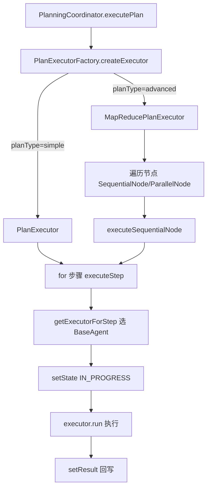

# 8-13 不同的执行者调用不同的执行流程

## 【学习目标】

学完本节，你能：
- 说清 JManus 计划执行的三阶段，以及 `PlanningCoordinator.executePlan` 如何把计划交给执行器。
- 区分简单计划（`PlanExecutor`）与复杂计划（`MapReducePlanExecutor`）两条执行链路的分支与汇合点。
- 解释「为何每个步骤都要绑定一个 `BaseAgent` 实例、并靠 `run()` 与 `setState()` 驱动与留痕」。
- 在自研多 Agent 框架里，照此模式设计「计划 → 步骤 → 执行者」的可扩展执行层。

## 【正文】

JManus 的计划执行整体分为三个阶段：计划开始、计划执行、计划结束。上一节讲的是「执行对象如何创建」，由工厂类 `PlanExecutorFactory` 的 `createExecutor` 方法负责，按计划类型产出不同执行对象：计划类型为 `simple`（简单计划）时创建 `PlanExecutor`；为 `advanced`（复杂计划）时创建 `MapReducePlanExecutor`。

本节看这两个执行对象各自怎么跑、流程有何差异。

在计划协调器 `PlanningCoordinator` 中，`executePlan` 是计划执行的入口。该方法先通过工厂方法 `createExecutor` 把计划执行对象实例化，真正的执行动作发生在 `executeAllSteps` 接口方法里。点进去可见它是接口方法，共三个实现类：除 `PlanExecutor` 与 `MapReducePlanExecutor` 外，还有 `DirectResponseExecutor`，用于「直接响应」类的场景（无需走分步执行）。

该接口定义如下：

```java
    public interface PlanExecutorInterface {
        /**
         * Execute all steps of the entire plan
         * @param context Execution context containing user request and execution process information
         */
        void executeAllSteps(ExecutionContext context);
    }
```

### 简单计划：PlanExecutor 的线性执行

`PlanExecutor` 先从执行上下文 `ExecutionContext` 取出计划，再用一个 for 循环把计划拆成步骤、逐条执行。每一步的实际逻辑封装在抽象类 `AbstractPlanExecutor` 的 `executeStep` 方法中。

点进 `executeStep` 可见：它先通过 `getExecutorForStep` 按步骤类型找到合适的执行者（智能体），写入步骤对象；若找不到执行者，则打印错误日志、把「未找到执行者」写入步骤结果并直接返回；找到后先把步骤状态置为「进行中」、记录步骤开始，再调用智能体的 `run()` 执行该步，并把结果写回步骤对象：

```java
    BaseAgent executor = getExecutorForStep(stepType, context, initSettings, ex);
    if (executor == null) {
        logger.error("No executor found for step type: {}", stepType);
        step.setResult("No executor found for step type: " + stepType);
        return null;
    }
    step.setAgent(executor);
    executor.setState(AgentState.IN_PROGRESS);
    recorder.recordStepStart(step, context);
    String stepResultStr = executor.run();
    step.setResult(stepResultStr);
    return executor;
```

**为什么这样写**：把「选执行者 → 置状态 → 执行 → 回写结果」固化为统一模板，新增一种步骤类型时只需扩展 `getExecutorForStep` 的路由，而不必改动循环主体。这正是「模板方法 + 工厂」在多 Agent 编排中的实际落点，生产里主管-子 Agent 调度也常采用同构设计：调度器只认 `run()` 契约，具体谁来干由路由决定。

### 复杂计划：MapReducePlanExecutor 的分支-步骤两级执行

`MapReducePlanExecutor` 同样实现 `executeAllSteps`，但区别于简单计划的单层 for 循环：它先把复杂计划切成「节点（分支）」，节点分 `SequentialNode`（顺序）与 `ParallelNode`（并行）两类，顺序节点交给 `executeSequentialNode` 执行；节点内部再嵌套一个 for 循环，把分支拆成步骤，复用 `executeStep` 选执行者、`run()` 执行、记录状态。

进入执行前会做类型校验，非法类型直接抛 `IllegalArgumentException`：

```java
    if (!(plan instanceof MapReduceExecutionPlan)) {
        logger.error("MapReducePlanExecutor can only execute MapReduceExecutionPlan, plan.getClass().getSimpleName()");
        throw new IllegalArgumentException("MapReducePlanExecutor can only execute MapReduceExecutionPlan");
    }
    MapReduceExecutionPlan mapReducePlan = (MapReduceExecutionPlan) plan;
    plan.updateStepIndices();
    try {
        recorder.recordPlanExecutionStart(context);
        List<ExecutionNode> steps = mapReducePlan.getSteps();
        if (CollectionUtil.isNotEmpty(steps)) {
            for (Object stepNode : steps) {
                if (stepNode instanceof SequentialNode) {
                    lastExecutor = executeSequentialNode((SequentialNode) stepNode);
                }
            }
        }
    }
```

**为什么这样做**：复杂计划天然有「分支并行 + 步内串行」的拓扑，单层 for 循环表达不了。两级结构让「分支级调度」与「步骤级执行」解耦，分支决策（哪些是并行节点、并行度多少）与执行细节（每步调哪个 Agent）各管一段。生产里这类「Map（并行分发）→ Reduce（汇总）」正是 `MapReducePlanExecutor` 命名的由来；并行节点落地时需配合 Java 21 虚拟线程或 `CompletableFuture`，避免分支阻塞主流程。

下图归纳两种执行器的链路差异：



### 统一底座：BaseAgent 的 run 与 setState

无论简单还是复杂计划，最终干活的都是智能体，且都继承自抽象类 `BaseAgent`。该抽象类仅两个核心方法：`run()` 是执行任务的入口，`setState()` 负责记录执行过程的状态。因此自定义智能体时须继承 `BaseAgent`，并实现 `run()` 与 `setState()`。

**为什么只暴露这两个方法**：执行层对智能体的全部认知就一句，「给我 `run()` 出结果、用 `setState()` 告诉我进展」。这与 981-demo 中 `com/travel/agent/agent/SupervisorAgent` 的设计同源：上层调度只依赖统一的 Agent 契约，下层换实现不影响编排。

## 【易错点 / 面试题】

1. **问：`PlanExecutor` 与 `MapReducePlanExecutor` 的核心差异是什么？**
   答：`PlanExecutor` 是单层「计划→步骤」的线性 for 循环；`MapReducePlanExecutor` 是「计划→节点（顺序/并行）→步骤」的两级结构，且进入前强制校验 `MapReduceExecutionPlan` 类型。前者适合扁平任务，后者适合有并行分支的复杂任务。

2. **问：为何 `executeStep` 找不到执行者时不抛异常而是写结果返回？**
   答：计划执行是长链路，单步失败若直接中断会让整段计划不可观测、难以恢复；写入「未找到执行者」结果并 `return null` 是「降级留痕」思路，便于上层记录与后续重试。生产里可在此基础上接 `@Retry`/`@CircuitBreaker` 做弹性增强。

3. **问：`BaseAgent` 为何只定义 `run()` 与 `setState()` 两个方法？**
   答：执行层只关心「能否执行、能否反馈状态」，其余能力（工具、记忆）由子类自行扩展。这是面向接口编程，保证调度器与具体智能体解耦。

## 【小结】

本节把 JManus 的「计划 → 执行器 → 步骤 → 智能体」四层链路讲透：工厂按类型选执行器、`PlanExecutor` 走线性、`MapReducePlanExecutor` 走分支-步骤两级、`BaseAgent` 提供统一 `run/setState` 契约。这套「调度只认契约、执行靠路由」的模式，正是多 Agent 编排的通用骨架，下游第 9 章 AgentScope 的 `ReActAgent` 同样是「上层发任务、底层 Agent 执行」的同构思路。

> 技术前瞻：Spring AI 2.x 的 `ToolCallingAdvisor` 把「工具循环」从各 `ChatModel` 私有实现提升为 Advisor 链一等公民；Spring AI Alibaba 已在 Graph 模块提供 `StateGraph` 式编排，与 JManus 这里的执行器分层思想一脉相承。

工程绑定：完整可部署示例见 `com/travel/agent/agent/SupervisorAgent.java`（981-demo 主管 Agent 实现）。需注意，981-demo 以 **AgentScope** 离线桩复刻同类多 Agent 编排范式，并非 JManus / Spring AI Alibaba 工程；两者执行层理念一致，但框架栈不同。
