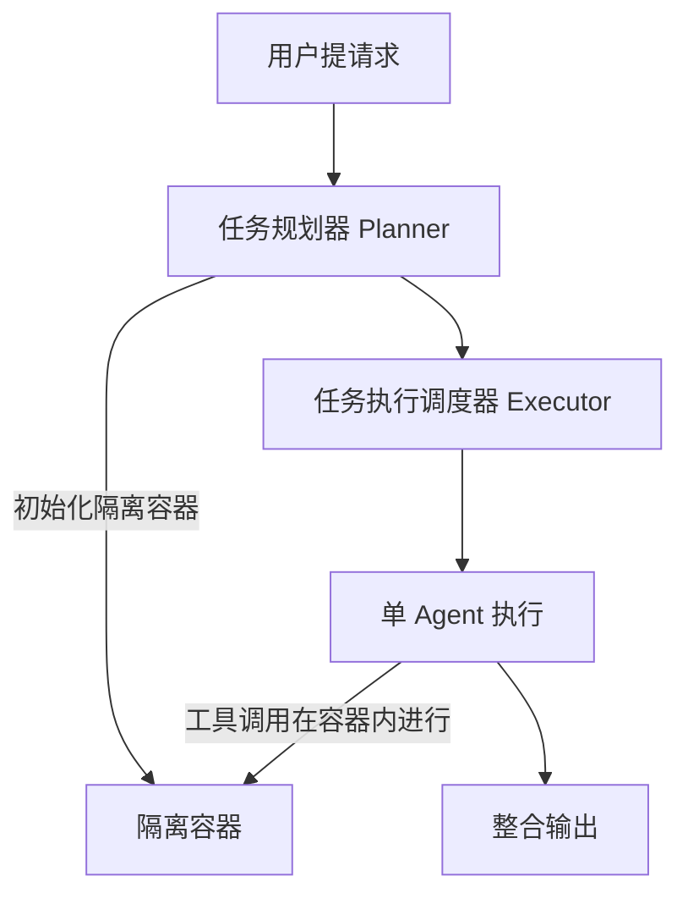

# 8-4 Manus多Agent的技术架构

## 【学习目标】

- 能说出多 Agent 框架的两条通用骨架，并指出 Manus 如何在这两条骨架上落地。
- 能讲清 Manus 相对其他框架的突出特点：隔离容器 + 规划/执行/验证三层分工。
- 能对比 AutoGen、CrewAI、LangChain、Manus、JoyAgent、muAgent 的定位差异。

## 【正文】

### 一、两条通用骨架（所有多 Agent 框架都绕不开）

无论国外还是国内的框架，底层逻辑都收敛为两条骨架：

- **骨架一（全局）**：主管理解需求 → 切分为简单子任务 → 按能力匹配派给对应 Agent → 主管整合全部结果回用户。
- **骨架二（单 Agent）**：拿到子任务后先思考步骤 → 每完成一步就观察结果、判断是否达标、动态调后续步骤。

这两条骨架就是第 8-1 ~ 8-3 章设计思路的抽象。所有框架的差异，只是 「怎么切、怎么派、怎么隔离、怎么验证」 的实现选择不同。

### 二、Manus 的闭环与两个核心元件

把骨架落成 Manus 的具体实现：用户提请求 → **任务规划器（Planner）** → **任务执行调度器（Executor）** → 单 Agent 执行 → 整合输出。

**任务规划器**做两件事：
1. 任务初始化：理解需求、拆成几个简单任务、列出计划、匹配适合执行的 Agent；
2. 初始化一个**隔离容器**：给单 Agent 调用工具用的受控环境（调第三方 API、本地命令、浏览器操作都在此进行）。

**任务执行调度器**做三件事：
1. 把切好的子任务分发给对应 Agent；
2. 协调 Agent 间的协作、矛盾、争议；
3. 读取并汇总每个 Agent 的结果，整理成用户友好的输出。

单 Agent 执行时，一要基于大模型推理，二要基于 MCP 协议调外部工具，且**所有工具调用都必须在隔离容器内进行**。这是 Manus 最突出的工程特点。

### 三、为什么 「隔离容器」 是 Manus 的关键设计

把工具调用收口到隔离容器，带来两点收益：

- **Agent 间互不干扰**：Agent A 用容器查百度、Agent B 用容器下单，各自独立环境，不会因共享状态导致数据串味。
- **与用户主机隔离**：即使工具调用出错（误删、越权），故障也封在容器内，不波及用户本机或服务器的关键文件。

这本质是 「工具执行的沙箱化」。没有它，多 Agent 并行调工具等于多个进程同时改同一份环境，正确性无法保证。

### 四、核心循环与流程细节

Manus 的工作主循环是：**拆解任务 → 分配子任务 → 执行任务 → 使用工具 → 再拆解**。任务规划器与执行调度器串联起用户、隔离容器、第三方 API、浏览器等外部资源；执行调度器最终汇总生成友好输出。

从多 Agent 视角串起来：用户请求 → 意图识别 → 任务初始化 → 任务规划 → 多 Agent 并行执行（Agent1/2/3 经结构化通信协作）→ 结果整合输出。

### 五、主流多 Agent 框架定位对比

Manus 闭源，但其 「规划-执行-验证」 三层分工思路被后续框架广泛借鉴。横向看一下定位差异：

| 框架 | 定位特点 |
|---|---|
| AutoGen | 多 Agent 协调能力强，支持人工干预 |
| CrewAI | 团队自主协作，角色专业化，动态委派，内置争议解决 |
| LangChain | 大规模流程定制、模块化，但需手动配置 |
| Manus | 规划-执行-验证三层分工，工具沙箱化 |
| 京东 JoyAgent | 本地部署，复用历史任务经验，工具原子化 |
| 蚂蚁 muAgent | 基于知识图谱，LLM + 知识图谱增强决策 |

> 选型视角：若看重 「开箱即用的自主执行 + 工具隔离」，Manus 思路占优；若要在自有生态做可控编排，CrewAI / JoyAgent 的类主管-成员范式更合适；若已有 Java/Spring 体系，则落到课程采用的 JManus（基于 Spring AI Alibaba）。注意 JManus 是课程所用框架、与本章 Manus 思路同源，但栈不同，Manus 本身闭源，不能直接拿来讲实现细节。

## 【易错点 / 面试题】

1. **问：Manus 的 「隔离容器」 解决什么工程问题？**
   答：把工具调用沙箱化，既隔离并发 Agent 的运行时状态、又隔离用户主机，保证多 Agent 并行调工具时的正确性与安全性。面试常把它和 「为什么不能共享环境」 一起问。

2. **问：任务规划器和任务执行调度器职责如何切分？**
   答：规划器管 「想」（拆任务、定计划、建容器），调度器管 「做与合」（派发、协调、汇总）。混淆二者会导致计划与执行耦合，难以做计划级回滚。

3. **问：Manus 闭源，为何还能作为课程参考架构？**
   答：其 「规划-执行-验证 + 工具沙箱」 的设计范式是公开可分析的思路，课程用同源思路的 JManus（Spring AI Alibaba）做落地实现，二者范式一致、栈不同。

## 【小结】

Manus 把前两章的通用设计思路（角色分工、冲突协商、SOP 排期）凝结成 「规划器 + 调度器 + 隔离容器」 三个工程元件，并用三层分工保证自主执行可控。下一章看 Manus 的第三个特点，「自主决策」 如何通过两个 AI 自循环实现。完整可跑的多 Agent 编排示例见 `981-demo/src/main/java/com/travel/agent/agent/SupervisorAgent.java`（以 AgentScope 离线桩复刻 「主管调度成员」 范式，与本章 Manus/JManus 多 Agent 思路同源，但栈不同）。技术前瞻：Spring AI 2.1 的渐进披露（ToolSearchToolCallingAdvisor）与 「Spring AI Agents」 方向，正把 「规划器动态选取工具」 这一能力框架化，可对照 Manus 的工具调度思路理解。
