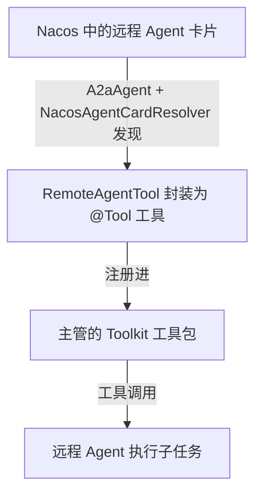

# 9-10 远程Agent封装为工具执行子任务

## 【学习目标】

- 理解「远程 Agent 即工具」的设计：主管从 Nacos 拉到远程 Agent 后，把它封装成 `@Tool`，从而复用 AgentScope 既有的工具调用循环去驱动远程执行。
- 掌握客户端侧 `A2aAgent.builder()` + `NacosAgentCardResolver` 的写法，以及 `call()` / `block()` 触发远程执行。
- 掌握把 Nacos 客户端抽取到 `NacosUtil` 公共类、并把远程 Agent 工具注册进主管的 `Toolkit`，让主管真正「能调远程 Agent」。

## 【正文】

9-9 把路线制定、行程规划两个成员 Agent 的卡片注册进了 Nacos（服务端侧）。本节处理客户端侧：主管如何**发现** Nacos 中的卡片，并把远程 Agent **调用起来**执行子任务。

整体思路是「远程 Agent 即工具」：主管拿到远程 Agent 后，把它包装成一个工具，调用该工具就等于让远程 Agent 去跑对应的子任务。先在主管模块下建 `tool` 包，新增 `RemoteAgentTool` 类承载这种封装。AgentScope 定义工具极简，给方法加 `@Tool` 注解即可：

```java
        package managerAgent.tool;
        import io.agentscope.core.tool.Tool;

        /**
         * @author: Imooc
         * @description: 将远程Agent封装为工具
         * @date: 2026
         */
        public class RemoteAgentTool {
            /**
             * @author: Imooc
             * @description: 基于A2A协议获取路线制定Agent
             * @param :
             * @return void
             */
            @Tool
            public void callRouteMakingAgent() {
                // 代码实现
            }
        }
```

`RemoteAgentTool` 里写两个方法：一个基于 A2A 获取远程路线制定 Agent，一个基于 A2A 获取行程规划 Agent。

客户端侧通过 `A2aAgent` 对象从 Nacos 拉取远程 Agent；`builder()` 中配两样东西：远程 Agent 的 `name`，以及按名称去解析卡片的 `agentCardResolver`。AgentScope 提供了 Nacos 封装 `NacosAgentCardResolver`，直接用它即可：

```java
        A2aAgent agent = A2aAgent.builder()
            .name("RouteMakingAgent")
            .agentCardResolver(new NacosAgentCardResolver(NacosUtil.getNacosClient()))
            .build();
```

这里还需传入 Nacos 配置（地址等），因此要先有一个 Nacos 配置对象封装这些信息再注入，否则会因缺少客户端而报错，把 Nacos 客户端创建逻辑抛出的异常按要求处理即可编译通过。返回的 `agent` 即为路线制定 Agent。接着用 `call()` 触发执行、`block()` 阻塞等待，远程 Agent 便去执行子任务。

为复用，把「创建 Nacos 客户端」的代码挪到公共模块 `Commons` 的 `NacosUtil` 工具类里，主管侧直接调用 `NacosUtil.getNacosClient()`。客户端也可直接用无参构造的解析器：

```java
        AgentCardResolver nacosAgentCardResolver = new NacosAgentCardResolver();
        A2aAgent agent = A2aAgent.builder()
            .name("RouteMakingAgent")
            .agentCardResolver(nacosAgentCardResolver)
            .build();
```

行程规划 Agent 的获取方法同理：按卡片 `name`（如 `TripPlannerAgent`）从 Nacos 检索并运行。

最后回到主管 Agent：前面已在公共模块封装了工具包（`Toolkit`），把 `RemoteAgentTool` 注册进该工具包，得到 `Toolkit` 对象，再把它挂到主管 Agent 的属性上。如此主管便能把「获取到的远程 Agent」当作工具来调用，整条「发现 → 封装 → 调用」链路闭环。



> 工程视角：`agentCardResolver` 解析出的卡片包含成员能力信息，主管据此把对应子任务路由给对应工具，这一步与 9-8「按专长分发」首尾呼应：9-8 在计划里标注归属，9-10 把归属真正落地为跨节点调用。

## 【易错点 / 面试题】

1. **为什么把远程 Agent 包成 `@Tool`？** 复用 AgentScope 既有的工具调用循环（ReAct 中「思考→调工具→观察」），省去自己写跨进程调用编排；远程 Agent 对主管而言就是一个「会自己干活的超级工具」。
2. **`agentCardResolver` 的作用是什么？** 按名称从 Nacos 解析出远程 Agent 的 `AgentCard`，没有它 `A2aAgent` 不知道去哪找、长什么样。
3. **`call()` 与 `block()` 分别做什么？** `call()` 触发远程 Agent 执行子任务，`block()` 阻塞当前线程等待结果返回，避免流式响应未结束时主线程提前退出。

## 【小结】

本节补齐 A2A 的「客户端」半边：主管经 `A2aAgent` + `NacosAgentCardResolver` 从 Nacos 发现远程 Agent，再借 `@Tool` 把它封装为工具并注册进 `Toolkit`，最终通过工具调用驱动远程子任务执行。它向上闭环 9-8 的分发意图与 9-9 的卡片注册，是 AgentScope 实现 Supervisor/Worker 跨节点协同的收口。在 981-demo 中，`com.travel.agent.a2a` 包（`NacosAgentCardResolver` / `A2aAgent` 风格封装）、`com.travel.agent.agent.TeamMembers` 与 `com.travel.agent.agent.SupervisorTools` 共同复刻了本节能力：主管的工具集里就挂着这些「远程 Agent 工具」。技术前瞻上，Spring AI Alibaba 的 A2A + `AgentCardResolver` 思路与此一致，但课程此处以 AgentScope 的 `A2aAgent` 为准，不展开其 API。
