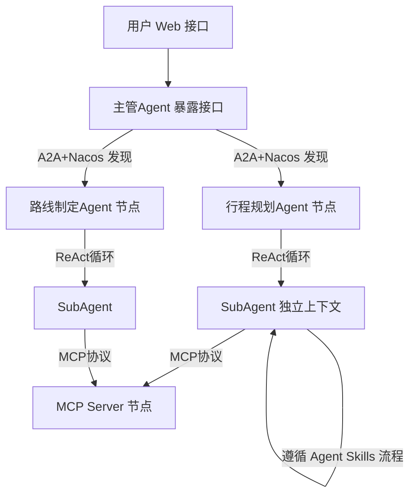

# 9-2 分布式Agent自主旅游规划的架构思路

## 【学习目标】

学完本节，你能：
- 画出课程旅游规划系统的整体分布式架构：用户入口、主管 Agent、各节点 Worker、MCP Server。
- 说清主管 Agent 的「自主分解 + 自主分发」职责，以及它如何利用 Nacos + A2A 发现远程 Worker。
- 解释 Worker 内部「ReAct 循环 + SubAgent + Skills + MCP」的协作链条。
- 把该架构抽象成可复用的「主管-远程 Worker + 工具节点」模板。

## 【正文】

下面看课程项目，分布式 Agent 如何自主完成旅游规划，以及整体架构如何搭建。

**入口与主管**。用户通过 Web 接口提交 Prompt，该接口由「主管 Agent」节点暴露。主管 Agent 收到 Prompt 后做两件事：一是自主进行任务分解，二是自主进行任务分发。

**分发到远程 Worker**。主管 Agent 如何把任务送到其他节点的 Agent？它借助 Nacos 注册中心，基于 A2A 协议把任务分发到对应节点执行。其余节点有两个 Agent：路线制定 Agent 与行程规划 Agent。它们各自基于 A2A 协议把自己的智能体卡片（AgentCard）注册到 Nacos；主管 Agent 据此发现这两个远程智能体，再分派任务。

**Worker 内部执行**。以行程规划 Agent 节点为例：收到任务后，它按 ReAct 架构，思考、执行、再反思，再思考、执行、反思，循环推进，自主完成任务。执行中遇到单一任务，会创建一个子 Agent（SubAgent，下一章讲解）去独立执行；因 SubAgent 在独立上下文，不干扰行程规划 Agent 的主干任务。

**SubAgent 与 Skills、MCP 的衔接**。SubAgent 执行任务时遵循 Agent Skills（不仅是专业工具，更是一整套专业流程）。执行该流程过程中会调用 MCP 工具；MCP Server 位于另一节点，SubAgent 基于 MCP 协议到该节点调用工具。

下图归纳端到端调用链：

**为什么是这种拓扑**：把「规划 / 路线 / 行程」拆成独立节点，等价于把单体 Agent 拆成微服务，每个节点可独立扩容、独立部署、独立故障隔离。主管只管「发现谁、派给谁」，Worker 只管「领到任务怎么干」，MCP Server 只管「提供工具能力」。三层职责清晰，正是分布式 Agent 相对单进程 Agent 的核心优势。

**生产经验类比**：该架构与「API 网关 + 微服务 + 第三方能力（地图/支付）」完全一致。Nacos 即注册中心，A2A 即服务调用协议，MCP 即标准化的能力接口。若把主管 Agent 理解为「调度编排层」、Worker 理解为「业务服务层」、MCP 理解为「外部依赖层」，架构认知难度会大幅下降。

## 【易错点 / 面试题】

1. **问：主管 Agent 与 Worker 之间靠什么「认识彼此」？**
   答：靠 A2A 协议 + Nacos 注册中心。Worker 启动时把 AgentCard 注册到 Nacos，主管在分发前从 Nacos 发现目标 Worker 的卡片并据此调用。离线场景可用本地 stub 模拟「发现+调用」全过程。

2. **问：SubAgent 为什么要用独立上下文？**
   答：避免子任务的工具调用、中间思考污染主管/Worker 的主干记忆，保证主干计划稳定可回溯；同时子任务失败不影响整体。

3. **问：MCP Server 为何独立成节点而非内嵌？**
   答：工具能力（如地图）独立于 Agent 演进，独立部署可复用、可限流、可替换实现；MCP 协议让「能力」与「智能体」解耦，这与 981-demo 把 `com/travel/agent/tool/RouteMakingTools.java` 作为可插拔工具层的设计一致。

## 【小结】

本节给出旅游规划的分布式骨架：用户 → 主管（分解+分发）→ 远程 Worker（ReAct + SubAgent）→ MCP 工具节点。下游章节将逐一落地：SpringBoot 4 整合 AgentScope、在各节点创建 ReAct Agent、主管自主分解任务。

> 技术前瞻：Spring AI 2.x 的 `ToolSearchToolCallingAdvisor` 提供「渐进式工具披露」，当工具集庞大时可省 50–70% token；该思路与 AgentScope 把 MCP/Skills 做成独立可插拔节点异曲同工。

工程绑定：981-demo 同栈（AgentScope）复刻本章架构，`com/travel/agent/agent/TeamMembers.java` 定义团队成员（路线/行程 Worker），`com/travel/agent/tool/RouteMakingTools.java` 提供路线工具，`com/travel/agent/a2a/AgentCard.java` 对应 A2A 的 AgentCard 注册发现，`com/travel/agent/config/*` 负责节点装配。
