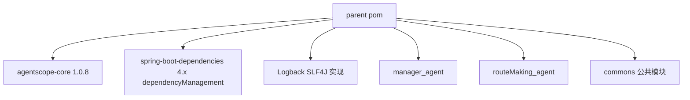

# 9-3 SpringBoot 4 和 AgentScope 的整合

## 【学习目标】

学完本节，你能：
- 在 Maven 工程中引入 AgentScope 1.0.8 与 Spring Boot 4 的依赖，并理解「core 依赖 + dependencyManagement 导入 Boot」的装配方式。
- 说清课程项目为何采用「多模块」结构（manager_agent / routeMaking_agent / commons），以及各模块职责。
- 跑通一个最小 ReAct Agent，验证 AgentScope 1.0.8 与 Spring Boot 4 整合无 JSON 冲突报错。
- 把环境变量的读取与校验写成启动前守卫，避免缺 Key 时运行时才崩溃。

## 【正文】

本节开始基于 AgentScope 搭建分布式多 Agent 旅游规划。AgentScope 当前最新版本为 1.0.8，前文 demo 用的是 1.0.7，本项目直接基于 1.0.8 构建。

前文 AgentScope demo 仅需一个依赖（它把其余依赖全打包在内）。但 1.0.7 版本里 JSON 依赖版本不一致会冲突，故 demo 需先排除 AgentScope 自身的 JSON 依赖、再额外引入统一 JSON 版本才能运行。本项目改用 1.0.8，且因要处理 Spring 的 JSON 数据与 Web 接口，需引入 Spring Boot，采用其最新 4.0 版本。

**整合方式**：引入 AgentScope 核心依赖即可：

```xml
        <!-- 引入 AgentScope 核心依赖 -->
        <dependency>
            <groupId>io.agentscope</groupId>
            <artifactId>agentscope-core</artifactId>
            <version>${agentscope.version}</version>
        </dependency>
```

SpringBoot 采用 Parent 式的 `dependencyManagement` 导入，后续用到某模块只需引入模块名、无需指定版本：

```xml
        <dependencyManagement>
            <dependencies>
                <dependency>
                    <groupId>org.springframework.boot</groupId>
                    <artifactId>spring-boot-dependencies</artifactId>
                    <version>${spring-boot.version}</version>
                    <type>pom</type>
                    <scope>import</scope>
                </dependency>
            </dependencies>
        </dependencyManagement>
```

第三个依赖是 SLF4J 的实现，同样采用 Logback 日志框架。

**多模块拆分**：因要建分布式 Agent，以模块方式组织，主管 Agent、路线制定 Agent、公共模块：

```xml
        <modules>
            <module>manager_agent</module>
            <module>routeMaking_agent</module>
            <module>commons</module>
        </modules>
```

注意：本项目**没有**像前文 demo 那样排除 AgentScope 自身的 JSON 依赖。

**跑最小 ReAct Agent 验证**。把阿里大模型平台 API Key 放进环境变量读取，用 `DashScopeChatModel` 配置模型与系统提示词：

```java
        .model(DashScopeChatModel.builder()
            .apiKey(apiKey)
            .modelName("qwen3-max")
            .build())
        .sysPrompt(
            "你是一个AI助手。"
        )
        .build();
```

环境变量读取与检查逻辑如下，确保 `DASHSCOPE_API_KEY` 已设置，否则退出：

```java
        String apiKey = System.getenv(name: "DASHSCOPE_API_KEY");
        if (Key == null || apikey.isEmpty()) {
            System.err.println("环境变量 DASHSCOPE_API_KEY 未设置");
            System.exit(status: 1);
        }
```

仅发送「你好」这类简单 Prompt，通过 Stream 流式响应读取模型反馈（前文已讲）。运行基于 1.0.8 的 AgentScope + Spring Boot 4 整合、且未排除 JSON 依赖的最小 ReAct Agent，可见无报错。

**为什么这样验证**：升级依赖后第一要务是「最小可运行验证」，用最简单的 Prompt 确认栈无冲突、依赖可解析、模型可联通。课程观察到 1.0.8 与 Spring Boot 4 整合时已无需排除 JSON 依赖（可能已修复该冲突），这说明依赖管理要随版本实测，不能照搬旧版结论。

下图归纳本节的工程装配结构：



## 【易错点 / 面试题】

1. **问：为何用 `dependencyManagement` 而非逐个声明 Boot 版本？**
   答：`dependencyManagement` 统一锁定 Boot 及其 starter 的版本，子模块引入 `spring-boot-starter-*` 时无需再写版本，避免版本漂移、保证全家桶一致。

2. **问：为何分 manager_agent / routeMaking_agent / commons 三个模块？**
   答：主管与路线制定是独立部署节点，公共模块放工具类与配置供两者复用。按部署边界切分模块，才能各自打镜像、独立运行。

3. **问：为何启动前就校验 `DASHSCOPE_API_KEY`？**
   答：Key 缺失时若等到真正调用模型才报错，会浪费启动与装配开销；前置守卫让故障「fail fast」，且错误提示明确。生产里这类校验还应配合配置中心与 Secret 管理。

## 【小结】

本节完成 AgentScope 1.0.8 + Spring Boot 4 的整合与最小验证，并确立「主管 / 路线制定 / 公共」三模块骨架。下一节将在这套依赖上，于各节点创建 `ReActAgent` 实例。

> 技术前瞻：Spring AI 2.x 把工具调用循环提升为 `ToolCallingAdvisor` 一等公民，与 AgentScope 的 ReAct 框架在「循环驱动」理念上一致；迁移到 Spring AI 栈时，AgentScope 的 `ReActAgent` 心智模型可直接迁移。

工程绑定：981-demo 同栈（AgentScope）复刻本节装配，`com/travel/agent/config/*` 对应本节的依赖与模块装配，主管 Agent 见 `com/travel/agent/agent/SupervisorAgent.java`。课程用 1.0.8，981-demo 以同栈离线桩复刻，不计版本差异。
