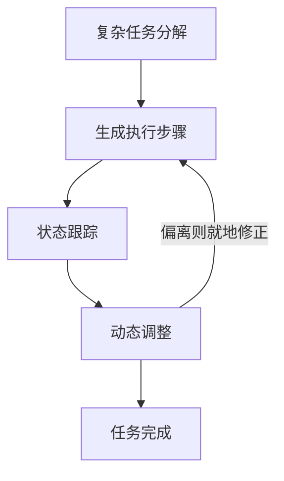

# 9-6 自主分解任务的关键：PlanNotebook

## 【学习目标】

- 说清 `enablePlan()` 与 `planNotebook()` 的差异，以及何时必须选用后者。
- 理解 `PlanNotebook` 在 AgentScope 中的核心地位：它同时承载「自主规划（PlanAct）」与「自主决策（ReAct）」两条主线。
- 掌握 `needUserConfirm`、`maxSubtasks`、`storage` 三个可定制属性的含义与默认值，能在主管 Agent 中按需配置任务分解粒度与确认策略。

## 【正文】

在 9-5 中，主管 Agent 已经能够基于 ReAct 框架把用户的复合需求拆成若干子任务，并逐步拟定执行计划。其背后只有两处属性开关：`enablePlan()` 与 `planNotebook()`。二者的关系决定了你能不能对计划过程做定制。

`enablePlan()` 内部其实就是用一套**默认属性**去实例化 `PlanNotebook`，因此它走的是「开箱即用」路径，无法干预计划的数量上限、是否需要人工确认、计划落盘方式等细节。而 `planNotebook()` 接收一个**显式的 `PlanNotebook` 实例**，你先按业务诉求把实例配好，再把它灌进方法里，Agent 就会按你的配置去分解与规划。

```java
        public PlanNotebook getPlan() {
            return PlanNotebook.builder()
                .needUserConfirm(false) // 不需要用户确认
                .maxSubtasks(1) // 子任务数量限制
                .build();
        }
```

（代码对照：9-5 的主管 Agent 模块里建了一个 `plan` 包，对外提供 `getPlan()` 这类工厂方法，返回的就是可被 `planNotebook()` 消费的定制实例。）

为什么 AgentScope 要把「规划」与「执行」融进同一个 `PlanNotebook`？因为一次完整的自主任务至少包含五段闭环：

1. **复杂任务分解**：把用户需求切成若干子任务（如查天气、定路线、排景点）。
2. **生成执行步骤**：给出子任务的先后逻辑。
3. **状态跟踪**：记录哪些子任务已完成、哪些还在排期。
4. **动态调整**：每轮执行后，用 ReAct 的「思考→行动→观察→比对目标」回环校验结果是否偏离设定，偏离则就地修正。
5. **任务完成**：所有子任务闭环后收尾。



这五段闭环恰好对应 AgentScope 对 Agent 行为的两种抽象：

- **PlanAct（自主规划）**：整体「先做什么、后做什么」的步骤顺序由 Agent 自己定，而不是由人工硬编码每个节点的先后。这是与工作流（StateGraph）最本质的区别，工作流的边是开发者画死的，PlanAct 的边是 Agent 临时生成的。
- **ReAct（自主决策）**：落到每个子任务的执行上，Agent 用「思考、行动、反思、比对目标、动态调整」的方式推进，而不是一条道走到黑。

`PlanNotebook` 把这两套机制打包成同一个对象，因此它是整个 Agent 能「自主规划 + 自主决策」的中枢。回顾 9-5 的运行日志，主管 Agent 在末尾曾向用户确认「是否继续执行既定计划」，那只是分解与拟定阶段；真正的「按步骤执行 + 状态跟踪 + 动态调整」由 `PlanNotebook` 在后半程接管。

可定制属性逐一拆解：

| 属性 | 含义 | 默认值 | 生产含义 |
|---|---|---|---|
| `needUserConfirm` | 每个计划步骤（即拆出的子任务）是否需人工确认后才执行 | `false` | `false` 适合全自动排程；`true` 适合高危操作（如扣款、发消息）需人拍板 |
| `maxSubtasks` | 分解出的子任务数量上限，控制规划粒度 | 由框架定 | 设小则粗粒度、单步直给；设大则细粒度、分步可控 |
| `storage` | 计划的存储后端，需传入一个存储对象 | 未设置（内存） | 接入持久化后可做断点续跑、计划审计 |

`storage` 在此处暂不配置（保持内存态，先注释留口），后续章节会随项目需要再补。

> 工程视角：`maxSubtasks(1)` 在示例里是刻意压到极致的演示值，它让 Agent 一次只盯一个子任务，便于观察「分解→执行」的最小闭环。真实旅游规划通常会放宽到 5～8，否则单步过细会让 LLM 调用次数翻倍、token 成本陡增。

## 【易错点 / 面试题】

1. **`enablePlan()` 与 `planNotebook()` 能同时用吗？** 不能，二者都是往 Agent 里塞同一个计划能力，重复配置后者会覆盖前者语义。需要定制就用 `planNotebook()`，纯默认就用 `enablePlan()`。
2. **PlanAct 和 ReAct 是一回事吗？** 不是。PlanAct 管「整体步骤怎么排」，ReAct 管「每步怎么执行并纠偏」。`PlanNotebook` 同时包含两者，这也是它被称为核心对象的原因。
3. **`needUserConfirm=true` 会卡住自动化吗？** 会。它要求每步人工确认，适合高风险场景；全自动链路应置 `false`，否则无人值守时会阻塞在等待确认上。

## 【小结】

`PlanNotebook` 是 AgentScope 让主管 Agent 从「会拆任务」升级为「会排计划、会跟踪、会纠偏」的关键。下一节（9-7）会用 `Hook` 把计划创建与执行过程中的内部事件（思考、调工具等）拦截出来，让黑箱变透明。向后看，9-8 起主管 Agent 会把拆好的子任务**分发**给路线制定 / 行程规划两个远程 Agent，而那套分发能力正是 981-demo 中 `com.travel.agent.agent.SupervisorAgent` 复刻的，该 demo 同样用 `PlanNotebook` 承载主管的任务分解与计划编排，只是把确认策略与子任务粒度按生产场景调大了。技术前瞻上，Spring AI Agents（计划并入 3.0 的方向）也在抽象类似的「计划 + 工具循环」中枢，但课程此处以 AgentScope 的 `PlanNotebook` 为准，不展开其具体 API。
