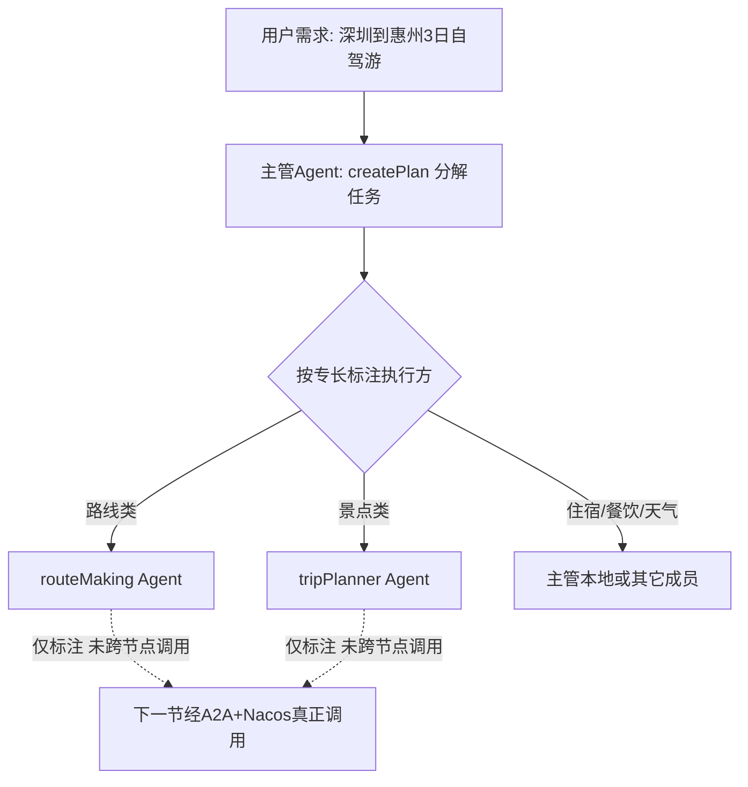

# 9-8 主管Agent分发任务给相应Agent

## 【学习目标】

- 理解主管 Agent 如何在「任务分解」之后，按子任务性质把每一步**自主分发**给对应专长的远程 Agent。
- 掌握用 Prompt 注入「成员清单 + 各自专长 + 子任务须注明调用方」的方式，先验证分发意图（只标注、不调用）。
- 引出下一节的核心问题：主管如何**自动发现**有哪些 Agent、它们各自擅长什么，答案是 A2A 协议 + Nacos 智能体卡片。

## 【正文】

9-5 / 9-6 解决的是「主管 Agent 把复合需求拆成步骤」；本节解决的是「拆出来的每一步，该交给谁干」。主管节点本身不落地执行，真正干活的是另外节点的两个 Agent：**路线制定 Agent（routeMaking）** 与 **行程规划 Agent（tripPlanner）**。分发不能由开发者手敲写死，必须由主管按子任务的性质自主判定。

先用 Prompt 做一次「轻量验证」：不真正调用远程 Agent，只让主管在拆分步骤时，给每个子任务**注明**应由哪个 Agent 认领。先给出需求：

```java
        String prompt = """
        帮我制定2026年元旦，
        深圳到惠州3日自驾游计划，
        请包含吃住行，天气，酒店，餐饮美食。
        """;
```

再补一段「成员档案」，告诉主管有两个可用成员及其专长，并要求每一步都标注调用方：

```java
        - routeMaking Agent：擅长处理自驾游路线制定
        - tripPlanner Agent：擅长处理景点行程规划
        - 每个子任务要注明调用的Agent
```

运行触发逻辑与前面一致，仍是把 Prompt 喂给主管 Agent 并订阅流式响应：

```java
        Flux<Event> stream = AgentUtils.streamResponse(agent, prompt);
```

执行后主管先调 `createPlan` 把需求传入并拟定计划，最终列出 5 个子任务，且**每个子任务都按专长绑定了执行方**：

```
        2026 [INFO] 我已为您制定了2026年元旦深圳到惠州3日自驾游计划，包含以下5个子任务：
        1. **制定自驾路线** - 调用 routeMaking Agent 规划最佳自驾路线
        2. **规划景点行程** - 调用 tripPlanner Agent 安排3日景点游玩
        3. **预订住宿安排** - 推荐适合的酒店
        4. **安排餐饮美食** - 推荐当地特色美食和餐厅
        5. **查询天气预报** - 提供元旦期间天气信息和出行建议
```

可以看到，主管确实依据「路线类归 routeMaking、景点类归 tripPlanner」的专长描述完成了自主分发，「制定自驾路线」认领给路线制定 Agent，「规划景点行程」认领给行程规划 Agent。这就是自主分发的雏形：分发依据是**能力画像**，不是硬编码。

但此处有个绕不过去的硬伤：成员清单是开发者写进 Prompt 的。真实系统里，主管不该靠人工把「有哪些 Agent、各自擅长什么」一条条塞进 Prompt，而应具备**自我发现**能力，自动探知存在哪些 Agent、各自能力为何。这就要靠 **A2A 协议 + Nacos 注册中心**：远程 Agent 把自己的「智能体卡片（AgentCard）」登记到 Nacos，卡片上写明该 Agent 拥有什么能力；主管从 Nacos 拉取卡片，据此自动匹配并分发。A2A 协议在前面的课程已演示过，9-9 起我们将基于 AgentScope 在框架层面落地这套机制。

下面是主管分发意图的简化示意（仅描述「标注归属」，尚未真正跨节点调用）：



## 【易错点 / 面试题】

1. **自主分发靠什么判定归属？** 靠「成员能力画像」，由 Prompt 或（更优的）Nacos 智能体卡片提供。硬编码成员映射会丧失灵活性，也违背「自主」初衷。
2. **本节的分发是真正调用远程 Agent 吗？** 不是。本节只在计划里**标注**每一步的认领方，验证分发意图正确；真正的跨节点调用要到 9-10 经 A2A + `A2aAgent` 完成。
3. **为什么不能把成员清单写死在 Prompt？** 成员会动态上下线、能力会演进，写死既难维护也无法让主管「发现新成员」。A2A + Nacos 才是可扩展的解法。

## 【小结】

本节把「任务分解」推进到「任务分发」：主管 Agent 依据成员专长，把每个子任务自主指派给对应 Agent，这是 Supervisor/Worker 范式在 AgentScope 中的第一体现。它向上承接 9-6 的 `PlanNotebook`（谁的步骤、几步），向下引出 9-9 / 9-10 的能力发现与远程调用。在 981-demo 中，`com.travel.agent.agent.SupervisorAgent` 负责规划与分发，`com.travel.agent.agent.TeamMembers` 则登记了各成员 Agent 的专长画像，复刻的正是本节「按能力分发」的逻辑。技术前瞻上，Spring AI Agents 规划的「子 Agent（sub-agent）路由」也是类似思路，主管按任务选子 Agent，但课程此处以 AgentScope 的自主分发为准，不展开其 API。
