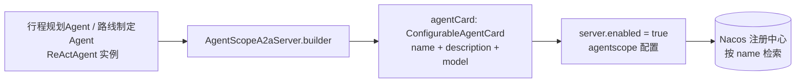

# 9-9 团队成员的智能体卡片注册到Nacos

## 【学习目标】

- 理解 A2A 协议里的「服务端 / 客户端」角色：远程成员 Agent 是**服务端（卡片提供方）**，主管 Agent 是**客户端（发现方）**。
- 掌握在 AgentScope 中引入 A2A 与 Nacos 依赖、编写 `application.yml`、用 `AgentScopeA2aServer` + `ConfigurableAgentCard` 把成员 Agent 的卡片自动注册进 Nacos。
- 记住智能体卡片 `name` 必须与 Agent 名称一致，因为 Nacos 是按卡片名称检索的。

## 【正文】

9-8 遗留的核心问题是：主管不该靠 Prompt 硬编码成员清单，而应自动发现「有哪些 Agent、各自擅长什么」。答案是 A2A 协议 + Nacos 注册中心，远程 Agent 把写有自身能力的「智能体卡片」存进 Nacos，主管再去拉取。A2A 在前面的课程已基于 SpringAI Alibaba 1.1 实现过；AgentScope 构建于 SpringAI Alibaba 之上，因此实现方式大体一致，本节落到 AgentScope 的具体依赖与配置上。

先引入两个 Starter 依赖：A2A 的 Spring Boot 封装，以及 AgentScope 对 Nacos 的 Spring Boot 封装：

```xml
        <!-- 以 SpringBoot 方式添加 A2A 依赖 -->
        <dependency>
            <groupId>io.agentscope</groupId>
            <artifactId>agentscope-a2a-spring-boot-starter</artifactId>
            <version>${AgentScope.version}</version>
        </dependency>

        <!-- 额外添加 Nacos Spring Boot starter 的依赖 -->
        <dependency>
            <groupId>io.agentscope</groupId>
            <artifactId>agentscope-nacos-spring-boot-starter</artifactId>
            <version>${AgentScope.version}</version>
        </dependency>
```

回到 A2A 的角色划分：主管 Agent 节点是**客户端（服务发现者）**，负责从注册中心发现远程 Agent；路线制定 Agent 与行程规划 Agent 这两个节点是**服务端（服务提供者）**，也就是智能体卡片的提供方。本节先把服务端，也就是 routeMaking 与 tripPlanner 两个成员 Agent，的卡片自动注册进 Nacos。

配置写在 `application.yml`，核心在 `agentscope` 名下：开启 `server.enabled: true` 把本节点作为 A2A 服务端，并指定注册中心用 Nacos、给出其地址：

```yaml
        agentscope:
          dashboard:
            api-key: your-api-key
          agent:
            name: my-assistant
            description: My Intelligent assistant based on AgentScope
            server:
              enabled: true
              card:
                name: My Assistant
                description: My Intelligent assistant based on AgentScope
            nacos:
              server-address: $(NACOS_SERVER_ADDRESS:127.0.0.1:8848)
              username: $(NACOS_USERNAME)
              password: $(NACOS_PASSWORD)
```

配置就绪后，看代码侧如何把成员 Agent 的卡片注册进去。以行程规划 Agent 为例：前面已用工具类把它创建为 ReAct Agent；现在要借助 AgentScope 提供的 `AgentScopeA2aServer` 把它暴露为 A2A 服务端。其构建同样走 `builder()`：

```java
        public ReActAgent getTripPlannerAgent() {
            return AgentUtils.getReActAgentBuilder(
                name: "TripPlannerAgent",
                description: "行程规划Agent"
            ).build();
        }

        AgentScopeA2aServer.builder().build();
```

`AgentScopeA2aServer.builder()` 有两种重载：

- **第一种**：`builder()` 直接接收 ReActAgent 的 Builder，于是可以把行程规划 Agent 的 Builder 传进去，由服务端托管该 Agent 的构建。
- **第二种**：Agent 实例已有，再单独通过 `agentCard()` 方法补上它的「智能体卡片」，卡片本身用 `ConfigurableAgentCard` 描述。

`ConfigurableAgentCard` 同样用 `Builder` 构造。下面为行程规划 Agent 建卡片，至少填 `name` 与 `description`，并把卡片交给服务端：

```java
        // 程规划Agent 智能卡片
        ConfigurableAgentCard agentCard = new ConfigurableAgentCard.Builder()
            .name("TripPlannerAgent")
            .description("行程规划Agent")
            .model(DashScopeChatModel.builder()
                .apiKey("sk-2bd2b61d8b724c6dae4d404159950203")
                .modelName("qwen3-max")
            ).build();

        AgentScopeA2aServer.builder()
            .agentCard(agentCard)
            .build();
```

卡片里还能配置 `Skills`（成员的专业能力），但 Skills 尚未讲到，此处先只填名称与描述。

> 关键约束：**智能体卡片的 `name` 必须与对应 Agent 的名称严格一致**。Nacos 是按卡片 `name` 检索成员 Agent 的，名称对不上会导致主管在 9-10 阶段「找不到人」。AgentScope 在卡片建好后即可自动把它注册进 Nacos。

下面用一张图归纳「服务端把卡片注册进 Nacos」的链路（纯归纳原文，无新增事实）：



## 【易错点 / 面试题】

1. **A2A 里谁是服务端、谁是客户端？** 成员 Agent（routeMaking / tripPlanner）是**服务端**，提供智能体卡片；主管 Agent 是**客户端**，去 Nacos 拉卡片做发现。角色弄反就无法连通。
2. **卡片 `name` 写错会怎样？** 主管将按错误名称检索不到对应 Agent，分发失败。务必保证 `ConfigurableAgentCard.name` 与 Agent 自身名称一致。
3. **`server.enabled` 不开启会怎样？** 本节点不会被当作 A2A 服务端暴露，卡片也就注册不进 Nacos，客户端无卡片可发现。

## 【小结】

本节完成了 A2A 的「服务端」半边：用 `AgentScopeA2aServer` + `ConfigurableAgentCard` 把成员 Agent 的卡片自动注册进 Nacos，让主管后续能按卡片发现并分发。它向上承接 9-8「主管需自动发现成员能力」的诉求，向下对接 9-10「主管从 Nacos 拉卡片并封装为工具调用」。在 981-demo 中，`com.travel.agent.a2a.NacosAgentRegistry` 负责把各成员 Agent 的 `AgentCard` 注册到 Nacos，`com.travel.agent.config.NacosBootstrap` 则封装 Nacos 地址等启动配置，二者复刻的正是本节能力。技术前瞻上，Spring AI Alibaba 也已加入 A2A + Nacos 的支持，但课程此处以 AgentScope 的 `AgentScopeA2aServer` 为准，不展开其 API。
