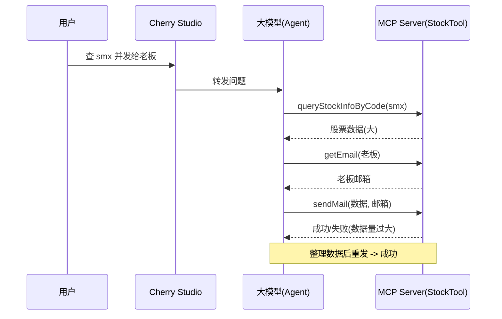

# 11-1 Cherry Studio 连接 MCP 服务与实践

## 【学习目标】

读完本节，你应该能够：

1. 在 Cherry Studio 里配置并启用本项目的 MCP Server（SSE 类型），理解它与 Cursor 类开发工具的接入差异。
2. 用一句自然语言驱动「查股票 → 取邮箱 → 发邮件」的自动化链路，并读懂模型打印的工具调用序列。
3. 分析一次「数据量过大导致反序列化失败」的踩坑，理解不同 Agent 客户端在「是否先整理数据」上的行为差异。
4. 对照 `982-demo` 的 `RiskQueryAgent` 与 `@Tool` 契约，理解 MCP 工具与 `ChatClient` 工具是同一套能力的两种入口。

## 【正文】

### 一、为什么不用 Cursor 类工具

到本节，项目已完全开发完成，本地跑起来没问题；想让别人用，建个钉钉群拉人、本地运行项目也完全可行。也可通过 Cursor 这类工具调用 MCP 提供的服务。但要提一句：Cursor 更偏向开发人员写代码场景。普通用户不习惯这种方式，更倾向于「直接对话」的交互形式，更方便。所以这节看另一类工具，**Cherry Studio**。

### 二、Cherry Studio 是什么

Cherry Studio 是国内外都较流行的客户端，可集成众多国内外大模型。搜 「Cherry Studio」 或访问官网 **cherry-ai.com** 即可，自称「你的超级 AI 工作站」。按操作系统选择下载，Windows 和 macOS 都有对应版本，安装后打开即可。

### 三、预设助手与自定义角色

打开后默认提供很多预设助手，如「产品精灵」「数据分析师」，扮演不同角色、已预定义好，可直接用；也可在左侧添加助手（Assistant）或代理（Agent）。默认情况下这些助手其实没有系统 Prompt。以「工程师」为例，选中后会出现一段系统提示词，即已定义好的角色设定；也可自己改，把它变成专属角色，比如让它「写一份北京一日游攻略」，直接生成对应输出。

### 四、配置大模型

真正使用前，在「设置 → 模型」里配置要用的大模型。可选很多，如阿里云百炼（通义千问）、DeepSeek（这两个最常用，基本都开），以及 ChatGPT、Gemini 等流行模型。配置方式即去对应平台注册、创建 API Key，把密钥填进来即可使用。没注册过的先去注册。

### 五、连接我们自己的 MCP 服务

重点来了：在「设置 → MCP」里可以看到我们自己用的 MCP。若列表为空，点「添加」→「快速创建」即可。

- **名称**：自定义；
- **类型**：选 **SSE**（本项目用的就是 SSE 实现）；
- **URL**：填本地 MCP 服务的 SSE 端点地址。

本项目 MCP 的 SSE 端口是 **7070**，所以 Cherry Studio 里填 `http://localhost:7070/sse` 即可（下面示例用 8090，实际按你项目跑起来的端口改）。

配置示例（MCP 服务器）：

```json
{
  "name": "MCP服务器",
  "type": "sse",
  "url": "http://localhost:8090/sse"
}
```

保存后提示「服务器更新成功」，先把服务关掉再重新打开，它会变成已启用状态，可直接使用。

> 工程对照：课程 10-x 的 `StockTool` 用 `@Tool(description="根据股票代码查询股票信息数据")` 把方法暴露成工具，MCP Server 通过 SSE 把这批 `@Tool` 广播给客户端。按 §3.2，同一套 `@Tool` 方法可进一步封装为注解式 MCP Server（`@McpTool` + `McpToolCallback`），以 SSE 暴露给 Cherry Studio 这类客户端，工具定义只有一份，SSE 只是它的传输通道。`982-demo` 的 `RiskQueryAgent` 同样用 `@Tool` 把 `evaluate` 挂给 `ChatClient`，与课程 MCP 工具共享同一契约；差异仅在运行载体（对话内 `ChatClient` vs 外部 MCP 客户端）。

### 六、在对话框里调用 MCP

回到对话框，新建助手（用默认也行），选好模型。输入框下方有一个 **MCP 工具** 开关，**点一下变绿**即开始使用我们的 MCP 工具；再点关闭。

开启后，直接发一句自然语言即可，比如：

> 查询 smx 股票的数据，并且发送给我的老板

模型会依次调用 MCP 工具完成这件事：

```text
MCP 服务器: queryStockInfoByCode
MCP 服务器: getEmail
MCP 服务器: sendMail
```

即：先用 `queryStockInfoByCode` 按代码查出 smx 数据，再用 `getEmail` 获取老板邮箱地址，最后用 `sendMail` 把数据发过去。

**为什么是这三步**：模型在 ReAct 循环里先做意图拆解（查数据 + 发邮件），再按依赖顺序规划工具调用，`getEmail` 必须先于 `sendMail`（后者依赖前者返回的地址），`queryStockInfoByCode` 提供邮件正文。工具调用顺序由模型根据 `@Tool` 的 `description` 与参数依赖推断，不需要人工写死工作流。

### 七、一次踩坑与解决

第一次发送，邮件没成功发出，而是报错：

```json
{
  "error": true,
  "content": "Cannot construct instance of class com.alibaba.fastjson.JSONObject: no String-argument constructor/factory method to deserialize from JSON"
}
```

排查有两种可能：一是返回的股票数据量太大，模型处理不过来；二是接收回复的邮箱服务本身有点小问题。把任务拆解测了一下，单独查「当前时间」「老板邮箱」两个工具都没问题，说明邮箱服务是好的，问题大概率出在**参数数据量过大**上。

这引出有意思的一点：Cursor 里调用时，模型会**主动帮我们把数据整理**成结构化内容再发送；而 Cherry Studio 当前这次调用里它没做整理，直接把过大原始数据丢给 `sendMail`，于是失败。本质是**代理（Agent）模式**的差异，更聪明的代理会先整理、再执行。把数据整理好重发一次，老板邮箱里就收到「关于 smx 股票的数据总结」，一切正常。

> 工程启示：工具返回体量不可控时，应在工具侧做「裁剪 / 聚合」而非把原始大对象交给下游。生产里可让 `queryStockInfoByCode` 只返回摘要字段，或在 `sendMail` 前由模型做一次 `call().entity(Summary.class)` 结构化抽取（Spring AI 的 `BeanOutputConverter`），避免把超长 JSON 直接喂给反序列化方。这正是 `982-demo` 用 `chatClient.prompt().call().content()` 前先做规则聚合、只回 `List<RiskAlert>` 小对象的思路。

顺带一提，Cursor 里的 MCP 配置写法和 Cherry Studio 类似，只是少了 `type` 字段：

```json
{
  "name": "stock-mcp-server",
  "url": "http://localhost:8090/sse"
}
```



## 【易错点 / 面试题】

1. **易错点：SSE 端口填错。**
   项目 MCP 的 SSE 端口是 7070（示例写 8090 仅为格式参考），填成别的端口 Cherry Studio 连不上。务必按自己项目实际端口改，且「保存后关服务再重开」才会变成已启用。

2. **面试题：为什么同一条数据在 Cursor 成功、在 Cherry Studio 失败？**
   答：差异在 Agent 是否先整理数据。Cursor 的代理会先把大对象收敛成结构化摘要再调 `sendMail`；Cherry Studio 这次直接把原始大 JSON 丢过去，触发 fastjson 反序列化异常（无 String 参数构造器）。本质是代理智能程度 / 提示词差异，不是工具本身的问题。

3. **易错点：邮箱服务被误判为坏。**
   报错先拆任务测单工具，`getEmail` / `queryCurrentTime` 单独都通，说明邮箱服务好，问题在入参体量。定位问题要靠「最小复现」而非整体重试。

4. **面试题：MCP 工具的 `@Tool` 和 `ChatClient` 的 `@Tool` 能共用吗？**
   答：能。方法是同一份，挂给 `ChatClient`（`defaultTools(this)`）即在对话内触发，封装成 MCP Server 即通过 SSE 给外部客户端调用。`982-demo` 的 `RiskQueryAgent` 与课程 `StockTool` 正是这一点的两个实例。

## 【小结】

本节把课程的 MCP 工具从「工程内可跑」推进到「普通用户可对话调用」：Cherry Studio 通过 SSE 接入本项目 MCP Server，一句自然语言即可驱动「查股票 → 取邮箱 → 发邮件」。踩坑揭示了一个生产级真理，工具返回体量要在工具侧收敛，而非甩给下游反序列化。这套 `@Tool` 契约与 `982-demo` 的 `RiskQueryAgent` 完全同源，区别在于入口（MCP 客户端 vs `ChatClient`）。课程总结见 13-1，而 `982-demo` 则是把「监测 → 判定 → 推送」闭环做成可运行工程的落地样本。
