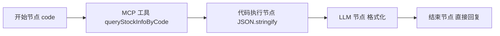

# 11-5 Dify 构建工作流调用自研 MCP 工具 - Chatflow 会话流

## 【学习目标】

读完本节，应当能够独立完成以下事项：

1. 区分 Dify 的五种形态（Workflow / Chatflow / 聊天助手 / Agent / 文本生成），并说清本节为什么选 Chatflow。
2. 把自研 MCP 服务接入 Dify，并规避「容器内部 localhost 访问不到宿主机 MCP」的经典坑。
3. 在 Chatflow 中拼出「开始 → MCP 工具 → 代码执行 → 大模型格式化 → 结束」的完整节点链路。
4. 处理调试中的两个真实问题：结束节点引用无效变量、超长 JSON 直接回复不友好。

---

## 【正文】

### 1. Dify 的几种形态

Dify 提供五种能力：工作流程（Workflow）、Chatflow（对话流）、聊天助手、Agent、文本生成。最主流的是 **Chatflow** 与聊天助手；想要更智能、更自主的玩法，就用 **Agent**。本节做 Chatflow，它比普通聊天助手多了一层「可视化节点编排」，既能对话，又能把工具调用、代码转换、模型加工串成确定性的流水线。

| 形态 | 特点 | 适用 |
|---|---|---|
| Chatflow | 对话 + 节点编排，流程可视可控 | 本节：带工具调用的对话流 |
| 聊天助手 | 纯对话，轻量 | 简单问答 |
| Agent | 自主决定调用哪些工具、按什么顺序 | 开放任务 |
| Workflow | 纯流程，无对话上下文 | 批处理 / 自动化 |
| 文本生成 | 一次性生成 | 内容生产 |

### 2. 创建 Chatflow 应用

进入工作室，点「创建空白应用」，类型选 Chatflow，起名例如「MCP股票」，加个头像、选个颜色，点创建即可。

创建后默认是三个节点组成的基础流程：

- **开始节点**：用户的输入；
- **结束节点**：直接回复，即最终要呈现的内容；
- 中间可插入各种复杂节点。

最简情况下，中间先放一个 **LLM 大模型节点**。点一下就能选模型，本节用 **DeepSeek**，想换可在下拉里切换，例如切到 `qwen-max`。

> 模型怎么接进来？两种方式：一是在插件市场安装对应模型；二是在「个人设置 → 模型供应商」里添加，填入你的 API Key（与 OpenAI 通用接入方式一致，硅基流动、本地 Ollama 等也都支持）。模型装好并填了密钥，才能在工作流节点里选用。

### 3. 把自研 MCP 工具导入 Dify

接下来是重点：把自研 MCP 工具导入。

在「工具」里点「添加 MCP 服务器」，把之前在 Cherry Studio 里加过的服务地址（本项目的 SSE 端点）直接复制过来。填一个名称，例如「美股异常波动 MCP 服务」，下面还有一个服务器的**唯一标识**（英文，例如 `my-stock`），再开启授权、保存。

#### 一个关键坑：别用 localhost

保存后若报「无法连接」，大概率是地址写成了 `localhost`。因为 Dify 部署在 **docker 容器**里，容器内部的 `localhost` / `127.0.0.1` 指「容器自己」，访问不到宿主机上跑着的 MCP 服务。

正确做法：用宿主机**内网 IP**。命令行里用 `ifconfig`（macOS）或 `ipconfig`（Windows）查一下，例如 `10.0.3.x`，将 IP 填进去，再确认协议是 **SSE**，保存并重新授权。一旦能显示工具列表，即说明授权成功。

> 工程视角：这条坑与 11-4 接入 Ollama 是同一根因，容器网络命名空间隔离。MCP 服务跑在宿主机 `7070` 端口，Dify 容器内必须用宿主机内网 IP 才能连通。这套自研 MCP 工具在 Java 端由 `@Tool` 注解暴露（如 `queryStockInfoByCode`），Dify 作为 MCP Host 通过 SSE 拉取工具清单并调用。生产工程 `982-demo` 的 `RiskQueryAgent` 用同样的 `ChatClient` + `@Tool` 暴露「查某票风险」，区别在于 `982-demo` 不依赖外部 Host，而是自己跑 Advisor 链驱动调用，二者工具语义同源。

### 4. 在工作流里使用 MCP 节点

回到工作室，加一个节点：工具 → MCP。若列表里没看到 MCP 工具，**刷新一下浏览器**再添加即可。点开能看到之前开发的所有工具，选「根据股票代码查询」那一个（即 `queryStockInfoByCode`）。

然后在**开始节点**加一个输入字段：变量名写 `code`，显示名「股票代码」，保存，这样工作流就多了一个入口参数。



### 5. 调试与第一个问题

直接点「预览」，输入股票代码（例如 `SMX`）运行。工作流跑通、任务成功，但**直接回复里什么都没输出**。

排查发现：直接回复节点引用了一个「无效变量」（原本想引用大模型输出）。把回复内容改成引用 **MCP 工具输出的文本 / JSON**。再跑一次，能看到 MCP 确实返回了数据，但那段长 JSON 直接甩给用户很不友好，而且直接回复节点对超长 JSON 处理不好。

### 6. 用代码执行节点做转换

解决办法：加一个 **代码执行节点**。支持 Python 和 JavaScript，本节用 JavaScript。把 MCP 返回的 JSON 数据作为入参传进来，用 `JSON.stringify(...)` 把它转成一个字符串，输出变量命名为 `jsonstr`：

```python
import requests
url = "http://localhost:7070/ise"
params = {"code": "600519"}
response = requests.get(url, params=params)
data = response.json()
# 返回数据给 LLM
```

> 注意：上面是示意调用形式，真实地址按你部署的 MCP 端点填写（实际用的是 SSE + 宿主机内网 IP）。

调整连线：代码执行 → 大模型 → 直接回复。

> 工程视角：为什么要在中间插一个代码执行节点？因为 MCP 返回的是机器可读的 JSON，直接给用户既难读又容易因长度 / 转义问题在回复节点出错。`JSON.stringify` 先做一层「压平 + 转义」的归一化，再交给 LLM 做语义化加工，既稳又可控。这与 `982-demo` 里 `service/RiskEvaluationService` 先拿 `StockTick` 原始行情、再过 `engine/RuleEngine` 做阈值判定的思路一致，「原始数据 → 预处理 → 模型/规则加工 → 输出」是一条通用管线。

### 7. 用大模型节点格式化输出

再加一个 **LLM 节点**，把 `jsonstr` 作为上下文传给它，并写好提示词，让它把原始 JSON 整理成易读内容：

```text
根据上下文的内容，进行数据处理，上下文内的数据是一段JSON的列表（字符串），请对该段内容进行数据格式化，优化为更好理解的可读列表数据格式，以便展示。
```

大模型最终输出一段自然语言文本，结束节点的「直接回复」改用**大模型的最终输出**。再运行一次（测试输入 `123`），大模型就会把 JSON 优化成通俗、便于查看的列表：

```json
{
  "name": "中国平安",
  "price": "50.00",
  "change": "+1.2%"
}
```

这才是真正对用户友好的结果。

---

## 【易错点 / 面试题】

1. **问：为什么 MCP 接入 Dify 不能用 localhost？**
   答：Dify 运行在 Docker 容器内，容器内 `localhost` 指向容器自身，而非宿主机。MCP 服务在宿主机 7070 端口，必须填宿主机内网 IP 或 `host.docker.internal`（视系统），并确认协议为 SSE。

2. **问：结束节点为什么报「无效变量」？**
   答：直接回复默认引用的是 LLM 节点输出，但本流程里数据来自 MCP 工具节点而非 LLM。需把回复内容改为引用「MCP 工具输出的文本 / JSON」，或引用后续 LLM 格式化节点的输出。

3. **问：为什么超长 JSON 不直接回复，而要先 `JSON.stringify` + LLM 格式化？**
   答：直接回复节点对超长、含特殊字符的 JSON 处理不稳，且原始结构对用户不友好。中间代码节点先压平转义，LLM 节点再做语义化呈现，兼顾稳定性与可读性。

4. **问：Chatflow 与 Agent 在接 MCP 时的最大区别？**
   答：Chatflow 的工具调用顺序由节点连线「人为编排」决定，确定可控；Agent 则由模型在对话中自主决定调用哪些工具、按什么顺序。前者偏生产流水线，后者偏开放助手。

---

## 【小结】

本节通过 Dify 这一外部工作流编排引擎，把自研 MCP 服务接了进来：用户输入股票代码 → MCP 工具查数据 → 代码节点转字符串 → 大模型格式化 → 友好回复。核心收获是「节点编排 + 容器网络坑 + 数据归一化」三件事。

无论是 **Dify**、**Coze** 还是 **n8n**，处理思路都一致。而把这条链路落到生产风控时，可在 Dify 的 MCP 工具背后接本课程 `982-demo`：其 `provider/QuoteProvider`（`MockQuoteProvider` 离线样本 / `RealQuoteProvider` 真实行情）提供数据，`engine/RuleEngine` 做异动阈值判定，`service/RiskEvaluationService` 编排「感知 → 决策」，与本节工作流是同一逻辑的不同承载层。
