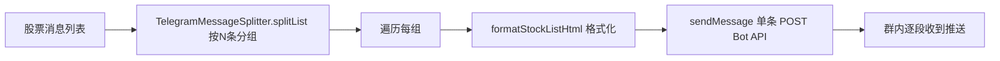

# 12-1 （拓展）Telegram 消息群发推送步骤说明操作演示

## 【学习目标】

读完本节，应当能够独立完成以下事项：

1. 通过 `@BotFather` 申请 Telegram 机器人，拿到 Token 与群 `chat_id` 三要素。
2. 说清 Telegram 单条消息的长度限制，以及为何必须「分段」发送长内容。
3. 用 `TelegramMessageSplitter` 把股票消息列表按组分片，再循环格式化、拼接、逐段发送。
4. 理解 `RestTemplate` 调用 Telegram Bot API 的请求结构（chat_id / text / parse_mode）。

---

## 【正文】

### 1. 本章定位

整个项目到本章其实已全部完成。最后这一节做一个拓展：聊聊 **Telegram** 与微信机器人。先讲 Telegram，相关代码已随工程提供，本节侧重把「群发推送」这条链路讲透，作为消息触达能力的补充（此前消息走的是钉钉 DingTalk API）。

> 合规提醒：Telegram 是境外聊天工具，**严禁用于任何违反国家法律法规的活动**，一旦用于违法用途，所有责任由使用者自行承担。本节仅讨论技术集成方式。

### 2. Telegram 发送服务的两种用法

Telegram 启动服务里，发送分两种方式：

1. **传一段文本**：发送单条消息，可直接写个控制器测一下；
2. **传整个消息列表**：真正的「群发」就是把列表传进来完成的。

在股票 RSS 服务里其实已集成了该能力。此前发消息是发给**钉钉（DingTalk API）**的，若要对接到 Telegram，只需用对应方法、把 Telegram Bot 服务注入进来，就能直接发送。

### 3. 三步拿到机器人三要素

要用 Telegram 机器人，先准备好三样东西：**账号、Token、群 ID**。

1. **注册 Telegram 账号**；
2. **申请机器人**：找 `@BotFather`，用 `/newbot` 指令创建，给它起个名字和一个**全局唯一的 username**，创建成功后拿到一个 **Token**（机器人唯一标识）；
3. **获取群 ID（chat_id）**：创建一个群组、把成员拉进来，再通过 `@getidsbot` 这类方式获取群组的 `chat_id`（一串数字）。

关于 Token 安全：**不要提交到 GitHub，不要写死在前端代码里**，它本质就是密钥，一旦泄露会有损失。建议放在 `.env` 配置文件、作为环境变量使用（`.env` 用法前面章节已讲）。

### 4. 长消息必须分段

Telegram 单条消息长度有限制。若一条消息写了一万、两万甚至十万字，会直接报错异常。所以长内容必须**分割**。

工程里写了一个简单工具类 `TelegramMessageSplitter`（分割器），把整个消息列表传进去执行分割。例如按「每 8 条一组」拆成多段，也可按 3 段、5 段拆。算法即：把对象列表按每组 N 个拆分，再把每组拼成一条消息。

分割好后，得到一份股票信息列表，接着对它做循环处理：对每条消息做**格式化**（股票列表用 HTML 格式），逐段拼接，最后用 `join` 连接，再逐段发送。

### 5. 发送方法与消息格式

发送方法核心就是输入一段文本。Telegram 支持两种富文本格式：

- **HTML**：显示效果较好，支持一些基本标签；
- **Markdown**：用 Markdown 语法输出即可。

普通纯文本也能直接发。两种格式差别不大，本项目用 HTML / Markdown 其一。

最终把消息封装成一个 `Map`（含 `chat_id` 和消息内容），用 `RestTemplate` 发出去，完成一次调用。下面是接口与实现的核心代码：

```java
public interface TelegramBotService {
    @Description("用于发送单个消息（测试）")
    @Author("风间影月")
    @param text
    //...
    public void sendMessage(String text);

    @Description("发送消息")
    @Author("风间影月")
    @param msgList
    //...
    public void sendMessage(List<USStockMsg> msgList) throws Exception;
}
```

```java
public String formatStockListHtml(List<USStockMsg> stocks) {
    return stocks.stream()
            .map(this::formatStockInfoHtml)
            .collect(Collectors.joining("\n\n")); // 用分隔线分隔
}

@Override
public void sendMessage(List<USStockMsg> msgList) throws Exception {
    // 每个Telegram的消息长度有限，此处进行分割
    List<List<USStockMsg>> splitList = TelegramMessageSplitter.splitList(msgList);
    for (List<USStockMsg> group : result) {
        String singleListStr = "";
        singleListStr = formatStockListHtml(group);
        sendMessage(singleListStr);
    }
}

@Override
public void sendMessage(String text) {
    System.out.println(text);
    Map<String, String> request = new HashMap<>();
    request.put("chat_id", CHAT_ID);
    request.put("text", text);
    // 这里格式转换一下，转换的更好看一些
    request.put("parse_mode", "HTML"); // 也可以用 "HTML"
    try {
        String response = restTemplate.postForObject(API_URL, request, String.class);
        System.out.println("Telegram API 响应：" + response);
    } catch (Exception e) {
        e.printStackTrace();
    }
}
```

> 工程视角：单条发送走的是 Telegram Bot API 的 `sendMessage` 端点，请求体是 `chat_id` + `text` + `parse_mode` 的表单结构，`RestTemplate.postForObject` 直接 POST 即可。群发则是「列表 → `splitList` 分片 → 逐组 `formatStockListHtml` 格式化 → 逐条 `sendMessage`」的循环。`parse_mode=HTML` 让消息里的 `<b>` / `<a>` 等标签被渲染。



### 6. 实际效果

发送成功后，群组里就能看到消息一条条推出来。上面的例子里消息量很大，中间就是靠分割器一段段发出来的。

回看 `@BotFather`，即创建机器人时所用。自己的机器人 `stockagent` 创建好后，既能群发，也能一对一单发；消息可以是中文，也可以是英文（例如有海外用户，拉进群里同样能接收）。

---

## 【易错点 / 面试题】

1. **问：为什么 Telegram 群发必须分段？**
   答：Telegram Bot API 对单条 `sendMessage` 的文本长度有上限，超长会直接抛异常。长内容（如整份股票异动列表）必须先按 N 条一组切片，再逐条发送，既绕过限制又保证完整送达。

2. **问：Token 为什么要放 `.env` / 环境变量，而不能提交进代码？**
   答：Token 是机器人的唯一凭证，等同密钥。写死在前端或提交到 GitHub 会导致泄露，他人可冒用你的机器人发消息。`.env` 不入库、仅本地 / 部署环境持有，是基本安全实践（同理适用于钉钉、邮件 SMTP 等所有密钥）。

3. **问：`parse_mode=HTML` 的作用是什么？**
   答：它告诉 Telegram 把 `text` 里的 HTML 标签（`<b>`、`<a>` 等）渲染为富文本而非原样展示。若不设或设为空，标签会被当纯文本显示。需注意 Telegram 支持的标签子集有限。

4. **问：群组 `chat_id` 与个人聊天 `chat_id` 有何不同？**
   答：群组 `chat_id` 通常为负数的长整型（如 `-100xxxx`），个人为正整型。推送到不同目标只需换 `chat_id`，其余请求结构一致。获取方式不同：群组靠 `@getidsbot` 之类工具，个人可由 `getUpdates` 取。

---

## 【小结】

Telegram 机器人能力相当强：既能群发也能单发。市面上有不少独立开发者靠 Telegram 机器人做定制化业务、实现变现。本节把「申请机器人三要素 → 长消息分段 → 列表格式化 → `RestTemplate` 推送」这条拓展触达链路讲透，作为钉钉之外的又一消息出口。

从工程全貌看，消息推送（钉钉 / Telegram / 邮件 MCP）是风控闭环的「执行」末端：行情由 `982-demo` 的 `provider/QuoteProvider`（`MockQuoteProvider` 离线样本 / `RealQuoteProvider` 真实行情）接入，`engine/RuleEngine` 做涨跌幅 / 成交量 / 波动率阈值判定，`service/RiskEvaluationService` 编排「感知 → 决策」，最终由推送通道把告警送达用户，推送通道可替换，决策核心稳定。
