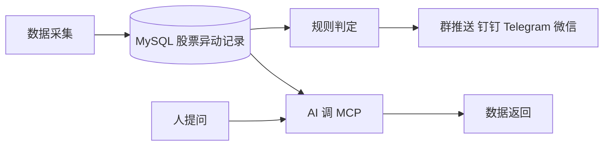

# 2-2 项目核心能力与功能说明

## 【学习目标】

读完本节后，你应当能够：

1. 说清本项目的两大核心功能板块，**聊天机器人消息推送**与 **MCP 股票服务**，各自解决什么问题、内部由哪些子能力构成。
2. 描述一条推送消息的数据结构（代码、标题、时间、标签、统计），并理解时区换算与消息切片这两个工程细节为何关键。
3. 列举 MCP 股票服务支持的查询能力，并理解「用自然语言查数据」相较「写 SQL 查数据」的范式差异。
4. 把功能点映射到 `982-demo` 的 `RiskQueryAgent`、`MockQuoteProvider` 等模块，建立「功能-代码」的对应直觉。

---

## 【正文】

### 一、两大功能板块总览

整个项目最终落地为两个相互补充的核心功能板块。它们解决的是同一批数据的两种不同消费方式：

| 功能板块 | 面向角色 | 核心价值 | 数据流向 |
|---|---|---|---|
| 聊天机器人消息推送 | 终端用户（人） | 把异动消息实时推到群里，人被动接收 | 数据 → 规则判定 → 群推送 |
| MCP 股票服务 | AI 客户端 / 开发者 | 用自然语言主动查询、分析数据 | 人提问 → AI 调 MCP → 数据返回 |

前者是「系统主动找人」，后者是「人/AI 主动找系统」。二者共享同一份底层数据（MySQL 中的股票异动记录），区别只在出口形态。这种「一份数据、多种出口」的设计，正是可迁移架构的典型特征。

两大板块的数据流对比如下：

在代码组织上，整个大项目被拆成两个子项目来构建：**MCP 服务**（对外暴露工具能力）与 **Web 服务**（负责采集、翻译、推送等业务逻辑）。两个子项目都会带着读者一步步写出来，它们通过共享的数据库与数据模型耦合，又通过独立的部署单元解耦。

### 二、聊天机器人：把异动消息推到群里

#### 2.1 平台选型与核心原则

课程中聊天机器人以 **钉钉** 机器人实现为主，同时提供 Telegram 与微信的扩展方案。一个必须强调的原则是：**无论用哪个平台，核心功能都要我们自己实现**。平台只是消息通道，真正的采集、清洗、判定、统计逻辑沉淀在我们自己的后端，这样才能在切换通道时不丢失业务。

为什么课程以钉钉为主？这涉及平台开放度的现实差异：

- **Telegram**：本身就提供开放的 Bot API，灵活度最高，能做底层二次开发，课程演示时也常以它举例（很多数据交流本就发生在 Telegram 群）；
- **微信**：底层规则较封闭，若真要落地往往依赖第三方方案（如 Python 插件生态），稳定性与合规风险更高；
- **钉钉**：企业场景普及、机器人 Webhook 接入简单、群组管理能力完善，适合作为教学主线。

#### 2.2 一条推送消息的数据结构

项目跑起来后，你会看到 Telegram 机器人对应的群组，群内所有消息都围绕股票信息自动推送。系统支持建多个群（第一群、第二群、国际化英文群等），用于分流不同用户。以其中一个中文群为例，每条推送消息包含以下字段：

- **股票代码**：某只股票对应的标识 `代码`；
- **标题**：这条消息讲了什么，由于数据源是英文，标题默认是英文；
- **时间**：消息发生的时间点。这里必须注意时区：本地展示为北京时间，而数据源是 **GMT 时间**，所以后端需要做一次时区换算，否则用户会看到「未来时间」或「错误时间」；
- **标签**：针对当前持有某只股票的含义标记，例如「低价股」「投资者会议」「发行」「私募股权融资」「低浮动」等，后端用**枚举**做一层映射，把英文标签翻译成中文含义；
- **统计**：针对每只股票做的简单统计，消息发出后，系统统计它在 **24 小时内**、**3 天内**、**1 周内**分别异动几次。例如以 24 小时为一个周期，若某只股票一周内出现 3 次甚至更多异动，就值得重点关注（可能暴涨，也可能暴跌）。

这套数据结构背后藏着三个工程要点，值得单独展开：

1. **时区换算是数据正确性的前提**。外部 RSS 源给的是 GMT 时间戳，若直接落库展示，中国用户会看到与直觉不符的时间。正确做法是在采集层统一转换成目标时区（如 `Asia/Shanghai`）再存储或展示，避免下游每个消费方各自处理。
2. **枚举映射是「翻译标签语义」的关键**。原始标签是英文缩写，直接展示给用户不友好。用枚举（`Enum`）把英文标签映射到中文含义，既保证展示清晰，又能在规则判定时按标签分类（例如只统计「投资者会议」类标签的异动）。
3. **滑动窗口统计是「异动热度」的量化**。24 小时 / 3 天 / 1 周三个窗口，本质是对同一只股票的异动事件做时间聚合，输出「近期活跃度」。这一能力在 `982-demo` 中由规则引擎配合统计窗口实现，是判断「该不该重点关注」的依据之一。

#### 2.3 翻译模块：标题中文化的代价与降级

由于数据源标题默认是英文，如果面向中文群，就需要用 **百度翻译 SDK** 把标题翻译成中文。这部分课程会专门演示如何申请密钥、配置、调用与入库。需要注意：翻译是付费能力，测试未成功（如额度耗尽、网络异常）时，标题可能显示不出来，因此工程上必须设计**降级路径**：翻译失败就保留原文，而不是让整条消息推送失败。

> **为什么必须降级**：推送链路的任何一个外部依赖（翻译、机器人 API）都可能临时不可用。若把「翻译成功」设成「消息可推送」的前置条件，一次翻译超时就会让整批异动消息卡住。正确做法是把外部依赖失败隔离在单条消息级别，失败的那条保留原文继续推，其余不受影响。

#### 2.4 消息切片：绕过平台字数限制

群发的另一个工程细节是**消息切片**。异动高峰期，系统可能一次性要发出几十条甚至几百条消息；而聊天平台对单条消息的字数有限制，直接群发很可能因超长而失败。因此系统会把一条过长的消息**切片、拆成多条**再分批发送，由机器人自动完成。这是保证推送成功率的关键功能，也体现了「终端通道限制」必须被业务层吸收的工程思想。

#### 2.5 推送能力的工程落点

在 `982-demo` 里，推送相关的编排逻辑集中在 `service/RiskEvaluationService`（决定「告警给谁、推什么」），而多端通道适配、消息切片、限流降级则由 Web 服务层的机器人模块承担。读者后续写钉钉/Telegram 机器人时，建议参考这种「判定与通道分离」的写法，规则只产出「告警事件」，通道适配负责把它变成各平台能接受的消息体。完整可部署示例见 `982-demo/src/main/java/com/riskbot/service/RiskEvaluationService.java`。

### 三、MCP 股票服务：让 AI 直接查数据

另一大核心功能，是把业务数据封装成 MCP 服务，让 AI 平台直接查询。课程在 **Cherry Studio** 中做了演示：它是一个 AI 对话界面，接入我们开发好的 MCP 服务之后，就能直接用自然语言查到数据，而不需要写任何 SQL 或打开管理后台。

#### 3.1 常用查询能力

MCP 股票服务对外提供的能力包括：

- 按**关键词**检索：例如搜与「债务（debt）」相关的消息，这类关键词可能预示一定涨幅；
- 按**股票代码**查询某只股票的数据；
- 查询**某只股票在一个月内的表现**、相关新闻报道，以及未来的发展趋势分析；
- 查询**一段时间内异动次数超过阈值的股票**（例如超过 3 次、超过 5 次），筛出交易更频繁、更值得关注的标的。

举一个真实例子说明其价值：股票 **SMX** 在过去两周里共发生 **14 次**异常变动，显然值得关注；再结合它与迪拜等地的合作，以及贵金属、稀土、塑料材料等领域的突破，用户就能据此做决策、预测趋势。这种「自然语言 → 结构化查询 → 业务数据 → 分析」的闭环，正是 MCP 服务的核心能力。

#### 3.2 为什么「自然语言查数据」是范式升级

传统做法是人写 SQL 或点开后台筛选，门槛在于「你必须知道数据怎么存」。MCP 服务把「数据怎么取」封装成工具，人只需用业务语言描述意图，由 `ChatClient` 驱动模型解析意图、选择合适工具、填好参数、执行查询。这一升级带来三点好处：

1. **降低使用门槛**：非技术同学也能通过聊天拿到数据；
2. **可组合**：同一组工具能被 Cherry Studio、Dify、N8N 等不同前端复用，无需为每个前端单独开发接口；
3. **可嵌入**：企业可把自有数据库通过 MCP 暴露给内部 AI 系统，让 AI 直接基于私有数据回答，这正是「重智能体」的雏形。

在 `982-demo` 中，这一能力由 `agent/RiskQueryAgent` 承载：它持有 `ChatClient`，并通过 `@Tool` 把「按代码查」「按关键词查」「按异动次数查」等方法注册为模型可调用的工具；离线测试时由 `OfflineChatModel` 返回固定 JSON 验证链路（见 `RiskQueryAgentMockTest`）。完整可部署示例见 `982-demo/src/main/java/com/riskbot/agent/RiskQueryAgent.java`。

#### 3.3 与低代码 / AI 工具生态的对接

除了 Cherry Studio 这类 AI 对话平台，服务还能集成到 **Dify**、**N8N** 等低代码工作流平台（以及 Coze、Cursor 等）。这意味着同一份 MCP 能力，既能给个人聊天用，也能被编排进自动化工作流（例如：定时扫描异动 → 命中规则 → 自动调取分析 → 推送摘要）。后续章节会逐步解释如何把这些对接实现出来。

---

## 【易错点 / 面试题】

1. **面试官问：你这项目推送和 MCP 查询，用的是同一份数据吗？怎么保证一致？**
   答：是的，二者共享同一 MySQL 数据源。推送是「系统按规则主动推」，MCP 是「人/AI 按意图主动查」，出口不同但数据同源。一致性靠统一的数据模型与入库逻辑保证，不会出现「群里推的消息和查到的数据对不上」。

2. **易错点：把翻译失败当成阻断错误。**
   正确做法是翻译失败保留原文继续推送（降级），而不是让整条消息卡住。任何外部依赖（翻译、机器人 API）都应在单条消息级别隔离失败。

3. **易错点：忽略消息切片。**
   异动高峰期可能一次性几十上百条，超长消息会被平台拒绝。必须设计切片分批发送，这是推送成功率的生命线。

4. **面试题：为什么选 MCP 而不是直接给前端写 REST 接口？**
   答：REST 接口是「人知道怎么调」，MCP 是「AI 知道怎么调」，模型能在 Advisor 链里自主决定调哪个工具、传什么参数。同一组 MCP 工具可被 Cherry Studio、Dify、N8N 等多前端复用，且支持跨进程标准化接入企业内部 AI 系统，复用与可嵌入性远高于手写 REST。

---

## 【小结】

本节明确了项目的两大功能板块：聊天机器人负责「系统主动找人」的实时推送（含时区换算、枚举映射、滑动窗口统计、翻译降级、消息切片等工程细节），MCP 股票服务负责「人/AI 主动找系统」的自然语言查询（含关键词、代码、时段、异动次数等能力）。二者共享底层数据、出口形态互补。下一节（2-3 项目架构全景图）将把这两大板块与数据库、SpringBoot 子项目、SpringAI MCP 服务一起，拼成完整的技术架构全景图，帮你从「功能」上升到「架构」。
