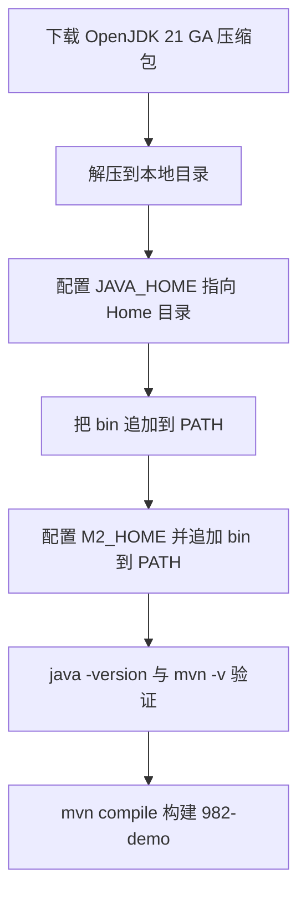

# 3-1 OpenJDK 与 Maven 高效开发环境完整配置指南

## 【学习目标】

读完本节并完成动手配置后，你应当能够：

1. 说清为什么本项目锁定 **JDK 21（LTS）** 而非更高版本，以及 OpenJDK 与 Oracle JDK 的取舍依据。
2. 在 macOS / Windows 上正确配置 `JAVA_HOME` 与 `PATH`，理解 shell 类型（zsh / bash）与变量引用符（`$` / `%`）的差异。
3. 验证 JDK + Maven 开发环境就绪，并能在多版本 JDK 共存时切换到项目所需的 21。
4. 把本地环境的 Java 21 + Maven 3.9.x，与 `982-demo` 的 `pom.xml`（Java 21 + Spring Boot 4.1.1 + Spring AI 2.0.1）对齐，确保后续工程能直接编译运行。

---

## 【正文】

### 一、为什么是 JDK 21，而不是「最新」

正式写代码之前，需要先把整体开发环境准备好，安装必要的软件。这一节要搞定两件事：**JDK** 和 **Maven**。但选哪个 JDK 版本，是有讲究的，不是「数字越大越好」。

目前 JDK 最新版本是 23，但它**不是长期支持（LTS）版本**；而 **JDK 21 是 LTS 版本**，得到了长期支持，所以本项目依赖最新的 JDK 21。该选型不是随意的，背后有三层工程理由：

1. **LTS 意味着长期维护与安全更新**：非 LTS 版本（如 22、23）只有约半年的支持窗口，不适合作为需要长期运行的生产项目基线。LTS 版本（8、11、17、21）会获得多年更新，企业环境几乎只认 LTS。
2. **Spring AI 2.0.1 的基线要求就是 Java 21**：Spring AI 2.0 构建于 Spring Boot 4.1.1 + Spring Framework 7.0，官方明确要求 Java 21。`982-demo` 的 `pom.xml` 即以此为准，若本地用 17 或更低版本，编译会在第一步就失败。
3. **Java 21 带来了本项目会用到的关键能力**：虚拟线程（`java.lang.Thread` 的虚拟线程变体）能廉价承载高并发 Agent 调用，避免线程池打满；分代 ZGC 让大堆低延迟成为可能；Record 模式让 DTO 更简洁。这些不是锦上添花，而是 `RiskScanScheduler` 用虚拟线程做周期扫描的底层支撑。

> **版本对照（避免选错）**：

| 版本 | 类型 | 是否推荐本课程 | 理由 |
|---|---|---|---|
| JDK 8 / 11 | LTS（旧） | 否 | 缺少虚拟线程、Record 等 21 特性，且 Spring AI 2.0 不支持 |
| JDK 17 | LTS | 否（作共存备用可） | 仍被部分存量团队使用，但本项目要求 21 |
| JDK 21 | LTS | **是** | 项目基线，支持虚拟线程与 Spring AI 2.0.1 |
| JDK 22 / 23 | 非 LTS | 否 | 支持窗口短，不适合生产基线 |

### 二、JDK 发行版：OpenJDK 还是 Oracle JDK

关于 JDK 的发行版，本课程使用 **OpenJDK**，而不是 Oracle 的官方 JDK。原因是：Oracle JDK 在部分版本中是需要收费的（生产环境商业使用需订阅），而 OpenJDK 完全免费、且源码与 Oracle JDK 同源（二者大部分类库一致）。目前美国很多公司都在用 OpenJDK，所以建议直接用 OpenJDK 即可。

下载时推荐选择带 **GA（General Availability，正式发布）** 标记的 21 版本，GA 意味着经过完整测试、可稳定使用，避免选用 Early Access（EA）这类未稳定版本踩坑。

不同操作系统的下载方式略有区别：

- **macOS**：官方提供 DMG 安装包，也提供压缩包。个人更推荐直接用**压缩包（tar.gz）**，解压后配置一下就能用，更方便、也便于多版本共存。macOS 分 **ARM64**（对应 Apple Silicon 的 M1/M2 芯片）和 **x64**（Intel 芯片）两种架构，按自己的芯片选。
- **Windows**：同样有安装版和压缩版（zip）两种。下载解压后，需要把它加到系统环境变量里。

### 三、配置 JAVA_HOME 与 PATH（以 macOS 为例）

下载解压之后，就要配置环境变量了。macOS 上我们编辑用户目录下的 `~/.zshrc`（可以用 `vim ~/.zshrc` 打开，按 `i` 进入编辑，加 `#` 注释也没问题），在里面加上 `JAVA_HOME`，指向 JDK 解压后的根目录（也就是 `Home` 目录），再把它下的 `bin` 目录追加到 `PATH` 里。`bin` 目录里包含了 `java`、`javac` 等可执行命令。

下面是一个多版本 JDK 共存的配置示例（课程用 JDK 21，其他版本按需保留或注释掉）：

```bash
# 配置 JDK17 的环境变量
export JAVA_HOME=/Library/Java/JavaVirtualMachines/jdk-17.jdk/Contents/Home

# 配置 zulu-Jdk8 的环境变量
export JAVA_HOME=/Library/Java/JavaVirtualMachines/zulu-8.jdk/Contents/Home

# 配置 JDK21 的环境变量
export JAVA_HOME=/Library/Java/JavaVirtualMachines/jdk-21.jdk/Contents/Home

# 配置 OpenJDK17 的环境变量
export JAVA_HOME=/Library/Java/JavaVirtualMachines/openjdk-17.0.2.jdk/Contents/Home

# 配置Mave的环境变量
export M2_HOME=/Volumes/lee/maven/apache-maven-3.9.0
export PATH=$PATH:$M2_HOME/bin:$JAVA_HOME/bin
```

这段配置里有几个必须理解的点：

1. **多版本共存的真相**：上面列了 JDK17、zulu-8、JDK21、openjdk-17 四行 `export JAVA_HOME`，但 shell 里后赋值的会覆盖前面的，所以「共存」不是同时生效，而是**你注释/取消注释哪一行，哪一行才生效**。真正想切换版本，应只保留目标版本那一行，或用更科学的管理方式（见下方「工程进阶」）。
2. **`JAVA_HOME` 必须是 `Home` 目录**：指向 `.../Contents/Home`（macOS）或 JDK 解压根目录（Windows/Linux），`bin` 在其下。指错层级会导致 `java` 找不到。
3. **`PATH` 把 `bin` 暴露到全局**：`$PATH:$M2_HOME/bin:$JAVA_HOME/bin` 的含义是「保留原有 PATH，再追加 Maven 与 Java 的命令目录」，这样在任意目录下都能直接执行 `java`、`mvn` 等命令。
4. **`M2_HOME` 先配好**：Maven 相关变量这里一并配好，下面马上会用到。

保存后执行 `source ~/.zshrc` 让配置生效。`JAVA_HOME` 是变量名，`=` 后面是它的取值；`PATH` 里用 `$JAVA_HOME/bin` 把 Java 命令加进来。

> **说明**：Intel 芯片的 macOS 改的是 `~/.bash_profile`（bash），逻辑相同，注意区分 shell 类型即可。macOS 自 Catalina 起默认 shell 是 zsh，所以新机器默认改 `~/.zshrc`；老机器或手动切过 bash 的才改 `~/.bash_profile`。

### 四、Maven 的下载与配置

Maven 的最新版本是 **3.9.x**（最新 3.9.9），它要求 **JDK 8 或更高版本**才能运行。本地的版本是 3.9.2，差别不大，小版本之间基本可以混用。这里有个容易混淆的点：**Maven 自身只需 JDK 8 就能跑起来，但它构建的项目可以用更高的 JDK**，也就是说，Maven 3.9.x 能正常启动，再去编译一个要求 Java 21 的 `982-demo` 工程，这是完全合法的（前提是 `JAVA_HOME` 指向 21，或 `pom.xml` 里 `maven.compiler` 配置正确）。

Maven 的环境变量配置方式和 JDK 一样：在 `~/.zshrc` 里加上 `M2_HOME`（指向 Maven 解压后的根目录），再把 `$M2_HOME/bin` 追加到 `PATH`。`mvn` 命令就在 `bin` 目录下。Windows 下也是同样的逻辑，只是变量引用要写成 `%M2_HOME%\bin`（注意 Windows 用 `%` 而非 `$`，路径分隔用反斜杠）。

### 五、验证配置

配置完成后，在命令行里能输出版本信息，就说明环境没问题了：

```bash
java -version
```

如果能正确打印出 JDK 21 的版本，再执行 `mvn -v` 能看到 Maven 版本，那么恭喜，你的 JDK + Maven 开发环境就配置成功了。

验证时建议多确认一步：`java -version` 显示的版本是否真的是 21（而非某个共存的老版本悄悄生效）。如果显示的不是 21，说明 `JAVA_HOME` 指向了错误的 JDK，回到 `~/.zshrc` 检查多版本共存的注释情况，再 `source` 一次即可。

环境配置的整体步骤如下图：



### 六、工程进阶：让多版本 JDK 管理不再靠注释

手动注释 `export JAVA_HOME` 行来管理多版本，既容易出错也不优雅。生产开发中更推荐两种方式：

1. **`jenv`**（macOS / Linux）：用 `jenv add` 注册多个 JDK，`jenv local 21` 在指定目录自动切换，配合 `.java-version` 文件实现「进项目目录自动用 21」。
2. **`sdkman`**（跨平台）：`sdk use java 21.0.x` 一键切换，适合同时维护多个 JDK 版本的开发者。

无论用哪种，最终目标一致：**保证编译 `982-demo` 时 `JAVA_HOME` 指向 21**。该工程的 `pom.xml` 已声明 Java 21 + Spring Boot 4.1.1 + Spring AI 2.0.1，本地环境对齐后，`mvn -q compile` 即可零报错通过，离线 `default` profile 下 `mvn -q test` 也能用 `OfflineChatModel` 跑通主链路。完整可部署示例见 `982-demo/pom.xml`。

---

## 【易错点 / 面试题】

1. **面试官 / 同事问：为什么不用最新的 JDK 23？**
   答：23 是非 LTS，支持窗口仅约半年，不适合生产基线；21 是 LTS 且是 Spring AI 2.0.1 的硬性要求。选 LTS 是为了长期安全更新与生态兼容，而非追新。

2. **易错点：`JAVA_HOME` 指向了 JDK 根目录而非 `Home` 子目录。**
   正确指向应是 `.../jdk-21.jdk/Contents/Home`（macOS）或解压根目录（Windows）。指错层级会让 `bin/java` 找不到，报「command not found」或版本错乱。

3. **易错点：多版本 JDK 共存时只注释不 `source`。**
   改完 `~/.zshrc` 必须执行 `source ~/.zshrc` 才能让新 `JAVA_HOME` 生效；否则当前 shell 仍用旧值，`java -version` 显示的还是老版本。更稳妥是用 `jenv`/`sdkman` 管理。

4. **易错点：以为 Maven 版本限制了项目 JDK。**
   Maven 3.9.x 只需 JDK 8 即可运行，但它能构建要求 Java 21 的工程。关键是 `JAVA_HOME` 或 `pom.xml` 的编译器配置指向 21，而非 Maven 自身跑在哪个 JDK 上。

5. **面试题：OpenJDK 和 Oracle JDK 在生产上有什么区别？**
   答：类库基本同源，主要差异在许可，Oracle JDK 部分版本商用需付费订阅，OpenJDK 免费。生产环境为规避许可风险、控制成本，普遍选 OpenJDK（或厂商构建如 Temurin、Zulu）。

---

## 【小结】

本节把「开发环境」这件看似简单的事讲透了：锁定 **JDK 21（LTS）** 是因为 Spring AI 2.0.1 的基线要求与生产长期维护需要；选用 **OpenJDK** 是为规避 Oracle 许可成本；`JAVA_HOME` / `PATH` 的配置本质是让 `java` / `mvn` 全局可用；多版本共存要靠科学管理而非手动注释。环境就绪后，下一节（3-2 Idea 构建可扩展的项目脚手架）将用这套 Java 21 + Maven 工具链，在 IDEA 里生成企业级多模块骨架，届时 `982-demo` 的 `pom.xml` 所声明的 Java 21 + Spring Boot 4.1.1 + Spring AI 2.0.1 技术栈就能直接落地编译。
