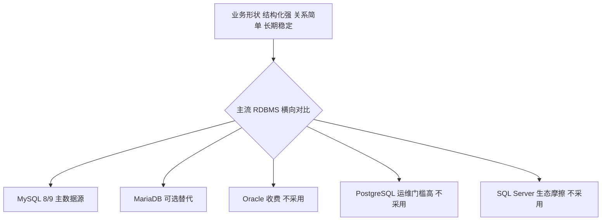

# 3-3 数据库选型策略，快速挑选最适合的方案

## 【学习目标】

学完这一篇，你应该能够：

1. 说清 MySQL、MariaDB、Oracle、PostgreSQL、SQL Server 五类主流关系型数据库（RDBMS）各自的定位与适用场景。
2. 理解 MariaDB 与 MySQL 的「同源分支」关系，以及「为什么有人要从 MySQL 迁到 MariaDB」。
3. 结合本课程「股票异动风控」的实际需求，讲清楚为什么最终选 MySQL 8 / 9 作为主数据源。
4. 在面试中面对「你们为什么选 MySQL 而不选 Oracle/PG」时，给出有依据、不空泛的回答。

选型不是「哪个厉害用哪个」，而是「哪个和我的业务形状最贴合」。这一篇把主流 RDBMS 摆在一起横向对比，帮你建立选型的判断框架。

## 【正文】

### 一、选型先看业务形状，而不是先看名气

在动手写代码之前先想清楚「数据长什么样、怎么被访问」，比直接选一个流行数据库更重要。对股票异动风控这个项目来说，数据有几个特征：

- **结构化强、关系简单**：核心是一张股票异动新闻表（`us_stock_rss`）加上后续的行情/规则数据，表之间关联不复杂，不需要图数据库或文档数据库的灵活 schema。
- **读写比例偏写后读**：RSS 抓取是持续写入，风控扫描是周期读取，没有超高并发的复杂联表。
- **需要长期稳定、社区活跃**：课程要可复现、可部署，数据库必须安装简单、文档丰富、坑少。

满足这些特征的，首选就是成熟的关系型数据库。下面把主流的几家逐一拆开看。

### 二、MySQL：主流之选

MySQL 是目前最流行的数据库之一，绝大多数互联网大厂、中小公司做项目开发都会选它。它有两个经典大版本：

- **MySQL 5**：非常经典，很多老项目、甚至一些新项目都还在用；
- **MySQL 8.0**：目前最新版本，我们课程就使用 **MySQL 8** 来做数据库相关的开发。

MySQL 的 Logo 是一只小海豚。

**为什么 MySQL 是默认答案**：第一，它免费、开源、安装包成熟，macOS / Windows / Linux 全平台覆盖；第二，它的生态（驱动、ORM、运维工具、云托管）是 RDBMS 里最完整的，Java 侧用 JDBC / MyBatis / JPA 都能无缝接；第三，社区资料海量，踩坑几乎都能搜到答案。对一个需要「稳定可复现」的教学 + 生产项目，MySQL 8 是风险最低的选择。课程后续用 Docker 跑 MySQL 9（演示用 9.5.0），但原理与 8 完全兼容，迁移成本几乎为零。

### 三、MariaDB：MySQL 的「亲兄弟」

MariaDB 的 Logo 是一只小海豹，它和 MySQL 关系非常近，它同样由 MySQL 最初的创始人团队开发，可以说是 MySQL 创始人的「亲生儿子」之一。

为什么会有 MariaDB？早期 MySQL 是开源的，后来被 **Oracle（甲骨文）** 收购。既然已经商业化，就有人担心 MySQL 未来会不会闭源、会不会向开发者收费。于是 MySQL 的创始人另起炉灶，创建了 **MariaDB** 这个独立分支。MariaDB 可以**零成本地从 MySQL 直接切换过来**（甚至覆盖安装即可），我们早期的一些项目就是这么迁移的。

更重要的是性能：当数据库**并发量上升**时，MySQL 的表现曲线会下滑、出现不稳定；而 MariaDB 在相同环境下非常稳定、性能不错。因此现在国外很多公司（比如 Wikipedia、Google 的部分业务）都已经从 MySQL 迁移到了 MariaDB，国内也有一部分公司在跟进。我个人也比较推荐大家试试 MariaDB，我在本地装的就是 MariaDB，Docker 里跑的则是 MySQL 8，两者都可以。

**分支与兼容性的工程含义**：MariaDB 在协议和 SQL 语法层面对 MySQL 高度兼容，以至于很多驱动、ORM 甚至分不清两者。但「高度兼容」不等于「完全等价」，随着版本演进，两者在存储引擎、优化器、部分系统变量上已经出现差异。生产上若要从 MySQL 迁 MariaDB，务必在测试环境跑一轮完整回归，不要只信「覆盖安装即可」。

### 四、Oracle：强大的商业数据库

Oracle（甲骨文）也是一个数据库，而且规模非常大、非常强，但它是**收费**的，并且每年的费用不低。不过它的服务确实好，技术支持团队专业度很高，能带来很出色的使用体验。

所以 Oracle 在互联网领域用得不多，更多是**传统企业、政企事业单位**在用，比如工商、公安派出所这类面向公众、对稳定性要求极高的系统，底层往往就是 Oracle。它适合「不惜代价换稳定」的场景。

**选型的经济学视角**：Oracle 的强不在技术本身，而在「出了问题有人兜底」的企业级服务契约。互联网业务通常追求弹性与成本可控，不会为这种契约买单；而金融、政务系统愿意为 SLA 付费。本课程是轻量风控 Bot，显然不属于「不惜代价」那一档。

### 五、PostgreSQL：能力全面的开源库

PostgreSQL（Logo 是大象）同样是一个非常不错的数据库，能力很强。虽然现在互联网企业里用它的相对少，但 10 年前我们做项目时其实考虑过、也确实用过，只是用了一半又切回了 MySQL。它在国外也有不少公司在用，感兴趣可以去了解。

**PG 的真正优势在哪**：PostgreSQL 对 SQL 标准遵循更严格，原生支持 JSONB、数组、自定义类型、复杂查询与扩展（如 PostGIS 地理扩展），在「需要复杂查询 + 半结构化数据」的场景比 MySQL 更顺手。但它对运维的要求略高、云上托管成本也不低，所以对「简单结构化 + 快速上手」的项目，MySQL 仍是更省心的选择。

### 六、SQL Server：微软生态的搭档

SQL Server 是微软推出的产品。我早年学 Java 的时候，MySQL 还没流行起来，用的就是 SQL Server。它很适合轻量、小型的桌面/传统应用；如果你做的是 **ASP.NET、WinForm、C#** 这类微软技术栈开发，基本上也会用到 SQL Server。但在 Java 生态里，我们基本不会再选它做数据库了。

**生态绑定的代价**：SQL Server 在微软全家桶里体验极佳，但一旦脱离 Windows / .NET 生态，它的授权、运维、跨平台支持都显得笨重。Java 项目选它会平白多出一层生态摩擦，所以基本不在考虑范围。

### 七、横向对比：一张表看清差异

| 数据库 | 开源 / 商业 | 典型适用场景 | 课程是否采用 | 关键备注 |
|---|---|---|---|---|
| MySQL 8 / 9 | 开源（Oracle 维护） | 互联网主流、轻量结构化业务 | **采用**（主数据源） | 生态最完整、坑最少，Docker 可跑 9.5.0 |
| MariaDB | 开源（社区分支） | 高并发下求稳定、想规避 Oracle 风险 | 可选替代 | 与 MySQL 高度兼容，但需回归测试 |
| Oracle | 商业收费 | 传统政企、金融、强 SLA 场景 | 不采用 | 强在服务保障，成本高 |
| PostgreSQL | 开源 | 复杂查询、半结构化、地理数据 | 不采用 | 能力全面，运维门槛略高 |
| SQL Server | 商业（微软） | .NET / Windows 桌面应用 | 不采用 | 脱离微软生态后摩擦大 |

### 八、课程选型结论与配套工程的关系

综上，我们的课程使用 **MySQL 8** 作为主数据源（演示环境用 MySQL 9.5.0，原理互通）。如果你对 MySQL 8 已经很熟，也可以尝试用 **MariaDB** 作为本项目的数据源，完全可行。

这里要特别说明课程**配套工程 `982-demo` 的特殊之处**：`982-demo` 是一个生产级但**刻意做小**的风控闭环示例，它的「感知→决策→执行」用的是 `MockQuoteProvider`（离线样本行情）和内存中的 `RuleEngine` 规则判定，默认 `default` profile 下**不依赖任何数据库**，它靠配置开关 `risk.market: A/US` 切换 A 股 / 美股行情源，靠 `OfflineChatModel` 离线跑通主流程。这样做是为了让你在「不联网、不填 Key、不起 MySQL」的情况下也能 `mvn test` 验证规则引擎与 Agent 查询链路。换句话说：**课程主工程用 MySQL 存 RSS 等结构化数据，而 `982-demo` 的行情/规则闭环被设计成无状态、可离线**，两者各司其职，不要混淆。

选型结论对比如下：

## 【易错点 / 面试题】

1. **面试题：MySQL 和 MariaDB 是什么关系？生产上能从 MySQL 直接切到 MariaDB 吗？**
   答：MariaDB 是 MySQL 创始人团队在 Oracle 收购 MySQL 后另起的开源分支，SQL 与协议高度兼容，理论上可低成本切换。但「高度兼容」不是「完全等价」，存储引擎、优化器、系统变量存在演进差异，生产切换必须先做完整回归测试，不能只信「覆盖安装即可」。

2. **面试题：你们的股票风控项目为什么选 MySQL 而不是 Oracle 或 PostgreSQL？**
   答：项目数据结构简单、关联少、需要稳定可复现且免费，MySQL 8 生态最完整、坑最少、Docker 一键可起，风险最低；Oracle 收费且面向政企 SLA 场景，与轻量 Bot 不匹配；PostgreSQL 能力全面但运维门槛更高。综合成本与可复现性选 MySQL。

3. **易错点：把「课程主工程用 MySQL」和「`982-demo` 用 MySQL「混为一谈。** `982-demo` 的默认 profile 是无状态离线设计，不引入任何 JDBC / 数据源依赖；只有课程主工程（RSS 入库那一脉）才真正落 MySQL。引用工程时要分清。

4. **易错点：认为 MariaDB 「完全等于」 MySQL。** 兼容性随版本分化，升级大版本后务必回归，否则某些系统变量或引擎行为差异会在生产暴露。

## 【小结】

选型的核心是「贴合业务形状」：本课程数据简单结构化、追求稳定可复现，所以主数据源选 MySQL 8（演示用 9.5.0），MariaDB 作为可选替代，Oracle / PostgreSQL / SQL Server 因成本或生态摩擦不在考虑范围。下一篇《从 Docker 容器到 MySQL 9 持久化》会把这门数据库真正装起来并做卷挂载，保证容器删了数据还在。配套工程 `982-demo` 的离线无状态设计（`982-demo/src/main/resources/application.yml` 的 `risk.market` 开关与 `MockQuoteProvider`）也值得对照阅读，理解「什么时候该引入数据库、什么时候可以故意不做」这一工程权衡。
