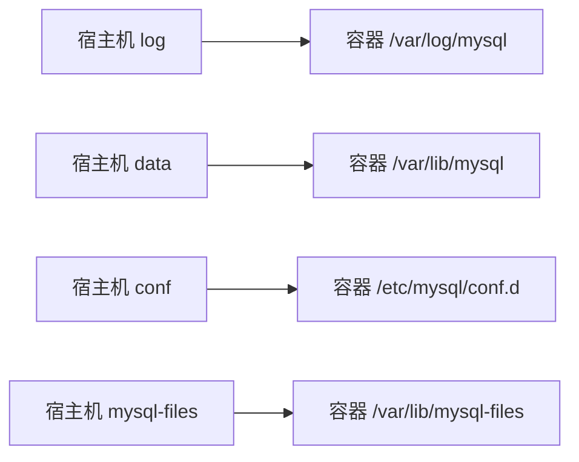

# 3-4 从 Docker 容器到 MySQL 9 持久化最佳实践

## 【学习目标】

学完这一篇，你应该能够：

1. 说清「原生安装」与「Docker 安装」中间件的核心差异，以及为什么日常装数据库优先用容器。
2. 用 Docker Desktop 拉取指定架构的 MySQL 9.5.0 镜像，并理解 OS/ARCH 匹配的重要性。
3. 正确规划宿主机目录与容器内部路径的**卷挂载（volume）**，保证容器删除后数据不丢。
4. 读懂并安全修改课程提供的 `docker run` 启动命令（端口映射、字符集、root 密码）。
5. 理解 MySQL 容器化后，如何与课程配套工程的 `docker-compose` 部署形态衔接。

上一篇定了用 MySQL 8 / 9，这一篇把它真正装上。容器化是今天装中间件的默认姿势，掌握它后面起任何服务都是同一套思路。

## 【正文】

### 一、两种安装方式：原生 vs Docker

安装 MySQL 主要有两种办法：

1. **原生安装**：直接去 MySQL 官网下载对应系统的安装包，按步骤装好即可；
2. **Docker 安装**：用容器来跑。

现在我们日常装中间件，基本都用 Docker，因为它非常方便、速度也快。所以这节课我们用 Docker 方式来部署。

**为什么容器优于原生安装**：原生安装会把 MySQL 的二进制、配置、数据目录散落到系统各处，重装系统或换机器就要重来一遍；而容器把「运行环境」封装成镜像，一条命令就能在任意装了 Docker 的机器上复现完全一致的环境。对课程这种「需要学员都能跑通」的场景，容器化几乎是唯一可规模复制的方案。代价是你得多理解一层「卷挂载」，否则容器一删数据就没了（这正是第三节要讲的重点）。

### 二、安装 Docker Desktop

首先去 `docker.com` 下载 **Docker Desktop**（一个桌面端管理软件）。根据你的操作系统选择对应版本：

- macOS 分 **Intel 芯片** 和 **Apple Silicon（ARM64，M1/M2）** 两种架构，按需下载；
- Windows 用户同样可以下载安装。

下载完成后按向导一步步安装即可（我本地已经装好，大家课后可以先装上）。安装完成后打开，界面一开始是空的，里面会显示你已经有的**容器**和**镜像**，默认是空的，需要你拉取镜像后才会出现内容。

**架构匹配是第一个坑**：Apple Silicon 机器是 ARM64，如果你误拉了 amd64 的 MySQL 镜像，在 M 系列芯片上要么跑不起来、要么靠 Rosetta 转译拖慢速度。拉镜像前一定在 Docker Hub 页面确认 tag 支持的 OS/ARCH 与你的机器一致。

### 三、从 Docker Hub 拉取 MySQL 镜像

打开 `hub.docker.com`（Docker 的镜像仓库），搜索 `mysql`。目前最新版本是 **9.5.0**（很多公司仍在用 8，但我们用最新的 9.5.0 演示）。点进 `9.5.0` 该 tag，注意看它支持的 **OS/ARCH**，一定要选和你操作系统匹配的，否则装了会有兼容性问题。

复制页面上的 pull 命令，回到命令行粘贴执行，就开始下载镜像了。下载速度有时偏慢，耐心等一下。注意：**课程依赖外网，请保证网络畅通**，否则拉不下来。

下载完成后，可以在命令行用 `docker images` 看到本地的所有镜像，其中就有刚拉下来的 `mysql:9.5.0`。在 Docker Desktop 的镜像列表里，它的状态一开始是 **unused（未使用）**，等我们把它跑成容器后就会变成 **in use**。

### 四、准备持久化目录

MySQL 的数据必须落盘，否则容器一删数据就没了。所以我们要在宿主机上建好几个目录，用来和容器内部做**卷挂载（volume）**。我本机（macOS）建的是 `/Volumes/lee/docker/mysql9.5.0`，里面包含四个子目录：`log`（日志）、`data`（数据）、`conf`（配置）、`mysql-files`。Windows 用户也类似，自己手动建一个同名文件夹即可，关键是保证目录是「纯净」的（如果是复用旧目录，建议先清空里面的数据）。

**为什么一定要四目录分开挂**：`data` 是数据库文件本体，必须落盘；`log` 方便你排查启动失败、慢查询；`conf` 让你把自定义 `my.cnf` 注入容器而不改镜像；`mysql-files` 是 MySQL 8+ 要求的 `secure-file-priv` 目录（导入导出文件用）。四个目录分开挂载的好处是：升级镜像版本时只换镜像、不动数据卷；排查问题时能快速定位是哪类数据。

**「纯净目录」原则**：如果复用旧目录，里面残留的 `ibdata`、表文件可能和新建容器的 MySQL 版本不兼容，导致启动直接失败。课程强调先清空，就是该原因。生产上同理：换大版本前务必备份 `data` 卷。

### 五、启动 MySQL 容器

下面是完整的启动命令（已整理进课程文档 `Docker安装MySQL9.5.md`）：

```bash
# 下载镜像
docker pull mysql:9.5.0

# 创建目录
mkdir /Volumes/lee/docker/mysql9.5.0/log -p
mkdir /Volumes/lee/docker/mysql9.5.0/data -p
mkdir /Volumes/lee/docker/mysql9.5.0/conf -p
mkdir /Volumes/lee/docker/mysql9.5.0/mysql-files -p

# 启动容器
docker run -p 5506:3306 --name mysql9-imoo \
-v /Volumes/lee/docker/mysql9.5.0/log:/var/log/mysql \
-v /Volumes/lee/docker/mysql9.5.0/data:/var/lib/mysql \
-v /Volumes/lee/docker/mysql9.5.0/conf:/etc/mysql/conf.d \
-v /Volumes/lee/docker/mysql9.5.0/mysql-files:/var/lib/mysql-files \
-e MYSQL_ROOT_PASSWORD=root \
-d mysql:9.5.0 \
--character-set-server=utf8mb4 \
--collation-server=utf8mb4_unicode_ci
```

逐参数说明：

- `-p 5506:3306`：把宿主机的 **5506** 端口映射到容器内的 3306。我本地 3306 被别的软件占了，所以换成了 5506，你按自己情况改；
- `--name mysql9-imoo`：给容器起个名字；
- 四个 `-v`：把上面建好的 `log`/`data`/`conf`/`mysql-files` 目录分别挂载到容器内部的对应路径，实现**数据持久化**；
- `-e MYSQL_ROOT_PASSWORD=root`：设置 root 账号密码为 `root`（可按需修改）；
- `-d`：后台运行；
- 最后两行：指定字符集为 **utf8mb4**，排序规则 `utf8mb4_unicode_ci`。

把命令粘贴到命令行回车，没有报错就说明启动成功。打开 Docker Desktop，可以看到 `mysql9-imoo` 容器状态是 **Running**，标签 `9.5.0`。点进去能看到日志（Logs）、内部终端（Terminal）、运行状态（Stats，含 CPU、内存、磁盘、网络占用），以及我们刚才做的目录映射结构。

**参数背后的工程含义**：

- **端口映射 `-p`**：容器内 MySQL 永远监听 3306，但宿主机端口可以任意挑。冲突就换宿主机侧（左侧）即可，不影响容器内。课程用 5506 正是为了避免和本机已有 3306 撞车，这一点下一篇用 Navicat 连接时要用到。
- **字符集 `utf8mb4`**：MySQL 的 `utf8` 其实是阉割版（最多 3 字节，存不了 emoji 和某些生僻字），`utf8mb4` 才是真正的 4 字节 UTF-8。股票异动新闻里常出现 emoji 与特殊符号，必须从一开始就统一 `utf8mb4`，否则后续插入报 `Incorrect string value` 才后悔。
- **root 密码**：演示用 `root` 方便记忆，但生产绝对不能用弱密码，且应通过环境变量 / 密钥管理注入，不写死在命令里。

### 六、容器与宿主的目录、端口映射一览

把上面的挂载与端口关系整理成表，便于记忆与排错：

| 宿主机路径 / 端口 | 容器内路径 / 端口 | 作用 |
|---|---|---|
| `/.../log` | `/var/log/mysql` | 数据库日志，排错用 |
| `/.../data` | `/var/lib/mysql` | 数据文件本体，持久化核心 |
| `/.../conf` | `/etc/mysql/conf.d` | 自定义配置注入 |
| `/.../mysql-files` | `/var/lib/mysql-files` | 安全文件目录（导入导出） |
| 宿主机 `5506` | 容器 `3306` | 对外访问入口，冲突就改左侧 |

卷挂载映射关系如下图：



### 七、常用运维命令

课程文档里还列了几个常用命令，课后可以都试一下：

- `docker start mysql`：启动容器
- `docker stop mysql`：停止容器
- `docker restart mysql`：重启容器

到这一步，我们这节课需要的数据库就成功安装并跑起来了。

> 注：上面 `start/stop/restart` 命令里的容器名写的是 `mysql`，而我们 `run` 时起的名字是 `mysql9-imoo`，实际运维时请统一用你创建时的名字 `mysql9-imoo`（或你自定义的 `--name`）。

### 八、与课程配套工程的容器化衔接

课程的配套生产级示例 `982-demo` 也提供了 `docker-compose.yml`，但它**没有把 MySQL 打进去**，因为 `982-demo` 默认 `default` profile 走离线 mock（`MockQuoteProvider` + `OfflineChatModel`），本身不需要数据库。它的 compose 只负责把风控 Bot 应用本身容器化，并暴露 `8080` 端口、挂了 `/actuator/health` 健康检查。

等到你真正把课程主工程的 MySQL（就是本节装好的 `mysql9-imoo`）和 `982-demo` 一起部署时，标准做法是：在 `docker-compose.yml` 里把 MySQL 作为**另一个 service** 加进来（或用已运行的独立容器），通过 Docker 网络让风控 Bot 用服务名访问 MySQL，而不是硬编码宿主机 IP。本节装好的 MySQL 9.5.0 正是后续 RSS 入库那一脉（第 5 章）的数据底座。

## 【易错点 / 面试题】

1. **面试题：Docker 装 MySQL，容器删除后数据还在吗？怎么保证不丢？**
   答：默认不在，容器可写层随容器销毁而消失。必须用 `-v` 把宿主机目录挂载到容器内的 `/var/lib/mysql`（数据）、`/var/log/mysql`（日志）等路径，数据实际写在宿主机卷上，删容器不删卷，数据保留。升级镜像时只换镜像、保留数据卷。

2. **易错点：OS/ARCH 不匹配。** Apple Silicon 误拉 amd64 镜像会跑不起来或转译变慢，拉取前务必核对 tag 支持的架构。

3. **易错点：复用旧 `data` 目录导致启动失败。** 换 MySQL 大版本或迁移机器时，旧 `data` 卷里的文件可能不兼容。课程要求目录「纯净」，生产上则要先备份再做卷迁移。

4. **易错点：字符集中途改。** 建库建表后再想从 `utf8` 切 `utf8mb4` 要逐表 `CONVERT`，成本极高。务必像本节一样在 `run` 时一次性定死 `utf8mb4` / `utf8mb4_unicode_ci`。

5. **易错点：运维命令的容器名对不上。** `run --name mysql9-imoo` 后，`start/stop/restart` 必须传 `mysql9-imoo`，不是文档示例里简写的 `mysql`。

## 【小结】

本节用 Docker 把 MySQL 9.5.0 装了起来：选对架构镜像、建「纯净」的四目录卷挂载、用 `docker run` 把日志/数据/配置/文件目录与宿主机绑定，再以 `utf8mb4` 字符集和自定义宿主机端口 5506 启动。这套「镜像 + 卷 + 端口映射」的范式，后面起任何中间件都通用。下一篇用 Navicat 连上该 5506 端口、建出 `us_stock_rss` 表。课程配套 `982-demo/docker-compose.yml` 展示的是「应用本身容器化 + 健康检查」的写法，当你要把本节的 MySQL 与风控 Bot 同网部署时，可参考把 MySQL 作为 compose 的第二个 service 接入。
