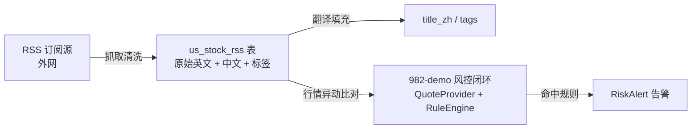

# 3-5 用 Navicat 完成数据库可视化建模与建表

## 【学习目标】

学完这一篇，你应该能够：

1. 用 Navicat 连接上上一篇用 Docker 起的 MySQL 9.5.0（宿主机端口 5506）。
2. 新建数据库并正确选择 `utf8mb4` / `utf8mb4_unicode_ci` 字符集与排序规则。
3. 运行课程提供的建表脚本，生成核心表 `us_stock_rss`，并理解每一列的语义。
4. 讲清「为什么英文标题和中文标题要分两列存」「为什么 GMT 与北京时间要各存一份」。
5. 理解 `us_stock_rss` 在课程数据流中的位置，以及它和配套工程 `982-demo` 行情接入模块的关系。

上一篇数据库跑起来了，这一篇用一款可视化工具把它建表落地。建表看似简单，字段怎么设计直接决定后面写代码顺不顺。

## 【正文】

### 一、建立连接

打开 Navicat，一开始左边是空的。我们新建一个连接，类型选 **MySQL**，双击后填写连接信息：

- **连接名**：`MySQL-9.5.0`
- **端口**：`5506`（对应前面容器映射的宿主机端口）
- **密码**：`root`

填好后点击 **连接测试**，提示「成功」就说明没问题，再点确定保存。

**端口为什么是 5506 而不是 3306**：这正是上一篇 `docker run -p 5506:3306` 留下的约定，容器内的 MySQL 监听 3306，但映射到了宿主机的 5506。Navicat 连的是「宿主机 IP:宿主机端口」，所以填 5506。如果你本机 3306 空闲、当初映射的是 3306，这里就填 3306。连不上的第一反应永远是：端口、IP、防火墙三个里有一个错了（这一点在 3-6 内网互通里会系统讲）。

### 二、创建数据库

双击刚建好的 `MySQL-9.5.0` 连接，里面还是空的。右键连接 → **新建数据库**，起名为 `us_stock_monitor_dev`，然后选字符集和排序规则：

- 字符集拖到最下面选 **utf8mb4**；
- 排序规则选 **utf8mb4_unicode_ci**。

点确定，数据库就创建成功了。

**库级字符集必须和实例级一致**：上一篇启动容器时已经用 `--character-set-server=utf8mb4` 把实例默认字符集定死了，这里建库再显式选一次 `utf8mb4`，是「双保险」，避免有人改过实例默认字符集后，新建库悄悄退回 `latin1` 导致中文乱码。排序规则 `utf8mb4_unicode_ci` 是大小写不敏感的 Unicode 排序，契合中英文混排的异动新闻场景。

### 三、运行 SQL 脚本建表

课程提供了一个建表脚本 `us_stock_lee.sql`。在数据库上右键 → **运行 SQL 文件**，选择这个脚本（也可以直接把文件拖进去），Windows 用户直接定位到自己的文件即可。点「开始」执行，执行完刷新一下，就能看到表已经建好了。

核心是要创建一张名为 `us_stock_rss` 的表，用来存美股异动相关的新闻 RSS 数据。脚本先是设置字符集并关闭外键检查：

```sql
SET NAMES utf8mb4;
SET FOREIGN_KEY_CHECKS = 0;
```

接着是完整的建表语句：

```sql
DROP TABLE IF EXISTS `us_stock_rss`;
CREATE TABLE `us_stock_rss` (
  `id` varchar(64) CHARACTER SET utf8mb4 COLLATE utf8mb4_unicode_ci NOT NULL,
  `stock_code` varchar(64) CHARACTER SET utf8mb4 COLLATE utf8mb4_unicode_ci NOT NULL,
  `title` varchar(2550) CHARACTER SET utf8mb4 COLLATE utf8mb4_unicode_ci NOT NULL,
  `title_zh` varchar(2550) CHARACTER SET utf8mb4 COLLATE utf8mb4_unicode_ci DEFAULT NULL,
  `link` varchar(255) CHARACTER SET utf8mb4 COLLATE utf8mb4_unicode_ci NOT NULL,
  `pub_date_gmt` datetime NOT NULL COMMENT '新闻的发布时间 (GMT时间)',
  `pub_date_bj` datetime NOT NULL COMMENT '新闻的发布时间 (北京时间)',
  `tags` varchar(255) CHARACTER SET utf8mb4 COLLATE utf8mb4_unicode_ci DEFAULT NULL COMMENT '股票标签',
  PRIMARY KEY (`id`)
) ENGINE=InnoDB DEFAULT CHARSET=utf8mb4 COLLATE=utf8mb4_unicode_ci;
```

脚本最后再把外键检查恢复回来：

```sql
SET FOREIGN_KEY_CHECKS = 1;
```

**为什么脚本要先 `SET FOREIGN_KEY_CHECKS = 0` 再恢复**：建表顺序在复杂 schema 里常常有循环依赖（A 表引用 B、B 又引用 A），临时关闭外键检查能让建表语句按任意顺序执行而不报「外键指向的表不存在」。本表没外键，关一下也无妨，但这是生产建表脚本的通用习惯。注意结尾一定要 `SET FOREIGN_KEY_CHECKS = 1` 恢复，否则后续正常业务会因缺少外键约束而悄悄写入脏数据。

**`DROP TABLE IF EXISTS` 的危险性**：脚本开头直接 `DROP` 再 `CREATE`，意味着每次跑都会清空旧表。课程演示没问题，但生产环境绝对不能把这种「破坏性建表脚本」当常规迁移用，生产该用带版本号的增量迁移（如 Flyway / Liquibase），而不是无脑 DROP。

### 四、字段设计说明

点开「设计表」，逐个字段来看这张表是怎么设计的：

- **id**：主键，表的唯一标识（每个表都会有这样一个主键）。
- **stock_code**：股票代码。无论是 A 股、港股还是美股，每只股票都有自己的代码。美股代码通常是一串英文字符（比如特斯拉 `TSLA`、英伟达 `NVDA`、新蛋 `NEGG`），A 股则是数字代码。
- **title**：股票异动消息的**英文标题**。我们的数据来自外网，原始标题是英文，比如「某公司宣布合作」这类异动新闻。
- **title_zh**：中文标题。因为后面我们会做翻译，把英文标题翻译成中文，所以单独存一份中文。
- **link**：消息来源，也就是这条新闻所在的**网页地址**。绝大多数新闻都发布在企业的官方网站。
- **pub_date_gmt**：新闻发布时间，存的是 **GMT 时间**（标准时间）。注意 GMT 和我们的北京时间不一样，美股交易所的时间也与 GMT 不同，所以拿到这个时间值后都需要做转换。
- **pub_date_bj**：新闻发布时间，存的是**北京时间**。我们做消息群发时用的是北京时间，所以必须把 GMT 转成北京时间再存。
- **tags**：股票标签。比如「低价股」表示股价较低，「低浮动」表示浮动率低、上下波动弱，还有「投资者会议」「财报」「电话会议」等。后端会用枚举做映射。最终呈现给用户的是中文内容，所以我这里保存的是中文标签；如果要走国际化，就需要中英两个版本。

> 注意：如果一只股票没有任何相关标签，那这条数据基本就等于不存在了，这是建表时要留意的一个点。

**字段设计背后的几个工程判断**：

1. **英文 / 中文标题分两列，而不是用一列 + 语言标记**：翻译是后续独立步骤（第 7 章百度翻译 SDK），原始英文必须原样保留以便溯源和重翻；中文是衍生数据，允许为空（`DEFAULT NULL`）。两列各司其职，查询时不用做「语言分支」，也更利于索引。
2. **GMT 与北京时间双存**：RSS 源给的是 GMT，但告警、群发都按北京时间。与其每次查询都做时区换算（易错且耗 CPU），不如写入时就把两个时区都算好落库。注意 `datetime` 类型在 MySQL 里**不带时区信息**，所以它存的是「已经换算好的墙上时钟值」，应用层必须约定好语义，这正是 `pub_date_gmt` / `pub_date_bj` 列注释存在的意义。
3. **`varchar` 长度够用即可**：`title` 给到 2550 是为了容纳带前缀的长英文标题并留余量；`link` 255 足以放下绝大多数 URL。不要无脑 `text`，`varchar` 在有合适前缀索引时查询更可控。
4. **`tags` 用逗号分隔字符串而非子表**：课程场景标签数量少、查询以「整条展示」为主，用一列存中文标签字符串最省事；若将来要做「按标签检索」，再拆成标签子表也不迟。这是「按需演进」而非过度设计。

### 五、表结构与数据流的定位

把 `us_stock_rss` 放在课程整体数据流里看：



`us_stock_rss` 是「数据入口」这一脉的落库表（第 5 章 RSS 抓取 / 清洗 / 入库的主战场）。而课程配套工程 `982-demo` 的**行情接入与规则判定**走的是另一条更内聚的路：它用 `QuoteProvider` 接口拿行情 tick（`MockQuoteProvider` 给离线样本、`RealQuoteProvider` 接真实端点），用 `RuleEngine` 套 `PriceVolatilityRule` / `VolumeSpikeRule` 做异动判定，默认 profile 下**不读 `us_stock_rss` 这张表**，它被设计成无状态离线闭环。两者可以组合：真实部署时，你可以把 `us_stock_rss` 里的异动新闻作为「事件线索」喂给风控 Bot 做二次研判，但这属于二次开发，不是 `982-demo` 开箱即用的部分。

### 六、字段语义一览表

| 字段 | 类型 | 可否空 | 语义 |
|---|---|---|---|
| id | varchar(64) | 否（主键） | 记录唯一标识 |
| stock_code | varchar(64) | 否 | 股票代码（美股英文 / A 股数字） |
| title | varchar(2550) | 否 | 原始英文标题（溯源用） |
| title_zh | varchar(2550) | 可 | 翻译后的中文标题 |
| link | varchar(255) | 否 | 新闻来源 URL |
| pub_date_gmt | datetime | 否 | 发布时间（GMT） |
| pub_date_bj | datetime | 否 | 发布时间（北京时间） |
| tags | varchar(255) | 可 | 中文标签（枚举映射） |

## 【易错点 / 面试题】

1. **面试题：`datetime` 和 `timestamp` 在 MySQL 里有什么区别？存多时区时间该用哪个？**
   答：`timestamp` 存的是 UTC、范围小（到 2038）、随会话时区显示；`datetime` 存的是「字面值」、不带时区、范围大。课程用 `datetime` 并显式分 `pub_date_gmt` / `pub_date_bj` 两列，是因为要保留「已换算的墙上时间」且避免 2038 限制；代价是应用层必须约定语义，不能假设它带时区。

2. **易错点：连接填 3306 却连不上。** 容器把 3306 映射到了宿主机 5506，Navicat 必须填宿主机侧端口 5506。连不上先查端口 / IP / 防火墙三件套。

3. **易错点：把 `DROP TABLE IF EXISTS` 的脚本直接上生产。** 演示脚本会清表，生产迁移必须用增量版本化脚本（Flyway / Liquibase），绝不能无脑 DROP。

4. **易错点：忘了 `SET FOREIGN_KEY_CHECKS = 1` 恢复。** 临时关闭外键检查建表后必须恢复，否则后续业务缺少约束、静默写入脏数据。

5. **易错点：认为 `982-demo` 用到了 `us_stock_rss` 表。** `982-demo` 默认离线无状态，行情来自 `MockQuoteProvider`、规则在内存 `RuleEngine`，不依赖这张 RSS 表。引用工程时要分清边界。

## 【小结】

我们用 Navicat 连上 MySQL 9.5.0（端口 5506），以 `utf8mb4` 建出 `us_stock_rss` 库与表。字段设计的关键判断是：英文 / 中文标题分列溯源、GMT / 北京时间双存避免查询期换算、`tags` 用字符串契合轻量场景、`DROP` 脚本只用于演示。这张表是课程「RSS 抓取→清洗→入库」一脉的落库点（第 5 章），而配套工程 `982-demo` 的行情接入走 `QuoteProvider` + `RuleEngine` 的离线闭环、默认不读此表，理解这条边界，后面把两块拼起来时才不会张冠李戴。下一篇我们把「为什么连不上」这件事从网络底层讲透。
