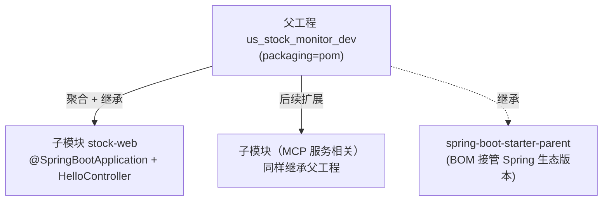

# 4-2 Maven 构建分层式多模块的 Spring Boot 工程结构

## 【学习目标】

学完本节，你应该能够：

- 在 IDEA 中基于一个 `packaging=pom` 的父工程，新增并登记子模块，理解 Maven 聚合（aggregation）与父子继承（inheritance）的区别。
- 读懂 `spring-boot-starter-parent` 接管依赖版本的原理，解释「为什么有的依赖要写 `<version>`、有的不用写」。
- 用最小依赖搭出一个可访问的 `stock-web` Web 子模块，并通过 `8080` 端口验证接口。
- 把本节「父工程统一管理 + 子模块各司其职」的思路，映射到 982-demo 的包分层工程，理解工程骨架的可扩展性。

## 【正文】

上一节我们认识了 Spring Boot 的工程基座，这一节动手把**分层式多模块**的结构搭出来。我们已经建好父工程 `us_stock_monitor_dev`（`packaging` 为 `pom`），现在往里加子模块。

### 一、创建子模块（Module）

在 IDEA 里选中父工程，点击 **New → Module**，新建一个模块。我们给它起名 `stock-web`（「股票网页」），保存位置保持默认，它会自动继承父工程的目录结构。

创建完成后，子模块里会有一个默认的 `main` 方法。同时父工程的 `pom.xml` 自动多了一个 `<modules>` 节点，把 `stock-web` 列了进去。在真实的微服务开发中，一个项目下挂几十个模块都很常见，它们都是这样在 `<modules>` 里登记、由父工程统一构建、统一版本管理的。

> 这里区分两个 Maven 概念：**聚合（aggregation）**靠 `<modules>` 实现「一起构建」；**继承（inheritance）**靠子模块的 `<parent>` 实现「复用配置」。本节父工程同时承担两种角色，既用 `<modules>` 聚合子模块，又作为 `<parent>` 被子模块继承。

### 二、理解 pom 的父子继承

Maven 的 `pom.xml` 和 Java 类一样，遵循**父子继承**关系。父工程里配好的坐标和依赖，子模块可以直接沿用，不用重复写，这正是 Maven「约定优于配置」的体现。

先来看父工程的 `pom.xml`：

```xml
<modelVersion>4.0.0</modelVersion>
<groupId>com.it</groupId>
<artifactId>us_stock_monitor_dev</artifactId>
<version>1.0-SNAPSHOT</version>
<packaging>pom</packaging>
<modules>
    <module>stock-web</module>
</modules>
<properties>
    <maven.compiler.source>21</maven.compiler.source>
    <maven.compiler.target>21</maven.compiler.target>
    <project.build.sourceEncoding>UTF-8</project.build.sourceEncoding>
</properties>
<parent>
    <groupId>org.springframework.boot</groupId>
    <artifactId>spring-boot-starter-parent</artifactId>
    <version>4.0.0</version>
    <relativePath/>
</parent>
```

这里关键是 `<parent>`：引入 `spring-boot-starter-parent`（4.0.0 版本），它就帮我们接管了绝大多数依赖的版本管理。后面的子模块只要声明依赖，不用操心版本号。`<packaging>pom</packaging>` 表示父工程本身不产出 jar/war，只做「容器」；`<modules>` 列出它要聚合构建的子模块。

**为什么要把 `<maven.compiler.source/target>` 设为 21？** 我们的目标栈是 Java 21 LTS，虚拟线程、分代 ZGC、Record 模式都依赖 21。父工程统一锁定编译版本，所有子模块继承即可，避免出现「父工程 21、子模块 17」的版本错配。

### 三、在子模块中引入依赖

接下来编辑 `stock-web` 的 `pom.xml`，在 `<dependencies>` 里加依赖。下面是课程用到的几个：

```xml
<dependency>
    <groupId>org.springframework.boot</groupId>
    <artifactId>spring-boot-starter-web</artifactId>
</dependency>
<dependency>
    <groupId>org.projectlombok</groupId>
    <artifactId>lombok</artifactId>
    <optional>true</optional>
</dependency>
<dependency>
    <groupId>org.apache.commons</groupId>
    <artifactId>commons-lang3</artifactId>
    <version>3.17.0</version>
</dependency>
<dependency>
    <groupId>org.apache.groovy</groupId>
    <artifactId>groovy-json</artifactId>
    <version>4.0.27</version>
</dependency>
<dependency>
    <groupId>cn.hutool</groupId>
    <artifactId>hutool-all</artifactId>
    <version>5.8.30</version>
</dependency>
```

各依赖的作用：

- **spring-boot-starter-web**：Web 启动器，用来构建 Web 应用，必加；
- **lombok**：在实体类上自动生成 getter/setter，省去大量样板代码；
- **commons-lang3**：Apache 通用工具类；
- **groovy-json**：JSON 处理；
- **hutool-all**：Hutool 工具集，整合了大量工具类，能极大简化开发。不过要提醒一点：部分公司会禁用 Hutool，因为它依赖较多、可能让项目变臃肿，甚至有版本冲突风险，要不要加看团队规范。

### 四、关于版本号：为什么有的要写、有的不用写

这里有个容易踩坑的点：**前面三个（starter-web、lombok）没写版本号，后面几个（commons-lang3、groovy-json、hutool-all）都带了 `<version>`**。

原因是：`spring-boot-starter-parent` 内部引用了 `spring-boot-dependencies` 该 BOM（物料清单，Bill of Materials），它已经替我们管理好了 starter-web、lombok 等**Spring 生态**依赖的版本。所以这些不用写版本。

而 Hutool、commons-lang3、groovy-json **不在 Spring 的 BOM 里**，父工程管不到它们的版本，所以必须显式指定。这跟 Java 的「子类覆盖父类方法」是一个道理：父 BOM 里有的版本，子模块不写就继承；父 BOM 里没有的，子模块就得自己声明（当然你硬要给 starter-web 写版本也行，相当于手动覆盖父类的版本）。

加完依赖后，记得在 Maven 面板点一下**刷新**，IDEA 会去 **Maven 仓库**重新下载，之后 `pom.xml` 里声明的依赖都能在 Dependencies 里清晰看到。最后在父工程上执行一次 **install**，确认构建通过。

> 这些依赖具体怎么找？打开浏览器进 Maven 中央仓库（mvnrepository.com），搜对应的 artifact 名，选好版本，把坐标复制过来即可。

### 五、编写启动类与 Controller

依赖就绪后，我们给 `stock-web` 写一个 Spring Boot 启动类（包名 `com.it`）：

```java
package com.it;

import org.springframework.boot.SpringApplication;
import org.springframework.boot.autoconfigure.SpringBootApplication;

@SpringBootApplication
public class Application {
    public static void main(String[] args) {
        SpringApplication.run(Application.class, args);
    }
}
```

再新建一个控制器 `HelloController`（包 `com.it.controller`），用来验证 Web 功能：

```java
package com.it.controller;

import org.springframework.web.bind.annotation.GetMapping;
import org.springframework.web.bind.annotation.RequestMapping;
import org.springframework.web.bind.annotation.RestController;

@RestController
@RequestMapping("/hello")
public class HelloController {
    @GetMapping("/world")
    public String world() {
        return "Hello World!";
    }
}
```

几个注解说明：

- **@RestController**：这是一个 REST 风格的控制器，返回的内容直接作为响应体（字符串或 JSON），不需要再配页面；
- **@RequestMapping(「/hello」)**：给整个控制器定一个路由前缀；
- **@GetMapping(「/world」)**：映射一个 GET 请求到 `/hello/world`。

REST 的几种请求方式要记一下：**GET（查询）**、**POST（新增/保存）**、**PUT（更新）**、**DELETE（删除）**。其中 GET 最特殊，可以直接在浏览器地址栏里输入 URL 访问；而 POST、PUT、DELETE 没法直接通过浏览器地址栏访问，需要用 Postman、Apifox 这类工具，或者写代码发请求来测试。

### 六、运行与访问

直接右键运行 `Application`，启动日志里会看到当前是 4.0.0 版本，并监听在默认的 **Tomcat 8080** 端口上。

访问地址就是：

```
http://127.0.0.1:8080/hello/world
```

或者 `http://localhost:8080/hello/world`。打开浏览器访问，页面上就会显示 `Hello World!` 该字符串，说明第一个分层子工程已经跑通了。

### 七、模块结构与课程工程的映射

把本节的「一个父工程 + 多个子模块」骨架画成图，结构一目了然：



注意图里区分了两种关系：实线表示「父工程聚合并管理子模块」，虚线表示「父工程继承 Spring Boot 的 parent 从而复用版本与插件」。

在 982-demo 配套工程里，落地的是同一套思想，但粒度不同：它采用**单 Maven 模块 + 包分层**而非多 Maven 模块，`com.riskbot` 下用 `provider / engine / service / agent / controller / scheduler` 六个包来划分职责，等价于把「不同子模块」收敛进一个可部署的 jar。其 `pom.xml` 同样通过 `spring-boot-starter-parent` 锁版本，并额外用 `dependencyManagement` 引入 `spring-ai-bom` 来接管 Spring AI 2.0.1 的版本（见 `982-demo/pom.xml`）。入口类为 `982-demo/src/main/java/com/riskbot/RiskBotApplication.java`。理解这种「模块 vs 包」的可替换性，是后续扩展微服务时最重要的判断力。

## 【易错点 / 面试题】

1. **问：`spring-boot-starter-parent` 和 `spring-boot-dependencies` 是什么关系？为什么引入 parent 后大部分依赖不用写版本？**
   答：parent 内部通过 `dependencyManagement` 引入了 `spring-boot-dependencies` 该 BOM，BOM 预先声明了 Spring 生态（starter、logging、json 等）的推荐版本。子模块声明这些依赖时省略 `<version>` 即自动继承。自己写版本相当于覆盖 BOM 的推荐值，可能破坏依赖兼容性。

2. **问：哪些依赖必须手写 `<version>`？**
   答：任何不在 `spring-boot-dependencies` BOM 里的第三方库，如 Hutool、commons-lang3、groovy-json，都必须显式声明版本，否则 Maven 报「version is missing」。

3. **问：`<packaging>pom</packaging>` 的父工程能直接 `java -jar` 运行吗？**
   答：不能。pom 类型工程只做聚合与配置载体，不编译产出可执行 jar；真正能跑的是它的子模块（如 `stock-web`）。

4. **问：多 Maven 模块和单模块包分层，生产上怎么选？**
   答：模块边界清晰、需独立部署/独立版本演进的服务用多模块；一个可整体部署的业务域用包分层更轻量。982-demo 选后者以便一键 `docker` 部署。

## 【小结】

到这儿，第一个分层子工程 `stock-web` 就搭建完成了：父工程通过 `spring-boot-starter-parent` 统一版本与插件，子模块声明式引入 `starter-web / lombok` 等依赖并继承版本，用 `@SpringBootApplication` + `@RestController` 跑通 `8080` 接口。后面我们会用**同样的方式**再建一个与 **MCP 服务**相关的工程，多模块、父子继承的思路完全一致。下一节先解决配置层面的问题，如何写出清晰、可维护的 `application.yml`，为后续接入 MyBatis-Plus、MCP、百度翻译等配置打好基础。完整可部署示例见 `982-demo/pom.xml` 与 `982-demo/src/main/java/com/riskbot/RiskBotApplication.java`。
