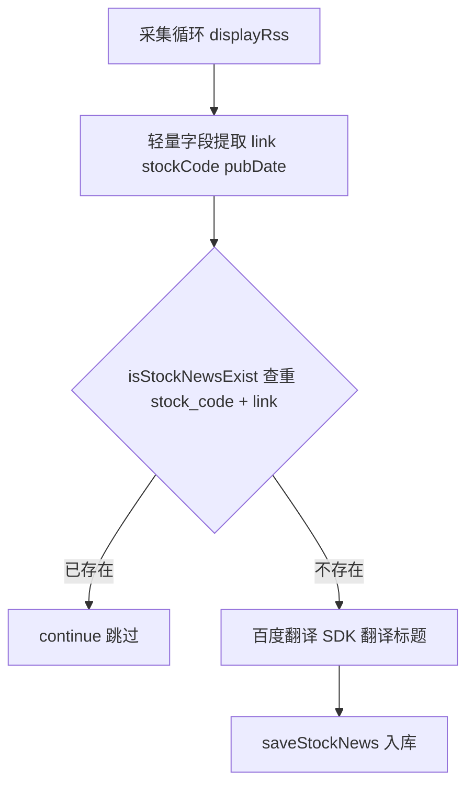

# 5-8 股票数据防重实践 - 本地数据库方案

## 【学习目标】

学完本节，你应该能够：

1. 说清楚「定时全量抓取」为什么会必然产生重复数据，以及重复数据对告警准确率、存储成本、下游分析带来的连锁危害。
2. 设计一套基于关系型数据库的「先查后插」去重方案：选对判重字段、写对 `QueryWrapper` 条件、把判重放在所有高成本操作之前。
3. 在 MyBatis-Plus 语境下，正确实现 `isStockNewsExist(stockCode, link)` 这类查重方法，并避开 `selectCount()` 漏传条件这一高频坑。
4. 把去重逻辑与采集链路（RSS 循环 → 清洗 → 入库）正确耦合，保证重复记录既不被入库、也不白白消耗翻译额度与算力。

---

## 【正文】

### 一、问题根源：定时任务为什么一定会重复

从 `5-3` 起我们已经用 `Spring Schedule` 周期性地拉取 StockTitan 的 RSS，把每一条股票异动消息清洗后落库。链路本身是通的，但有一个被「跑通即正确」表象掩盖的隐患：**我们每次拉取的都是「全部」数据，而不是「增量」数据**。

RSS feed 的本质是一个固定窗口的最近 N 条消息列表，服务端不会因为你上次读过就把它藏起来。于是：

- 第 1 次抓取，拿到最近 140 条，入库 140 条；
- 10 秒后第 2 次抓取，窗口里仍是这 140 条（新消息还没产生），又准备入库 140 条；
- 如此循环，数据库很快被同一批消息反复灌入，记录数呈线性膨胀。

如果不加去重，直接的后果有三层：

- **存储与索引膨胀**：同样的 `link` 在库里出现几十份，表体积、索引体积被无意义地撑大，查询越来越慢。
- **告警误触发**：风控机器人的核心动作是「发现异动就告警」。同一消息被当 30 条不同消息处理，用户同一天收到同一事件的 30 次推送，体验直接崩塌。
- **下游统计失真**：成交量异动、异动次数这些指标一旦基于重复数据计算，结论就全是错的，后面接的规则引擎、Agent 决策都建立在沙子上。

所以去重不是「锦上添花」，而是采集链路的**正确性前提**。下面给的方案是「入库前先判断是否存在」，属于最朴素也最稳妥的「查重即拦截」模式。

### 二、判重字段怎么选：唯一性优先，组合兜底

去重的第一步是找到一个能稳定标识「这条记录是否已被处理过」的依据。我们手里的候选字段，以及它们各自的唯一性特征如下：

| 候选字段 | 唯一性 | 风险 | 结论 |
|---|---|---|---|
| `id`（自增主键） | 高 | 抓取时服务端没给，本地也还没生成 | **不可用**，拿不到 |
| `stock_code`（股票代码） | 低 | 一只票对应无数条新闻 | 不能单独用 |
| `title`（标题） | 较高 | 极少数场景下标题会被改写/转义导致不一致 | 可作辅助 |
| `link`（链接） | 最高 | 每条新闻的详情页地址基本全球唯一 | **首选** |

综合来看，单用任何一个都有缺陷，稳妥做法是**组合键 `stock_code + link`**：

- `link` 负责唯一标识「哪条新闻」；
- `stock_code` 负责把同票新闻归到同一维度，方便后续按票维度做分析、建索引。

如果你对 `title` 的微小改写有顾虑（比如 RSS 源偶尔给标题加前后空格），可以把「代码 + 标题 + 链接」三字段都进条件，代价只是 `WHERE` 多两个 `AND`，对索引命中影响很小。绝大多数情况双字段已经足够。

一条原始 RSS 数据的结构大致如下，注意我们要的就是 `<link>` 和解析出的股票代码：

```xml
<item>
    <title>U.S. Marine Technologies Inc. Announces Pricing of Public Offering</title>
    <link>https://www.stocktitan.net/news/.../html</link>
    <pubDate>18 Dec 2025 04:25:00 GMT</pubDate>
    <description>...</description>
    <guid>...</guid>
</item>
```

> 工程经验：`guid` 在某些 RSS 源里比 `link` 更稳定（源方保证全局唯一），实际项目可以先尝试用 `guid` 判重，退化再用 `link`。但本项目的 StockTitan 源 `link` 已足够稳定，故以 `link` 为准。

### 三、接口与实现：在 Service 层封装查重

去重逻辑放在哪一层？放在 `StockService` 业务层最合适：它既能访问 Mapper，又能被采集循环（`RssServiceImpl.displayRss`）直接调用，符合「业务规则内聚到 Service」的分层原则。

先给 `StockService` 定义能力，注意原稿里接口只声明了 `saveStockNews`，查重方法追加进同一接口即可保持契约统一：

```java
public interface StockService {
    public void saveStockNews(USStockRss stockNews);
}
```

实现类注入 `USStockRssMapper`，把「保存」与「查重」两个动作都收口在这里：

```java
@Service
public class StockServiceImpl implements StockService {
    @Resource
    private USStockRssMapper usStockRssMapper;

    @Override
    public void saveStockNews(USStockRss stockNews) {
        usStockRssMapper.insert(stockNews);
    }

    @Override
    public Boolean isStockNewsExist(String stockCode, String link) {
        QueryWrapper<USStockRss> queryWrapper = new QueryWrapper<>();
        queryWrapper.eq("stock_code", stockCode);
        return usStockRssMapper.selectCount() > 0;
    }
}
```

**为什么这么写（以及原稿里那个坑）**：`QueryWrapper` 是 MyBatis-Plus 的条件构造器，`eq("stock_code", stockCode)` 等价于 SQL 的 `WHERE stock_code = ?`。`selectCount` 本应把拼好的条件传进去，但上面这段初版代码写成了 `usStockRssMapper.selectCount()`，**漏传了 `queryWrapper` 参数**。

漏传的后果是灾难性的：MyBatis-Plus 会执行 `SELECT COUNT(*) FROM us_stock_rss`，**不带任何条件**，永远返回全表总数。只要库里有一条记录，它就永远返回 `> 0`，于是所有新数据都被判为「已存在」而跳过，程序看起来在跑，实则一条新数据都进不去。这是初学者极容易踩的静默失败。

正确的写法必须是：

```java
return usStockRssMapper.selectCount(queryWrapper) > 0;
```

这里要讲清 MyBatis-Plus 的方法签名语义：`selectCount(Wrapper<T> queryWrapper)` 的入参就是条件；不传等于「无条件的全表计数」。这类错误编译器不会报错，只有跑起来看到「库里数据不增长」才会暴露，所以**凡是 `selectCount/selectList/selectOne` 后跟 `Wrapper` 的，务必确认 Wrapper 真的进了参数列表**。

> 补充：从数据库正确性角度，更彻底的做法是在表上建 `UNIQUE KEY (stock_code, link)`。这样即使应用层判重因并发出现竞态（两个线程同时查到「不存在」再同时插入），数据库约束也会兜底拒绝第二条，返回 `DuplicateKeyException`，由事务回滚或捕获忽略。应用层查重解决 99% 的重复，唯一索引解决那 1% 的并发边界，两者配合才是生产级写法。

### 四、在采集循环里挂载去重：顺序决定成本

定义好方法之后，关键是把它插到采集循环的**正确位置**。原稿给出的清洗 + 入库片段，去重检查恰好卡在「所有高成本操作之前」：

```java
// 获取股票异动信息的标题
stockNews.setTitleZh(""); // TODO 处理股票标题，翻译为中文

// 获取股票异动信息的链接地址
stockNews.setLink(entry.getLink());

// 获取股票异动信息的发布时间
Date getDateTime = entry.getPublishedDate();
LocalDateTime gmtDate = GMTDateConverter.convertGmt(getDateTime);
stockNews.setPubDateGmt(gmtDate);
stockNews.setPubDateBeijing(GMTDateConverter.convertGmtToBeijing(gmtDate));

// 获取股票异动信息的股票代码
String stockCode = getStockCode(title);
stockNews.setStockCode(stockCode);

// 判断股票异动信息是否已存在，如果存在则不进行保存的操作
if (stockService.isStockNewsExist(stockCode, stockNews.getLink())) {
    System.out.println("股票代码为 [" + stockCode + "] 的已存在，跳过。。。");
    continue;
}

// TODO 处理股票标题，翻译为中文
stockNews.setTitleZh("");
```

这段代码的精妙之处在于**执行顺序**。它先只做「轻量、零成本、零外部调用」的字段提取：`link`、`pubDate`、`stockCode`，全部来自本地已抓到的 `entry` 对象，不需要任何网络请求。提取完立刻查重，命中就 `continue` 跳出循环本次迭代。

为什么这个顺序至关重要？因为循环后面跟着两件**又烧钱又吃资源**的事：

- **调用百度翻译 SDK 翻译标题**：百度翻译按字符计费（见 `7-2` 的额度与资费），本地大模型翻译则吃 CPU/内存。如果先翻译再查重，每条重复数据都要白白翻译一遍，纯属花钱买噪声。
- **额外网页抓取**：某些字段需要从详情页二次爬取，重复数据会触发重复爬取，进一步放大被目标站限流（429）的概率。

把「先查重、命中即跳过」放在最前面，等于在数据入口处竖了一道闸门：重复数据连 `if` 后面的世界都进不去，既不入库、也不耗翻译额度、也不惹恼目标站。这就是「**把耗时/耗钱操作放在判断之后**」这条工程铁律的来历。

去重在采集循环中的位置如下图：



### 五、运行验证与 429 限流的关联

跑起来后看数据库：初始约 139 条，刷新后缓慢增长（约每秒一条并趋于平稳），说明正常入库；停掉再重启重新抓，去重逻辑会跳过已存在的记录，库里数量不再暴涨。

这里必须点出一个和去重**强相关**的工程现象，**HTTP 429（请求频率过高）**：

```
java.io.IOException: Server returned HTTP response code: 429 for URL: https://www.stocktitan.net/rss
...
```

429 是目标站点的反爬限流返回码。它和去重的关系是双向的：

- **去重减少 429**：重复数据被拦截后，我们不再对同一条消息做二次翻译/二次详情抓取，出站请求量下降，被限流的概率随之降低。
- **限流倒逼参数**：原稿定时间隔设 10 秒其实偏短，实测约 20～45 秒甚至 1 分钟才稳。把间隔调到 20～40 秒，再观察控制台里「已存在，跳过」是否正常打印，能打印就证明去重真正生效了。

> 注意「已存在，跳过」这行日志用的是 `System.out.println`。这是课程演示阶段的写法，生产环境应换成 `log.info` 并带 `stockCode` 参数，便于后续用日志系统检索。本节重点是去重逻辑本身，日志规范在 `6-1` AOP 监控篇会进一步统一。

### 六、与 982-demo 采集层的对应关系

课程配套的 982-demo 工程（`D:\ai\video2text\output\全部课程交付\06-mksz982-股票异动风控机器人\982-demo`）把「感知」这一环抽象成了独立的 `provider` 层：

- `src/main/java/com/riskbot/provider/QuoteProvider.java`：行情接入的统一接口；
- `src/main/java/com/riskbot/provider/MockQuoteProvider.java`：内置样本 tick，离线即可跑通主流程；
- `src/main/java/com/riskbot/provider/RealQuoteProvider.java`：切真实行情 API 的实现；
- `src/main/java/com/riskbot/scheduler/RiskScanScheduler.java`：用虚拟线程周期扫描的调度器。

本项目用 `Spring Schedule` 拉 RSS 的思路，与 `RiskScanScheduler` 的「周期轮询」完全一致。把本节的「先查重再入库」原则平移过去，就是：**在 `RiskScanScheduler` 每次拿到 tick 后、交给 `RuleEngine` 判定前，先在存储层判重，避免对同一行情重复触发风控规则**，否则同一异动会被反复告警。采集层与风控层之间的这道去重闸门，是「感知→决策→执行」闭环不出噪声的前提。

---

## 【易错点 / 面试题】

**1. 为什么 `selectCount()` 漏传 `queryWrapper` 不会编译报错，却会导致所有数据写不进库？**
答：MyBatis-Plus 的 `selectCount` 有「无参重载语义」，不传 Wrapper 时执行无条件的全表 `COUNT(*)`，永远返回全表行数。只要库里已有 ≥1 条，`> 0` 恒为真，所有新数据都被判「已存在」而跳过。这是静默失败，只能靠「库里数据不增长」或单测断言来发现。面试延伸：应用层查重 + 数据库 `UNIQUE KEY` 双保险，如何应对并发竞态下的重复插入。

**2. 判重字段为什么选 `stock_code + link` 而非单独用 `title`？**
答：`link` 唯一性最强且稳定可得；`stock_code` 单独用会因一票多消息而失效；`title` 偶有转义/改写导致误判。组合键兼顾唯一性与业务维度。面试官可能追问：高并发下组合键的索引怎么建、`UNIQUE` 约束与查询性能如何权衡。

**3. 为什么去重检查必须放在翻译/二次抓取之前？**
答：翻译按字符计费、详情抓取消耗出站带宽与目标站限流额度。先查重命中即 `continue`，可同时省下存储、算力和被 429 的概率。这是「高成本操作后置」的工程原则，也是去重方案价值最大化的关键。

---

## 【小结】

本节把「定时全量抓取必然重复」这一隐性问题显性化，给出了基于关系型数据库的「查重即拦截」最小实现：`isStockNewsExist` 用 `QueryWrapper` 拼 `stock_code + link` 条件，挂载在采集循环高成本操作之前。重点纠偏了两个易错点，`selectCount` 必须传入 `queryWrapper`、去重顺序决定成本。它与 `5-9` 的 Redis 方案是同一问题的两种规模适配：本地/个人预警用本节的 DB 方案足够，云部署/大规模再上 Redis。去重闸门卡住的是「感知」层的噪声，下一环 `6-1` 会用 AOP 给这些被频繁调用的 `isStockNewsExist`、`displayRss` 方法做耗时画像，定位真正该优化的瓶颈。
