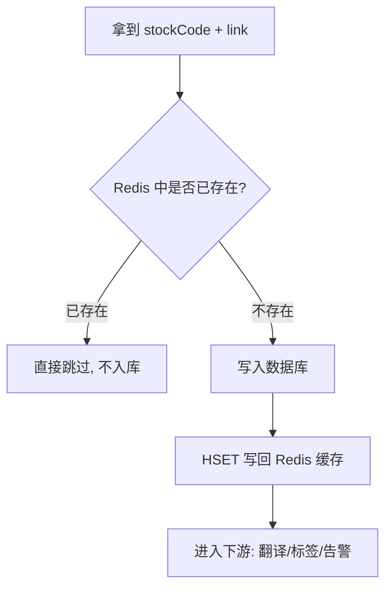

# 5-9 股票数据防重实践 - 分布式Redis方案

## 【学习目标】

学完本节，你应该能够：

1. 对比「数据库查重」与「Redis 缓存查重」两种方案的适用边界，说清各自的性能特征与代价。
2. 用 Redis 的 **Hash 结构**建模「股票代码 → 多个链接」的从属关系，并设计合理的过期策略避免内存无限增长。
3. 在采集链路里把 Redis 查重与数据库写入串成「先缓存查重 → 命中即拒 / 未命中则入库并回写缓存」的闭环。
4. 说清为什么本地缓存（Caffeine / Guava Cache）在「服务重启不能丢数据」的场景下不如 Redis，并据此做出选型判断。

---

## 【正文】

### 一、回顾：数据库去重已经解决了什么问题

上一节（`5-8`）我们落地了基于关系型数据库的「先查后插」去重：`isStockNewsExist(stockCode, link)` 用 MyBatis-Plus 的 `QueryWrapper` 拼 `stock_code + link` 条件，命中就 `continue` 跳过。采集循环里的代码片段是这样的：

```java
Date gmtDateTemp = entry.getPublishedDate();
LocalDateTime gmtDate = GMTDateConverter.convertGmt(gmtDateTemp);
stockNews.setPubDateGmt(gmtDate);
stockNews.setPubDateBj(GMTDateConverter.convertGmtToBeijing(gmtDateTemp));

// 获取股票异动信息的股票代码
String stockCode = getStockCode(title);

// 判断股票异动信息是否存在，如果存在则不进行保存的操作
if (stockService.isStockNewsExist(stockCode, stockNews.getLink())) {
    System.out.println("股票代码为[" + stockCode + "]的已存在，跳过。。");
    continue;
}

// TODO 处理股票标题，翻译为中文
stockNews.setTitleZh(...);

// 获得股票异动信息的标签
try {
    List<String> tagsList = StockTitanCrawler.getTags(titleEn);
    stockNews.setTags(tagsList);
} catch (Exception e) {
    throw new RuntimeException(e);
}
// 此处因标签解析异常，可能导致429的反爬虫异常，无需处理，tags无所谓，可以直接设为空值
stockNews.setTags("");
```

这段逻辑的执行顺序是经过设计的：先取发布时间、做 GMT/北京时间的转换，再取股票代码，然后用 `isStockNewsExist` 判重；命中就打印日志并 `continue`，不命中才往下走翻译、抓标签等重操作。

这里还有一个工程上值得记住的稳健性细节：**标签解析这一步如果抛异常（比如又触发了 429 反爬虫），其实无所谓**。标签本身不影响风控主流程，可以直接把 `tags` 字段置为空字符串，保证程序不因为标签问题把整条数据卡死。这是「非核心字段异常可降级」的典型写法，抓不到标签只损失一点元数据，绝不该阻断入库。

DB 去重方案非常简洁，对「只在本地把项目跑起来、做个预警」这类需求完全够用，既简单又稳定，没有任何问题。但一旦目标变成「部署到云服务器、支撑更大规模的业务」，它就开始显出结构性短板。

### 二、为什么规模上来后要换方案：DB 查重的代价

数据库查重每一次判定都要走一次 `SELECT COUNT(*)`。在本地、低频、数据量小的场景里，单次毫秒级的查询无感；但在以下情况会迅速劣化：

- **抓取频率高**：把定时间隔从 30 秒压到几秒，每次全量扫描都要对每条已存在记录做一次 `COUNT`，库的压力随扫描频率线性放大。
- **历史数据量大**：`us_stock_rss` 表积累到几十万行后，即便 `stock_code + link` 有索引，高频 `COUNT` 仍会占用连接与 IO。
- **多实例部署**：云上跑两个采集节点，各自查库，数据库连接数被分摊，单库成为瓶颈。

本质矛盾是：**去重是一个「高频、读多写少、容忍毫秒响应」的判定，而关系型数据库擅长的是「事务一致、复杂查询」，并不擅长「超高 QPS 的轻量查重」**。把这类判定挪到内存缓存里，才是 scale 的正确姿势，这正是 Redis 登场的理由。

### 三、Redis 方案的整体设计

引入 Redis 后，判定「这只股票、该链接是否已经处理过」不再打数据库，而是走内存，响应是毫秒级的，系统能立即给出答复。整体三步闭环如下：

1. 在数据真正插入数据库**之前**，先去 Redis 查一下「当前股票代码 + 链接」是否已有记录；
2. 若没有（新的），正常写入数据库，同时把这条数据也写进 Redis 缓存；
3. 若已有，直接拒绝，不再执行后续保存操作。



要点在于：**Redis 是「查重的快路径」，数据库仍是「数据的真源」**。Redis 丢了对业务影响有限（只是短期内可能重复入库，由 DB 唯一索引兜底），数据库丢了对业务是毁灭性的。两者职责分离，各司其职。

### 四、Redis 数据结构选型：为什么用 Hash

去重要存的是「股票代码 → 该票下所有见过的链接」的映射。最自然、最省内存的建模方式是 Redis 的 **Hash（哈希）**：

- `key`：股票代码，例如 `TSLA`、`NVDA`；
- `field`：链接，例如 `link1` / `link2`；
- `value`：对应的数据（可以只存占位，或存整条摘要）。

```
key: TSLA
  field: https://www.stocktitan.net/news/tsla-1  -> value: 1
  field: https://www.stocktitan.net/news/tsla-2  -> value: 1
key: NVDA
  field: https://www.stocktitan.net/news/nvda-1  -> value: 1
  field: https://www.stocktitan.net/news/nvda-2  -> value: 1
```

这样设计的优势：

- **同一股票的所有链接天然聚合在同一个 key 下**，符合「一票多消息」的业务结构，也方便后续按票维度做统计（例如 `HLEN TSLA` 看某票已处理多少条）。
- **查重只需 `HEXISTS key link`**，复杂度 O(1)，比数据库的 `COUNT` 轻得多；写入用 `HSET key link 1`，同样 O(1)。
- **内存紧凑**：Hash 在 Redis 内部用 ziplist/listpack 编码时，小字段非常省内存。

如果改用 `SET`（每个 link 一个 member）也能查重，但就丢失了「按股票代码聚合」的能力，后续想按票维度清理、统计都要额外维护。Hash 是结构与性能的双重最优解。

### 五、过期策略：用「时间换内存可控」

缓存不能无限增长，否则内存会被长期占满。因此给这些 Hash 数据设置过期时间，比如 **7 天**：

- 7 天内同一 link 再来，直接命中跳过，绝不重复入库；
- 7 天后数据自动失效被清除，下次再遇到该链接，缓存里已不存在，会重新走一遍入库逻辑。

如果担心 7 天太短导致「本应跳过却重新入库」的误判（例如某票 8 天后又发了同源链接），可以把期限放宽到 **30 天**。本质是在「内存可控」与「去重窗口长度」之间做权衡：过期越久，去重越严格，但内存占用越高。

> 进阶提醒：给 Hash 设过期要用 `EXPIRE key 604800`（整 key 过期），注意它是**整 key 级别**的，`TSLA` 该 key 过期会连带丢掉它下面所有 field。若希望「每 7 天滚动、按 field 细粒度过期」，Redis 原生 Hash 不支持 field 级 TTL，需要业务上用 `HSCAN` 定期清理老 field，或在 key 里拼日期分片（如 `TSLA:202512`）。这是方案选型的真实约束，不是 bug。

### 六、两种方案怎么选 + 本地缓存为什么不合适

把两张方案的取舍摆在一起：

| 维度 | 数据库去重 | Redis 去重 |
|---|---|---|
| 适用规模 | 本地 / 个人预警 / 低频 | 云部署 / 大规模 / 高 QPS |
| 判定延迟 | 毫秒级（依赖索引与库负载） | 亚毫秒级（纯内存） |
| 部署复杂度 | 无额外组件 | 需维护 Redis 实例 |
| 重启后数据 | 持久化，不丢 | 独立部署不随应用丢；但本身可配持久化策略 |
| 代价 | 高频下打库 | 引入中间件、需管内存与过期 |

结论很清晰：

- **本地部署 / 个人预警**：直接用数据库方案就够了，简单、稳定，没必要上 Redis。
- **云部署 / 大规模业务**：建议用 Redis 分布式缓存，去重和查询都走内存，性能与扩展性更好。

可能会有疑问：那用**本地缓存**（Caffeine、Guava Cache 这类进程内缓存）行不行？答案是「也能用，但不建议」。本地缓存最大的问题是：**一旦服务重启，缓存里的数据会丢失或失效**，这时候再去做查重判断，会把已经处理过的历史数据误判为「新数据」重新入库，等于去重形同虚设。相比之下，Redis 独立部署、不随应用重启而丢数据，可靠性更高，这正是「分布式缓存」相对「进程内缓存」在去重场景下的决定性优势。

### 七、与 982-demo 采集/调度层的对应

课程配套 982-demo 的「感知」层同样面临「不能对同一个 tick 重复决策」的问题。它的 `src/main/java/com/riskbot/scheduler/RiskScanScheduler.java` 用虚拟线程周期扫描，每次拿到 tick 后交给 `src/main/java/com/riskbot/service/RiskEvaluationService.java` 做「感知→决策」。如果扫描频率高、历史 tick 多，同样的「先查重再处理」诉求就会出现。

本节的两种方案可直接平移：

- 小规模/离线：沿用 `RiskEvaluationService` 内对存储层的查重（对应 DB 方案，demo 的 `default` profile 用 `MockQuoteProvider` 样本，天然无重复）；
- 大规模/生产：`RiskScanScheduler` 在把 tick 交给 `RuleEngine` 前，先经 Redis 层判重（对应本节 Hash + 过期方案），避免同一异动被 `PriceVolatilityRule` / `VolumeSpikeRule` 反复触发告警。

也就是说，去重不是「RSS 采集的专属技巧」，而是所有「周期轮询 + 状态判定」系统都绕不开的工程基础。

---

## 【易错点 / 面试题】

**1. 为什么高 QPS 下去重不该每次都打数据库？**
答：去重是「读多写少、要毫秒响应」的轻判定，关系型库擅长事务与复杂查询而非超高 QPS 点查；高频 `COUNT` 会占用连接与 IO，成为瓶颈。正确做法是用 Redis 内存查重做快路径，数据库仍作数据真源。面试官可能追问：Redis 挂了怎么办？答：降级回 DB 查重 + 唯一索引兜底，保证不丢数据只损失一点性能。

**2. 为什么选 Hash 而不是 String/Set 来存「股票+链接」去重？**
答：Hash 的 key=股票代码、field=链接，天然把「一票多消息」聚合，且 `HEXISTS`/`HSET` 都是 O(1)；Set 能查重但丢了按票聚合能力。延伸：Redis 原生 Hash 不支持 field 级 TTL，需整 key 过期或业务侧定期清理。

**3. 为什么本地缓存（Caffeine）不适合做去重？**
答：进程内缓存随服务重启丢失，重启后历史数据被误判为「新」而重复入库，去重失效。Redis 独立部署、不随应用重启丢数据，可靠性更高。面试延伸：那 Redis 重启丢数据怎么办？答：开启 AOF/RDB 持久化，或接受短窗口重复 + DB 唯一索引兜底。

---

## 【小结】

本节在 `5-8` 的数据库去重之上，给出了面向规模化部署的 Redis 方案：用 Hash 建模「股票代码 → 链接集合」、以 `HEXISTS`/`HSET` 做 O(1) 查重与回写、用 7~30 天过期换取内存可控，并对比了本地缓存「重启即失」的根本缺陷。选型结论是「本地/低频用 DB，云上/高频用 Redis」。这条去重闸门守护的是整个「感知」层的干净度，下一阶段 `6-1`、`6-2` 我们会换一个视角，用 AOP 与 `StopWatch` 给 `isStockNewsExist`、`displayRss` 这些被高频调用的方法做耗时画像，看清真正的性能瓶颈在哪。
