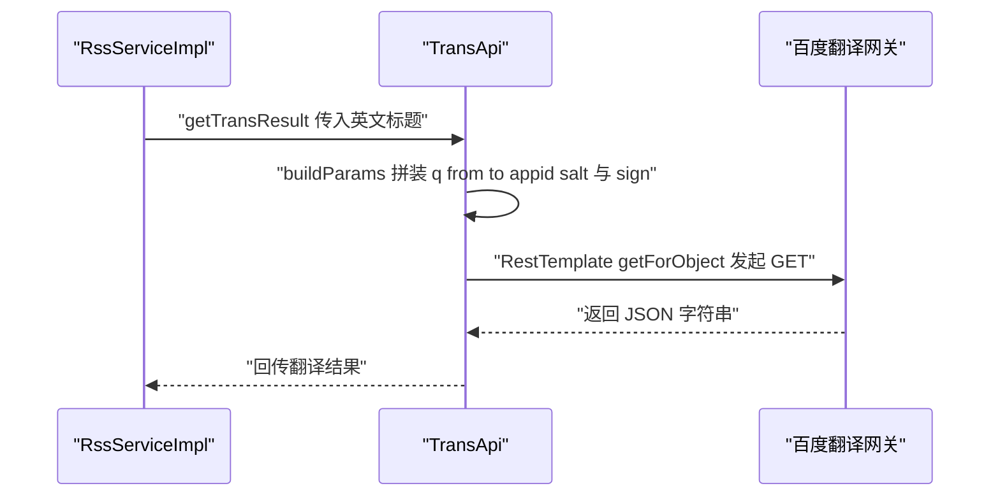

# 7-4 执行调用百度翻译 SDK 获得英译中翻译结果

## 【学习目标】

- 复用百度翻译官方提供的 `TransApi` 与 `MD5` 工具类，理解其 Spring 注入方式。
- 掌握 `TransApi` 内「参数拼装 → 签名 → 构造 URL → RestTemplate 发起 GET」的完整调用链路。
- 看清 `UriComponentsBuilder` 在不同 Spring Boot 版本下的 `encode()` 行为差异，避免 URL 编码陷阱。
- 在 `RssServiceImpl` 业务代码里落地翻译调用，并验证英译中结果正确回写 `title_zh`。

## 【正文】

### 一、百度翻译提供的两个工具类

百度翻译官方文档里已经给出了可以直接复用的工具类，不需要手写，复制进来改改就能用。主要有两个：

- **`TransApi`**：封装了百度翻译 API 的调用逻辑；
- **`MD5` 工具类**：百度要求每次请求都带签名，签名用 MD5 加密生成，该工具类也是百度提供的，原样使用即可。

把这两个类复制到项目里后，可以用 IDE 的「重命名」功能（快捷键 `Shift + F6`）把文件名改成自己习惯的中文名，重命名时记得勾选「在注释和字符串中搜索引用」，让所有引用自动更新。

为什么直接用官方类而不是自己写 HTTP 调用？因为签名算法（`sign = md5(appid + q + salt + securityKey)`）有明确规范，手写容易在拼接顺序、编码（UTF-8）、大小写上出错，而官方实现已经把这些都处理对了。在工程里，第三方 SDK 提供的客户端类应当被视为「不可变的依赖」，优先复用而非重写。

### 二、TransApi 的配置注入

`TransApi` 是一个 `@Service` 组件，通过 `@Value` 把 `application.yml` 里的三个配置项注入进来：

```java
@Service
public class TransApi {
    @Value("${baidu.translate.host}")
    private String host;
    @Value("${baidu.translate.appid}")
    private String appid;
    @Value("${baidu.translate.securityKey}")
    private String securityKey;

    @Resource
    private RestTemplate restTemplate;

    public TransApi(String appid, String securityKey) {
        this.appid = appid;
        this.securityKey = securityKey;
    }

    public String getTransResult(String query, String from, String to) {
        Map<String, String> params = buildParams(query, from, to);
        MultiValueMap<String, String> requestParams = new LinkedMultiValueMap<>();
        requestParams.setAll(params);

        UriComponentsBuilder builder = UriComponentsBuilder.fromUriString(host);
        URI uri = builder
            .queryParams(requestParams)
            .build()
            .encode() // <--- 问题点：Spring Boot 3 中 encode 方法失效
            .toUri();

        return restTemplate.getForObject(uri, String.class);
    }

    private Map<String, String> buildParams(String query, String from, String to) {
        Map<String, String> params = new HashMap<>();
        params.put("q", query);
        params.put("from", from);
        params.put("to", to);
        params.put("appid", appid);
        return params;
    }
}
```

注入完成后，在 `host`、`appid`、`securityKey` 上按 `Command`（Windows 下 `Ctrl`）+ 点击，能跳回 `application.yml` 对应的配置位置，说明配置已经成功绑定。

> 小提示：文档里给的 `host` 前缀和我们之前配置的可能略有差异，用哪一个都可以，不影响调用。

这里有几个值得深究的点：

1. **`@Value` 注入的是字段，构造函数又接收 `appid`/`securityKey`**：两个赋值入口并存，容易让人困惑。实际生效的是 Spring 字段注入（先实例化再填字段），构造函数参数更多地是给手动 `new` 的场景用。生产里建议二选一，要么纯 `@Value` 字段注入，要么去掉 `@Value`、走构造器注入并从 yml 绑定的 `@ConfigurationProperties` 对象传入，避免「两套赋值」的歧义。

2. **`restTemplate` 用 `@Resource` 注入，但类里没有声明它的 `@Bean`**：这正是下一节要补的，`RestTemplate` 不是 Spring Boot 的自动配置项（WebClient 才是新项目的默认），必须自己声明 `@Bean` 才能注入，否则启动报 `No qualifying bean`。

3. **`buildParams` 目前只放了 `q`/`from`/`to`/`appid`，但百度接口还要求 `salt` 和 `sign`**：完整签名两个字段在真正的 `getTransResult` 里要补上（见第四节）。官方示例里 `salt` 是随机整数，`sign` 是 `md5(appid + q + salt + securityKey)`。

### 三、注入 RestTemplate 发起 HTTP 请求

`TransApi` 里用到了 `RestTemplate`，它是 Spring 用来调用 RESTful Web Service、向外部 API 发请求的客户端。除了 `RestTemplate`，用 `OkHttp` 也完全可以，只是用 `RestTemplate` 需要我们多配置一步。

新建一个配置类，加 `@Configuration` 和 `@Bean`，在容器里声明一个 `RestTemplate`：

```java
@Configuration
public class RestTemplateConfig {
    @Bean
    public RestTemplate restTemplate() {
        return new RestTemplate();
    }
}
```

这样在任何类里都能通过 `@Resource` 注入 `RestTemplate` 来发请求。构造函数里把 `appid` 和 `securityKey` 填进去，组件就能正常使用了。

生产经验补充：默认的 `RestTemplate` 没有连接超时和读取超时（某些版本用 JDK `HttpURLConnection`，超时是无限），打外部 API 时一条慢请求就能拖住线程。生产环境应给它配上 `HttpClient` / `OkHttp` 底层，并设置 `connectTimeout` / `readTimeout`，再结合重试与熔断（正如 `982-demo` 的 `RiskEvaluationService` 用 resilience4j 包裹外部调用那样）。

### 四、参数构建与签名机制

真正的翻译在 `getTransResult` 里完成。我们来看几个核心参数：

- `query`：要翻译的内容，也就是我们的英文标题；
- `from`：源语言，这里是英文 `en`；
- `to`：目标语言，中文是 `zh`。

在 `buildParams` 中，我们会把这些参数连同 `appid`、一个随机数 `salt` 以及用 `MD5` 工具类生成的**签名 `sign`** 一起放进 `Map`。第三方 API 基本都要做签名：我们把参数排序后用 MD5 加密得到签名，百度服务端收到请求后会再验一次签名，只有两边一致才会执行翻译，否则直接拒绝，这是一道安全机制。

随后把 `Map` 塞进 `LinkedMultiValueMap`，用 `UriComponentsBuilder` 基于 `host`（百度翻译网关地址）拼出完整的请求 URL，最后 `restTemplate.getForObject(uri, String.class)` 发起 GET 请求。

> ⚠️ **Spring Boot 版本兼容性**：我们在用 Spring Boot 4，URL 构建用上面这种新写法即可；如果你用的是 Spring Boot 3，注意 `UriComponentsBuilder` 的 `encode()` 方法在该版本存在缺陷，会导致 URL 编码错误，老项目里要避开该坑。

返回结果是一个 `String` 类型（JSON 字符串），代表百度翻译网关给我们的响应。

关于版本差异再展开一句：Spring Boot 3 的 `UriComponentsBuilder.encode()` 在处理中文 `q` 参数时，曾出现双重编码 / 编码缺失的问题，导致百度侧收到的 `q` 乱码、翻译失败。Boot 4（配合 Spring Framework 7）已修正该路径。若你的项目仍停在 Boot 3，稳妥的做法是把参数先手动 `URLEncoder.encode(q, "UTF-8")`，再交给 builder，而不是依赖 `encode()`。

一次翻译调用的完整时序如下：



### 五、在业务代码里调用并验证

回到 `RssServiceImpl`，注入 `TransApi`，在设置中文标题的位置发起调用：

```java
// 获得股票异动信息的股票代码
String stockCode = getStockCode(title);
stockNews.setStockCode(stockCode);

// 判断股票异动信息是否已存在，如果存在则不进行保存的操作
if (stockService.isStockNewsExist(stockCode, stockNews.getLink())) {
    System.out.println("股票代码为 [" + stockCode + "] 的已存在，跳过。。");
    continue;
}

// 使用百度翻译SDK调用其API对英文标题进行翻译（翻译为中文）
String result = transApi.getTransResult(titleEn, from, to);
System.out.println("百度翻译调用的结果 result: " + result);
stockNews.setTitleZh(result);
```

为了测试，我们启动应用，等几十秒让定时任务跑起来；也可以删掉数据库里最新的几条数据（比如删 10 条），触发程序重新抓取并翻译。控制台会打印出类似这样的结果：

```
百度翻译调用的结果 result: {"from":"en","to":"zh","trans_result":[{"src":"FDA Approves Genentech's Lunsumio VEL01 for Subcutaneous Use in Relapsed or Refractory Follicular Lymphoma","trans_result":"FDA批准Genentech的Lunsumio VEL01用于复发或难治性滤泡性淋巴瘤的皮下给药"}
```

可以看到，英文标题已经被成功翻译成中文，返回结果里带有 `dst` 字段（中文，初始是 Unicode 编码，拿到后直接就是中文）。至此，百度翻译的调用已经成功跑通。

> 工程注意：本节把 `result`（整段 JSON）直接写进了 `titleZh`，这仅是「跑通验证」。真正落库前应把 JSON 反序列化成对象、提取 `trans_result[0].dst`（详见 7-5），否则 `title_zh` 存的是原始 JSON 串而非纯中文。生产上绝不该把接口原始响应直接当业务字段落库。

## 【易错点 / 面试题】

1. **`RestTemplate` 注入失败（`No qualifying bean of type 'RestTemplate'`）？**
   因为 Spring Boot 不会自动注册 `RestTemplate` 的 `@Bean`，必须像本节这样在 `@Configuration` 类里显式声明。如果想用自动配置，可改用 `RestClient`（Spring 6 起推荐）或 `WebClient`。

2. **为什么翻译接口要签名（`sign`）？**
   签名 = `md5(appid + q + salt + securityKey)`，服务端用同样的算法复算并比对，确认请求来自合法应用且参数未被篡改。缺少或错误的 `sign` 会直接被拒。这也是为什么 `securityKey` 绝不能泄露，它等同于签名私钥。

3. **面试官：Boot 3 到 Boot 4，`UriComponentsBuilder` 的编码行为变了，你遇到过吗？**
   能讲清「旧版 `encode()` 对中文参数处理有缺陷，需手动 `URLEncoder`；新版已修复，可直接 `build().encode()`」即可。延展点：生产里更推荐 `RestClient` + `UriComponentsBuilder` 组合，且对外部调用统一加超时与重试。

## 【小结】

本节打通了翻译的「执行链路」：`TransApi`（`@Service` + `@Value` 注入）→ `RestTemplateConfig` 提供 HTTP 客户端 → `getTransResult` 拼参、签名、构造 URL 并发起 GET。同时点出了两个生产级隐患，`RestTemplate` 必须显式声明 `@Bean`、以及 Boot 3/4 的 URL 编码差异。

这条「外部 HTTP API 调用 + 配置注入 + 超时重试」的范式，在 `982-demo` 里对应 `provider/RealQuoteProvider.java`（同样向外部行情网关发请求，密钥走 `${RISK_QUOTE_API_URL:}` 环境注入）与 `service/RiskEvaluationService.java`（用 resilience4j 熔断器包裹外部调用，异常时降级返回空）。下一节（7-5）我们把本节拿到的 JSON 结果反序列化成实体类并正确落库。
